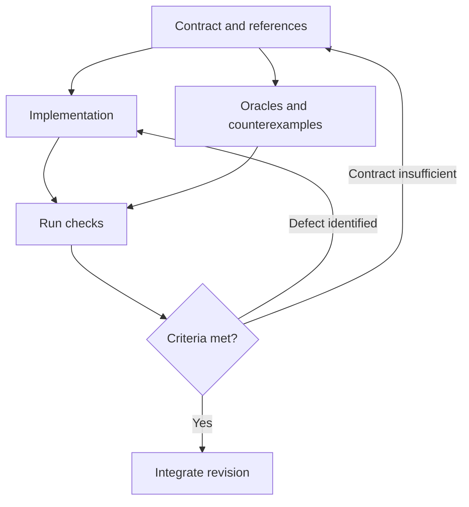

# Applying the Craft Ecosystem to a Trivariate Geometry Kernel

## Archival scope

This study reviewed selected repositories at pinned revisions and assessed which development practices could support a trivariate geometry kernel. It examined architecture and implementation mechanisms; it did not run the repositories' Rust test suites locally. The proposal is to combine **AutoCraft's work orchestration, Solidcore's geometric-kernel discipline, FieldCraft's scientific references and reproducible commands, and Craft Anything's shared tools and evidence records**.

The resulting development model is concrete: agents propose constructions, while independent verification checks maps, interfaces, and the volume complex before adoption. The sources do not quantify productivity gains or demonstrate that this process solves volumetric parameterization.

## 1. Attribution: where the “ArtCraft method” resides

ArtCraft is an image and video creation application. The practices relevant to this project are distributed across several repositories. ArtCraft's own instruction file adopts shared `craft-contrib` rules while documenting local exceptions, including the then-current absence of a command registry and agent entry point. [ArtCraft instructions](https://github.com/storytold/artcraft/blob/9a1cc6b701e9dbec38af820507c9b33b668f54f0/AGENTS.md).

| Source | Practice found in the repository | Relevance to the kernel |
|---|---|---|
| **craft-contrib** | Shared rules for bounded tasks, isolated changes, relevant tests, and reporting checks | Give agents a stable framework |
| **AutoCraft** | Orchestration of implementation, fixes, review, verification, and integration | Organize controlled code production |
| **Solidcore** | Guidance specific to geometric invariants, coordination, and result inspection | Adapt agent work to kernel requirements |
| **FieldCraft** | Executable commands, recipes, scientific references, and separate regression tests | Build a reproducible geometry and analysis pipeline |
| **Craft Anything** | Tools shared across interfaces and results accompanied by provenance, coverage, and limits | Make the kernel inspectable and operable |

AutoCraft implements an orchestration chain for tasks, implementation, review, verification, and integration; it is more than a convention in an agent instruction file. [storytold/autocraft on GitHub](https://github.com/storytold/autocraft?utm_source=chatgpt.com).

The most useful idea is the separation of responsibilities and checks. It may reduce the cost of repetitive development, speed defect discovery, and make results easier to review. The inspected sources provide no defensible productivity estimate and do not establish that orchestration resolves volumetric parameterization challenges.

## 2. Specify the required evidence before delegating work

Solidcore's `docs/coordinating.md` is directly applicable. It asks coordinators to understand invariants before splitting work, then provide each agent with:

- an objective and a completion criterion;
- established results;
- references and functions to inspect;
- files owned by the agent;
- the starting revision;
- verifiable evidence to report.

It also recommends isolated workspaces and parallelism limited by review capacity. [Solidcore coordination method](https://github.com/tangency-labs/solidcraft/blob/765f26e0d1fc7c66a0d03ea2dae28ee3b65270b8/solidcore/docs/coordinating.md).

Before delegating “implement extrusion” or “build the interfaces,” define the operation in the representation. For an extrusion, specify the admissible parameterized section, the construction of the trivariate map, allowed orientations, regularity conditions, boundary and provenance data, and the result when assumptions fail. For an interface, specify the shared-face representation, parameter permutations and reversals, degree/knot/weight compatibility, relations between analysis spaces, and treatment of shared edges and vertices.

**Module interfaces should be project deliverables in their own right.** Once fixed, construction, verification, and adapter work can proceed in parallel without each module inventing a different representation.

### A reasonable initial team

| Role | Main responsibility | Expected result |
|---|---|---|
| Coordinator | Contracts, dependencies, architecture consistency, integration | A coherent revision with explicit acceptance criteria |
| Construction agent | Spline algebra, trivariate maps, construction operators | Implementation and use cases |
| Verification agent | Independent references, edge cases, counterexamples | Checks capable of disproving the implementation |
| Integration agent | Commands, persistence, display, SolidCraft/FieldCraft adapters | A complete, replayable workflow |

Numerical review can be assigned as appropriate, but the algorithm's author should not be its sole validation authority. In the FieldCraft bracket, **the thirty blocks describe a geometric decomposition; they are not thirty independent programming tasks.** Work should be divided by reusable capability: extrusion, a bore sector, shared faces, partition verification, and so forth.

## 3. Execute checks outside the agent reporting success

AutoCraft has a particularly relevant mechanism: the orchestrator runs implementation checks through specified scripts and collects their execution results. Assertions in the programming session are not the verdict. This is explicit in [`src/implement/checks.ts`](https://github.com/storytold/autocraft/blob/28aa39720b3708d9e72808474e7c8ad8ec29706f/src/implement/checks.ts).

A kernel delivery should therefore include:

1. an exact code revision;
2. the recipes used;
3. checks actually run;
4. structured results;
5. remaining limitations;
6. images useful for inspection.

The coordinator reviews these artifacts and reruns checks as needed.

The “contract insufficient” branch matters in research software. Some difficulties require revising an assumption or narrowing a geometric family; repeating an implementation request will not resolve them.

### A concrete AutoCraft limitation to address

AutoCraft's regression verifier may report success when the new version passes but the old version **does not compile with the newly added test**, while noting that failure of the old version was not demonstrated. [Verdict calculation](https://github.com/storytold/autocraft/blob/28aa39720b3708d9e72808474e7c8ad8ec29706f/src/verify/results.ts).

For a numerical fix, stronger evidence is needed:

> The old version compiles, then fails an assertion that characterizes the defect; the new version satisfies that assertion.

A compile failure unrelated to the defect is inconclusive. This rule applies to demonstrating a fix. For a new feature whose API does not exist in the old version, use other evidence such as an analytic solution, structural property, independent comparison, or certificate.

## 4. Separate scientific references, regressions, and certificates

FieldCraft's verification model distinguishes three files:

| Item | Question answered |
|---|---|
| `recipe.json` | Which model was built, and with what parameters? |
| `expected.json` | Which reference value is expected, from what source and with what tolerance? |
| `fixture.json` | Has the result changed since the previously accepted version? |

This separation is described in [FieldCraft verification documentation](https://github.com/tangency-labs/fieldcraft/blob/35e834652d8548384c2da8ef1b28d588c9af2ffd/docs/verification.md) and implemented in its [reference and fixture comparator](https://github.com/tangency-labs/fieldcraft/blob/35e834652d8548384c2da8ef1b28d588c9af2ffd/crates/testkit/src/oracle.rs). Solidcore makes the same distinction: invariants and references establish correctness; frozen outputs, or *goldens*, establish behavioral stability. [Solidcore correctness and regression rules](https://github.com/tangency-labs/solidcraft/blob/765f26e0d1fc7c66a0d03ea2dae28ee3b65270b8/solidcore/AGENTS.md).

For the trivariate kernel, retain three complementary levels:

- **Mathematical properties:** representation and construction properties such as partition of unity, geometry preservation under knot insertion, trace identity, orientation, non-folding, and partition consistency.
- **Calculation references:** physical quantities such as analytic or manufactured solutions, affine fields, rigid modes, equilibrium, convergence, and sensitivities.
- **Recorded regressions:** changes in block count, produced topology, operation status, calculation values, and diagnostics.

A fixture update may be justified; it must never disable a geometric validity check. FieldCraft already has a useful safeguard: tetrahedral mesh validity is checked after fixture processing, including fixture re-recording. [Independent fixture check in the runner](https://github.com/tangency-labs/fieldcraft/blob/35e834652d8548384c2da8ef1b28d588c9af2ffd/crates/testkit/src/runner.rs).

### A useful counterexample

FieldCraft includes a hexahedron whose Jacobian is positive at corners and center but negative in the interior. Its analytic determinant is

\[
\det J(w)=(1-3w)(1-4w).
\]

It is negative for

\[
\frac14<w<\frac13.
\]

The test requires this element to be rejected despite reassuring samples. [FieldCraft analytic counterexample](https://github.com/tangency-labs/fieldcraft/blob/35e834652d8548384c2da8ef1b28d588c9af2ffd/crates/mesh/src/quality/tests.rs).

This is a model task for a verification agent: find a case that defeats a weak check. For the kernel's certifier, useful cases include a Jacobian positive at sample points but negative elsewhere; locally regular maps that overlap globally; geometrically close faces with incompatible parametric traces; joins that work with unit weights but fail with rational weights; and parameter changes outside a template's admissible domain.

FieldCraft's testing mechanisms are a strong methodological starting point, but adapting them to continuous rational maps needs more work. The contract should distinguish sampled observations, estimated bounds, properties proven under explicit assumptions, and checks that could not conclude. Numerical guarantees must account for rounding and rational denominators. A local Jacobian certificate must be supplemented by checks for injectivity and global partition. **The validator can also be developed with agents, but it needs references and counterexamples that do not depend solely on the constructor it checks.**

## 5. Use one engine for people and agents

FieldCraft and Craft Anything provide concrete examples. FieldCraft's `CommandSpec` describes an operation, parameters, prerequisites, and execution function; UI and automation tools go through the session engine. Craft Anything has a comparable shared `ToolSpec`. [FieldCraft commands](https://github.com/tangency-labs/fieldcraft/blob/35e834652d8548384c2da8ef1b28d588c9af2ffd/crates/engine/src/lib.rs) · [Craft Anything tool contract](https://github.com/storytold/craft-anything/blob/4f0f744b7e2ad16198a7b08b9edc53286b1b8b67/crates/engine/src/tool.rs).

The kernel should be a shared library with reproducible commands, with SolidCraft and FieldCraft adapters layered on top. Suggested project commands are:

| Proposed command | Function |
|---|---|
| `kernel.capabilities` | Describe construction families and guarantees actually available |
| `kernel.build` | Build a candidate trivariate complex from features and a partition recipe |
| `kernel.audit` | Check maps, interfaces, partition, and certificates |
| `kernel.inspect` | Expose blocks, control nets, sections, orientations, and diagnostics |
| `kernel.refine` | Refine with specified geometric preservation |
| `kernel.rebuild` | Regenerate the affected complex after a parameter change |

This would let users reproduce a defect with a short recipe, run a corpus without a GUI, and give agents tools with precisely defined effects. Visualization remains useful—transparent blocks, colored interfaces, sections, and distortion fields—but complements the kernel data.

### Strengthen transactions

FieldCraft restores the previous state when a model-changing command fails. A command sequence is not a global transaction, however: successful earlier steps remain applied if a later step fails. This is visible in `run_command` and `run_script`. [Command and script handling](https://github.com/tangency-labs/fieldcraft/blob/35e834652d8548384c2da8ef1b28d588c9af2ffd/crates/engine/src/lib.rs).

For a trivariate complex, use atomic adoption:

1. Build new blocks in a candidate state.
2. Rebuild affected interfaces.
3. Verify the affected complex.
4. Replace the active version only after acceptance.

If a radius change rebuilds six blocks and the sixth fails, the active part should retain its prior coherent version. This property supports interactive editing, agent exploration, and later optimization.

## 6. Preserve inspectable results and their provenance

Craft Anything's `Evidence` type records the operation, parameters, result, environment, limitations, coverage, and linked inputs. It distinguishes observations, derived results, and inferences. A content-derived identifier supports integrity checks. [The `Evidence` model](https://github.com/storytold/craft-anything/blob/4f0f744b7e2ad16198a7b08b9edc53286b1b8b67/crates/evidence/src/lib.rs).

Each volumetric construction should have an acceptance record containing:

- kernel revision **and validator revision**;
- recipe, parameters, and units;
- construction-template version;
- produced blocks and interfaces;
- exact or approximate representation status;
- verified properties, assumptions, and bounds;
- checks not run or inconclusive;
- associated diagnostics and visualizations.

The construction history adds a requirement: **the recipe must be complete, versioned, and replayable**. Craft Anything's activity journal is best-effort and may summarize oversized parameters, so it is not by itself the geometric journal needed here. [Craft Anything journal](https://github.com/storytold/craft-anything/blob/4f0f744b7e2ad16198a7b08b9edc53286b1b8b67/crates/engine/src/journal.rs).

### A geometry-appropriate completion status

Craft Anything's reconstruction loop may finish as `Ready` when a result is usable even if the target similarity threshold was not reached within the iteration budget; it exposes remaining open questions. [Reconstruction-loop completion](https://github.com/storytold/craft-anything/blob/4f0f744b7e2ad16198a7b08b9edc53286b1b8b67/crates/ai/src/rebuild/mod.rs).

For this kernel, distinguish explicitly:

- construction obtained;
- geometric properties established;
- analysis model accepted;
- operation refused or verification inconclusive.

Exhausting an iteration budget cannot turn an indeterminate property into an established one.

## 7. Applying the practices to a Solidcore replacement

The target architecture is **a master representation made of native trivariate maps, with interfaces and provenance in the construction tree**. Development practices should support that target from the first demonstrator.

### Step 1 — Define a small shared contract

Before broadening functionality, define the rational block map, its six parametric sides, topological faces and incidences, parameterization relations between neighbors, feature-linked identities, and validation outcomes and refusal reasons. Declare the initially supported families. Extrusion and construction around a through-hole can have precise contracts before a general Boolean operator exists.

This is a prerequisite for parallel work and reduces the risk of separate modules that cannot be assembled.

### Step 2 — Build a small end-to-end case

The first milestone should be **two native trivariate blocks, one shared interface, a curved rational boundary, save/reload, and a parameter edit**. This already exercises rational weights, orientation, face sharing, persistence, regeneration, and inspection. Add geometry-preserving refinement and an affine-field check to prepare for analysis.

This produces a usable pipeline from construction intent to an inspectable, verifiable result.

### Step 3 — Build the templates needed for the bracket

Extend the demonstrator with reusable extrusion of a parameterized section, bore sectors, the bend and fillet in the selected family, interfaces between regions, and parameter updates within an admissible domain. Each template should come with a contract, edge cases, and checks. Parallel work becomes useful when traces and data exchange are fixed.

### Step 4 — Use the FieldCraft bracket as the integrated demonstrator

The existing bracket test checks **30 cells**, minimum quality, and convergence of hex8/hex20 mechanical results under refinement. It is a useful integration scenario. [Partitioned bracket test](https://github.com/tangency-labs/fieldcraft/blob/35e834652d8548384c2da8ef1b28d588c9af2ffd/crates/testkit/tests/bracket_blocks.rs).

For the kernel, turn the partition recipe into a **construction template for the trivariate complex**:

1. Read feature parameters.
2. Construct block maps.
3. Establish canonical interfaces.
4. Check coverage and non-overlap.
5. Produce the IGA representation.
6. Compare mechanical results.
7. Change parameters and replay the pipeline.

Thirty blocks are the starting point supplied by the example. If maps require further subdivision to satisfy the kernel contract, state that explicitly and measure its cost.

### Step 5 — Expand coverage based on observed failures

Classify failures as a constructor limit, interface defect, poor parameterization quality, excessive verification cost, out-of-contract geometric family, or IGA formulation issue. This identifies the capability that is actually missing. A well-diagnosed refusal is correct software behavior. **A refusal on a declared admissible and required case is still a coverage failure.** Preserve that distinction in project statistics.

## 8. Required checks

Tie work to the project's four scientific milestones:

| Milestone | Acceptance conditions |
|---|---|
| **J1 — Geometry** | Regular maps, expected boundaries, consistent interfaces, correct partition |
| **J2 — Analysis** | Space coupling, admissible fields, rigid modes, equilibrium, convergence |
| **J3 — Edits and sensitivities** | Coherent regeneration, identified topological regimes, derivatives verified in their validity domain |
| **J4 — Coverage and cost** | Success rate on a fixed corpus, time and memory at comparable accuracy, comparison with selected references |

Compilation and code-quality checks accompany these milestones; they do not replace them.

Retain Craft's preference for property tests and cases that detect plausible errors. [Testing standard](https://github.com/storytold/craft-contrib/blob/main/standards/testing.md?utm_source=chatgpt.com). In numerical computation, several inputs following the same code path may still represent different regimes: extreme weights, thin elements, near-zero Jacobians, or large scale disparities. Preserve cases that challenge conditioning or guarantees.

To manage development cost, select affected test suites for each change and periodically run the full corpus. FieldCraft already selects tests from changed packages and their transitive dependents. [Affected-package selection](https://github.com/tangency-labs/fieldcraft/blob/35e834652d8548384c2da8ef1b28d588c9af2ffd/xtask/src/affected.rs).

## Recommendation

Adopt the development protocol now, then introduce AutoCraft orchestration as parallel workload warrants it. The initial requirements are a short trivariate representation contract, a shared library, distinct construction and verification responsibilities, commands runnable without a GUI, a corpus separating references, regressions, and counterexamples, and one end-to-end case followed by the FieldCraft bracket.

Agents can propose decomposition recipes or choose templates. The kernel must check the resulting objects against the same criteria regardless of how they were proposed.

The first investment should be **native construction plus independent verification**, applied to two connected blocks and then the bracket template. This uses the development capacity of the Craft ecosystem while retaining the project's central property: geometry is constructed and maintained in the trivariate kernel.
