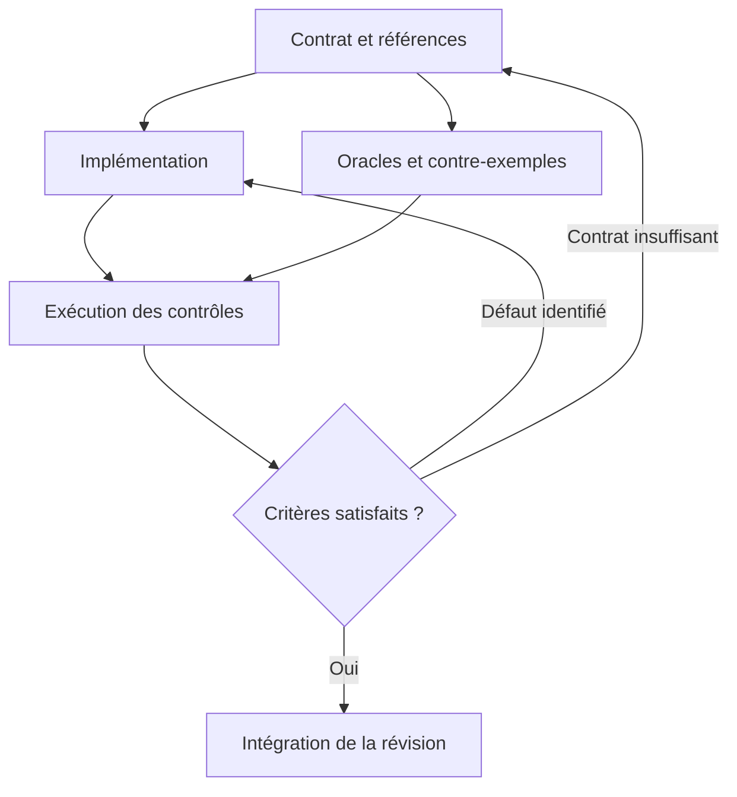

**Oui. Après lecture des sources, je reprendrais une grande partie des méthodes de développement de cet écosystème pour notre projet, avec une validation mathématique plus exigeante.** La combinaison que je recommande est :

- **AutoCraft pour l’organisation du travail entre agents ;**
- **Solidcore pour la discipline de développement d’un noyau géométrique ;**
- **FieldCraft pour les références scientifiques, les corpus de tests et les commandes reproductibles ;**
- **Craft Anything pour la manière d’exposer les outils et de conserver les preuves d’exécution.**

Cela donne une méthode assez concrète pour construire notre noyau trivarié : **des agents développent et proposent les constructions ; un programme de vérification contrôle les cartes, les interfaces et le complexe volumique avant leur acceptation.**

J’ai examiné les sources à des révisions précises. C’est un audit de leur architecture et de leurs mécanismes ; je n’ai pas exécuté localement leurs suites de tests Rust.

## 1. Où se trouve réellement la « méthode ArtCraft » ?

Il faut préciser l’attribution. **ArtCraft est l’application de création d’images et de vidéos.** Les méthodes intéressantes pour nous sont réparties dans plusieurs dépôts. Son propre fichier d’instructions adopte les règles communes de `craft-contrib`, tout en déclarant certaines exceptions locales, notamment l’absence actuelle de registre de commandes et d’entrée d’agent dans cette application. [Instructions d’ArtCraft](https://github.com/storytold/artcraft/blob/9a1cc6b701e9dbec38af820507c9b33b668f54f0/AGENTS.md).

Voici ce que j’en retiens :

| Source | Méthode effectivement présente | Intérêt pour notre noyau |
|---|---|---|
| **craft-contrib** | Règles communes : tâches bornées, changements séparés, tests pertinents, déclaration des vérifications effectuées | Donner aux agents un cadre stable |
| **AutoCraft** | Orchestration de l’implémentation, des corrections, des revues, de la vérification et de l’intégration | Organiser une production de code contrôlée |
| **Solidcore** | Consignes spécifiques aux invariants géométriques, à la coordination et à l’inspection des résultats | Adapter le travail des agents aux exigences d’un noyau |
| **FieldCraft** | Commandes exécutables, recettes, références scientifiques et tests de régression distincts | Construire une chaîne reproductible de géométrie et de calcul |
| **Craft Anything** | Outils communs aux différentes interfaces et résultats accompagnés de provenance, couverture et limitations | Rendre le noyau inspectable et pilotable |

AutoCraft possède bien une chaîne d’orchestration implémentée : traitement des tâches, implémentation, revue, vérification, puis intégration. Ce n’est donc pas seulement une convention écrite dans un fichier destiné aux agents. [storytold/autocraft · GitHub](https://github.com/storytold/autocraft?utm_source=chatgpt.com)

**Mon évaluation : la partie la plus intéressante est l’organisation des responsabilités et des contrôles.** Pour notre projet, elle peut réduire le coût des développements répétitifs, accélérer la recherche de défauts et rendre les résultats plus faciles à examiner. Les sources ne permettent pas de chiffrer honnêtement un gain de productivité, ni de conclure que cette organisation résout les difficultés de paramétrisation volumique.

## 2. La première méthode à reprendre : définir la preuve attendue avant de distribuer le travail

Le document le plus directement applicable à notre cas est étonnamment celui de **Solidcore**, dans `docs/coordinating.md`.

Il demande au coordinateur de comprendre les invariants avant de découper le travail, puis de fournir à chaque agent :

- l’objectif et le critère qui permet de le considérer atteint ;
- les résultats déjà acquis ;
- les références et les fonctions à lire ;
- les fichiers dont il est responsable ;
- la révision de départ ;
- les éléments vérifiables à rapporter.

Il recommande aussi des espaces de travail séparés et une quantité de travail parallèle compatible avec la capacité de relecture. [Méthode de coordination de Solidcore](https://github.com/tangency-labs/solidcraft/blob/765f26e0d1fc7c66a0d03ea2dae28ee3b65270b8/solidcore/docs/coordinating.md).

### Application à notre projet

Avant de demander à un agent « implémente l’extrusion » ou « construis les raccords », nous devons fixer ce que cette opération signifie dans notre représentation.

Pour une extrusion, par exemple :

- quelle section paramétrée est admissible ;
- comment la carte trivariée est construite ;
- quelles orientations sont autorisées ;
- quelles conditions garantissent sa régularité ;
- quelles informations de frontière et de provenance sont conservées ;
- quel résultat est produit lorsque les hypothèses échouent.

Pour un raccord, il faut préalablement préciser :

- la représentation de la face commune ;
- les permutations et inversions des paramètres ;
- la compatibilité des degrés, nœuds et poids ;
- les relations entre les espaces de calcul ;
- le traitement des arêtes et des sommets partagés.

**Les interfaces entre modules doivent donc être un livrable du projet à part entière.** Les agents peuvent ensuite travailler en parallèle sur les constructions, les contrôles et les adaptateurs sans inventer chacun leur propre représentation.

### Une équipe initiale raisonnable

Je commencerais avec cette organisation :

| Rôle | Travail principal | Résultat attendu |
|---|---|---|
| **Coordinateur** | Contrats, dépendances, cohérence de l’architecture, intégration | Une révision cohérente dont les critères d’acceptation sont explicites |
| **Agent construction** | Algèbre spline, cartes trivariées, opérateurs de construction | Une implémentation et ses cas d’usage |
| **Agent vérification** | Références indépendantes, cas limites, contre-exemples | Des contrôles capables de mettre en défaut l’implémentation |
| **Agent intégration** | Commandes, persistance, affichage, adaptateurs SolidCraft/FieldCraft | Un scénario complet et rejouable |

Les fonctions de relecture numérique peuvent être distribuées selon les tâches, mais l’auteur d’un algorithme ne doit pas constituer sa seule autorité de validation.

Pour l’équerre de FieldCraft, **les trente blocs décrivent une décomposition géométrique ; ils ne constituent pas trente tâches indépendantes de programmation.** Le travail doit se répartir par capacité réutilisable : extrusion, secteur autour d’un trou, face commune, vérification de partition, etc.

## 3. La deuxième méthode : faire exécuter les contrôles en dehors de l’agent qui annonce la réussite

AutoCraft contient un mécanisme que je trouve particulièrement pertinent : ses vérifications d’implémentation sont lancées par l’orchestrateur au moyen de scripts déterminés. Il récupère leurs résultats d’exécution ; les affirmations de la session de programmation ne constituent pas le verdict. C’est explicite dans [`src/implement/checks.ts`](https://github.com/storytold/autocraft/blob/28aa39720b3708d9e72808474e7c8ad8ec29706f/src/implement/checks.ts).

Je reprendrais exactement cette séparation.

Pour nous, une livraison devrait contenir :

1. une révision précise du code ;
2. les recettes utilisées ;
3. les contrôles réellement exécutés ;
4. leurs résultats structurés ;
5. les limitations restantes ;
6. les images utiles à l’inspection.

Le coordinateur examine ensuite ces éléments et relance les contrôles nécessaires.

Le fonctionnement proposé serait le suivant :

La branche « contrat insuffisant » est essentielle dans un projet de recherche. Certaines difficultés demandent de revoir une hypothèse ou de restreindre une famille géométrique. Elles ne se résolvent pas en répétant indéfiniment la demande d’implémentation.

### Une limite concrète d’AutoCraft à corriger pour notre usage

Dans son vérificateur de régression, AutoCraft peut déclarer le contrôle réussi lorsque la nouvelle version passe et que l’ancienne version **ne compile pas avec le test ajouté**, avec une note signalant que l’échec du test sur l’ancienne version n’a pas été démontré. [Calcul du verdict](https://github.com/storytold/autocraft/blob/28aa39720b3708d9e72808474e7c8ad8ec29706f/src/verify/results.ts).

Pour une correction numérique, je demanderais davantage :

> L’ancienne version compile, puis échoue sur une assertion qui caractérise le défaut ; la nouvelle version satisfait cette assertion.

Un échec de compilation sans rapport avec le défaut serait classé **non concluant**.

Cette règle concerne la démonstration d’une correction. Pour une nouvelle fonctionnalité dont l’ancienne version ne possède pas l’API, on utilise naturellement d’autres preuves : solution analytique, propriété structurelle, comparaison indépendante ou certificat.

## 4. La troisième méthode : séparer références scientifiques, régressions et certificats

C’est probablement **la pratique de FieldCraft que je reprendrais le plus directement**.

Sa vérification distingue :

| Élément | Question à laquelle il répond |
|---|---|
| `recipe.json` | Quel modèle a été construit et avec quels paramètres ? |
| `expected.json` | Quelle valeur de référence attend-on, avec quelle source et quelle tolérance ? |
| `fixture.json` | Le résultat a-t-il changé depuis la version précédemment acceptée ? |

Cette séparation est décrite dans sa [documentation de vérification](https://github.com/tangency-labs/fieldcraft/blob/35e834652d8548384c2da8ef1b28d588c9af2ffd/docs/verification.md) et implémentée dans son [comparateur de références et de fixtures](https://github.com/tangency-labs/fieldcraft/blob/35e834652d8548384c2da8ef1b28d588c9af2ffd/crates/testkit/src/oracle.rs).

Solidcore exprime la même distinction : les invariants et les références établissent la correction ; les résultats figés, ou *goldens*, établissent la stabilité du comportement. [Règles de correction et de régression de Solidcore](https://github.com/tangency-labs/solidcraft/blob/765f26e0d1fc7c66a0d03ea2dae28ee3b65270b8/solidcore/AGENTS.md).

### Ce que cela devient pour le noyau trivarié

Je conserverais trois niveaux complémentaires.

**Les propriétés mathématiques.** Elles portent sur la représentation et les constructions : partition de l’unité, préservation de la géométrie par insertion de nœuds, identité des traces, orientation, absence de repliement, cohérence de la partition.

**Les références de calcul.** Elles portent sur les grandeurs physiques : solutions analytiques ou manufacturées, champs affines, modes rigides, équilibre, convergence et sensibilités.

**Les régressions enregistrées.** Elles surveillent les changements : nombre de blocs, topologie produite, statut des opérations, valeurs de calcul, diagnostics.

Une modification d’une fixture peut être justifiée. **Elle ne doit jamais neutraliser un contrôle de validité géométrique.**

FieldCraft possède déjà un mécanisme intéressant dans cette direction : le contrôle de validité du maillage tétraédrique reste exécuté après le traitement des fixtures, y compris lorsqu’elles sont réenregistrées. [Contrôle indépendant des fixtures dans le runner](https://github.com/tangency-labs/fieldcraft/blob/35e834652d8548384c2da8ef1b28d588c9af2ffd/crates/testkit/src/runner.rs).

### Un exemple particulièrement bon à reprendre

FieldCraft contient un hexaèdre dont le jacobien est positif aux coins et au centre, mais négatif à l’intérieur. Le déterminant analytique est :

\[
\det J(w)=(1-3w)(1-4w).
\]

Il devient négatif pour :

\[
\frac14<w<\frac13.
\]

Le test exige que cet élément soit reconnu comme invalide malgré ses échantillons rassurants. [Contre-exemple analytique de FieldCraft](https://github.com/tangency-labs/fieldcraft/blob/35e834652d8548384c2da8ef1b28d588c9af2ffd/crates/mesh/src/quality/tests.rs).

**Voilà une excellente tâche pour un agent de vérification : chercher un cas qui trompe un contrôle trop faible.**

Pour notre certificateur, je demanderais notamment des exemples de :

- jacobien positif aux points testés mais négatif ailleurs ;
- cartes localement régulières produisant un recouvrement global ;
- faces proches géométriquement mais incompatibles comme traces paramétriques ;
- raccords corrects pour des poids unitaires et incorrects pour des poids rationnels ;
- changements de paramètres qui sortent du domaine admissible d’un gabarit.

Cette approche apporte beaucoup plus d’information qu’une collection de pièces faciles qui passent toutes.

### La certification doit rester une exigence propre à notre noyau

Les mécanismes de test de FieldCraft constituent une excellente base méthodologique. Leur adaptation aux cartes rationnelles continues demande cependant un travail supplémentaire.

Notre contrat devra distinguer :

- une propriété observée par échantillonnage ;
- une borne estimée ;
- une propriété démontrée sous des hypothèses explicites ;
- un contrôle qui n’a pas permis de conclure.

Pour les garanties numériques, il faudra traiter les erreurs d’arrondi et les dénominateurs rationnels. Et un certificat de jacobien local devra être complété par les contrôles nécessaires à l’injectivité et à la partition globale.

**Le validateur peut lui aussi être développé avec des agents ; il doit disposer de références et de contre-exemples qui ne dépendent pas uniquement du constructeur qu’il contrôle.**

## 5. La quatrième méthode : un moteur unique, utilisable par les personnes et les agents

Cette architecture est concrète dans FieldCraft et Craft Anything.

FieldCraft possède un `CommandSpec` qui décrit une opération, ses paramètres, ses prérequis et sa fonction d’exécution. L’interface et les outils d’automatisation passent par le moteur de session. Craft Anything possède un `ToolSpec` comparable, partagé entre plusieurs points d’entrée. [Commandes de FieldCraft](https://github.com/tangency-labs/fieldcraft/blob/35e834652d8548384c2da8ef1b28d588c9af2ffd/crates/engine/src/lib.rs) ; [contrat des outils de Craft Anything](https://github.com/storytold/craft-anything/blob/4f0f744b7e2ad16198a7b08b9edc53286b1b8b67/crates/engine/src/tool.rs).

### Pour nous, c’est une décision d’architecture importante

Je construirais le noyau comme **une bibliothèque commune avec une interface de commandes reproductibles**, puis je brancherais SolidCraft et FieldCraft dessus.

Les noms ci-dessous sont une proposition pour notre projet :

| Commande proposée | Fonction |
|---|---|
| `kernel.capabilities` | Décrire les familles de construction et les garanties effectivement disponibles |
| `kernel.build` | Construire un complexe trivarié candidat depuis les features et une recette de partition |
| `kernel.audit` | Vérifier cartes, interfaces, partition et certificats |
| `kernel.inspect` | Exposer blocs, réseaux de contrôle, coupes, orientations et diagnostics |
| `kernel.refine` | Effectuer un raffinement dont la préservation géométrique est spécifiée |
| `kernel.rebuild` | Régénérer le complexe concerné après une modification paramétrique |

Cela permettrait de reproduire un défaut avec une recette courte, de lancer un corpus sans interface graphique et de donner à un agent des outils dont les effets sont précisément définis.

L’affichage resterait très utile : blocs transparents, interfaces colorées, coupes, champs de distorsion. Il compléterait les données du noyau.

### Il faut renforcer la transaction

FieldCraft restaure l’état précédent lorsqu’une commande modifiant le modèle échoue. En revanche, une suite de commandes n’est pas une transaction globale : les étapes déjà réussies restent appliquées lorsqu’une étape ultérieure échoue. C’est visible dans `run_command` et `run_script`. [Gestion des commandes et scripts](https://github.com/tangency-labs/fieldcraft/blob/35e834652d8548384c2da8ef1b28d588c9af2ffd/crates/engine/src/lib.rs).

Pour notre complexe trivarié, je demanderais une adoption atomique :

1. construire les nouveaux blocs dans un état candidat ;
2. reconstruire les raccords affectés ;
3. vérifier le complexe concerné ;
4. remplacer la version active seulement après acceptation.

Si un changement de rayon reconstruit six blocs et que le sixième échoue, la pièce active doit conserver sa version précédente cohérente.

Cette propriété sera utile pour les modifications interactives, les explorations faites par les agents et, plus tard, l’optimisation.

## 6. La cinquième méthode : conserver des résultats inspectables, avec leur provenance

Craft Anything dispose d’un type `Evidence` contenant l’opération, ses paramètres, le résultat, l’environnement, les limitations, la couverture et les liens vers les éléments utilisés. Il distingue notamment les observations, les résultats dérivés et les inférences. Un identifiant calculé sur le contenu permet d’en vérifier l’intégrité. [Modèle `Evidence`](https://github.com/storytold/craft-anything/blob/4f0f744b7e2ad16198a7b08b9edc53286b1b8b67/crates/evidence/src/lib.rs).

Je reprendrais cette organisation pour chaque construction volumique.

Un dossier d’acceptation contiendrait :

- la révision du noyau **et celle du validateur** ;
- la recette, ses paramètres et leurs unités ;
- la version du gabarit de construction ;
- les blocs et interfaces produits ;
- le statut de représentation exacte ou approchée ;
- les propriétés vérifiées, leurs hypothèses et leurs bornes ;
- les contrôles non exécutés ou non concluants ;
- les diagnostics et visualisations associés.

Il faut toutefois ajouter une exigence spécifique à notre historique de construction : **la recette doit être complète, versionnée et rejouable**. Le journal d’activité de Craft Anything est écrit au mieux et peut résumer des paramètres trop volumineux ; il ne constitue donc pas directement le journal géométrique dont nous avons besoin. [Journal de Craft Anything](https://github.com/storytold/craft-anything/blob/4f0f744b7e2ad16198a7b08b9edc53286b1b8b67/crates/engine/src/journal.rs).

### Un statut « terminé » adapté à la géométrie

Autre différence à prendre en compte : la boucle de reconstruction de Craft Anything peut terminer avec le statut `Ready` lorsqu’un résultat est utilisable, même si le seuil de ressemblance visé n’a pas été atteint après le nombre d’itérations prévu. Le programme expose les questions encore ouvertes. [Fin de la boucle de reconstruction](https://github.com/storytold/craft-anything/blob/4f0f744b7e2ad16198a7b08b9edc53286b1b8b67/crates/ai/src/rebuild/mod.rs).

Pour notre noyau, je séparerais explicitement :

- **construction obtenue** ;
- **propriétés géométriques établies** ;
- **modèle d’analyse accepté** ;
- **opération refusée ou vérification non concluante**.

Épuiser un budget d’itérations ne peut pas transformer une propriété indéterminée en propriété acquise.

## 7. Comment appliquer tout cela à notre remplacement de Solidcore

Je conserverais notre objectif : **la représentation maîtresse est un complexe de cartes trivariées natives, avec leurs interfaces et leur provenance dans l’arbre de construction**.

L’organisation du développement doit servir cet objectif dès le premier démonstrateur.

### Étape 1 — Définir le petit contrat commun

Avant d’élargir les fonctionnalités, fixer quelques objets :

- la carte rationnelle d’un bloc ;
- ses six côtés paramétriques ;
- les faces topologiques et leurs incidences ;
- les relations de paramétrisation entre voisins ;
- les identifiants liés aux features ;
- les résultats de validation et les motifs de refus.

Il faut aussi déclarer les familles initialement admises. Une extrusion et une construction autour d’un trou traversant peuvent avoir un contrat clair bien avant de disposer d’un opérateur booléen général.

Cette étape est le préalable aux travaux parallèles. Elle réduit le risque d’avoir trois modules fonctionnels qui ne peuvent pas s’assembler.

### Étape 2 — Réaliser une petite chaîne complète

Le premier jalon que je choisirais est :

> **Deux blocs trivariés natifs, une interface commune, une frontière rationnelle courbe, une sauvegarde/relecture et une modification de paramètre.**

Ce cas sollicite déjà les points essentiels : poids rationnels, orientation, partage de face, persistance, régénération et inspection.

J’y ajouterais un raffinement qui préserve la géométrie et un premier contrôle de champ affine pour préparer l’analyse.

Nous aurions alors une chaîne utilisable, depuis une intention de construction jusqu’à un résultat inspectable et vérifiable.

### Étape 3 — Construire les gabarits nécessaires à l’équerre

On développe ensuite les capacités réutilisables du démonstrateur :

- extrusion d’une section paramétrée ;
- secteurs autour d’un trou ;
- traitement du coude et du congé dans la famille retenue ;
- raccords entre les différentes régions ;
- mise à jour des paramètres dans un domaine admissible.

Chaque gabarit arrive avec son contrat, ses cas limites et ses contrôles.

C’est ici que le travail entre agents devient particulièrement rentable : les modules peuvent avancer séparément lorsque leurs traces et leurs échanges sont fixés.

### Étape 4 — Reprendre l’équerre de FieldCraft comme démonstrateur intégré

Le test existant de l’équerre vérifie notamment les **30 cellules**, une qualité minimale et le rapprochement des résultats mécaniques hex8/hex20 sous raffinement. Il fournit un bon scénario d’intégration. [Test de l’équerre partitionnée](https://github.com/tangency-labs/fieldcraft/blob/35e834652d8548384c2da8ef1b28d588c9af2ffd/crates/testkit/tests/bracket_blocks.rs).

Pour notre version, la recette de partition devient un **gabarit de construction du complexe trivarié** :

1. lire les paramètres des features ;
2. construire les cartes des blocs ;
3. établir les interfaces canoniques ;
4. vérifier la couverture et l’absence de recouvrement ;
5. produire la représentation destinée à l’IGA ;
6. comparer les résultats mécaniques ;
7. modifier les paramètres et rejouer l’ensemble.

Le nombre de trente blocs est un point de départ fourni par l’exemple. Si certaines cartes exigent une subdivision supplémentaire pour satisfaire notre contrat, il faudra l’expliciter et en mesurer le coût.

### Étape 5 — Étendre la couverture à partir des échecs observés

À ce stade, les agents peuvent aider à classer les échecs :

- limite d’un constructeur ;
- défaut de raccord ;
- mauvaise qualité de paramétrisation ;
- vérification trop coûteuse ;
- famille géométrique hors contrat ;
- problème dans la formulation IGA.

Cette classification permet d’ajouter la capacité qui manque réellement.

Un refus bien diagnostiqué est un comportement correct du logiciel. **Sur un cas déclaré admissible et obligatoire, il reste cependant un échec de couverture.** Il faut conserver cette distinction dans les statistiques du projet.

## 8. Les contrôles que je rendrais obligatoires

Je rattacherais les tâches aux quatre jalons scientifiques de notre projet :

| Jalon | Conditions d’acceptation |
|---|---|
| **J1 — Géométrie** | Cartes régulières, frontières attendues, interfaces cohérentes, partition correcte |
| **J2 — Analyse** | Raccords d’espaces, champs admissibles, modes rigides, équilibre et convergence |
| **J3 — Modifications et sensibilités** | Régénération cohérente, régimes topologiques identifiés, dérivées vérifiées dans leur domaine de validité |
| **J4 — Couverture et coût** | Taux de réussite sur un corpus fixé, temps et mémoire à précision comparable, comparaison avec les références retenues |

Les contrôles de compilation et de qualité du code accompagnent ces jalons. Ils ne les remplacent pas.

Je conserverais également la préférence de Craft pour les tests de propriétés et les cas qui détectent une erreur plausible. [GitHub](https://github.com/storytold/craft-contrib/blob/main/standards/testing.md?utm_source=chatgpt.com) Mais en calcul numérique, plusieurs entrées qui suivent exactement les mêmes branches peuvent représenter des régimes très différents : poids extrêmes, éléments minces, jacobien proche de zéro ou forte disparité d’échelles. Il faut préserver ces cas lorsqu’ils éprouvent le conditionnement ou les garanties.

Pour maîtriser les coûts de développement, on peut reprendre la sélection des suites concernées par une modification, puis exécuter périodiquement le corpus complet. FieldCraft possède déjà une sélection fondée sur les packages modifiés et leurs dépendants transitifs. [Sélection des modules affectés](https://github.com/tangency-labs/fieldcraft/blob/35e834652d8548384c2da8ef1b28d588c9af2ffd/xtask/src/affected.rs).

## Ma recommandation

**Je reprendrais dès maintenant le protocole de développement, puis j’introduirais progressivement l’automatisation d’AutoCraft lorsque le volume de travaux parallèles le justifiera.**

Pour démarrer, il nous faut surtout :

1. un contrat court de représentation trivariée ;
2. une bibliothèque commune ;
3. un constructeur et un vérificateur développés avec des responsabilités distinctes ;
4. des commandes exécutables sans interface graphique ;
5. un corpus séparant références, régressions et contre-exemples ;
6. une première chaîne complète, puis l’équerre de FieldCraft.

Les agents pourront ensuite proposer des recettes de décomposition ou sélectionner des gabarits. Le noyau devra toujours vérifier les objets obtenus selon les mêmes critères, quelle que soit l’origine de la proposition.

**Le premier investissement que je ferais est donc le couple “construction native + vérification indépendante”, appliqué à deux blocs raccordés, puis au gabarit de l’équerre.** C’est ce qui permettra d’utiliser la puissance de développement de l’écosystème Craft tout en conservant la propriété centrale de notre projet : une géométrie construite et maintenue dans le noyau trivarié.
