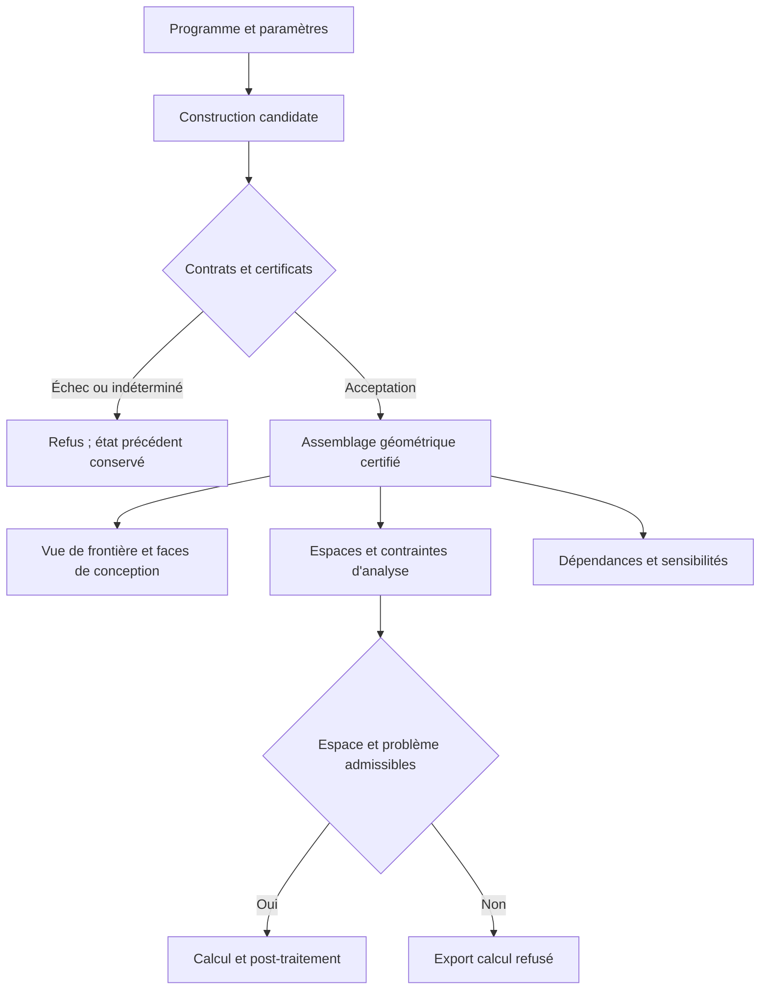

# CdC — Noyau géométrique trivarié par partition (IGA sans trim)

**Révision technique : 24 novembre 2026.**

**Objet :** construction native de volumes trivariés entiers, avec raccords forts, certificats de validité et interfaces de calcul.

**Statut :** cahier des charges révisé. Les garanties exigées doivent être établies par les constructions, certificats et jalons décrits ; les performances et la couverture restent à mesurer sur les corpus annoncés.

Les formulations « doit », « exigé » et « condition d'acceptation » désignent des obligations. Les objectifs de recherche et les extensions non qualifiées sont identifiés séparément. Le statut géométrique, la validité du modèle et l'admissibilité du calcul sont toujours distingués.

## 1. Contexte, motivation et thèse

Le projet construit un **noyau géométrique trivarié natif**. Le domaine matériel est représenté par un assemblage fini de blocs B-splines ou NURBS tensoriels entiers, sans trim volumique, injectifs et non dégénérés. Les opérations de conception construisent et maintiennent cet intérieur paramétré. Le bord du solide et le modèle d'analyse sont des vues cohérentes de cet assemblage.

Le premier calcul visé est l'élasticité linéaire 3D en déplacement, dans un espace $H^1$-conforme. La conformité est obtenue par partage de degrés de liberté ou par contraintes fortes entre espaces de trace emboîtés. Elle ne nécessite pas de terme de couplage faible entre blocs. Un problème mécanique bien posé, des matériaux admissibles et des conditions aux limites suffisantes restent requis.

**Motivation.** Une représentation de frontière ne fournit pas à elle seule une carte de l'intérieur adaptée à l'IGA volumique. Le projet fait de cette carte une donnée de conception persistante, susceptible de porter également des champs matériels. Le programme de construction fournit des contraintes et des possibilités de décomposition ; son ordre historique n'est pas imposé comme découpage final lorsque des transformations équivalentes sont autorisées.

**Périmètre par rapport aux autres voies.**

| Voie | Apport | Place dans le projet |
| --- | --- | --- |
| Analyse immergée | Calcul sur un fond indépendant de la frontière, avec traitement des cellules coupées et formulations adaptées | Référence de comparaison ; elle ne constitue pas la représentation géométrique native recherchée |
| V-rep à trivariées trimées | Modélisation volumique, champs internes et opérations booléennes | Antériorité et source de méthodes ; la sortie native du présent noyau reste une union de blocs entiers |
| Conversion d'une B-rep finale | Segmentation et paramétrisation à partir d'une géométrie existante | Antériorité utile ; reconstruction depuis STEP hors du périmètre initial |
| Volumetric untrimming | Décomposition tensorielle d'un domaine trimé, notamment pour l'intégration | Source de méthodes ; une carte d'intégration singulière ne doit pas être confondue avec la carte géométrique et la base d'analyse. Seules des cartes respectant les invariants du noyau peuvent y être intégrées |

Les références et leurs limites sont précisées en section 21. L'exclusion d'une voie du modèle natif ne constitue pas une affirmation de son infériorité numérique générale.

**Principe de construction.** Sur un hôte plan affine, les contours d'esquisse et les opérations compatibles définissent un arrangement. Celui-ci est partitionné en cellules paramétrables, puis transformé en blocs par les opérateurs admis. Les coupes nécessaires aux frontières matérielles et les coupes de structuration sont distinctes. La partition peut être reconstruite lorsqu'une modification l'exige ; sa localité doit être démontrée ou mesurée.

**Hypothèse à évaluer.** Maintenir une géométrie volumique native valide peut réduire le coût et les ambiguïtés de la chaîne conception–calcul–modification, tout en fournissant des sensibilités exploitables. Le projet n'affirme ni couverture universelle des solides, ni supériorité sur tout solveur FEM. Il définit des familles admissibles, des certificats et des critères de validation ou de rejet par contribution (sections 18 et 19).

## 2. Objectifs, périmètre et non-objectifs

Le premier livrable est un **noyau prismatique natif sans trim, exact de représentation pour une famille explicitement définie de sections et d'opérations**, couplé à un solveur d'élasticité linéaire 3D. Sa couverture est mesurée sur un corpus fixé avant les essais. Il ne revendique pas le traitement complet de toutes les pièces 2,5D.

**Objectifs.**

| ID | Objectif | Résultat attendu |
| --- | --- | --- |
| O1 | Représentation | Assemblage de blocs trivariés entiers, injectifs et non dégénérés, avec espaces d'analyse raccordés fortement en $C^0$ |
| O2 | Opérateurs | Esquisse, partition, extrusion, perçages, poches, motifs, congés et chanfreins dans des familles déclarées ; extensions opérateur par opérateur |
| O3 | Validité | Certificats de jacobien, justification de l'injectivité et de la partition, étanchéité structurelle, cohérence des incidences et des contraintes |
| O4 | Modification | Invalidation par dépendances, réutilisation des données inchangées et reconstruction mesurée ; distinction entre événements du domaine, de représentation et de validité |
| O5 | Sensibilités | Dérivées complètes des données géométriques et algébriques nécessaires, dans un régime différentiel déclaré valide |
| O6 | Calcul | Export d'espaces compatibles, contraintes, relèvements de Dirichlet et groupes de sous-faces liés aux faces de conception |
| O7 | Démonstration | Construction, modification et calcul sur un corpus 2,5D, comparaison à précision imposée avec des chaînes de référence |

**Statuts géométriques et refus.** Le statut de représentation est indépendant du certificat de validité du modèle. L'acceptation d'une géométrie exige les invariants géométriques de la section 4 ; les exigences relatives à l'espace de champ et au problème mécanique conditionnent séparément l'export pour calcul.

| Statut | Signification | Garantie sur l'écart à la géométrie de conception |
| --- | --- | --- |
| EXACT_REPRESENTATION | La forme est représentée sans approximation de modèle ni fitting ; les erreurs de construction numérique et les prédicats sont traités explicitement | Exactitude analytique de représentation, avec erreurs numériques documentées ; ne signifie pas égalité symbolique de tous les nombres stockés |
| APPROX_ESTIMATED | Une approximation est construite et son écart est estimé par un protocole déclaré | Erreur observée, domaine et densité de contrôle enregistrés ; aucune borne globale n'est revendiquée |
| APPROX_CERTIFIED | Une approximation est accompagnée d'une borne globale valide | Borne de l'erreur dans la métrique déclarée, inférieure ou égale à la tolérance demandée |
| Refused | Précondition non satisfaite, configuration non couverte, budget atteint ou preuve indéterminée | Aucune nouvelle géométrie n'est validée ; l'état précédent est conservé |

Un appel exigeant une tolérance garantie accepte EXACT_REPRESENTATION selon son budget numérique, ou APPROX_CERTIFIED. APPROX_ESTIMATED reste un résultat explicitement exploratoire ; il ne satisfait pas une exigence de tolérance garantie. Le statut d'une construction composée tient compte de tous ses opérandes et de toutes ses approximations.

**Périmètre par phase.**

| Phase | Inclus et limites |
| --- | --- |
| Phase 1 — familles prismatiques qualifiées | Sections à segments et arcs dans les configurations couvertes par les gabarits ; contraintes d'esquisse admissibles ; extrusion ; trous et poches parallèles ; motifs ; congés et chanfreins longitudinaux avec gabarit métrique validé ; élasticité linéaire 3D. Les NURBS sont admises uniquement dans les sous-familles qualifiées avec statut géométrique explicite. Aucune exactitude générale des intersections NURBS n'est présumée |
| Phase 2 — modifications et sensibilités | Branches de représentation, événements, conditions de différentiabilité, dérivées des contrôles et poids ou coordonnées homogènes, contraintes et relèvements ; sensibilités adjointes |
| Phase 3 — extensions 3D ciblées | Familles de révolution avec contacts à l'axe classés ; perçages obliques dans des parois planes ; bossages ; congés terminaux dont le voisinage volumique régulier est construit et validé |
| Phase 4 — extensions de recherche | Balayages, lissages, booléens libres approchés, rencontres de congés, import partiel d'historiques réels ; formulations mécaniques supplémentaires évaluées séparément |

La simple exactitude d'une courbe ou d'une surface primitive ne valide pas l'opérateur volumique qui l'utilise. Chaque famille doit disposer d'un domaine admissible, d'une construction, de raccords compatibles et d'une procédure de certification. Les jalons J1 et J2 conditionnent la phase 1 ; J3 conditionne l'usage des gradients ; J4 conditionne les conclusions de couverture et de performance (section 19).

**Non-objectifs et exclusions.**

- Cellules matérielles trimées, qu'elles soient introduites directement ou comme repli automatique.
- Blocs à face ou arête effondrée, ou à jacobien nul sur le fermé d'un élément de Bézier. Aux lignes de nœuds de faible continuité, les dérivées unilatérales sont traitées explicitement.
- Raccords faibles généraux de type mortar ou Nitsche dans le modèle d'analyse visé.
- Continuité $C^1$ globale entre blocs : le premier problème en déplacement requiert un espace $H^1$-conforme.
- Pointes, cusps, contacts de dimension inférieure ou configurations non-manifold matérielles incompatibles avec les invariants. Une pointe de cône exacte ne devient pas admissible par le seul ajout d'un cœur.
- Modeleur interactif complet, import exhaustif de formats propriétaires et reconstruction générale depuis une B-rep ou de l'imagerie.
- Grandes déformations et quasi-incompressibilité dans les premières phases. Leur éventuelle prise en charge doit définir une formulation et une validation propres.

Une modification géométrique destinée à rendre un cas admissible, par exemple un arrondi d'une pointe, doit être demandée ou explicitement autorisée et porter son contrat d'approximation. Le noyau ne modifie pas silencieusement la pièce.

## 3. Glossaire

Ces termes ont un sens précis dans tout le document. Les noms anglais entre parenthèses désignent les entités du modèle de données. La distinction entre côté paramétrique, face topologique et face de conception est obligatoire, notamment aux raccords emboîtés.

| Terme | Définition |
| --- | --- |
| Bloc (*Block*) | Application tensorielle B-spline ou NURBS $X:[0,1]^3\to\mathbb R^3$, injective et non trimée. Le cube paramétrique entier représente du matériau si le bloc est actif. Le jacobien est strictement positif avec une borne certifiée, élément par élément et jusqu'aux limites unilatérales pertinentes. |
| Cellule de section (*Cell2D*) | Région plane à quatre côtés paramétriques issue de la partition d'une esquisse, image entière de $[0,1]^2$ par une application régulière. |
| Hôte (*Host*) | Application de référence $S$ portant une face ou un volume ; affine pour une esquisse plane. Le choix de l'hôte ne dispense pas de certifier les blocs produits. |
| Partition | Décomposition du domaine visé en images entières de cellules régulières, avec intérieurs disjoints et interfaces enregistrées. Les courbes ou surfaces de l'arrangement guident sa construction ; elles ne servent pas à masquer une partie d'un bloc livré. |
| Reparamétrisation $\varphi_c$ | Application $[0,1]^2\to c$ vers une cellule du domaine de l'hôte ; le patch géométrique correspondant est $S\circ\varphi_c$. |
| Coupe imposée | Courbe ou surface de construction qui doit être représentée par des frontières de cellules ou des interfaces : profil d'esquisse, paroi de perçage, fond de poche. |
| Coupe de structuration | Courbe ou surface ajoutée pour rendre possible une partition régulière, par exemple les branches d'un O-grid. |
| Gabarit (*Template*) | Règle de partition associée à une configuration, munie de préconditions, d'une construction géométrique, d'incidences et de raccords vérifiables. |
| O-grid | Couronne de blocs autour d'un trou ou d'une région centrale ; son nombre de secteurs et ses raccords sont définis par le gabarit. |
| Bloc de cœur | Bloc central qui remplace l'effondrement polaire d'une paramétrisation de disque ou de révolution contenant l'axe. |
| Côté paramétrique de bloc (*BlockSide*) | Restriction de $X$ à l'une des six faces du cube paramétrique. Un côté peut porter plusieurs faces topologiques ; il n'est pas nécessairement entièrement frontière ou entièrement intérieur. |
| Face topologique (*TopologicalFace*) | Sous-face entière d'un ou de deux côtés paramétriques, issue de leur subdivision commune en sous-rectangles. Elle est frontière si elle possède une seule incidence matérielle, intérieure si elle en possède deux. Son contour peut comporter des arêtes topologiques subdivisées. |
| Face de conception (*DesignFace*) | Groupe sémantique de faces topologiques frontières, par exemple « paroi du perçage H7 ». Elle porte le nommage, la provenance et les sélections de conditions aux limites. |
| Trace canonique | Définition commune de la géométrie d'une interface, avec paramétrisation, degrés, nœuds, poids et relations de restriction ou de raffinement. Les côtés incidents en dérivent leur trace. |
| Raccord identique | Traces géométriques identiques après orientation et normalisation des poids. Les espaces de trace d'analyse sont également identiques pour leur couplage par identification directe des coefficients. |
| Raccord emboîté | Raccord sur un sous-rectangle paramétrique pour lequel l'espace de trace maître restreint s'inclut exactement dans celui de l'esclave. La compatibilité concerne degrés, multiplicités, paramétrisations et dénominateurs NURBS ; elle permet des contraintes linéaires fortes. |
| Assemblage cellulaire (*CellComplex*) | Blocs, côtés paramétriques, faces topologiques, arêtes et sommets, avec incidences orientées, raccords, statuts et provenance. Le complexe topologique actif représente exactement le domaine matériel. |
| Coordonnée homogène | Pour un point de contrôle $P_A$ de poids $w_A>0$, vecteur $H_A=(w_AP_A,w_A)$. L'insertion de nœuds et l'élévation de degré NURBS agissent linéairement sur ces coordonnées. |
| Espace d'analyse | Espace de champs construit sur les blocs, distinct de leur stockage géométrique et compatible avec leurs traces. Par défaut, il provient d'un raffinement exact de la géométrie et reproduit les coordonnées physiques, donc les champs affines et les modes rigides. |
| Contrat de représentation | Statut indépendant de la validité : EXACT_REPRESENTATION sans ajustement géométrique et avec erreurs numériques bornées ; APPROX_ESTIMATED avec erreur observée ; APPROX_CERTIFIED avec borne globale vérifiée inférieure à la tolérance annoncée. |
| Refus | Résultat motivé d'une opération qui ne satisfait pas son contrat ou ses préconditions. L'état valide antérieur est conservé ; le refus n'est pas un quatrième statut de géométrie produite. |
| Certificat de jacobien | Preuve encadrée de $\det DX\ge J_{\min}>0$ sur chaque élément paramétrique, avec traitement des limites unilatérales aux nœuds de faible continuité. Il ne remplace pas le certificat d'injectivité et de partition. |
| Singularité topologique | Sommet intérieur d'une partition quadrangulaire où la valence diffère de quatre, ou arête correspondante en 3D. Elle n'autorise aucune singularité du jacobien d'un bloc. |
| Affectation de coin $k$ | Nombre de cellules incidentes à un coin du bord, choisi notamment selon son angle $\alpha$, la qualité visée et les gabarits admissibles. |
| Branche topologique | Composante de paramètres où les propriétés topologiques matérielles suivies sont inchangées : connectivité, tunnels, cavités et adjacences matérielles pertinentes, indépendamment des coupes de structuration. Cette seule propriété ne garantit pas la différentiabilité de la construction. |
| Branche de représentation | Régime où les cellules de structuration et leurs incidences, les gabarits, affectations, maîtres, degrés, nœuds et sous-rectangles paramétriques sont fixés. |
| Régime différentiel régulier | Partie d'une branche où les constructions implicites, ensembles actifs, rangs de contraintes et données du calcul satisfont les hypothèses nécessaires aux dérivées déclarées. |
| Événement | Changement physique, topologique, de représentation ou de régime différentiel. Sa nature et les garanties perdues sont annoncées séparément. |
| Bloc inactif | Bloc conservé pour la construction ou la provenance mais exclu du matériau, du complexe actif et de l'assemblage mécanique. |
| Programme de conception | Graphe des paramètres, esquisses, opérations, sélections et dépendances qui définit la pièce et ses variantes. |

## 4. Principes directeurs et invariants

Les dix invariants suivants définissent le contrat complet. Les exigences géométriques conditionnent chaque transaction sur l'assemblage ; leur échec conserve l'état courant. Les exigences relatives aux espaces de champ et au problème mécanique — partie analyse d'INV-4, INV-9 et INV-10 — conditionnent en plus l'export pour calcul. Une acceptation géométrique ne vaut pas validation d'un problème mécanique ; un résultat annoncé prêt au calcul satisfait les deux niveaux.

| ID | Invariant | Vérification |
| --- | --- | --- |
| INV-1 | Le domaine matériel est exactement l'union des images des blocs actifs entiers ; aucune donnée de trim matériel | Contrôle structurel et classification des blocs |
| INV-2 | $\det DX\ge J_{\min}>0$ sur chaque élément de Bézier fermé, avec échelle et dérivées unilatérales définies | Certificat polynomial ou rationnel avec arrondis encadrés ; le dénominateur et les changements d'échelle sont inclus (section 12) |
| INV-3 | Chaque bloc est injectif, les intérieurs de blocs sont disjoints et les contacts correspondent aux incidences admises | Preuve de partition par construction ou vérifications certifiées d'intersection et d'inclusion ; contrôle de l'injectivité du bord |
| INV-4 | Les raccords de calcul imposent une continuité forte compatible avec la géométrie ; contraintes d'arêtes et de sommets cohérentes | Inclusion des espaces de trace, compatibilité des poids et multiplicités, résolution des contraintes, rang et reproduction des champs attendus (section 10) |
| INV-5 | Les interfaces partagent une même géométrie canonique ; aucun raccord par simple tolérance de proximité | Entités partagées ou restrictions dérivées d'une même donnée homogène ; cohérence des caches et des erreurs d'évaluation |
| INV-6 | Le statut de représentation et la preuve de validité sont explicites et distincts | EXACT_REPRESENTATION, APPROX_ESTIMATED ou APPROX_CERTIFIED selon section 2 ; journal des approximations et refus motivés |
| INV-7 | Toute sous-face extérieure appartient à une face de conception ou à un groupe explicitement créé ; toute entité possède une provenance | Complétude et vérification des sélections après scission, fusion ou suppression |
| INV-8 | Les choix et résultats sont reproductibles pour un programme, des paramètres, des options, une version et un environnement numérique déclarés | Ordre déterministe, graines enregistrées si un algorithme en utilise, tests de reconstruction |
| INV-9 | Géométrie et espace d'analyse sont séparés ; leur compatibilité est démontrée | Raffinement exact de référence ; capacité de reproduction des coordonnées géométriques et des modes rigides ; contraintes de trace maintenues |
| INV-10 | Le premier calcul utilise un Galerkin $H^1$-conforme, sans terme de couplage faible entre blocs ni traitement de cellules coupées | Espace admissible, relèvement de Dirichlet fort, quadrature contrôlée et problème mécanique bien posé |

La positivité du jacobien est une garantie de régularité locale, pas à elle seule une preuve de disjonction ou d'injectivité globale. Les diagnostics de qualité complètent la validité : un bloc valide peut rester coûteux ou défavorable au calcul.

**Principes de conception.**

1. **Construire et maintenir l'intérieur.** Chaque opération prépare une partition et des cartes candidates, puis valide la transaction. Le rayon de la reconstruction dépend des contraintes effectives ; aucune borne universelle à une couche n'est supposée.
2. **Anticiper sous contrôle sémantique.** Les opérations parallèles compatibles peuvent être regroupées. Les références à des faces intermédiaires, les dépendances et l'ordre des congés doivent être préservés. L'arrangement, les intersections et les événements ne sont pas connus sans calcul.
3. **Séparer frontières matérielles et structuration.** Les coupes imposées décrivent la pièce ; les coupes de structuration servent la représentation. Les choix de ces dernières sont enregistrés et peuvent évoluer.
4. **Refuser une garantie non établie.** Un refus protège l'état courant, mais un refus sur un cas du corpus obligatoire reste un échec de couverture. La sûreté ne suffit pas à valider l'utilité du noyau.
5. **Qualifier des familles avant de généraliser.** Les premiers gabarits utilisent des hôtes affines et des frontières représentables exactement. Les configurations exactes, approchées et hors périmètre sont distinguées avant les essais.
6. **Rendre les décisions et régimes explicites.** Topologie du domaine, représentation et régime différentiel possèdent des descriptions distinctes. Les choix discrets figés ne dispensent pas de vérifier rang, transversalité et régularité des systèmes résolus.
7. **Porter les conditions aux limites dans la topologie.** Un changement de statut d'une portion de face doit apparaître dans les sous-faces et dans les espaces de trace appropriés. La persistance des noms est vérifiée ; une sélection ambiguë n'est jamais transférée silencieusement.

## 5. Architecture en niveaux de représentation

Le noyau sépare quatre niveaux : programme de conception, assemblage géométrique certifié, vue de frontière et modèle d'analyse. L'assemblage porte la géométrie de référence ; les autres niveaux fournissent son programme générateur ou des vues et espaces dérivés.



La construction géométrique utilise les raccords géométriques et les sous-faces de la section 6. La préparation du calcul construit ensuite les traces, contraintes et conditions essentielles admissibles. Une géométrie acceptée n'est pas annoncée « prête au calcul » si ce second contrat échoue.

| Niveau | Contenu | Responsabilité |
| --- | --- | --- |
| Programme de conception | Paramètres, esquisses, opérations, sélections, dépendances | Définir les pièces et leurs variantes ; permettre une compilation groupée équivalente |
| Assemblage géométrique | Blocs, côtés paramétriques, sous-faces, arêtes, sommets, raccords, certificats et provenance | Représentation native du domaine matériel |
| Vue de frontière | Sous-faces extérieures, incidences orientées et groupes DesignFace | Sélections, visualisation, export de frontière ; aucune fusion implicite de surfaces incompatibles |
| Modèle d'analyse | Espaces raffinés, traces, matrice d'élimination, relèvement, quadrature, matériaux et conditions aux limites | Calcul conforme et sensibilités discrètes |

| Module | Rôle | Sections |
| --- | --- | --- |
| Solveur d'esquisse | Résoudre les contraintes dans une branche déclarée ; détecter les rangs insuffisants ; conserver les types analytiques et le budget numérique | 7, 14 |
| Arrangement 2D | Intersections robustes, classification des régions, niveaux axiaux et coupes imposées | 7, 13 |
| Découpage | Gabarits admissibles, budget combinatoire, coupes de structuration et reprises de partition | 7 |
| Reparamétrisation | Cartes à bords prescrits, amélioration de qualité, contrôle de faisabilité et certification | 7, 11, 12 |
| Opérateurs volumiques | Extrusion, couches, révolutions qualifiées, perçages et voisinages de congés | 8, 9 |
| Raccords et traces | Correspondances paramétriques, poids compatibles, sous-faces, contraintes globales et conditions essentielles | 6, 10, 15 |
| Certification | Régularité locale, injectivité, partition, étanchéité et preuve d'erreur lorsque demandée | 11, 12 |
| Gestionnaire paramétrique | Dépendances, signatures, événements, dérivées géométriques et algébriques | 14 |
| Export | Format natif, analyse, frontière STEP et rapport de validité | 15, 16 |

Les dépendances sont invalidées à partir des données effectivement modifiées. Le mode de compilation anticipée et le mode de mise à jour incrémentale sont identifiés séparément dans les mesures de coût. Les certificats ne sont réutilisés que si leurs hypothèses et les coefficients concernés sont inchangés.

## 6. Modèle de données

L'assemblage conserve séparément les blocs paramétriques, leur subdivision topologique et les groupes sémantiques de conception. Une structure de type radial-edge peut stocker les incidences multiples nécessaires à la construction ; le domaine matériel accepté reste soumis aux contrôles de partition, de voisinage et de régularité de la section 12.

**6.1 Topologie.** Un bloc possède exactement six côtés paramétriques (*BlockSide*). Un côté est subdivisé en faces topologiques (*TopologicalFace*) par le recouvrement commun des sous-rectangles de raccord, des portions exposées et des sélections de bord. Cette subdivision est topologique : elle ne supprime aucun point du bloc matériel et n'introduit aucun trim.

Chaque face topologique possède un domaine rectangulaire entier dans le côté de référence et une incidence orientée sur chacun des côtés matériels concernés. Les arêtes et sommets résultent d'une subdivision commune, y compris aux jonctions en T et aux intersections de subdivisions venant de plusieurs côtés. Une face peut ainsi avoir quatre côtés paramétriques mais davantage de quatre arêtes topologiques sur son contour.

Les contrôles suivants sont obligatoires après chaque opération :

- les faces topologiques couvrent chaque côté de bloc actif sans lacune ni recouvrement de leurs intérieurs ;
- une face intérieure possède exactement deux incidences matérielles, avec orientations opposées ; une face frontière en possède une ;
- les incidences d'arêtes et de sommets concordent entre toutes les faces qui les rencontrent ;
- les voisinages des gabarits acceptés satisfont les conditions de domaine matériel annoncées. Un contact entre deux corps limité à une arête ou à un sommet ne devient pas implicitement une liaison mécanique ;
- les blocs inactifs sont exclus du domaine, de ses comptages topologiques et du calcul.

Le contrôle d'Euler porte sur ce complexe actif subdivisé, et non sur une liste de six faces non subdivisées par bloc :

$$
V-E+F-C=\chi=\beta_0-\beta_1+\beta_2,
$$

pour les domaines volumiques bornés admissibles ici, où $C$ compte les blocs actifs et $\beta_i$ les nombres de Betti du domaine. Une pièce contractile a $\chi=1$ ; un tore plein a $\chi=0$ ; une cavité fermée doit également être prise en compte. Ce contrôle ne suffit pas à prouver les propriétés de voisinage, l'absence de recouvrement ou l'injectivité. Les gabarits de phase 1 doivent fournir leurs incidences de référence et les contrôles correspondants, y compris avec jonctions en T.

**6.2 Géométrie et statuts.**

| Entité | Données géométriques ou algébriques | Statuts et métadonnées |
| --- | --- | --- |
| Bloc (*Block*) | Degrés $(p,q,r)$ ; vecteurs nodaux ouverts ; points $P_A$ et poids $w_A>0$, ou coordonnées homogènes $H_A$ ; références des six côtés | Actif ou inactif ; contrat de représentation ; certificats de validité ; indicateurs de qualité ; origine ; état de mise à jour |
| Côté paramétrique (*BlockSide*) | Bloc incident ; direction fixée et extrémité 0 ou 1 ; trace tensorielle entière ; liste de faces topologiques | Orientation locale et référence à une trace canonique éventuelle |
| Face topologique (*TopologicalFace*) | Sous-rectangle dans le côté de référence ; applications affines vers les côtés incidents ; arêtes orientées ; géométrie obtenue par restriction entière | Frontière ou intérieure ; incidences matérielles ; groupe de conception pour une face frontière |
| Arête et sommet topologiques | Restrictions communes, positions, incidences orientées ; subdivisions pendantes explicitement enregistrées | Provenance ; coin de conception ; valence ; singularité topologique éventuelle |
| Trace canonique | Degrés, nœuds, poids normalisés, coefficients homogènes de référence et relations exactes de restriction ou raffinement | Définition faisant autorité ; matérialisations numériques dérivées avec erreurs bornées |
| Raccord | Références des côtés et faces ; orientations ; sous-rectangles ; opérateurs homogènes géométriques $A_g$ et opérateurs euclidiens $T_g$ ; opérateurs d'analyse $T_a$ distincts si nécessaire | Type géométrique et type d'analyse ; choix du maître ; contrôles d'inclusion, de cohérence et de rang |
| Face de conception (*DesignFace*) | Ensemble de faces topologiques frontières | Identité stable ; sélection sémantique ; provenance ; règles de transfert des conditions aux limites |
| Espace d'analyse (*AnalysisSpace*) | Degrés, nœuds, poids et numérotation ; opérateur de raffinement depuis la géométrie ou preuve équivalente de reproduction | Version ; règles de raffinement ; contrôles de champs affines et de modes rigides |
| Modèle d'analyse (*AnalysisModel*) | Espaces par bloc ; contraintes globales $B_{\mathrm{int}}u=0$ ; paramétrisation $C_I$ de leur noyau ; opérateurs de trace ; réduction avec conditions aux limites | Rang ; groupes matériels ; données de chargement ; quadrature ; signatures et statut des sensibilités |
| Données de construction | Hôte $S$ ; $\varphi_c$ ; intervalles de couche ; gabarit ; affectations de coins ; relations canoniques | Préconditions et gardes ; dépendances ; choix discrets ; historique des événements |

Les poids égaux à 1 sont représentés explicitement ou par une convention documentée. Les faces voisines ne sont jamais reconstruites par deux ajustements géométriques indépendants. Leur définition commune réside dans la trace canonique et les relations de raffinement ; les tableaux flottants dérivés sont des matérialisations contrôlées de cette définition.

Le contrat de représentation distingue EXACT_REPRESENTATION, APPROX_ESTIMATED et APPROX_CERTIFIED. Les mesures, bornes, tolérances, unités et méthodes associées sont enregistrées. Aucun de ces statuts ne dispense des certificats de validité. Un refus conserve l'état antérieur et ne publie pas de nouvel assemblage valide.

**6.3 Provenance et dépendances.** Chaque bloc conserve l'opération qui l'a créé ; chaque face topologique frontière est reliée à sa face de conception. Le graphe des dépendances relie les paramètres aux coordonnées homogènes, aux espaces d'analyse, aux contraintes et aux données de bord qu'ils influencent. Il permet de fournir $dP/d\theta$ et $dw/d\theta$, ou de manière équivalente $dH/d\theta$, ainsi que les dérivées des opérateurs dérivés lorsqu'elles sont nécessaires.

Trois signatures sont conservées : topologie matérielle, représentation, régime différentiel régulier (section 14). L'égalité d'une signature combinatoire ne constitue pas à elle seule une preuve de différentiabilité. Chaque résultat dérivé porte les hypothèses vérifiées, le régime et les gardes dans lesquels il est utilisable.

**6.4 Sérialisation.** Format natif versionné : topologie, relations canoniques et métadonnées en JSON ; tableaux de coefficients et matrices creuses en binaire, par exemple HDF5 ou NPZ. L'ordre des entités est déterministe. Le schéma conserve les trois niveaux de face, les normalisations des poids, les applications paramétriques de raccord, les contrats, les preuves de validité et les signatures. Il porte un numéro de version et une politique de migration. La relecture doit reconstruire les mêmes incidences, contraintes et définitions géométriques, sans reclassification par tolérance.

**6.5 Esquisse d'API (indicative, en anglais).**

Les types ci-dessous précisent les responsabilités, sans imposer une bibliothèque numérique. Les références à une définition canonique font autorité sur les caches de coefficients.

```python
@dataclass
class Block:
    geometry: TensorSplineMap      # degrees, knots, homogeneous coefficients
    sides: tuple[BlockSideId, ...] # exactly six parametric sides
    active: bool
    representation: RepresentationContract
    validity: ValidityReport
    origin: OperationId

@dataclass
class BlockSide:
    block: BlockId
    axis: int
    end: int                       # 0 or 1
    faces: list[TopologicalFaceId]
    canonical_trace: TraceId | None

@dataclass
class SideIncidence:
    side: BlockSideId
    rectangle: ParametricRect
    parameter_map: AxisAffineMap  # includes permutation and reversal
    orientation: int

@dataclass
class TopologicalFace:
    incidences: list[SideIncidence] # one boundary, two interior
    oriented_edges: list[EdgeUse]
    design_face: DesignFaceId | None

@dataclass
class DesignFace:
    boundary_faces: list[TopologicalFaceId]
    semantic_name: str
    origin: OperationId

@dataclass
class TraceRelation:
    master: BlockSideId
    slave: BlockSideId
    parameter_map: AxisAffineMap
    geometry_refinement: HomogeneousRefinement
    analysis_constraint: SparseOperator
    verification: TraceCompatibilityReport

@dataclass
class AnalysisModel:
    spaces: dict[BlockId, AnalysisSpace]
    interface_constraints: SparseOperator  # B_int
    interface_reduction: SparseOperator    # C_I
    boundary_data: BoundaryData
    reduction: ReducedSystemMap | None    # u = C * u_free + u_D
    sensitivities: SensitivityBundle | None

class CellComplex:
    def apply(self, op: Operation) -> Result:
        # Ok(new_valid_complex) or Refused(reason); atomic commit
        ...
    def signatures(self) -> SignatureBundle: ...
    def certify(self) -> ValidityReport: ...
    def make_analysis(self, spec: AnalysisSpec) -> Result: ...
```

## 7. Esquisses et partition 2D

Pour une esquisse plane, l'hôte est affine : la partition du domaine paramétrique se transporte exactement dans le plan physique. La construction produit des cellules à quatre côtés, munies de cartes régulières sur leur domaine fermé. Une partition combinatoirement admissible n'est acceptée qu'après certification géométrique.

**7.1 Entrée.** Une esquisse est un ensemble de courbes — segments, arcs rationnels quadratiques, NURBS — avec contraintes géométriques et dimensionnelles, résolu par un solveur. Elle fournit des profils fermés orientés : contour extérieur dans le sens trigonométrique, trous dans le sens inverse. Les courbes doivent être régulières sur chaque morceau utilisé. Une jonction continue mais non G¹ est un coin ; une jonction G¹ régulière n'en est pas un. Cusps, retours de tangente et contacts entre contours font l'objet d'une classification distincte.

La phase 1 couvre une famille explicite de profils en segments et arcs, associée à des gabarits et à leurs préconditions. Les profils NURBS sont une extension qualifiée : leur conservation sans ajustement permet un contrat exact de représentation lorsque toute la construction le justifie ; sinon, le contrat d'approximation de la section 11 s'applique. Aucun contrat de couverture générale des esquisses NURBS n'est annoncé.

**7.2 Hôte.** On choisit un repère orthonormé orienté du plan, avec $\mathbf n=\mathbf e_1\times\mathbf e_2$ :

$$
S(u,v)=O+u\,\mathbf e_1+v\,\mathbf e_2,
\qquad (u,v)\in[0,L_1]\times[0,L_2].
$$

La composition $S\circ\varphi_c$ n'augmente pas le degré de $\varphi_c$. Si un autre repère affine est utilisé, sa métrique et son facteur d'aire sont conservés explicitement ; les distances, rayons et seuils physiques ne sont pas évalués comme si ce repère était orthonormé.

**7.3 Arrangement anticipé.** On superpose les profils de l'esquisse et les profils ramenés dans ce plan des opérations ultérieures compatibles avec la même direction d'extrusion : perçages, poches, motifs et congés longitudinaux admissibles. Les arêtes de l'arrangement sont les coupes imposées. Chaque région conserve la liste des features qui la recouvrent et leur ordre de construction ; son occupation matérielle est déterminée par intervalles axiaux selon la section 8.2. Une seule étiquette « poche de profondeur $d$ » ne suffit pas dans les cas de poches superposées ou issues de faces opposées.

- Pour les segments et arcs de la famille exacte, les courbes restent dans leur représentation analytique. Les intersections, éventuellement à coordonnées algébriques, sont isolées et leur incidence est certifiée. « Exact de représentation » ne signifie pas que tous les calculs sont exacts en double précision.
- Pour les NURBS, le noyau distingue la conservation exacte de courbes restreintes et les ajustements nécessaires à leur assemblage. Tout déplacement de courbe, de sommet ou de raccord dû à un ajustement entre dans le budget d'erreur géométrique. Une résolution numérique d'intersection ne reçoit pas automatiquement le statut exact.
- Les décisions d'orientation, d'incidence, de nombre d'intersections et de classement utilisent des prédicats robustes ou des isolations certifiées. Une ambiguïté non levée ne doit pas être convertie silencieusement en coïncidence.
- Les courbes communes et leurs extrémités ont une représentation canonique partagée. L'écart entre la géométrie calculée et la géométrie de conception est traité séparément de cette identité interne.

**7.4 Affectation des coins.** Pour un angle intérieur $\alpha$, l'initialisation propose $k=\operatorname{arrondi}(\alpha/90^\circ)$, borné entre 1 et 4 ; un sommet ajouté sur un bord lisse reçoit par défaut $k=2$. Ce choix est une heuristique, à valider globalement avec les contraintes de partition et le compte de la section 7.5.

Chaque secteur de cellule au coin doit avoir un angle strictement compris entre $0$ et $180^\circ$, des tangentes régulières et une marge compatible avec le certificat de jacobien. Les seuils effectifs de changement de $k$ sont $135^\circ$, $225^\circ$ et $315^\circ$ ; le seuil nominal de $45^\circ$ ne change pas la valeur après limitation à $k\ge1$. Les choix au voisinage d'un seuil sont enregistrés dans la signature combinatoire. En dessous de l'angle admissible $\alpha_{\min}$, ou si aucune affectation compatible n'est trouvée, la construction est refusée.

**7.5 Formule de comptage.** Pour une quadrangulation conforme, avec $d_v$ le nombre d'arêtes issues d'un sommet intérieur, $k_v$ le nombre de cellules incidentes à un sommet de bord et $\chi=\text{composantes}-\text{trous}$ :

$$
\sum_{v\in\mathcal V_{\mathrm{int}}}(4-d_v)
=4\chi-\sum_{v\in\mathcal V_{\mathrm{bord}}}(2-k_v).
$$

Cette identité sert à budgéter les valences, à vérifier un découpage et à caractériser certains événements combinatoires. Elle est nécessaire, mais ne prouve ni l'existence d'une partition géométrique admissible ni sa qualité. La parité du nombre total d'arêtes de bord et les autres incidences du complexe doivent également être vérifiées.

| Section | $\chi$ | Affectation de bord | Charge intérieure | Exemple de découpage |
| --- | --- | --- | --- | --- |
| Rectangle | 1 | 4 coins avec $k=1$ | 0 | 1 cellule |
| Disque | 1 | Bord lisse | $+4$ | 5 cellules : cœur et 4 cellules latérales, avec 4 sommets intérieurs de valence 3 |
| L | 1 | 5 coins avec $k=1$, 1 rentrant avec $k=3$ | 0 | 3 cellules conformes ; 2 macrocellules possibles avec un raccord emboîté |
| Plaque rectangulaire percée, gabarit admissible | 0 | 4 coins divisés avec $k=2$, secteurs de $45^\circ$ | 0 | 4 cellules en O-grid |
| Plaque rectangulaire percée, angles droits conservés | 0 | 4 coins avec $k=1$ | $-4$ | 12 cellules : grille 3×3 dont la case centrale est remplacée par un O-grid, avec 4 sommets de valence 5 |

Les nombres du tableau décrivent des gabarits soumis à leurs conditions de placement et de dégagement. Une « singularité » de valence 3 ou 5 est combinatoire : elle n'autorise jamais un jacobien nul dans les cartes incidentes.

Pour les jonctions en T, on construit le graphe topologique conforme en subdivisant les arêtes aux incidences. Une macrocellule géométrique peut alors avoir un contour topologique à $n_f$ côtés, sans changer sa carte tensorielle. Pour des cellules topologiques simplement connexes et des composantes de bord simples, l'identité à vérifier est :

$$
\sum_{v\in\mathcal V_{\mathrm{int}}}(4-d_v)
+\sum_{v\in\mathcal V_{\mathrm{bord}}}(3-d_v)
=4\chi+\sum_f(n_f-4).
$$

Les degrés et les nombres de côtés sont ceux du même graphe conformisé. On ne mélange pas les côtés paramétriques des macrocellules et les sous-entités topologiques de la section 6.

Le disque illustre la contrainte de non-dégénérescence : une seule carte régulière du carré ne peut envoyer ses quatre coins sur un bord partout lisse avec un jacobien strictement positif jusque sur le bord. La plaque percée montre que le budget de valences dépend des angles attribués aux cellules.

**7.6 Génération du découpage.**

1. **Gabarits de phase 1.** Rectangle, disque avec cœur, couronne, L, T, U, trou dans un rectangle et rangée de trous. Chaque gabarit précise son domaine de paramètres, ses marges de dégagement, ses raccords et son procédé de certification. La juxtaposition de gabarits est elle-même validée.
2. **Méthode générale, en recherche.** Champ de croix et séparatrices, ou optimisation combinatoire. L'objectif combine nombre de cellules, distorsion aux coins, tailles et compatibilité des interfaces. Aucun succès universel n'est présumé.
3. **Règles communes.** Chaque région matérielle de l'arrangement est une union de cellules entières ; aucune cellule ne traverse une coupe imposée. Une jonction en T n'est admise que si elle possède un raccord emboîté conforme au contrat de la section 10. Chaque cellule doit avoir un bord de Jordan et des coins différentiellement compatibles avec une carte régulière du carré.

**7.7 Reparamétrisation $\varphi_c$.**

- **Bords.** Les quatre côtés proviennent de courbes canoniques de l'arrangement. Ils conservent leur géométrie exacte de représentation ou leur contrat d'approximation. Deux cellules voisines partagent une paramétrisation, ou une restriction compatible avec le raccord emboîté. Degrés, nœuds et poids rationnels sont pris en compte.
- **Initialisation.** Une interpolation de Coons fournit une candidate, sans garantie de bijectivité. Pour des côtés compatibles $c_0,c_1,d_0,d_1$ et des coins $p_{ij}$ :

$$
\begin{aligned}
\varphi(s,t)={}&(1-t)c_0(s)+t c_1(s)+(1-s)d_0(t)+s d_1(t)\\
&-\big[(1-s)(1-t)p_{00}+s(1-t)p_{10}+(1-s)t p_{01}+st p_{11}\big].
\end{aligned}
$$

- **Amélioration.** On peut rechercher une inverse harmonique, utiliser une formulation de Winslow ou minimiser une énergie de distorsion. Les limites de degré, de raffinement et de coût sont explicites. Les bords restent fixés lors de l'optimisation intérieure ; leur modification éventuelle constitue une opération coordonnée avec les voisins et un nouveau contrat géométrique.
- **Portée du résultat harmonique.** Avec une correspondance homéomorphe des bords, le théorème de Radó–Kneser–Choquet donne une application harmonique d'un domaine de Jordan vers une cible convexe qui est un difféomorphisme à l'intérieur. Il ne donne pas à lui seul une borne positive uniforme du jacobien sur le fermé, ni une carte spline à degré borné reproduisant exactement les bords. Voir Hinz et Buffa (2024), section 21.
- **Acceptation.** Chaque candidate passe les certificats de la section 12. En cas d'échec, le noyau peut raffiner, élever le degré, modifier le découpage ou refuser. Il n'est pas garanti que l'ajout de nœuds suffise sans ajout de cellules.
- **Degré.** Les espaces doivent représenter les bords et les raccords imposés. Pour des bords rationnels, la mise au même dénominateur et la construction de Coons peuvent augmenter le degré ; la politique de la section 11 s'applique.

**7.8 Sorties.** Cellules, cartes $\varphi_c$ certifiées, adjacences et sous-entités topologiques, raccords, allocations de coins, contrats d'exactitude et provenance. Chaque morceau de courbe de conception engendre, après extrusion, une ou plusieurs faces rattachées à la même intention de conception.

**7.9 Motifs de refus.** Profil auto-intersecté ; cusp ou courbe non régulière non prise en charge ; ligament hors du domaine admissible ; coin incompatible avec les marges prescrites ; incidence ou intersection non certifiée ; absence de gabarit ; raccord incompatible ; budget de degré ou de cellules dépassé ; jacobien, injectivité ou erreur géométrique exigée non certifiés. Aucun refus n'autorise une sortie trimée ou dégénérée.

## 8. Opérateurs volumiques et contrats

Chaque opérateur est spécifié par ses préconditions, sa construction, son contrat géométrique et ses motifs de refus. La phase 1 vise une famille exacte de représentation en segments, arcs et gabarits validés ; elle ne couvre pas toutes les esquisses ni toutes les configurations. Une opération exacte appliquée à une entrée déjà approchée ne supprime pas son erreur héritée.

Les statuts EXACT_REPRESENTATION, APPROX_ESTIMATED et APPROX_CERTIFIED suivent la section 11. Tous exigent des blocs entiers non trimés, une non-dégénérescence certifiée et un assemblage valide. Le refus est un résultat séparé qui ne modifie pas l'état valide courant.

| Opérateur | Phase | Construction | Contrat visé | Préconditions ou motifs de refus principaux |
| --- | --- | --- | --- | --- |
| Extrusion droite | 1 | Cellules de section × intervalle axial | EXACT_REPRESENTATION pour une section exacte | Hauteur positive ; direction transverse ; section et interfaces certifiées |
| Perçage traversant parallèle | 1 | Coupe imposée dans l'arrangement 2D | Exact dans les familles de gabarits | Ligaments et débouchés dans le domaine admissible |
| Poche borgne parallèle | 1 | Occupation par couches axiales et raccords emboîtés | Exact dans les familles de gabarits | Profondeur admissible ; profondeur nulle ou débouchante traitée comme événement avec une sémantique explicite |
| Motif linéaire ou circulaire | 1 | Profils dupliqués dans l'arrangement | Exact pour les transformations et profils exacts pris en charge | Contacts et interférences couverts par un gabarit ; nombre de cellules dans le budget |
| Congé et chanfrein longitudinaux | 1 | Construction métrique de section, puis extrusion | Exact pour le premier gabarit d'extrusion normale | Conditions de la section 9 ; le cas oblique requiert son propre gabarit |
| Révolution | 3 | Profil hors axe × secteurs rationnels ; gabarits distincts au contact de l'axe | Exact pour les familles régulières certifiées | Refus des contacts à l'axe non couverts, notamment d'une pointe de cône exacte |
| Perçage oblique dans une paroi plane | 3 | Couronne orientée selon l'axe et blocs de transition | Exact pour des gabarits entièrement construits et certifiés | Deux débouchés plans transverses, dégagement suffisant, transitions compatibles |
| Bossage, union de corps non coaxiaux | 3 | Partition anticipée | Exact dans des cas particuliers ; approximation qualifiée en général | Intersections, partition et raccords certifiables |
| Miroir | 1 | Symétrie des blocs et inversion d'une direction paramétrique | Conservation du contrat d'entrée | Orientations et provenance mises à jour |
| Extrusion avec dépouille | 4 | Sections variables selon une définition métrique explicite | Exact sur certaines familles analytiques ; approximation qualifiée sinon | Décalages et transitions représentables ; absence de disparition de section |
| Balayage | 4 | Transport des cellules avec un repère à rotation minimale | Contrat par famille, généralement approché | Régularité locale et absence de collision globale certifiées |
| Lissage entre sections | 4 | Correspondance de partitions, puis interpolation ou ajustement | Contrat par construction | Correspondance compatible et injectivité certifiée |
| Booléen libre | 4 | Construction de la section 13 | Approximation qualifiée en général | Configuration couverte ; budget et certificats respectés |

**8.1 Extrusion droite.** Pour une cellule $c$, une longueur d'extrusion $h>0$ et une direction unitaire $\mathbf d$ :

$$
X_c(u,v,w)=S\big(\varphi_c(u,v)\big)+h\,w\,\mathbf d.
$$

Dans le repère affine général $S(u,v)=O+u\mathbf e_1+v\mathbf e_2$ :

$$
\det DX_c
=h\,\det D\varphi_c\,(\mathbf e_1\times\mathbf e_2)\cdot\mathbf d.
$$

Dans le repère orthonormé orienté de la section 7.2, le dernier facteur vaut $\mathbf n\cdot\mathbf d$. On exige une borne positive de ce facteur et la marge de jacobien volumique prescrite. Une certification 2D de $\varphi_c$, avec ces bornes, suffit pour la non-dégénérescence locale du bloc ; la partition de section et les intervalles axiaux fournissent le certificat d'assemblage correspondant.

Le degré en $w$ est 1 ; son élévation pour l'analyse ne change pas la géométrie. L'extrusion normale est le premier gabarit. Une extrusion oblique reste une construction géométrique exacte, mais $h$ n'est alors pas l'épaisseur mesurée suivant $\mathbf n$ : cette épaisseur vaut $h\,\mathbf n\cdot\mathbf d$. Les congés métriques obliques ne sont pas obtenus par la simple extrusion d'un arc de même rayon dans le plan d'esquisse.

**8.2 Couches axiales.** Pour chaque cellule de section, les niveaux des features qui la recouvrent définissent des intervalles axiaux. L'occupation de chaque intervalle est évaluée en respectant l'ordre des opérations et leurs références. Ce mécanisme couvre les poches superposées, les retraits issus de faces opposées et les unions de hauteurs différentes.

Si $n_c^{\mathrm{act}}$ désigne le nombre d'intervalles matériels retenus après les regroupements autorisés :

$$
N_{\mathrm{blocs\ actifs}}=\sum_c n_c^{\mathrm{act}}.
$$

Les blocs inactifs éventuels sont comptés séparément. Les niveaux et interfaces nécessaires aux charges, matériaux ou références de conception ne sont pas fusionnés sans préserver leur sémantique.

Deux piles voisines peuvent se raccorder par emboîtement lorsque les restrictions de faces et les espaces de trace satisfont la section 10. Le fait qu'une pile comporte moins de couches ne suffit pas à la désigner automatiquement comme maître : les découpages doivent être effectivement compatibles. Sinon, on introduit un découpage commun local ou l'on refuse.

Une face paramétrique partiellement couverte est décomposée en sous-faces topologiques rectangulaires : les unes sont intérieures, les autres constituent la paroi de poche. Les lignes de séparation sont compatibles avec les traces et leur intégration. Il ne s'agit jamais de retrancher une partie active de l'intérieur d'un bloc.

**8.3 Réduction des booléens coaxiaux en 2D.** Plus généralement, cette réduction concerne des extrusions suivant la même direction et exprimées dans un même repère transversal. Pour des sections $A,B$ et des intervalles axiaux $I,J$ :

$$
\begin{aligned}
(A\times I)\setminus(B\times J)&=(A\setminus B)\times I,
&&\text{si }I\subseteq J,\\
(A\times I)\cap(B\times J)&=(A\cap B)\times(I\cap J).
\end{aligned}
$$

Lorsque $I=J$, les trois opérations, y compris l'union, se réduisent à une opération sur les sections suivie de l'extrusion sur $I$. La seule inclusion $I\subseteq J$ ne suffit pas pour réduire l'union à une extrusion unique de $A\cup B$.

Pour des intervalles différents, on stratifie l'axe selon toutes leurs bornes et l'on applique l'opération 2D dans chaque tranche. Ces identités décrivent les occupations ; les frontières sont traitées selon la convention de booléens régularisés de la section 13.

**8.4 Révolution.** Hors de l'axe, on tourne les cellules du profil par secteurs circulaires rationnels, de $90^\circ$ au plus dans le premier gabarit. L'angle géométrique n'est pas supposé affine dans le paramètre rationnel.

Soient $(r(u,v),z(u,v))$ les coordonnées du profil et $(c(t),s(t))$ un arc rationnel du cercle unité orienté positivement. En fixant explicitement l'ordre des coordonnées paramétriques $(u,t,v)$ :

$$
X(u,t,v)=\big(r(u,v)c(t),\,r(u,v)s(t),\,z(u,v)\big),
$$

$$
\det D_{(u,t,v)}X
=r\,\det D_{(u,v)}(r,z)\,\big(c\,s'-s\,c'\big).
$$

Le dernier facteur est la dérivée de l'angle géométrique. Le certificat exige des bornes strictement positives de $r$, du jacobien du profil et de ce facteur, avec les orientations indiquées.

Les contacts avec l'axe nécessitent un autre découpage volumique : cœur cartésien et blocs périphériques pour les familles validées, par exemple un cylindre plein. Le remplacement n'est pas une simple révolution d'une cellule atteignant $r=0$. Des pôles géométriquement réguliers peuvent demander des gabarits tridimensionnels distincts.

Une pointe de cône exacte ou un cusp essentiel n'est pas admis sous le contrat de cartes rationnelles régulières sur le fermé : la singularité de la frontière impose une dégénérescence de toute face qui en couvre un secteur jusqu'à la pointe. Le noyau refuse ce contrat exact. Une géométrie régularisée n'est possible que comme construction approchée explicitement identifiée, avec sa propre erreur et ses certificats. Un profil traversant l'axe ou un contact non classé est également refusé.

**8.5 Perçage oblique.** Le premier gabarit vise un trou cylindrique débouchant sur deux faces planes transverses à son axe, éloigné des arêtes, congés et autres features. Les intersections sont alors des ellipses, éventuellement des cercles, représentables rationnellement. Cette propriété ne garantit pas à elle seule la construction des blocs de transition.

Dans un repère d'axe $\mathbf d$, une couronne plane régulière $q(u,v)$ peut être prolongée entre les deux plans par :

$$
X(u,v,w)=q(u,v)+
\big[(1-w)z_a(q(u,v))+w z_b(q(u,v))\big]\mathbf d,
$$

où $q$ appartient au plan transverse et $z_a,z_b$ sont les hauteurs affines des deux faces. Une borne positive de $z_b-z_a$, combinée à la régularité de $q$, certifie ce prolongement local. Les blocs qui relient cette couronne au reste de la pièce ont leur propre gabarit, leur contrat de trace et leurs certificats.

Le gabarit n'est accepté qu'après validation de l'ensemble. Axe trop rasant, dégagement insuffisant, sortie dans un congé, transition non compatible ou certificat indéterminé entraînent un refus ou le choix explicite d'une autre famille.

**8.6 Spécification commune à tout opérateur.** Entrées et paramètres nommés ; domaine admissible et marges ; sémantique exacte de l'opération ; coupes imposées ; gabarit et choix discrets ; blocs créés, reconstruits ou désactivés ; sous-entités et raccords mis à jour ; provenance ; dépendances et dérivées des données géométriques, poids et contraintes selon la section 14 ; statut et budget d'erreur ; certificats requis ; coûts maximaux ; motif de refus.

La validation précède la publication du nouvel état. Aucun opérateur ne contourne ses préconditions par une cellule trimée, une carte dégénérée ou une approximation non déclarée.

## 9. Congés et chanfreins

Un congé est porté par une ou plusieurs faces de blocs, avec une définition métrique et un contrat géométrique explicites. Les cartes volumiques de son voisinage gardent une épaisseur et un jacobien strictement positifs jusque sur le bord. La rationalité de la surface extérieure ne suffit pas à certifier ce voisinage.

**Exigences.**

| ID | Exigence |
| --- | --- |
| C-1 | Le congé cible est défini par une boule roulante de rayon $r$, avec côté matière et faces de tangence identifiés. EXACT_REPRESENTATION signifie que cette construction métrique est représentée sans ajustement géométrique ; APPROX_CERTIFIED porte une borne d'écart à cette cible. Une erreur seulement estimée ne satisfait pas un contrat de tolérance garantie. |
| C-2 | Les deux lignes de tangence sont des arêtes ou des chaînes d'arêtes du complexe ; elles sont intégrées aux coupes de la partition lorsque leurs dépendances géométriques sont résolues. |
| C-3 | Le seul volume ajouté ou retiré en forme de biseau arrondi n'est pas utilisé comme bloc qui s'écrase sur ses rails. Un voisinage d'épaisseur positive est reconstruit, puis certifié avec les blocs adjacents. |
| C-4 | La continuité géométrique G¹ de la face de congé avec ses voisines est construite ou prouvée, indépendamment du raccord C⁰ des champs d'analyse. Un faible écart angulaire échantillonné ne vaut pas preuve de G¹ exacte. |
| C-5 | Pour chaque paire de gabarits congé/chanfrein annoncée substituable, un domaine commun de paramètres garantit la même topologie de blocs et les mêmes raccords. Cette propriété n'est pas revendiquée pour toutes les configurations. |

**Ce qu'un arrondi coûte en topologie.** Dans une quadrangulation conforme, à allocations des autres coins inchangées, arrondir un coin convexe avec $k=1$ supprime une contribution de bord $+1$. La charge intérieure doit donc augmenter de $+1$, par exemple avec un sommet de valence 3. Arrondir un coin rentrant avec $k=3$ demande à l'inverse une variation de $-1$, par exemple un sommet de valence 5.

- Un rectangle à un coin arrondi admet un gabarit de trois cellules autour d'un sommet de valence 3.
- Un rectangle à quatre coins arrondis a le même budget de charge que le disque, par exemple un cœur et quatre cellules latérales.
- Par extrusion, ces sommets engendrent des arêtes de valence correspondante. Dans une construction tridimensionnelle générale, elles appartiennent à un graphe dont les jonctions et les terminaisons sur le bord sont validées par des gabarits de sommet.

Ces singularités sont combinatoires. Elles n'autorisent ni carte singulière ni disparition d'épaisseur. Pour des raccords emboîtés, le comptage s'effectue sur le complexe topologique conformisé de la section 7.5.

**Chanfrein à $45^\circ$ : un cas de seuil.** Dans une section avec coin initial de $90^\circ$, un chanfrein symétrique crée deux coins de $135^\circ$. Les affectations $k=1$ et $k=2$ sont localement envisageables ; le choix reste soumis à la compatibilité globale. Le gabarit substituable au congé retient $k=2$ aux deux coins, ce qui conserve son budget de charge et peut conserver sa topologie. Ce choix fait partie du gabarit, pas d'une règle universelle d'arrondi.

**Niveaux de difficulté.**

| Niveau | Cas | Construction | Contrat | Phase |
| --- | --- | --- | --- | --- |
| A | Congé ou chanfrein longitudinal d'une extrusion normale | Arc tangent rationnel quadratique ou segment dans la section métrique ; partition du voisinage puis extrusion | Exact pour les courbes, tangences et gabarits pris en charge | 1 |
| A, extension oblique | Arête parallèle à une direction d'extrusion oblique | Construction dans un plan normal à l'arête, puis retour dans le plan d'esquisse ; une courbe circulaire devient généralement elliptique | Exact si le gabarit complet est représentable et certifié ; sinon refus ou approximation qualifiée | Après validation du gabarit |
| B1 | Congé terminal entre deux faces planes orthogonales, le long d'une arête droite | Quart de cylindre ; dans le gabarit de plaque normale, coupe décalée de $r$ et couche à $h-r$ ; reconstruction du voisinage | Exact sous les marges et certificats du gabarit | 3 |
| B2 | Entrée circulaire d'un trou cylindrique sur une face plane normale à son axe | Portion de tore et reconstruction de son voisinage | Exact sur les plages excluant dégénérescence, auto-intersection et conflit de raccords | 3 |
| B3 | Congé terminal sur géométrie NURBS générale | Construction de la cible de boule roulante puis approximation compatible de ses faces et rails | Approximation qualifiée ; recherche sur le paramétrage et les certificats | 4 |
| C | Rencontre de congés en un sommet ; rayon variable | Gabarit de sommet et définition métrique de la transition | Contrat par famille ; refus avant prise en charge | 4 |
| Chanfrein terminal droit | Chanfrein le long d'une arête droite entre plans | Face plane inclinée et reconstruction suivant la logique de B1 | Exact dans le gabarit admissible | 3 |

Pour le niveau A, extruder obliquement un cercle tracé dans l'esquisse ne produit pas en général un congé de même rayon métrique : sa section normale à l'arête est elliptique. Le premier gabarit est donc explicitement limité à l'extrusion normale. Pour B1 et B2, disposer d'un cylindre ou d'un tore exact ne remplace pas la construction de cartes volumiques régulières ni le certificat des raccords.

**Ordre dans le programme.** Les congés dépendent des booléens qui créent leurs arêtes. L'anticipation repère ces dépendances et réserve les coupes nécessaires ; les lignes de tangence sont calculées lorsque la géométrie dont elles dépendent est connue. Un regroupement d'opérations n'est autorisé que s'il conserve les références et le résultat de construction.

Les travaux de Masalha, Cirillo et Elber (2021), cités en section 21, constituent une antériorité pour les congés trivariés, mais leurs constructions ne démontrent pas le contrat présent : certaines dégénèrent sur les rails et les blends proposés ne sont pas tous des congés métriques à rayon constant. Le noyau doit donc valider ses propres gabarits de voisinage régulier.

**Motifs de refus.** Rayon ou emprise hors du domaine admissible ; consommation complète d'une face voisine non prévue par le gabarit ; rails non réguliers ou non certifiés ; congés adjacents en conflit ; rencontre de sommet non prise en charge ; G¹ exigée non établie ; épaisseur, jacobien, injectivité ou raccords non certifiés ; borne d'erreur requise indisponible. La substitution par un chanfrein n'est automatique que dans le domaine commun certifié de C-5.

## 10. Raccords entre blocs

Deux types de raccords sont admis : identique et emboîté. Ils imposent une continuité forte des traces et produisent un espace global $H^1$-conforme pour les formulations visées, sans terme de couplage d'interface. La conformité de la géométrie et celle de l'espace d'analyse sont vérifiées séparément sur la même correspondance physique.

| Type | Contrat de trace | Effet sur la propagation | Statut |
| --- | --- | --- | --- |
| Identique | Paramétrisations, degrés, nœuds et poids compatibles après orientation ; définition géométrique commune et bases de trace d'analyse identiques pour l'identification directe | Un raffinement de trace est partagé, ou le raccord d'analyse est reclassé emboîté après vérification | Admis |
| Emboîté | Une trace maître restreinte à un sous-rectangle appartient exactement à l'espace esclave ; dénominateurs rationnels compatibles ; contraintes fortes explicites | Permet des subdivisions différentes et limite certaines propagations ; aucune borne universelle d'une couche n'est garantie | Admis |
| Non conforme général | Traces sans inclusion admissible, ou paramétrisations dont la correspondance n'est pas prise en charge | Reconstruction, raffinement compatible ou refus | Couplage mortar ou Nitsche exclu, conformément à INV-10 |

Une géométrie à raccord identique peut porter deux espaces d'analyse emboîtés après raffinement. Les deux statuts et leurs opérateurs sont alors enregistrés distinctement. L'absence de raccord admissible ne déclenche jamais un recours au trim, à l'immersion ou à un couplage faible.

**10.1 Condition d'emboîtement.** Soit $M$ un côté maître de domaine $[0,1]^2$, et $E$ un côté esclave dont le domaine entier correspond au sous-rectangle $R=[a,b]\times[c,d]$ du maître. L'application $\rho:[0,1]^2\to R$ est affine dans les directions paramétriques ; elle inclut, si nécessaire, leur permutation et leur renversement. Elle est stockée explicitement. La condition géométrique est :

$$
X_E(\eta)=X_M(\rho(\eta)),\qquad \eta\in[0,1]^2.
$$

La condition d'analyse porte sur les fonctions de trace, pas seulement sur la coïncidence de leurs supports :

$$
\{v_M\circ\rho:\ v_M\in V_M^{\mathrm{trace}}\}
\subseteq V_E^{\mathrm{trace}}.
$$

Pour les espaces tensoriels retenus, le noyau vérifie cette inclusion par restriction, élévation de degré et insertion de nœuds. Les degrés esclaves sont suffisants dans chaque direction ; les nœuds maîtres restreints sont présents avec les multiplicités nécessaires. Une élévation de $p_M$ à $p_E$ conserve la continuité d'un nœud intérieur de multiplicité $m_M$ en lui donnant au moins la multiplicité $m_M+p_E-p_M$. Comparer seulement les positions des nœuds ne suffit donc pas.

Pour une trace NURBS, il faut aussi rendre les dénominateurs compatibles. Soit $A$ l'opérateur **polynomial** de restriction et de raffinement dans les coordonnées homogènes, après orientation. Avec les poids normalisés de manière cohérente :

$$
w_E=Aw_M,\qquad
Q_E=AQ_M,\qquad
Q_M=\operatorname{diag}(w_M)P_M.
$$

L'opérateur sur les coefficients euclidiens est :

$$
T=\operatorname{diag}(w_E)^{-1}A\operatorname{diag}(w_M),
\qquad P_E=TP_M.
$$

La même formule donne l'opérateur sur les coefficients d'un champ exprimé dans ces bases NURBS. L'Oslo polynomial brut $A$ ne doit pas être appliqué directement aux points ou aux coefficients euclidiens lorsque les poids ne sont pas uniformes. Des poids proportionnels par un facteur global positif sont équivalents ; leur normalisation est enregistrée.

Les opérateurs de géométrie et d'analyse sont nommés séparément :

$$
P_E=T_gP_M,\qquad u_E=T_au_M.
$$

Ils ne sont identiques que si les espaces concernés le sont. Un raccord identique exige également des poids correspondants compatibles, et non seulement des degrés, nœuds et points de contrôle communs. La trace canonique fait autorité ; restriction et raffinement ne créent pas une seconde définition géométrique indépendante.

Les contraintes fortes de traces NURBS ainsi raffinées sont notamment établies dans Kleiss, Pechstein, Jüttler et Tomar (2012), *IETI*, sections 3.2 et 5.1, DOI : 10.1016/j.cma.2012.08.007.

**10.2 Couverture partielle et portions de frontière.** Les intérieurs des sous-rectangles esclaves d'un même côté maître doivent être disjoints. Leur union, complétée par les portions exposées, fournit une subdivision topologique complète du côté. Une portion exposée est représentée par des faces topologiques rectangulaires entières, rattachées aux faces de conception correspondantes. Tous les séparateurs sont des isolignes paramétriques du maître.

Un séparateur entre interface intérieure et frontière extérieure doit également être représenté dans l'espace de trace d'analyse maître. En phase 1, le nœud correspondant est inséré avec multiplicité $p$ dans la direction de degré $p$, pour assurer une continuité $C^0$ et permettre des traces indépendantes de part et d'autre hormis leur valeur commune. La même règle s'applique aux séparateurs de groupes portant des conditions essentielles différentes. Les conséquences de ces insertions sont propagées aux traces esclaves.

Cette exigence évite une surcontrainte : si un unique span polynomial ou rationnel couvre à la fois la portion intérieure et une portion extérieure encastrée, imposer exactement une trace nulle sur une partie ouverte de ce span l'annule sur le span entier. Une projection de Dirichlet ne corrige pas ce défaut d'espace.

L'insertion concerne l'analyse ; elle peut laisser la géométrie et le nombre de blocs inchangés. Les interfaces restent fortes et tous les blocs matériels restent entiers. Si le raffinement compatible ne peut être construit dans les limites annoncées, la préparation du calcul est refusée avec un motif explicite.

**10.3 Contraintes globales et élimination.** Les degrés de liberté identiques sont d'abord identifiés. Les relations maître vers esclave restantes sont enregistrées dans un graphe de dépendances. Les gabarits de phase 1 doivent permettre une élimination sans cycle après ces identifications. Une relation cyclique non résolue par une équivalence canonique provoque le refus de ce raccord ; elle n'est pas présentée comme une impossibilité géométrique générale.

Les chaînes sont composées en conservant les normalisations des poids. Toutes les relations alimentent un système global :

$$
B_{\mathrm{int}}u=0,\qquad u=C_Iz,\qquad
B_{\mathrm{int}}C_I=0,\qquad
\operatorname{Im}C_I=\ker B_{\mathrm{int}}.
$$

Les colonnes de $C_I$ sont indépendantes. Le noyau vérifie le rang et la cohérence globale, par les propriétés structurelles des gabarits et un contrôle algébrique adapté à la précision utilisée. Une ambiguïté numérique de rang n'est pas acceptée silencieusement. L'acyclicité seule ne constitue pas un certificat de conformité ou de bonne approximation.

Les contrôles de reproduction comprennent les constantes et les champs affines physiques. Pour un assemblage élastique 3D libre, les six modes rigides doivent appartenir à l'espace contraint. Les tests vérifient aussi l'absence de modes parasites, selon les conditions aux limites et le problème considéré.

**10.4 Arêtes et sommets partagés.** Une arête peut appartenir à plusieurs côtés emboîtés ; toutes les relations induites doivent définir la même trace géométrique et le même espace de champ sur cette arête. Le contrôle porte également sur leurs extrémités et sur les sommets pendants.

La construction confronte les différents chemins de restriction ou de raffinement, assemble les contraintes une seule fois par entité canonique et élimine leurs redondances. Elle vérifie que ces opérations ne suppriment aucun champ exigé par le contrat de reproduction. La compatibilité d'arêtes et de sommets est une **condition d'acceptation de phase 1**, avec cas de test dédiés ; elle ne peut être différée comme question de recherche. L'extension à des graphes plus généraux peut, elle, rester hors du périmètre initial.

**10.5 Ordre de construction.** La géométrie d'interface est définie côté maître puis transmise par les relations canoniques. Le choix du maître commence par la vérification des inclusions admissibles ; parmi les choix valides, il privilégie la trace la moins subdivisée puis un ordre de création déterministe. Une simple comparaison du nombre de cellules ne remplace pas cette vérification.

Les choix géométriques et d'analyse sont enregistrés. Un changement de maître ou de représentation de trace constitue un événement de représentation et impose la reconstruction des contraintes concernées. Les sous-rectangles, orientations et normalisations sont conservés dans la sérialisation.

**10.6 Compatibilité et qualité du raffinement.** Tout raffinement d'analyse doit préserver l'inclusion des traces, les séparateurs de frontière et les contrôles globaux précédents. Un nœud ou une élévation de degré du maître est reporté sur les esclaves concernés avec les multiplicités et poids appropriés.

Raffiner seulement un esclave est autorisé si l'inclusion subsiste ; cela n'enrichit pas automatiquement la trace commune, qui reste limitée par le maître. Le gestionnaire de raffinement doit donc pouvoir demander un enrichissement du maître lorsque l'erreur de trace limite la convergence. Les limites de rapports de tailles ou de niveaux requises par les gabarits et les objectifs d'approximation sont déclarées et contrôlées.

La propagation des mises à jour de traces est poursuivie jusqu'à un état compatible, y compris à travers les chaînes et les contraintes d'arêtes. Le nombre de blocs concernés et le coût sont mesurés ; aucune garantie générale d'arrêt après une seule couche n'est formulée. Le raffinement doit soit se terminer dans les limites de ressources déclarées, soit être refusé sans altérer le modèle valide antérieur.

**10.7 Continuité.** Entre blocs, la continuité imposée est $C^0$ sur les traces. À l'intérieur d'un bloc, la continuité dans une direction de degré $p$ est $C^{p-m}$ à un nœud de multiplicité $m$ ; elle vaut $C^{p-1}$ aux nœuds simples. Les espaces utilisés pour l'élasticité de déplacement restent au moins continus à l'intérieur des blocs. Une continuité supérieure entre blocs n'est pas un objectif.

Avec des cartes régulières, une partition valide et des traces effectivement compatibles, l'espace ainsi assemblé est $H^1$-conforme. La convergence et le conditionnement font l'objet de contrôles distincts ; ils ne découlent pas de la seule continuité.

## 11. Degré, composition et tolérances

Le noyau distingue l'exactitude de représentation, l'erreur géométrique et la validité des cartes. EXACT_REPRESENTATION signifie que la construction mathématique est représentée sans ajustement géométrique ; les erreurs numériques restent bornées et documentées. APPROX_ESTIMATED fournit une estimation d'erreur, sans garantie globale de tolérance. APPROX_CERTIFIED fournit une borne d'erreur selon une métrique et un domaine précisés. Les trois statuts exigent les certificats de validité de la section 12.

La composition sur un hôte affine conserve le degré de la reparamétrisation. Sur un hôte courbe, elle peut augmenter ce degré et rencontrer des lignes de nœuds incompatibles avec une représentation tensorielle unique. Le choix entre composition exacte, partition supplémentaire, approximation et refus suit un contrat explicite.

**11.1 Degré de la composition.** Sur un morceau de Bézier, soit un hôte polynomial ou rationnel $S$ de bidegré au plus $(p,q)$ et une reparamétrisation $\varphi$ dont les composantes homogènes ont un bidegré au plus $(r,s)$ avec dénominateur commun. Le numérateur et le dénominateur de $S\circ\varphi$ admettent la borne :

$$
\deg(S\circ\varphi)\le\big((p+q)r,\,(p+q)s\big).
$$

Il s'agit d'une borne, non d'une égalité générale. Des annulations ou des dépendances séparables peuvent réduire le degré. Pour un hôte affine, la borne se réduit à $(r,s)$.

| Hôte, sur un morceau admissible | Borne de bidegré | Politique |
| --- | --- | --- |
| Plan affine | $(r,s)$ | Composition exacte ; conservation du contrat d'entrée |
| Bilinéaire | $(2r,2s)$ | Composition exacte si le budget est respecté |
| Cylindre ou cône, patch rationnel régulier de bidegré $(2,1)$ | $(3r,3s)$ | Exact si degrés, nœuds et validité le permettent |
| Sphère ou tore, patch rationnel régulier de bidegré $(2,2)$ | $(4r,4s)$ | Exact sous les mêmes conditions |
| Surface libre bicubique | $(6r,6s)$ | Comparer coût exact, repartitionnement et approximation qualifiée |

Ces bornes ne garantissent ni régularité ni admissibilité d'une singularité géométrique, notamment à la pointe d'un cône. Le paramètre $D_{\max}$ borne les degrés homogènes admis ; les budgets portent aussi sur le nombre de nœuds, de blocs et sur le coût de certification.

Pour un hôte trivarié de multidegré $(p,q,\ell)$ et une reparamétrisation volumique de multidegré homogène au plus $(r,s,t)$, l'analogue est :

$$
\deg(S\circ\varphi)\le
\big((p+q+\ell)r,\,(p+q+\ell)s,\,(p+q+\ell)t\big).
$$

**Franchissement des nœuds.** Les formules précédentes s'appliquent par morceaux. La préimage d'une ligne ou d'une surface de nœuds de l'hôte par $\varphi$ n'est généralement pas isoparamétrique. Dans ce cas, la composée n'est pas nécessairement une B-spline tensorielle sur une seule grille rectangulaire, même à degré élevé. Ce problème est distinct de la seule hausse du degré ; voir van Sosin et Elber (2018), section 21.

Une composition exacte est donc admise si son image reste dans un morceau approprié, si les franchissements sont compatibles avec les directions tensorielles, ou si une nouvelle partition exacte est construite et certifiée. Sinon, le noyau produit une approximation qualifiée dans des blocs entiers, ou refuse. Dépasser $D_{\max}$ n'autorise jamais une approximation silencieuse.

**11.2 Approximation contrôlée.** L'ajustement suit les dépendances géométriques : sommets, arêtes, faces, intérieurs. Les entités communes sont construites une seule fois, puis partagées ou restreintes par les opérateurs exacts de raccord. Les degrés, nœuds et poids sont inclus dans cette compatibilité. Des ajustements indépendants de deux faces voisines ne suffisent pas à garantir l'étanchéité.

L'approximation doit préserver les contraintes de conception retenues, notamment G¹ lorsqu'elle est exigée, et la positivité des dénominateurs rationnels. Elle est suivie des certificats de jacobien, d'injectivité et d'assemblage. Les erreurs héritées et celles de chaque ajustement sont propagées dans un budget documenté ; une opération exacte ne remet pas ce budget à zéro.

L'évaluation géométrique distingue :

- **Estimation.** Échantillonnage documenté, recherches de plus proches points et indicateurs adaptatifs. Une distance de Hausdorff échantillonnée reste une estimation ; elle ne prouve pas $d_H\le\varepsilon$.
- **Certification.** Borne globale sur le domaine annoncé, obtenue par exemple par subdivision avec bornes d'erreur, ou par une majoration uniforme sur une correspondance paramétrique justifiée. Le sens de la distance, les deux directions si une distance de Hausdorff est annoncée, et les erreurs de calcul sont précisés.

APPROX_ESTIMATED peut être conservé comme état géométriquement valide, mais ne peut satisfaire une demande de tolérance garantie. Une telle demande exige APPROX_CERTIFIED ou un refus.

**11.3 Plancher de convergence.** Un raffinement exact de l'espace spline conserve la géométrie déjà construite. Il ne réduit donc pas son erreur géométrique vis-à-vis de la cible de conception. Cette erreur peut limiter la convergence du calcul vers le problème posé sur la cible.

On ne compare pas directement une longueur $\varepsilon_{\mathrm{geo}}$ à une erreur de contrainte, d'énergie ou de déplacement. Le budget est défini sur une grandeur d'intérêt $Q$, avec une part $\eta_{\mathrm{geo}}$ attribuée à la géométrie. Lorsque des estimations de sensibilité ou des comparaisons contrôlées sont disponibles, elles servent à relier la tolérance géométrique à :

$$
\big|Q(\Omega_{\mathrm{construite}})-Q(\Omega_{\mathrm{cible}})\big|
\le\eta_{\mathrm{geo}}.
$$

À défaut de borne démontrée, cette relation reste un objectif à valider numériquement, et non un certificat. Une faible distance de Hausdorff ne suffit pas, seule, à contrôler toutes les réponses mécaniques, notamment près d'un changement de topologie, d'un coin ou d'une condition aux limites sensible.

Un réajustement géométrique au cours du raffinement est une opération distincte : il modifie les cartes, invalide les certificats concernés et nécessite le transfert contrôlé des champs ainsi qu'une nouvelle validation.

**11.4 Tolérances hiérarchisées.**

| Paramètre | Rôle | Règle de définition |
| --- | --- | --- |
| $\varepsilon_{\mathrm{geo}}$ | Écart géométrique admis à la cible, dans une métrique précisée | Budget explicite pour les opérations approchées ; lien à la précision mécanique documenté |
| $\varepsilon_{\mathrm{num}}$ | Bornes d'erreur des calculs et représentations stockées | Incluses dans les certificats et les budgets géométriques |
| $\varepsilon_{\mathrm{coinc}}$ | Échelle de traitement d'une proximité ou d'une coïncidence | Compatible avec les unités, la résolution numérique et la plus petite feature admissible ; ne décide pas seule d'une fusion topologique |
| $J_{\min}>0$ | Marge exigée du jacobien sur les paramètres normalisés du bloc | Définie par rapport à des longueurs caractéristiques documentées, par exemple $J_{\min}=\beta\,\ell_1\ell_2\ell_3$ en 3D |
| $\alpha_{\min}$ | Angle minimal admissible dans une cellule | Fixé par famille de gabarits et par exigences de qualité |

La relation $\varepsilon_{\mathrm{coinc}}\ll\varepsilon_{\mathrm{geo}}$ n'est pas une règle universelle, en particulier pour une construction exacte de représentation. Toute fusion ou modification géométrique liée à une tolérance de coïncidence est déclarée et comptabilisée. Les seuils sont distincts des certificats de signe et des décisions topologiques robustes.

**11.5 Arithmétique.** La géométrie courante peut être stockée en double précision. Les prédicats topologiques utilisent une stratégie robuste, avec précision accrue ou isolation lorsque nécessaire. Les certificats reposent sur des intervalles à arrondi dirigé ou sur des bornes explicites des erreurs d'arrondi.

Le rapport distingue la validité prouvée de la carte effectivement stockée et son écart éventuel à la construction mathématique cible. Les identités internes de partage sont imposées par la représentation canonique et les opérations de restriction ; elles ne sont pas remplacées par un test de proximité.

## 12. Validité et certification des blocs

Un bloc n'entre dans un nouvel état valide qu'avec une non-dégénérescence certifiée sur tout son domaine fermé. S'y ajoutent l'injectivité, l'étanchéité et la validité de la partition. Un résultat indéterminé entraîne le refus de la construction candidate ; l'état valide précédent est conservé. Une géométrie approchée reste soumise aux mêmes exigences de validité qu'une géométrie exacte de représentation.

**12.1 Certificat de jacobien.** Sur chaque morceau de Bézier d'un bloc polynomial de degré au plus $(p,q,r)$, le jacobien est un polynôme de multidegré au plus :

$$
\deg(\det DX)\le(3p-1,\,3q-1,\,3r-1).
$$

On exprime les dérivées dans les paramètres du bloc. Si les paramètres locaux d'un élément ou d'une subdivision sont normalisés à nouveau, le seuil est transporté avec le facteur affine correspondant. Un changement de coordonnées paramétriques ne doit pas modifier artificiellement le verdict.

Pour une carte rationnelle $X=P/W$, où $P$ est le numérateur vectoriel, on pose $H=(P,W)$. Avec les quatre vecteurs comme colonnes :

$$
\det DX=\frac{N}{W^4},
\qquad
N=\det\big(H_u,H_v,H_w,H\big).
$$

Les poids positifs donnent un dénominateur strictement positif ; la borne utilisée est explicitement conservée. Certifier seulement le signe de $N$ suffit pour le signe du jacobien, mais pas pour sa marge. Pour imposer $\det DX\ge J_{\min}$, on certifie :

$$
N-J_{\min}W^4\ge0,
$$

ou une borne équivalente telle que $N_{\min}/W_{\max}^4\ge J_{\min}$. Le résultat doit être invariant sous une multiplication globale positive des coordonnées homogènes. En 2D, pour $H=(P_1,P_2,W)$, on utilise $\det D\varphi=\det(H_u,H_v,H)/W^3$ et la même logique de marge.

La procédure est :

1. Construire les coefficients de Bernstein, avec bornes d'arrondi, de $\det DX-J_{\min}$ dans le cas polynomial, ou du polynôme équivalent dans le cas rationnel.
2. Si toutes leurs bornes inférieures sont positives ou nulles, la marge est certifiée par la propriété d'enveloppe convexe.
3. Sinon, subdiviser par de Casteljau et recommencer dans les limites de profondeur et de coût. Un coefficient négatif ne prouve pas, à lui seul, que la carte est invalide.
4. Une évaluation ponctuelle certifiant $\det DX\le0$ prouve une dégénérescence ou une inversion. Une évaluation certifiant $0<\det DX<J_{\min}$ prouve seulement le non-respect de la marge exigée ; les deux cas sont refusés sous ce contrat.
5. Si les bornes ne permettent pas de conclure dans le budget, le résultat est indéterminé, donc refusé. Un intervalle contenant zéro n'est pas une preuve de dégénérescence.

Le certificat couvre aussi les traces et les limites des morceaux. Si le paramétrage présente des interfaces internes seulement C⁰, leur compatibilité et la non-superposition locale sont vérifiées comme des interfaces de blocs ; le signe des déterminants de part et d'autre n'est pas le seul contrôle.

Pour une extrusion du gabarit de la section 8.1, le certificat 2D et les bornes analytiques du prolongement peuvent remplacer le calcul général 3D. Cette simplification est justifiée par la formule de construction et reste accompagnée du certificat de partition.

**12.2 Injectivité.**

- **Dans un bloc.** Pour les cartes C¹ régulières considérées, un jacobien strictement positif et une restriction au bord injective donnent l'injectivité globale par un argument de degré topologique. Le certificat de bord porte sur les six faces ensemble : absence d'auto-intersection de chaque face, intersections entre faces uniquement selon les incidences prévues, et cohérence des arêtes, sommets et orientations. Un test sur des points échantillonnés ne suffit pas.
- **Entre blocs.** Les images des intérieurs doivent être disjointes et leurs intersections égales aux entités du complexe déclarées. Un gabarit peut fournir cette propriété par construction, à condition d'en vérifier les préconditions. À défaut, le contrôle géométrique combine intersections interdites et classification intérieur/extérieur : deux blocs à frontières disjointes peuvent néanmoins être emboîtés et se recouvrir.
- **Portée des outils.** Une hiérarchie de boîtes englobantes élimine des paires certainement séparées ; les paires restantes requièrent une méthode certifiée ou une preuve de construction. Les contacts autorisés sont traités avec leurs orientations et leur provenance. Toute ambiguïté restante interdit la publication du nouvel assemblage.

**12.3 Étanchéité.** Pour un raccord identique, les deux traces sont dérivées de la même représentation canonique, orientation comprise. Dans le cas rationnel, les nœuds, degrés et coordonnées homogènes — donc les poids — participent à cette identité. Le partage des seuls points euclidiens ne suffit pas.

Pour un raccord emboîté, la trace esclave est la restriction de la trace maître, construite par des opérations exactes de représentation dans l'espace compatible de la section 10. Les relations homogènes de géométrie et les matrices de contrainte des champs sont vérifiées selon leurs définitions respectives ; elles ne sont pas confondues.

Une équivalence rationnelle démontrée peut justifier deux écritures différentes d'une même trace. Une proximité géométrique échantillonnée ne vaut jamais identité interne. Le budget d'erreur vis-à-vis de la conception reste distinct de cette exigence d'étanchéité.

**12.4 Cohérence topologique.** Le contrôle comprend les incidences orientées, les couvertures des faces, l'absence de sous-faces oubliées ou comptées deux fois, les liens autour des arêtes et sommets, ainsi que les composantes et les caractéristiques topologiques attendues de l'opération.

L'identité $V-E+F-C=\chi$ est évaluée sur un complexe topologique conforme cohérent avec les sous-faces de la section 6, et non par un mélange de faces paramétriques et de sous-faces. La formule 2D de la section 7.5 est appliquée dans ses hypothèses. Ces identités sont des contrôles nécessaires, pas une preuve suffisante de topologie correcte.

Les relations de raccord géométrique et l'affectation de chaque sous-face frontière à une face de conception sont vérifiées dès l'acceptation géométrique. Les contrôles de rang, de reproduction et de cohérence des contraintes de champ de la section 10 conditionnent en plus la préparation et l'export du calcul. Les configurations non-manifold admises ou refusées sont déterminées par le contrat de domaine, pas par la seule valeur de $\chi$.

**12.5 Indicateurs de qualité.** La validité ne garantit pas une bonne précision ni un bon conditionnement numérique. Les indicateurs suivants sont rapportés avec leur méthode d'évaluation, estimée ou certifiée. Ils donnent des alertes, ou des motifs de refus lorsqu'un seuil fait explicitement partie du gabarit ou du contrat d'analyse.

| Indicateur | Définition | Usage |
| --- | --- | --- |
| Valeur singulière minimale | Borne ou estimation de $\min\sigma_{\min}(DX)$, avec unités et normalisation précisées | Quantifie les directions localement comprimées et le coût de l'inversion de la carte |
| Distorsion spectrale | $\kappa_2(DX)=\sigma_{\max}(DX)/\sigma_{\min}(DX)$ | Détecte l'anisotropie ou le cisaillement du paramétrage |
| Jacobien normalisé | $\det DX/(\|X_u\|\,\|X_v\|\,\|X_w\|)$ | Mesure la perte d'indépendance angulaire des directions |
| Variation du jacobien | $\max\det DX/\min\det DX$ | Décrit la variation de volume ; ne prédit pas seule le conditionnement |
| Angle minimal | Plus petit angle entre directions paramétriques | Complète la détection des cartes écrasées |
| Élancement | Rapport des longueurs caractéristiques, interprété avec la géométrie physique | Oriente le raffinement et le choix des gabarits |
| Marge d'événement | Distance ou intervalle admissible avant un contact, une disparition de ligament ou un changement d'allocation | Informe l'optimisation paramétrique |

Un bloc affine très allongé peut avoir un rapport de jacobien égal à 1 et une distorsion spectrale élevée. Le conditionnement du système mécanique dépend aussi des espaces, matériaux, contraintes et conditions aux limites ; il n'est pas certifié par ces seuls indicateurs géométriques.

**12.6 Rapport de validité.** Chaque assemblage exporté est accompagné de sa signature combinatoire et d'un rapport précisant : cartes et versions certifiées ; marges et normalisations ; preuve ou méthode d'injectivité ; contrôle de partition et des interfaces ; statut géométrique de chaque opération ; erreurs héritées, estimées ou majorées ; budgets de calcul ; indicateurs de qualité. Une modification de donnée invalide les certificats qui en dépendent.

Le rapport distingue un certificat obtenu, un contre-exemple établi et un résultat indéterminé. Il ne présente ni une réussite sur échantillons comme une preuve globale, ni un refus conservateur comme la preuve que la géométrie cible est impossible.

## 13. Booléens par partition anticipée

La stratégie retenue est « partitionner, puis sélectionner ». Le noyau construit une partition commune des opérandes, avec des cartes trivariées entières dont l'occupation vis-à-vis de chaque opérande est constante dans l'intérieur. Le résultat matériel est une union de blocs entiers, sans domaine actif découpé dans une carte.

Cette stratégie n'affirme pas qu'une partition régulière de coût borné existe pour tous les opérandes. La fermeture opérationnelle est garantie sur des familles de gabarits déclarées ; hors de ces familles, le noyau peut construire une approximation qualifiée ou refuser, sans changer de modèle de représentation.

**13.1 Principe.** Les booléens portent sur des solides régularisés : les entités résiduelles de dimension inférieure à trois ne constituent pas à elles seules un volume matériel. Chaque cellule de la partition commune porte des étiquettes d'appartenance à $A$ et $B$, certifiées à partir de la partition et de la classification.

| Opération | Blocs retenus |
| --- | --- |
| $A\cup B$ | Blocs appartenant à au moins un opérande ; aucun recouvrement n'est compté deux fois |
| $A\setminus B$ | Blocs de $A$ hors de $B$, avec régularisation des frontières |
| $A\cap B$ | Blocs appartenant aux deux opérandes |

Les portions de frontières des opérandes qui deviennent internes sont reclassées comme interfaces ou supprimées si une fusion admissible de blocs est effectuée. Les frontières du résultat conservent leur provenance. Une classification par un point intérieur n'est suffisante que si l'absence de traversée de la cellule par une frontière d'opérande a été établie.

**13.2 Deux sortes de coupes.**

- **Imposées.** Les portions de frontières des opérandes qui séparent des occupations différentes, ainsi que les interfaces matérielles ou de conception à conserver. Le programme de construction en identifie les supports et dépendances ; leurs intersections et portions effectives doivent encore être calculées et classées.
- **De structuration.** Les surfaces ajoutées pour obtenir des cellules topologiquement cubiques et des cartes régulières. Une région percée doit, par exemple, être subdivisée autour de son trou. Les O-grids sont des gabarits possibles, pas une solution universelle pour toute disposition de trous.

Les surfaces de coupe appartiennent au plan de construction et deviennent des faces des blocs retenus. Elles ne définissent jamais un masque de matière à l'intérieur d'un bloc exporté.

**13.3 Déroulement.**

1. Identifier les familles géométriques, les dépendances et les configurations candidates : disjonction, recouvrement, directions communes, obliquité, contact ou coïncidence.
2. Sélectionner un gabarit candidat et vérifier ses préconditions avec des marges ou des prédicats robustes. Une proximité numérique ne vaut pas classification topologique certaine.
3. Calculer et classer les intersections courbe/courbe ou surface/surface. En déduire la topologie effective et confirmer le gabarit ; déclarer tout ajustement géométrique et son budget.
4. Déterminer le voisinage à reconstruire et les interfaces à préserver. Les raccords emboîtés peuvent limiter la propagation ; une limite à une seule couche n'est garantie que pour un gabarit qui l'établit. Sinon, le voisinage peut croître dans un budget explicite, ou la construction est refusée.
5. Construire les cellules et leurs cartes, imposer les raccords, puis certifier jacobiens, injectivité, absence de recouvrement et couverture selon la section 12.
6. Sélectionner les blocs et mettre à jour sous-faces, provenance, matériaux, dépendances, contraintes et signature. Publier le nouvel état seulement après validation de l'ensemble affecté.

**13.4 Anticipation groupée.** Le programme est lu en avance pour regrouper les opérations compatibles. Une extrusion suivie de plusieurs perçages parallèles peut donner un seul arrangement transversal et une seule stratification axiale, selon les sections 7.3 et 8.3. Cette organisation évite des redécoupages successifs sans supprimer le coût intrinsèque des intersections ni garantir une croissance linéaire du nombre de cellules.

L'ordre et la sémantique restent ceux du programme : une référence « jusqu'à cette face », un matériau déposé à une étape ou un congé sur une arête intermédiaire peuvent interdire un regroupement. La validité du regroupement est justifiée par les dépendances et la définition des opérateurs.

**13.5 Ce qui ne s'anticipe pas.** L'historique aide à proposer les familles, les coupes et la topologie candidate ; la géométrie calculée décide des intersections réelles, des tangences et de l'applicabilité du gabarit. La topologie n'est donc pas garantie indépendamment des paramètres géométriques.

Une coupe transverse d'un cylindre circulaire par un plan donne une ellipse, éventuellement un cercle, représentable rationnellement. Une intersection générale de deux cylindres peut être une quartique non rationnelle ; des configurations particulières restent rationnelles. Une telle courbe non rationnelle ne devient pas une arête NURBS exacte par simple changement de partition.

Le contrat doit alors préciser quelles entités sont approchées et comment leur représentation commune est construite. Les ajustements des deux côtés sont coordonnés pour conserver les interfaces exactes de représentation, avec une erreur déclarée vis-à-vis des opérandes cibles.

**13.6 Configurations dégénérées.** Tangence, faces quasi coïncidentes, trou affleurant une arête, ligament disparaissant ou gabarits voisins en conflit sont des événements à classer. Un seuil $\varepsilon_{\mathrm{coinc}}$ guide la recherche mais ne remplace pas un certificat d'incidence. Une incertitude résiduelle entraîne le refus.

Le noyau applique un gabarit spécifique lorsqu'il existe. Sinon, il refuse la configuration plutôt que de créer des blocs très plats, de modifier silencieusement la topologie ou d'abaisser la marge de jacobien. Les contacts de dimension inférieure et les configurations non-manifold ne sont admis que si leur sémantique géométrique et mécanique est explicitement prise en charge.

**13.7 Cellules inactives, option.** Les blocs retirés peuvent être conservés comme blocs entiers inactifs. Le domaine matériel reste une union de blocs actifs complets. Leur provenance, leurs interfaces potentielles et leur état de validité restent suivis.

Annuler une opération peut se réduire à une réactivation si les données et certificats nécessaires sont encore valides. Déplacer une poche ne constitue pas, en général, une simple réactivation : ses frontières peuvent imposer le déplacement de cartes, un nouveau découpage et une nouvelle certification. Les cellules inactives facilitent la réutilisation mais ne garantissent pas une topologie stable sous toute modification.

**13.8 Booléens libres, phase 4.** Pour des corps non coaxiaux à surfaces gauches, le problème comprend au moins trois tâches : calculer les intersections, construire une partition volumique admissible, puis paramétrer et raccorder ses cellules avec les certificats requis. Les deux dernières tâches s'ajoutent au problème d'intersection surface/surface rencontré en B-rep.

Lorsqu'un bloc hôte courbe est reparamétré, la hausse de degré et le franchissement de ses surfaces de nœuds suivent la section 11. Des intersections exactes ne garantissent ni une partition hexaédrique régulière ni un atlas de faible degré. L'absence de garantie générale est assumée comme un sujet de recherche ; chaque extension doit produire une famille d'opérations testable, avec préconditions, budget, contrat d'erreur et motifs de refus.

L'objectif demeure un résultat construit nativement en blocs trivariés non trimés et non dégénérés. Les méthodes de recherche ou de certification ne créent pas un mode alternatif de représentation matérielle.

## 14. Paramétrique, événements topologiques et sensibilités

Le noyau distingue la continuité de la pièce physique, la stabilité de sa représentation et la différentiabilité des constructions numériques. Une topologie inchangée ne suffit pas à garantir un gradient. Les dérivées sont livrées uniquement dans un régime dont les hypothèses de régularité sont vérifiées ; les événements sont annoncés avec leur nature et leurs conséquences.

La phase 1 conserve les dépendances, choix de construction, signatures et événements nécessaires. Le calcul des sensibilités et sa validation relèvent du jalon J3, en phase 2 ; les sections 14.5 à 14.7 en fixent le contrat.

**14.1 Paramètres, signatures et régimes.** Les paramètres $\theta$ comprennent les cotes d'esquisse, positions, profondeurs, rayons et angles. Le nombre d'instances d'un motif est un paramètre discret : aucune dérivée continue n'est déclarée par rapport à ce nombre.

Trois signatures sont conservées :

| Signature | Contenu | Rôle |
| --- | --- | --- |
| Topologique $\sigma_{\mathrm{top}}$ | Connectivité et composantes matérielles, tunnels, cavités, adjacences matérielles pertinentes et étiquettes de régions physiques, indépendamment des coupes de structuration | Suivre les propriétés topologiques matérielles déclarées |
| De représentation $\sigma_{\mathrm{rep}}$ | Cellules de structuration et de calcul, incidences de leur partition, gabarits, affectations de coins, maîtres, correspondances paramétriques, degrés, nœuds, normalisations, raffinements et numérotation | Définir une réalisation géométrique et un espace discret donnés |
| Différentielle $\sigma_{\mathrm{diff}}$ | Branche des solveurs implicites, contraintes actives, rangs et choix d'élimination, règles discrètes du calcul et données de bord | Identifier les hypothèses nécessaires aux sensibilités |

Une branche est une composante connexe de paramètres satisfaisant les choix et les gardes déclarés ; l'égalité d'une empreinte ne prouve pas à elle seule cette propriété, et la signature matérielle n'est pas annoncée comme un invariant topologique complet. Une repartition par de nouvelles coupes de structuration peut changer $\sigma_{\mathrm{rep}}$ sans changer la pièce ni les propriétés suivies par $\sigma_{\mathrm{top}}$. Les configurations où le rang se dégrade, où une intersection devient tangente ou où un ensemble actif change sont distinguées même si $\sigma_{\mathrm{top}}$ reste inchangée.

**14.2 Règle de paramètres de représentation fixes.** À l'intérieur d'une branche de représentation, les degrés, vecteurs nodaux et sous-rectangles paramétriques des raccords sont fixes. La géométrie varie par ses points de contrôle **et, si nécessaire, ses poids** :

$$
P_A=P_A(\theta),\qquad w_A=w_A(\theta)>0,\qquad
H_A(\theta)=(w_A(\theta)P_A(\theta),w_A(\theta)).
$$

Le caractère fixe des nœuds ne rend pas les fonctions NURBS indépendantes de $\theta$. Un arc rationnel quadratique d'angle variable fournit un exemple : son poids médian dépend de l'angle.

Pour une poche, une position paramétrique $\zeta_*$ peut rester fixe tandis qu'une carte axiale $g$ satisfait $g(\zeta_*;\theta)=d(\theta)/h(\theta)$. Les cartes voisines doivent être construites de façon compatible et rester certifiées. Cette possibilité ne garantit pas qu'une même branche puisse couvrir toutes les profondeurs, ni un franchissement de profondeur entre features.

Les opérateurs polynomiaux de raffinement $A$ restent constants lorsque les degrés, nœuds, orientations et sous-rectangles le sont. En revanche,

$$
T(\theta)=
\operatorname{diag}(w_E(\theta))^{-1}
A\,\operatorname{diag}(w_M(\theta))
$$

peut varier. Les contraintes de champ et leur élimination doivent alors être dérivées. Une formulation utilisant des inconnues homogènes pour rendre certaines relations constantes est possible, mais doit être explicitement déclarée dans l'export ; elle ne permet pas d'omettre la dépendance du dénominateur des fonctions de base.

**14.3 Mise à jour.** Le graphe des dépendances limite la mise à jour aux objets affectés, y compris les poids, les opérateurs de trace, les contraintes, les groupes de bord et leurs certificats. Une mise à jour est d'abord construite dans un état provisoire.

Si les signatures et les gardes du régime sont conservées, les coefficients et, lorsqu'elles sont disponibles, les sensibilités concernés sont recalculés, puis la validité est vérifiée avant publication. Si une garde échoue, le noyau annonce l'événement, reconstruit la zone lorsque le contrat le permet ou refuse la modification. L'état valide antérieur est conservé en cas de refus. Une topologie inchangée n'autorise pas à conserver automatiquement une matrice de raccord ou un gradient périmé.

**14.4 Événements et conséquences.**

| Nature | Exemple | Détection | Conséquence |
| --- | --- | --- | --- |
| Physique ou topologique | Perçage débouchant sur le bord ; fusion de trous ; poche devenant traversante | Arrangement, classification des régions et intervalles | Nouvelle partition ; revalidation des sélections de bord et du problème mécanique |
| De représentation | Angle franchissant un seuil d'affectation ; changement de gabarit, maître ou raffinement | Gardes des gabarits et comparaison des signatures | Nouvelle représentation ; reconstruction des contraintes et des opérateurs dérivés |
| Différentielle | Changement d'ensemble actif ; perte de rang du solveur d'esquisse ; intersection tangente | Conditions de régularité des solveurs implicites | Arrêt de la garantie de gradient classique ; poursuite seulement dans un régime à nouveau validé |
| De validité | Borne de jacobien ou de séparation non certifiée | Certificats et contrôles de partition | Reconstruction certifiée ou refus |
| Discrète | Modification du nombre d'instances | Type du paramètre | Reconstruction du motif ; aucune dérivée par rapport à ce saut |
| Du calcul numérique | Changement de règle adaptative, de discrétisation ou de sélection de données de bord | Métadonnées du modèle d'analyse | Nouveau régime numérique ; vérification des sensibilités du système effectivement résolu |

Un changement de représentation ne prouve pas que la dérivée de la pièce ou de l'objectif physique n'existe pas. Le noyau annonce précisément la garantie perdue : gradient non disponible, non certifié, ou dérivée directionnelle définie par une méthode explicitement prise en charge. Il n'annonce pas systématiquement « gradient inexistant ».

Le transfert des conditions aux limites utilise les faces de conception et la provenance. Si une face disparaît, se scinde ou change de rôle, une règle de transfert explicite doit s'appliquer ; sinon le calcul est signalé incomplet, sans réaffectation silencieuse à une surface différente.

Les marges disponibles sont des distances ou bornes conservatrices relatives aux gardes suivies, accompagnées de leur statut de certification. Le noyau ne promet pas de connaître à tout instant la distance exacte au prochain événement parmi toutes les configurations possibles.

**14.5 Dérivées de construction.** Chaque opérateur déclare ses variables différentiables et ses préconditions de régularité. La chaîne de dérivation comprend notamment :

- solveur d'esquisse : différentiation implicite après traitement des degrés de liberté de jauge et des contraintes redondantes, avec rang requis vérifié ;
- intersections : branche identifiée, intersection transverse et système implicite non singulier ;
- construction de Coons et conversions de représentation : dérivation des bords, des poids et des opérations algébriques effectivement utilisées ;
- reparamétrisation optimisée : dérivation du système d'optimalité correspondant aux contraintes réellement résolues ;
- extrusion, révolution et autres opérateurs explicites : dérivation des points, des poids et des transformations ;
- raccords : dérivation des normalisations, des opérateurs rationnels et de leur élimination lorsque ces objets varient.

Pour un problème non contraint, avec un optimum intérieur et une Hessienne inversible, la formule usuelle reste valable :

$$
\frac{dQ}{d\theta}
=-\bigl(\nabla^2_{QQ}E\bigr)^{-1}\nabla^2_{Q\theta}E.
$$

Elle ne s'applique pas telle quelle lorsque des contraintes de qualité ou de jacobien sont actives. Pour une formulation différentiable de dimension finie des contraintes de construction, on écrit les conditions KKT sous la forme $F(z,\theta)=0$, où $z$ rassemble les inconnues et multiplicateurs de l'ensemble actif retenu :

$$
\frac{dz}{d\theta}
=-\left(\frac{\partial F}{\partial z}\right)^{-1}
\frac{\partial F}{\partial\theta}.
$$

L'ensemble actif doit rester stable et le système d'optimalité être régulièrement résoluble. Des conditions suffisantes usuelles comprennent qualification des contraintes, conditions suffisantes du second ordre et complémentarité stricte. L'unicité locale seule ne suffit pas. Un changement d'ensemble actif ou une matrice KKT singulière invalide la garantie de dérivée classique de ce régime.

La certification géométrique globale reste requise après l'optimisation, indépendamment de la formulation numérique qui a servi à la produire. Si une subdivision ou une sélection de contraintes est adaptée, son effet sur le régime de construction est enregistré.

**14.6 Sensibilités mécaniques.** La dérivation porte sur le système réduit réellement résolu, avec raccords et conditions essentielles. On écrit :

$$
u=C(\theta)\widetilde u+u_D(\theta),
$$

où $u_D$ satisfait les données essentielles projetées et les raccords, et où les colonnes de $C$ satisfont les contraintes homogènes correspondantes. Avec les matrices assemblées $K$ et $f$ :

$$
K_r=C^{\mathsf T}KC,\qquad
f_r=C^{\mathsf T}(f-Ku_D),\qquad
K_r\widetilde u=f_r.
$$

Les dérivées incluent celles de la réduction et du relèvement :

$$
K_r'=C'^{\mathsf T}KC+C^{\mathsf T}K'C+C^{\mathsf T}KC',
$$

$$
f_r'=C'^{\mathsf T}(f-Ku_D)
+C^{\mathsf T}(f'-K'u_D-Ku_D').
$$

En particulier, $K'$ comprend les dépendances aux points et poids géométriques, aux poids des bases d'analyse et aux données matérielles variables. Pour des nœuds et degrés fixés, une écriture explicite est :

$$
K'
=\sum_A \frac{\partial K}{\partial P_A^g}(P_A^g)'
+\sum_A \frac{\partial K}{\partial w_A^g}(w_A^g)'
+\sum_B \frac{\partial K}{\partial w_B^a}(w_B^a)'
+K'_{\mathrm{données}}.
$$

Les poids d'analyse obtenus par raffinement sont dérivés par la même chaîne que leur construction. Le chargement $f'$ inclut, selon la convention physique déclarée, la variation des surfaces, normales, mesures, pressions ou efforts prescrits. Les conditions essentielles variables contribuent à $u_D'$.

Pour une grandeur $J(u,\theta)$, définir $J_r(\widetilde u,\theta)=J(C\widetilde u+u_D,\theta)$. L'adjoint donne :

$$
K_r^{\mathsf T}\lambda
=\left(\frac{\partial J_r}{\partial\widetilde u}\right)^{\mathsf T},
\qquad
\frac{dJ}{d\theta}
=\frac{\partial J_r}{\partial\theta}
+\lambda^{\mathsf T}\bigl(f_r'-K_r'\widetilde u\bigr).
$$

Ces formules supposent un problème réduit régulièrement résoluble et un objectif différentiable dans le régime considéré. Un problème libre doit traiter explicitement ses modes rigides et sa jauge. Des objectifs non lisses ou des valeurs propres multiples requièrent un contrat de sensibilité distinct.

**14.7 Vérification et usage en optimisation.**

- Les tests de sensibilité du jalon J3, en phase 2, comprennent des poids variables, des raccords emboîtés, un relèvement de Dirichlet non nul et les dérivées de $C$ lorsqu'elles interviennent.
- Les gradients sont vérifiés par différences finies centrées sur plusieurs pas et par tests de Taylor directionnels, dans un même régime régulier. Les tolérances de résolution et de quadrature sont suffisamment serrées pour distinguer l'erreur de dérivée du bruit numérique.
- Les choix de quadrature et de discrétisation sont conservés pendant cette vérification ; leur adéquation est contrôlée pour les perturbations utilisées.
- Les tests d'événement couvrent aussi un changement d'ensemble actif ou une perte de rang à topologie fixe. Le statut de sensibilité doit changer avant qu'un gradient non justifié soit utilisé.
- L'optimiseur reçoit les signatures, gardes et statuts. Un pas quittant le régime accepté est réduit, refusé ou traité dans une nouvelle phase après reconstruction et validation. Les dérivées ne sont jamais réutilisées à travers un événement sans ce contrôle.

## 15. Interface avec le calcul

Le noyau livre au solveur une partition en blocs entiers certifiés, un espace d'analyse compatible, les contraintes globales et des sélections de bord fondées sur les faces de conception. Pour l'élasticité de déplacement visée en phase 1, le calcul est un Galerkin standard $H^1$-conforme. L'intégration porte sur des éléments paramétriques entiers et des faces topologiques entières ; aucune cellule matérielle n'est coupée, aucun couplage faible d'interface n'est introduit.

La validité géométrique et celle de l'espace discret sont nécessaires au calcul. Elles ne suffisent pas à garantir qu'un problème mécanique quelconque est bien posé : les matériaux, chargements, conditions aux limites et éventuels modes libres sont vérifiés par le modèle d'analyse.

**15.1 Contenu de l'export.**

| Élément | Contenu obligatoire |
| --- | --- |
| Géométrie | Blocs actifs ; degrés, nœuds, points et poids ou coefficients homogènes ; traces canoniques ; orientations et unités ; contrats de représentation et certificats |
| Topologie | Côtés paramétriques ; faces topologiques frontières et intérieures ; sous-rectangles et correspondances affines ; incidences d'arêtes et de sommets |
| Espace d'analyse | Degrés, nœuds, poids, numérotation et extraction éventuelle par élément ; relation avec la géométrie ; contrôles de reproduction affine et de modes rigides |
| Raccords | Contraintes $B_{\mathrm{int}}u=0$ ; opérateur $C_I$ donnant les inconnues compatibles avec les interfaces ; normalisations et règles de composition |
| Conditions aux limites | Faces de conception et faces topologiques sélectionnées ; composantes concernées ; données physiques ; opérateurs de projection et de trace ; règles de transfert |
| Réduction du problème | Après définition des conditions essentielles, $C$ et $u_D$ tels que $u=C\widetilde u+u_D$, ou données suffisantes pour les reconstruire sans ambiguïté |
| Matériaux et charges | Lois et paramètres par bloc ou groupe ; conventions de pression, traction, force totale et repère ; dépendances éventuelles aux paramètres |
| Quadrature | Règle par élément et face ; ordre retenu ; tolérances et résultats des contrôles de convergence ; statut des adaptations |
| Dérivées | Au jalon J3, phase 2 : $dP^g/d\theta$ et $dw^g/d\theta$, ou $dH/d\theta$ ; dérivées des poids d'analyse, contraintes, réduction, relèvement et données variables ; signatures et statut de sensibilité. Avant leur disponibilité, statut explicite sans valeur de substitution. |
| Rapport | Validité géométrique, compatibilité des traces, rangs, qualité, précision de représentation, contrôles numériques et limites déclarées |

L'espace d'analyse et le stockage géométrique restent séparés conformément à INV-9. **Par défaut, l'espace d'analyse provient d'un raffinement exact de la représentation géométrique.** Il contient alors les coordonnées $X_1,X_2,X_3$ et les constantes ; les champs affines physiques et les rotations rigides sont représentables.

Une autre base n'est acceptée que si elle satisfait explicitement le même contrat de reproduction, les raccords forts et les contrôles correspondants. Une carte rationnelle associée arbitrairement à une base polynomiale indépendante n'est pas réputée satisfaire ce contrat.

**15.2 Règles de raffinement.** Les raffinements $h$, $p$ et les séquences de type $k$ doivent conserver la géométrie, les champs exigés et la conformité des traces. Le modèle enregistre les opérateurs de transfert depuis l'espace précédent.

- Sur un raccord d'analyse identique, les traces sont raffinées ensemble ou deviennent emboîtées après vérification explicite.
- Sur un raccord emboîté, toute modification du maître est propagée aux esclaves concernés. Un raffinement esclave seul n'enrichit pas la trace commune ; le maître est également enrichi si l'objectif d'erreur le requiert.
- Les séparateurs entre frontière et interface, ainsi que les séparateurs de conditions essentielles, sont représentés avec les nœuds et multiplicités imposés en section 10.2.
- Les contraintes d'arêtes, de sommets et de chaînes sont recalculées globalement. La propagation est poursuivie jusqu'à compatibilité, avec limites de ressources et refus explicites.
- Une élévation de degré ou une séquence de type $k$ ne supprime pas librement les multiplicités héritées de la géométrie. L'augmentation de continuité doit conserver l'inclusion des coordonnées géométriques et les contraintes de bord.

Les objectifs de convergence reposent sur des familles d'espaces dont les cartes et tailles sont contrôlées et dont les traces communes sont effectivement enrichies. Le comportement d'une interface laissée grossière pendant le raffinement des seuls intérieurs est mesuré séparément.

Un raffinement THB interne pourra être ajouté après la phase initiale, avec un contrat démontré de trace, de transfert, d'indépendance et de reproduction. Il n'est ni nécessaire à la phase 1, ni une dispense des contrôles précédents.

**15.3 Assemblage et quadrature.** Les contributions élémentaires sont assemblées dans les inconnues locales, puis réduites par les raccords et les conditions essentielles. Avec un relèvement admissible $u_D$ :

$$
u=C\widetilde u+u_D,\qquad
C^{\mathsf T}KC\,\widetilde u
=C^{\mathsf T}(f-Ku_D).
$$

Les colonnes de $C$ sont indépendantes et satisfont les contraintes homogènes d'interface et de Dirichlet. Le relèvement satisfait les raccords et les données essentielles projetées. Le cas $u_D=0$ est une spécialisation, pas une hypothèse générale de l'export.

L'intégration volumique utilise les éléments définis par les vecteurs nodaux. Les intégrales de frontière portent sur les sous-rectangles entiers des faces topologiques, ramenés à un carré de référence par leur carte affine. Ces restrictions rectangulaires ne sont pas des quadratures sur cellules coupées.

La règle de Gauss à $p_a+1$ points dans une direction de degré d'analyse $p_a$ peut servir de règle initiale. **Elle n'est pas déclarée exacte en général.** Même pour une géométrie polynomiale non affine, les inverses du jacobien rendent généralement les intégrandes de raideur rationnels. Avec des bases NURBS, cette difficulté existe également par les dénominateurs des bases.

Une exactitude par comptage de degré n'est annoncée que dans un cas où l'intégrande est effectivement polynomial, par exemple certaines cartes affines, bases polynomiales et données matérielles constantes. Dans les autres cas :

1. augmenter l'ordre ou subdiviser les domaines paramétriques d'intégration selon une stratégie enregistrée ;
2. contrôler la variation des matrices ou actions pertinentes, des chargements et des grandeurs énergétiques sur des règles successivement plus précises ;
3. poursuivre jusqu'à satisfaire les tolérances de quadrature du calcul, ou annoncer l'échec du contrôle ;
4. vérifier la procédure sur des références indépendantes et les tests de reproduction, afin de détecter une sous-intégration ou des modes parasites.

La précision d'intégration est suivie séparément de l'erreur de discrétisation. Une convergence observée entre règles n'est pas présentée comme une preuve universelle d'erreur quadrature. Pour les sensibilités, les choix discrets de quadrature sont fixés dans le régime différentiel considéré et leur adéquation est recontrôlée.

Avant résolution, le solveur vérifie les propriétés requises des matériaux et du problème réduit. Un corps libre conserve ses modes rigides, qui sont traités explicitement ; un système singulier dû à des appuis insuffisants n'est pas masqué par une stabilisation géométrique.

**15.4 Conditions aux limites.** Une condition est définie par une face de conception ou une sélection sémantique explicite de telles faces. Sa réalisation utilise la liste exacte des faces topologiques frontières et leurs sous-rectangles paramétriques. Elle n'est pas attachée à un nom instable de bloc.

**Dirichlet.** Les données sont représentées par une fonction de l'espace de trace compatible avec les interfaces. Une interpolation ou une projection adaptée fournit $g_h$ lorsque la donnée $g$ n'appartient pas exactement à cet espace ; la méthode et son erreur sont déclarées. L'imposition est forte pour $g_h$. Les coefficients NURBS ne sont pas traités comme des valeurs nodales interpolatoires sans justification.

Les contraintes sont résolues globalement avec les raccords. Les séparateurs de groupes et les portions partiellement exposées doivent satisfaire la règle de nœuds de la section 10.2 avant cette résolution. Les données incompatibles sur les intersections de groupes sont signalées et le calcul refusé tant qu'elles ne définissent pas un problème cohérent. Aucun degré de liberté n'est fixé par simple appartenance de son support à une face partiellement encastrée.

**Neumann.** Les tractions ou pressions sont intégrées sur les faces topologiques frontières sélectionnées, avec normales et mesures calculées à partir des cartes géométriques. Une traction par unité d'aire, une pression normale et une force totale répartie constituent des données différentes ; la convention et sa dépendance paramétrique sont enregistrées.

Les dérivées du relèvement, des normales, des mesures et des chargements variables sont incluses dans les sensibilités. Après un événement, les sélections sont revalidées selon la provenance et les règles de transfert ; une face disparue ne reçoit pas de remplacement implicite.

**15.5 Solveurs cibles.** Phase 1 : élasticité linéaire 3D dans un solveur de référence interne, pour maîtriser les cartes, bases, contraintes, données essentielles et quadratures. Ses portes de validation comprennent les champs affines, les six modes rigides d'un corps libre, les raccords rationnels emboîtés, les frontières partiellement encastrées et les contrôles de convergence.

Ensuite : évaluer des adaptateurs vers des bibliothèques IGA, par exemple G+Smo, GeoPDEs et PetIGA, ainsi qu'un export d'extraction de Bézier. L'export transporte les poids rationnels, les cartes, les contraintes et les sélections de bord ; une liste de points et d'éléments ne suffit pas.

Un adaptateur n'est déclaré pris en charge qu'après relecture, contrôles de reproduction, conservation des raccords et comparaison de résultats avec le solveur de référence. L'extraction de Bézier facilite l'intégration dans un code éléments finis muni d'un lecteur approprié ; elle ne garantit pas une lecture native par tout solveur existant.

**15.6 Post-traitement.** Évaluation des déplacements, déformations et contraintes sur les blocs et les faces de conception ; cartes de qualité et d'erreur ; comparaison avec une solution de référence sur des domaines et grandeurs identifiés.

La continuité $C^0$ des déplacements n'impose pas la continuité des contraintes entre blocs. Les valeurs de part et d'autre d'une interface sont donc accessibles séparément. Toute moyenne ou reconstruction de contraintes est annoncée comme un post-traitement et ne remplace pas les champs calculés dans les évaluations d'erreur ou de sensibilité.

## 16. Entrées et sorties

Le premier calcul fiable utilise une source géométrique maîtrisée : un langage de description interne. Les importateurs réels sont des adaptateurs versionnés ; ils doivent fournir les données et la sémantique requises par les opérateurs, sans supposer la complétude d'un historique importé.

**16.1 Entrées.**

| Source | Phase | Contenu | Contrat |
| --- | --- | --- | --- |
| Langage interne, recettes de features traitées par le noyau Rust | 1 | Paramètres nommés, esquisses, contraintes, extrusion, coupe, poche, congé, chanfrein, motif, miroir | Sélections par entités de conception ; préconditions et modes de construction explicites |
| Programmes code-CAD, par exemple CadQuery ou build123d | 3, option | Traduction d'un sous-ensemble d'appels et de leurs dépendances | Liste des opérations couvertes et test d'équivalence ; aucune déduction automatique de trivariées depuis le seul résultat B-rep |
| CADIR / CADmpeg | 4 | Données de conception effectivement disponibles dans une version identifiée du format | Valider opérandes, paramètres, références et sémantique ; feature native, non résolue ou incomplète refusée si elle ne peut être traduite avec le contrat exigé |
| STEP sans historique | Hors périmètre initial | Frontière du solide | Reconstruction générative et segmentation à développer et évaluer séparément |

Les noms des niveaux de décodage d'un format externe ne sont pas des garanties pérennes. Chaque adaptateur déclare la version du schéma, les capacités testées et les informations manquantes. L'import n'est pas placé sur le chemin critique du premier démonstrateur.

**16.2 Exemple de description (pseudocode indicatif de la recette, en anglais).**

```python
m = Model(
    params={"L": 120.0, "W": 60.0, "T": 10.0,
            "D": 12.0, "x0": 35.0, "r": 4.0, "depth": 4.0},
    length_unit="mm",
    representation_contract="EXACT_REPRESENTATION",
)
sk = m.sketch(plane=XY)
sk.rect("outline", w="L", h="W").fillet_corners("r")
sk.circle("hole", center=("x0", "W/2"), d="D")
body = m.extrude(sk, length="T")
pocket_sketch = m.sketch(plane=body.face("top"))
pocket_sketch.rect("pk", w=30, h=20, at=(80, 30))
m.pocket(body.face("top"), sketch=pocket_sketch, depth="depth")
result = m.build()  # Accepted(CellComplex, ValidityReport) | Refused(reason)
```

Cet exemple ne constitue pas une preuve de couverture : les conventions d'esquisse, les sélections et les gabarits doivent être définis dans l'API, puis ce cas et ses variantes doivent appartenir au corpus qualifié.

**16.3 Sorties.**

- Assemblage natif versionné : géométrie, côtés et sous-faces, incidences, contrats, certificats et provenance.
- Modèle d'analyse conforme et données de conditions aux limites, uniquement après validation du contrat de trace et du problème (section 15).
- Vue B-rep étanche et export STEP à partir des patches frontières admissibles. Le regroupement DesignFace est sémantique ; il ne transforme pas automatiquement plusieurs patches en une seule surface rectangulaire non trimée. Les restrictions rectangulaires peuvent être extraites exactement pour l'export.
- Rapport indiquant séparément validité du modèle stocké, statut géométrique, erreurs numériques, erreur estimée ou certifiée, limites de qualité et motifs des refus.
- Visualisation des blocs, sous-faces, raccords, jacobiens, métriques de distorsion et singularités combinatoires.
- Graphe des dépendances, signatures et dérivées disponibles avec leur régime de validité.

**16.4 Persistance des sélections.** Les conditions aux limites référencent des DesignFace et des règles de sélection enregistrées. Une scission peut étendre un groupe ; une fusion, une disparition ou un changement de sens peut rendre la sélection ambiguë. L'importateur ou le gestionnaire de modification produit un rapport de résolution. Une condition visant une face disparue n'est jamais réaffectée par simple proximité sans règle explicite ; le calcul est suspendu tant que la sélection n'est pas résolue.

## 17. Exigences non fonctionnelles

La robustesse et la traçabilité priment sur la performance brute. Les mesures exploratoires servent à fixer des objectifs ; les seuils d'acceptation du corpus de validation sont ensuite figés avant sa campagne, sans ajustement après observation des résultats.

| ID | Domaine | Exigence |
| --- | --- | --- |
| NF-1 | Robustesse | Toute transaction produit un assemblage valide ou un refus motivé ; aucune exception ne laisse un état partiellement modifié. L'export calcul possède sa validation propre |
| NF-2 | Reproductibilité | Choix déterministes et ordre stable ; versions des bibliothèques, options, environnement numérique et graines éventuelles enregistrés. Le niveau de reproductibilité numérique exigé est déclaré |
| NF-3 | Traçabilité | Chaque gabarit, affectation, choix de maître, degré, approximation et reprise est journalisé avec sa raison et ses dépendances |
| NF-4 | Langage et code | Noyau natif en Rust dès le démonstrateur, avec API stable. Les constructeurs, les audits de production et les nouveaux algorithmes sont implémentés en Rust. Python sert aux oracles de test et aux références de portage. Code, commentaires techniques, docstrings et messages de commit en anglais |
| NF-5 | Vérification | Tests de propriétés, cas analytiques, tests de contraintes, solutions manufacturées, non-régression et benchmarks selon section 18. Une campagne d'échantillonnage ne remplace pas les certificats |
| NF-6 | Performance | Mesurer compilation anticipée et mise à jour incrémentale séparément ; invalider par dépendances et réutiliser les résultats inchangés. Compter blocs, sous-faces, coefficients, degrés de liberté, contraintes et coefficients non nuls ; chronométrer intersections, reconstruction, certification, assemblage et résolution. Aucune complexité linéaire universelle ni rayon d'une couche n'est présumé |
| NF-7 | Documentation | Pour chaque famille : préconditions, domaine de paramètres, construction, statuts, preuves, budget de calcul, causes de refus et exemples exécutables |
| NF-8 | Licence | Logiciel libre ; choix de licence et compatibilité des dépendances établis avant intégration |
| NF-9 | Interopérabilité | Formats ouverts et versionnés ; unités, conventions, orientations et normalisations explicites ; validation des exports STEP et d'analyse |
| NF-10 | Visualisation | Inspection des blocs et sous-faces, des contraintes, des certificats et des échecs ; outils nécessaires au développement des gabarits |

Les caches de matrices de raccord doivent dépendre des degrés, nœuds, orientations, sous-domaines et poids concernés. Les caches de dérivées dépendent en outre du régime différentiel. Aucun cache n'est réutilisé sur la seule base de la signature topologique.

Le diagnostic d'un refus distingue au minimum : entrée invalide, hors domaine annoncé, configuration annoncée mais non construite, contraintes incohérentes, carte invalide, certification indéterminée, budget dépassé, condition aux limites non résolue et dérivée non disponible. Les temps d'échec et les interventions humaines sont inclus dans les résultats de couverture.

## 18. Validation, benchmarks et critères de décision

La validation distingue trois exigences : **ne jamais livrer une géométrie invalide**, **réussir effectivement les constructions annoncées**, et **obtenir un calcul suffisamment précis à un coût mesuré**. Un refus préserve la première exigence ; il ne satisfait pas les deux autres.

Les tests utilisent les contrats EXACT_REPRESENTATION, APPROX_ESTIMATED et APPROX_CERTIFIED définis dans le document. Le niveau de fidélité géométrique et la validité du modèle sont indépendants : la certification requise des blocs et des raccords s'applique aux trois contrats. Les assertions de représentation exacte ne sont pas assimilées à une arithmétique réelle sans arrondi.

### 18.1 Tests géométriques

| ID | Test | Résultat exigé |
| --- | --- | --- |
| T-G1 | Incidences orientées, caractéristique d'Euler et comptage 2D | Vérification sur le complexe topologique commun, après subdivision des côtés maîtres en faces topologiques. La formule de quadrangulation n'est appliquée que sous ses hypothèses ; les jonctions en T ne sont pas comptées comme des raccords identiques. La caractéristique attendue tient compte des composantes, tunnels et cavités. |
| T-G2 | Certificats de jacobien, cas polynomiaux et rationnels | Comparaison à des cas analytiques et à une évaluation indépendante avec bornes d'arrondi. Inclure des cartes valides difficiles à certifier, des inversions très localisées et des valeurs proches du seuil. Un échantillonnage dense peut réfuter un certificat ; il n'en constitue pas la preuve. |
| T-G3 | Étanchéité des interfaces | Vérification des identités de construction dans une représentation canonique, des orientations et des relations de restriction homogènes pour les NURBS ; contrôle numérique indépendant des traces. Aucune réparation par tolérance ne remplace l'identité partagée. |
| T-G4 | Fidélité des opérateurs | EXACT_REPRESENTATION : comparaison à la représentation analytique et audit des transformations exactes, avec erreurs d'arrondi bornées. APPROX_ESTIMATED : erreur observée et protocole d'échantillonnage publiés. APPROX_CERTIFIED : borne supérieure démontrée inférieure à la tolérance déclarée. Une distance de Hausdorff échantillonnée seule ne valide pas ce dernier statut. |
| T-G5 | Variantes paramétriques et transactions | Jeux déterministes et variations à graine fixée sur les domaines annoncés ; invariants préservés pour toute sortie acceptée ; retour à l'état précédent en cas de refus. Les refus sont aussi comptés dans la couverture définie en 18.5. |
| T-G6 | Injectivité globale et absence de double couverture | Inclure auto-intersections, recouvrements, bloc entièrement contenu dans un autre sans intersection de leurs frontières, coïncidences admissibles et contacts non admissibles. Les tests de frontières seuls ne suffisent pas à exclure l'inclusion volumique. |
| T-G7 | Opérations ensemblistes et intervalles axiaux | Vérifier différence, intersection et union sur des extrusions de mêmes sections mais d'intervalles égaux, inclus et partiellement superposés. Contrôler volume, connectivité, sélection des blocs et provenance des frontières. |
| T-G8 | Représentation rationnelle et composition | Arcs d'ouverture variable, restrictions d'arcs, poids non uniformes, élévation de degré et composition traversant ou non un nœud de l'hôte. Vérifier le statut exact/approché annoncé, les poids positifs et le traitement des changements de morceaux. |
| T-G9 | Qualité et changements d'échelle | Transformations affines très anisotropes, blocs minces et changement d'unité. Vérifier les indicateurs normalisés, les valeurs singulières de la jacobienne et les décisions de qualité ; un déterminant constant ne suffit pas à conclure à une faible distorsion. |
| T-G10 | Géométries exclues par le contrat | Exemples à arête ou face effondrée, singularité géométrique incompatible avec les blocs réguliers exigés et configurations hors gabarit. Refus typé, reproductible et distinct d'une certification simplement indéterminée. |

### 18.2 Tests des raccords et de l'espace conforme

Ces tests sont un préalable à la généralisation des raccords emboîtés en phase 1.

| ID | Test | Résultat exigé |
| --- | --- | --- |
| T-I1 | Raccords identiques et emboîtés, orientations des faces | Toutes les orientations admises, restrictions rectangulaires, degrés différents et chaînes de raccords ; égalité des traces et absence de dépendance à l'ordre de parcours des incidences. |
| T-I2 | Raccords NURBS | Poids non uniformes et poids issus d'une restriction/élévation. Distinguer transformation des coordonnées homogènes et transformation des coefficients de champ ; rejeter un prétendu emboîtement fondé uniquement sur les degrés et les nœuds lorsque les poids sont incompatibles. |
| T-I3 | Arête ou sommet commun à plusieurs raccords | Contraintes cohérentes après élimination des redondances, rang attendu, absence de surcontrainte. Les cas compatibles et volontairement incompatibles sont tous deux présents. |
| T-I4 | Côté de bloc partiellement interface, partiellement frontière de Dirichlet | Statuts portés par les faces topologiques, trace adaptée à la séparation et compatibilité avec le relèvement de Dirichlet. Vérifier que l'imposition sur la partie frontière ne bloque pas artificiellement une partie intérieure. |
| T-I5 | Raffinement maître et esclave | Raffiner successivement le maître, un esclave, puis plusieurs voisins ; reconstruire les contraintes nécessaires et vérifier emboîtement, reproduction des champs et convergence. Mesurer la propagation effectivement requise. |
| T-I6 | Noyau de rigidité et contraintes essentielles | Avant conditions de Dirichlet, retrouver les six mouvements rigides indépendants par composante matérielle 3D libre, sous les hypothèses mécaniques du test. Après suppression des mouvements rigides, aucun mode parasite ; vérifier aussi les relèvements non homogènes dans $u=C\tilde u+u_D$. |

### 18.3 Tests mécaniques

| ID | Test | Résultat exigé |
| --- | --- | --- |
| T-M1 | Reproduction affine et solutions manufacturées | Patch test, puis suites de raffinements sur assemblages avec raccords emboîtés et valences irrégulières. Les taux $p+1$ en norme $L^2$ et $p$ en semi-norme $H^1$ sont attendus lorsque régularité de la solution et du problème adjoint, qualité des cartes, espaces et raffinement satisfont les hypothèses correspondantes ; les cas singuliers sont évalués séparément. |
| T-M2 | Plaque percée en traction | Utiliser Kirsch avec un régime et des conditions aux limites compatibles, par exemple une extrusion en déformation plane avec chargements appropriés. Sur une plaque finie, quantifier séparément l'écart au domaine infini ; ne pas attribuer cet écart au noyau. |
| T-M3 | Démonstrateur contre FEM d'ordre élevé | Même domaine cible, même loi, mêmes conditions aux limites et budgets d'erreur géométrique comparables. Erreur en énergie et grandeurs d'intérêt contre temps total et mémoire ; le nombre de degrés de liberté est une mesure complémentaire. |
| T-M4 | Deux programmes produisant le même domaine | Même problème physique et mêmes groupes de chargement ; convergence vers la même solution, sans exiger des partitions ou des erreurs à maillage fixé identiques. |
| T-M5 | Convergence en quadrature | Sur cartes courbes polynomiales et rationnelles, augmenter l'ordre jusqu'à rendre l'erreur de quadrature négligeable devant le budget retenu. La seule régularité du jacobien n'autorise pas une règle universelle à $p+1$ points. |

### 18.4 Tests paramétriques et sensibilités

| ID | Test | Résultat exigé |
| --- | --- | --- |
| T-P1 | Déplacer un perçage vers une poche puis vers le bord | Suivre séparément signature du domaine, signature de représentation et régime de différentiation. Contrôler validité, continuité physique attendue et détection des événements ; comparer mise à jour et reconstruction complète. |
| T-P2 | Tests de Taylor directionnels | Dans un régime différentiable fixé, contrôler le reste $R(h)=\lvert J(\theta+h d)-J(\theta)-h\,\nabla J(\theta)\cdot d\rvert$ sur une gamme de pas. Attendre le comportement $O(h^2)$ lorsque la régularité le permet, avant le plateau d'arrondi et les tolérances des solveurs. Compléter par différences finies centrées et critères absolus/relatifs adaptés aux gradients proches de zéro. |
| T-P3 | Angle traversant un seuil d'affectation, notamment $135^\circ$ | Identifier un changement algorithmique de partition. Ne pas déclarer automatiquement le gradient physique inexistant ; comparer les résultats des représentations de part et d'autre et signaler la limite de la dérivée discrète disponible. |
| T-P4 | Poche atteignant une autre couche ou débouchant | Localiser l'événement ensembliste ; actualiser le domaine et les sélections. Une face supprimée ou devenue ambiguë entraîne une notification explicite, jamais un transfert silencieux de condition aux limites. |
| T-P5 | Arc d'ouverture variable et interface rationnelle mobile | Vérifier $dH/d\theta$ ou le couple $dP/d\theta,dw/d\theta$, ainsi que $dC/d\theta$ lorsqu'il est non nul. Inclure la dérivée du relèvement $u_D$ et du système réduit. |
| T-P6 | Reparamétrisation par optimisation contrainte | Cas à ensemble actif fixé puis changement d'ensemble actif. Vérifier les dérivées du système KKT, les conditions de régularité et les décisions lorsque le minimiseur n'est pas localement unique. |
| T-P7 | Esquisse et intersections | Cas à rang fixé et intersections transverses, puis perte de rang ou tangence. Vérifier la validité des dérivées implicites et le statut d'indisponibilité hors de leurs hypothèses. |
| T-P8 | Caches et dépendances | Une modification de paramètre doit invalider toutes les géométries, poids, contraintes, certificats et données de calcul qui en dépendent. Les résultats doivent coïncider avec une reconstruction sans cache, au niveau de reproductibilité annoncé. |

### 18.5 Corpus, couverture et refus

Deux corpus versionnés sont définis **avant** la campagne :

- **Corpus obligatoire de la version (must-succeed).** Familles, gabarits, plages paramétriques et cas de régression annoncés comme pris en charge. Tous les cas valides de ce corpus doivent aboutir à un modèle certifié et au calcul prévu. Un refus faute de gabarit ou une certification indéterminée est un échec de la version sur ce corpus.
- **Corpus exploratoire.** Pièces et variantes valides plus larges, réparties par complexité, proximité d'événement et type d'opération. Il mesure la couverture et les limites ; son contenu n'est pas sélectionné a posteriori parmi les seuls succès.

Les préconditions géométriques et exclusions sont publiées avant les essais. Les entrées réellement invalides ou hors du périmètre déclaré sont comptées séparément. Chaque essai reçoit une catégorie finale unique, de sorte que refus, dépassements de délai et erreurs d'exécution ne sont jamais comptés deux fois. Pour les entrées admissibles :

$$
\text{couverture}=
\frac{N_{\text{succès complets}}}
{N_{\text{succès complets}}+N_{\text{refus dans le périmètre}}+
N_{\text{délais dépassés}}+N_{\text{erreurs d'exécution}}}.
$$

Un succès complet satisfait toutes les sorties exigées par la campagne. Dans une campagne mécanique, une géométrie certifiée suivie d'un refus d'export ou d'un calcul ne satisfaisant pas la précision imposée n'est pas un succès complet. Les couvertures géométrique et de calcul sont également publiées séparément, avec leurs dénominateurs.

Un refus ne permet pas de reclasser rétroactivement un cas en « hors périmètre ». Le rapport conserve chaque motif : précondition non satisfaite, opérateur non couvert, construction invalide, certification indéterminée, contrainte incompatible ou ressource dépassée. Il publie également le temps consommé par les essais infructueux et toute intervention humaine.

### 18.6 Comparaison des chaînes complètes

Comparer le noyau à un FEM d'ordre élevé sur tétraèdres courbes générés automatiquement et à une méthode immergée à base de B-splines. Ces références servent à mesurer les compromis ; elles ne deviennent pas des modes de représentation du noyau sans trim.

Le protocole fixe la géométrie cible, les conditions physiques, les grandeurs d'intérêt, les budgets d'erreur et les ressources. Le critère principal est le **coût jusqu'à un résultat valide à précision imposée**, au premier calcul puis après modification d'une cote.

Mesurer séparément : préparation géométrique, intersections et partition, reparamétrisation, certification, génération des contraintes, quadrature, assemblage, résolution, préconditionnement, calcul des gradients, mémoire maximale et interventions humaines. Publier aussi le nombre de blocs, de points de contrôle, de degrés de liberté et de coefficients non nuls des contraintes. Les méthodes de référence doivent elles-mêmes satisfaire un contrôle de précision et de convergence.

### 18.7 Critères de décision et portée d'un échec

| ID | Critère | Interprétation |
| --- | --- | --- |
| R1 | À précision imposée, aucun gain sur les scénarios de premier calcul ou de modifications répétés annoncés, compte tenu de la préparation et de la couverture | Invalide l'avantage opérationnel revendiqué sur ces scénarios. Une absence de gain en erreur par degré de liberté, prise isolément, ne réfute pas l'intérêt du modèle volumique natif. |
| R2 | Échec d'un cas du corpus obligatoire, ou couverture exploratoire inférieure au seuil préenregistré | Bloque la livraison du périmètre concerné ou impose d'en revoir explicitement les prétentions. Un refus sûr reste un échec de couverture. |
| R3 | Sur des motifs à espacement, interactions et complexité locale bornés, croissance excessive des blocs, contrôles ou contraintes par rapport au budget annoncé | Met en défaut la maîtrise de la propagation. Pour les motifs interactifs, rapporter les coûts à la complexité effective de l'arrangement et des couches : une croissance superlinéaire imposée par la géométrie n'est pas un échec de l'algorithme. |
| R4 | Tests de Taylor ou dérivées indépendantes incompatibles avec le gradient annoncé dans un régime différentiable admissible | Bloque l'usage du gradient concerné ; ne remet pas automatiquement en cause le constructeur géométrique. |
| R5 | Cartes ou contraintes produisant une dégradation de précision, de conditionnement ou de coût au-delà du budget accepté | Impose un meilleur gabarit, un raffinement ou une restriction explicite. Comparer des systèmes et préconditionneurs documentés ; le déterminant seul n'est pas une mesure suffisante. |

Les seuils de couverture, de coût et de qualité sont fixés dans la fiche de campagne avant son exécution. Tant qu'ils ne sont pas fixés, les résultats sont exploratoires et ne constituent pas une validation des promesses de performance.

## 19. Jalons de preuve avant généralisation

Le développement commence par quatre démonstrateurs limités. Chacun possède ses entrées, ses hypothèses, ses sorties et un rapport de passage. Le passage d'un jalon n'établit une garantie que sur son périmètre annoncé ; il n'autorise ni à généraliser les gabarits sans preuve, ni à remplacer les blocs sans trim par un autre type de représentation.

### J1 — Construire et certifier les blocs natifs

**Périmètre.** Sections de référence : rectangle, disque avec cœur, couronne, plaque percée et coin arrondi ; extrusion droite. Inclure un exemple de poche à couches axiales, d'abord avec raccords identiques si nécessaire. Les paramètres, unités, degrés, tolérances et domaines admis sont versionnés.

**Livrables.** Constructeurs exécutables, visualisation des cartes, représentation des frontières, certificats de jacobien et contrôle d'injectivité globale. La différence entre EXACT_REPRESENTATION et une construction approchée est démontrée sur des exemples.

**Passage.** Réussite du corpus obligatoire J1, tests géométriques applicables de 18.1, aucune dégénérescence ni double couverture, et diagnostic correct des cas négatifs. Publier le coût de certification, y compris les résultats indéterminés. Un défaut de gabarit est corrigé ou conduit à une réduction explicite du périmètre dans une nouvelle version et une nouvelle campagne. L'échec de la campagne initiale reste publié et son dénominateur inchangé.

### J2 — Prouver les raccords, la topologie et le calcul conforme

**Périmètre.** Raccord en T 3D, plusieurs faces partageant une arête, orientations variées, raccords rationnels, côté maître partiellement interface et partiellement frontière, raffinements successifs du maître et des esclaves.

**Livrables.** Distinction BlockSide/TopologicalFace, complexe d'incidences commun, contraintes et relèvement $u=C\tilde u+u_D$, calcul mécanique minimal et règles d'admissibilité des configurations de raccord.

**Passage.** T-I1 à T-I6, reproduction affine et convergence sur solutions manufacturées, quadrature contrôlée. Les contraintes ne créent ni mode parasite ni surcontrainte ; la partie de Dirichlet ne bloque pas artificiellement une interface intérieure. Les configurations non prouvées restent exclues. J2 conditionne l'emploi général des raccords emboîtés dans la version de phase 1.

### J3 — Mettre à jour et différencier la construction

**Périmètre.** Position et rayon d'un trou, profondeur d'une poche, ouverture d'un arc, reparamétrisation optimisée et franchissement d'un seuil algorithmique. Ajouter un événement réel de topologie du domaine.

**Livrables.** Graphe de dépendances, signatures distinctes, dérivées géométriques homogènes ou $dP,dw$, dérivées des contraintes et du relèvement lorsque nécessaires, adjoint du problème réduit et comparaison à une reconstruction complète.

**Passage.** T-P1 à T-P8 sur les cas applicables ; comportement de Taylor attendu dans les régimes réguliers ; indisponibilité motivée des dérivées lorsque leurs hypothèses échouent. Un changement de gabarit est distingué d'un changement du domaine physique. La régularité KKT, le rang des esquisses et les hypothèses sur les poids ne restent pas implicites.

### J4 — Établir la couverture et le coût à précision donnée

**Périmètre.** Corpus obligatoire de version et corpus exploratoire fixés ; familles 2,5D combinant trous, poches, motifs et congés longitudinaux. Deux séries de motifs séparent les interactions géométriques intrinsèques de la propagation artificielle des découpes.

**Livrables.** Campagne reproductible, comparaison aux deux références de 18.6, résultats bruts, refus, interventions, budgets d'erreur et mesures par étape. Le positionnement scientifique de 21 est rédigé face aux travaux les plus proches.

**Passage.** Aucun échec dans le corpus obligatoire ; seuils exploratoires et budgets de campagne satisfaits ; convergence mécanique et gradients validés pour les usages revendiqués. Les seuils sont arrêtés avant les essais, sans valeur choisie a posteriori. L'extension aux opérateurs 3D ciblés commence après ce passage, avec un contrat propre à chaque nouvel opérateur.

**Décision après un échec.** Corriger l'algorithme, réduire explicitement le périmètre d'une nouvelle version ou ajouter un jalon de recherche. Une réduction de périmètre ne transforme pas rétroactivement une campagne échouée en campagne réussie. Le caractère sans trim, la non-dégénérescence et la conformité exigés ne sont pas abandonnés pour faire passer un test.

## 20. Risques et parades

Le risque principal est la couverture effective de la construction régulière, à coût acceptable. Les risques sur les raccords, les certificats et la différentiation sont traités par les jalons de la section 19 ; ils ne sont pas reportés à une phase ultérieure tout en étant supposés résolus en phase 1.

| Risque | Gravité | Parade et condition de maîtrise | Indicateur |
| --- | --- | --- | --- |
| Découpage automatique insuffisant au-delà des cas simples | Élevée | Famille initiale explicite, corpus obligatoire, gabarits vérifiés et étude des méthodes générales avant extension | Couverture et refus par famille ; J1/J4 |
| Existence d'une carte lisse confondue avec celle d'une carte spline certifiable sur le fermé | Élevée | Hypothèses de bord et de coins explicites ; budgets de degré, nœuds et cellules ; aucune garantie générale déduite du seul théorème harmonique | Échecs de paramétrisation/certification ; J1 |
| Coût intrinsèque de l'arrangement confondu avec une propagation évitable | Élevée | Mesurer intersections, régions, couches, contrôles et contraintes ; séparer motifs interactifs et non interactifs | R3 et coût par étape |
| Raccords emboîtés incompatibles sur arêtes/sommets ou surcontraignant une frontière partielle | Élevée | Configurations admissibles prouvées, topologie commune, contraintes rationnelles correctes et tests de trace/Dirichlet | Rang, modes rigides, convergence ; J2 |
| Fausse certification par arrondis ou comparaison de frontières insuffisante | Élevée | Bornes d'arrondi, normalisation rationnelle, tests indépendants, détection des inclusions et recouvrements | T-G2/T-G6 ; aucun certificat incorrect admissible |
| Distorsion malgré un jacobien positif | Élevée | Valeurs singulières, indicateurs normalisés et contrôle mécanique ; reblocage ou restriction du gabarit | Qualité, coût de résolution, R5 |
| Hausse de degré et franchissement de nœuds par composition | Élevée pour les extensions | Traitement par morceaux, preuve de représentation ou approximation au statut explicite ; hôtes affines prioritaires | Degrés, contrôles, erreur, certification |
| Dérivées incomplètes : poids, contraintes, relèvement ou ensemble actif omis | Élevée | Contrat différentiel complet, tests de Taylor et vérification KKT | T-P2/T-P5/T-P6 ; J3 |
| Événement de représentation pris pour une singularité physique | Moyenne | Signatures séparées, comparaison de branches et de reconstructions | T-P3, continuité des grandeurs d'intérêt |
| Localité annoncée mais dépendances ou optimisations globales | Élevée | Journal d'invalidation, mode anticipé distingué du mode incrémental, caches vérifiés | Blocs réellement recalculés et coût de modification |
| Géométrie approchée qualifiée à tort de certifiée | Élevée | Séparation APPROX_ESTIMATED/APPROX_CERTIFIED ; provenance des bornes et budgets géométriques | T-G4 ; statut d'export |
| Congés terminaux, pointes et coins de congés hors des constructeurs réguliers disponibles | Élevée pour l'extension | Contrat par famille, singularités géométriques explicitement traitées par le périmètre, aucun bloc effondré de substitution | Cas 3D réussis/refusés et motif |
| Nouveauté surestimée | Moyenne | Lecture ciblée de Chen 2022/2024, IETI 2012, Hinz–Buffa 2024 et Wang et al. 2026 ; tableau des différences démontrées | Positionnement écrit avant J4 |
| Dépendance prématurée aux historiques propriétaires | Faible si le phasage est respecté | DSL interne d'abord ; adaptateur CADIR versionné ensuite | Aucun blocage de J1–J4 dû à un codec |
| Charge d'un noyau général engagée avant validation de ses fondations | Élevée | Quatre jalons, solveur minimal vérifiable, extensions opérateur par opérateur | Rapports de passage et périmètres versionnés |

## 21. État de l'art et positionnement

Le projet s'inscrit dans les travaux sur les modèles volumiques guidés par les features, les paramétrisations multi-blocs et les espaces conformes à traces emboîtées. Ces principes ont des antériorités directes. La contribution recherchée est leur mise en œuvre dans un **noyau natif sans trim, à couverture déclarée, dont les opérations, mises à jour et calculs sont vérifiés**.

La bibliographie est mise à jour au 24 novembre 2026. Les statuts ci-dessous distinguent une notice ou un résumé vérifié, des passages techniques consultés et une lecture détaillée restant à réaliser. Une référence correctement identifiée ne constitue pas une validation indépendante de son algorithme.

### 21.1 Contributions candidates, à établir par comparaison

| Contribution candidate | Antériorité à prendre en compte | Élément à démontrer dans ce projet |
| --- | --- | --- |
| Construction volumique directement depuis les features | Chen et al. 2022 et 2024 ; plateforme iMSO décrite par Wang et al. 2026 | Contrats opératoires, maintien des invariants au fil des opérations, couverture et mise à jour incrémentale reproductible |
| Partition et reparamétrisation sans trim | Travaux de segmentation, untrimming et composition de splines | Blocs réguliers sur leur domaine fermé, fidélité déclarée, décisions de subdivision et couverture réellement obtenue |
| Raccords emboîtés conformes | Emboîtement de traces NURBS et nœuds pendants déjà traités dans IETI 2012 | Configurations 3D admises, cohérence d'arêtes, frontières partielles, absence de surcontrainte et coût de propagation mesuré |
| Certification pendant la construction | Conditions suffisantes de positivité et optimisation de paramétrisations déjà étudiées | Certificats avec arrondis maîtrisés, contrôle global du complexe, transactions et refus distincts des succès |
| Sensibilités du programme de conception | Chen et al. 2024 ; paramétrisations différentiables et optimisation de forme | Dérivées des poids, cartes, raccords et relèvements ; régimes différentiables explicites ; tests de Taylor et transitions de représentation |

Une analyse détaillée des algorithmes les plus proches précède toute revendication de nouveauté. Le caractère ouvert ou l'intégration logicielle peuvent constituer une contribution utile, mais ne rendent pas nouvelles les propriétés mathématiques déjà établies.

### 21.2 Sources directement structurantes

| Référence et lien primaire | Vérification effectuée | Usage et limites pour le projet |
| --- | --- | --- |
| **Chen, Bu, Jin, Xu, Li (2022)**, *Construction of IGA-suitable Volume Parametric Models by the Segmentation–Mapping–Merging Mechanism of Design Features*, Computer-Aided Design 146, 103228. [DOI 10.1016/j.cad.2022.103228](https://doi.org/10.1016/j.cad.2022.103228) | Notice et résumé vérifiés ; lecture détaillée de l'algorithme requise | Antériorité centrale de la construction depuis un réseau sémantique de features. Examiner précisément incrémentalité, raccords, validité et couverture avant de distinguer notre apport. |
| **Chen, Zhang, Wu, Xu, Li (2024)**, *Isogeometric Size Optimization Design Based on Parameterized Volume Parametric Models*, Computer-Aided Design 169, 103672. [DOI 10.1016/j.cad.2023.103672](https://doi.org/10.1016/j.cad.2023.103672) | Métadonnées et résumé vérifiés | Relation entre dimensions de conception, contrôles volumiques et sensibilités. Le millésime de publication est 2024, malgré « 2023 » dans le DOI. |
| **Kleiss, Pechstein, Jüttler, Tomar (2012)**, *IETI – Isogeometric Tearing and Interconnecting*, CMAME 247–248, 201–215. [DOI 10.1016/j.cma.2012.08.007](https://doi.org/10.1016/j.cma.2012.08.007) ; [texte auteur](https://www.ag.jku.at/pubs/2012kpjt.pdf) | Texte et passages sur les interfaces/nœuds pendants consultés | Emboîtement exact de traces, poids raffinés compatibles et contraintes de continuité. Le choix d'un solveur IETI n'est pas imposé ici. Les configurations 3D du présent noyau et les frontières partielles nécessitent leurs propres preuves. |
| **Hinz, Buffa (2024)**, *On the use of elliptic PDEs for the parameterisation of planar multipatch domains. Part 1: Numerical algorithms and foundations of parametric control*, Engineering with Computers 40, 3735–3764. [DOI 10.1007/s00366-024-01997-x](https://doi.org/10.1007/s00366-024-01997-x) | Texte, hypothèses et théorème harmonique consultés | Méthodes inverses harmoniques et contrôle paramétrique multi-patch. Le résultat continu dans l'intérieur ne prouve pas une borne uniforme du jacobien d'une approximation spline sur le fermé, à bord et complexité imposés ; il ne se transpose pas automatiquement en 3D. |
| **van Sosin, Elber (2018)**, *Crossing knot lines in composition of freeform B-spline geometry*, Computer Aided Geometric Design 62, 217–227. [DOI 10.1016/j.cagd.2018.03.009](https://doi.org/10.1016/j.cagd.2018.03.009) ; [texte auteur](https://gershon.cs.technion.ac.il/papers/cross_knot_line_comp2018.pdf) | Métadonnées, résumé et introduction consultés | Lorsque la composition traverse un nœud de l'hôte, la rupture de régularité peut suivre une courbe non isoparamétrique. Une simple formule de hausse de degré ne suffit donc pas à établir une représentation tensorielle exacte. |
| **Pan, Chen, Tong (2019)**, *Volumetric Spline Parameterization for Isogeometric Analysis*. [DOI 10.1016/j.cma.2019.112769](https://doi.org/10.1016/j.cma.2019.112769) ; [prépublication et texte](https://arxiv.org/abs/1902.00650) | Texte des conditions de bijectivité et de positivité consulté | Distinguer positivité locale, hypothèses sur le bord, injectivité globale et qualité. Les critères de Bernstein sont suffisants, pas nécessaires ; une subdivision peut rester indéterminée sous budget fini. |
| **Masalha, Cirillo, Elber (2021)**, *Heterogeneous Parametric Trivariate Fillets*. [DOI 10.1016/j.cagd.2021.101970](https://doi.org/10.1016/j.cagd.2021.101970) ; [texte auteur](https://gershon.cs.technion.ac.il/papers/HeterogeneousFillets2021.pdf) | Passages sur la construction et les singularités aux rails consultés | Construction volumique de congés instructive, avec jacobien s'annulant sur certaines lignes de raccordement. Elle ne fournit pas directement les gabarits réguliers jusqu'au bord exigés ici ; le voisinage doit être reconstruit et certifié selon notre contrat. |
| **Wang, Chen, Zhang (2026)**, *Construction of complex non-uniform rational B-spline volume parametric models with G1 continuity*, Visual Computing for Industry, Biomedicine, and Art 9, article 7. [DOI 10.1186/s42492-026-00217-1](https://doi.org/10.1186/s42492-026-00217-1) | Texte, exemples, discussion et conclusion consultés ; publication du 9 avril 2026 | Décrit iMSO, les constructions par features et l'ajustement de raccords. Les exemples discutent encore des jacobiens négatifs et la conclusion reporte leur élimination : ce travail ne prouve pas notre invariant de non-dégénérescence. L'amélioration géométrique $G^1$ n'est pas une nécessité générale pour l'élasticité en déplacement $H^1$. |
| **Patrikalakis, Maekawa, Cho**, *Shape Interrogation for Computer Aided Design and Manufacturing*, édition en ligne, §3.1 « Tangent plane and surface normal ». [Source MIT](https://web.mit.edu/hyperbook/Patrikalakis-Maekawa-Cho/node27.html) | Passage consulté | Distingue singularités artificielles de paramétrisation et singularités géométriques essentielles, dont la pointe du cône. Les conclusions sur ce qui est représentable par notre atlas fini de blocs réguliers relèvent de l'analyse du présent contrat ; elles ne sont pas attribuées à cette page comme un théorème général d'impossibilité. |

### 21.3 Décomposition, représentation et provenance

| Référence | Statut et rôle |
| --- | --- |
| **Massarwi, Elber (2016)**, *A B-spline based framework for volumetric object modeling*, Computer-Aided Design 78, 36–47. [DOI 10.1016/j.cad.2016.05.003](https://doi.org/10.1016/j.cad.2016.05.003) ; [texte auteur](https://gershon.cs.technion.ac.il/papers/vrep_framework2016.pdf) | Notice et cadre V-rep identifiés. Structures volumiques et booléens instructifs ; les blocs trimés ne sont pas une sortie admise ici. |
| **Antolin, Buffa, Martinelli (2019)**, *Isogeometric Analysis on V-reps: first results*. [Prépublication](https://arxiv.org/abs/1903.03362) | Source primaire identifiée ; lecture numérique ciblée à compléter pour la comparaison. Calcul sur V-rep, distinct du contrat sans trim. |
| **Massarwi, Antolin, Elber (2019)**, *Volumetric untrimming: Precise decomposition of trimmed trivariates into tensor products*, Computer Aided Geometric Design 71, 1–15. [Dépôt EPFL](https://infoscience.epfl.ch/record/267682) | Référence identifiée. Vérifier la régularité de chaque type de bloc et l'usage visé, notamment quadrature ; « produit tensoriel » ne signifie pas automatiquement bloc admissible pour nos fonctions de forme. |
| **Lu, Gadh, Tautges (2001)**, *Feature based hex meshing methodology: feature recognition and volume decomposition*, Computer-Aided Design 33(3), 221–232. [DOI 10.1016/S0010-4485(00)00122-6](https://doi.org/10.1016/S0010-4485(00)00122-6) | Notice et résumé vérifiés. Décomposition guidée par features en volumes maillables ; cette référence remplace le lien erroné vers le chapitre de Pauley. |
| **Pauley, Nguyen, Mayer, Špeh, Weeger, Jüttler (2015)**, *The isogeometric segmentation pipeline*, dans *Isogeometric Analysis and Applications*, LNCSE 107, 51–72. [DOI 10.1007/978-3-319-23315-4_3](https://doi.org/10.1007/978-3-319-23315-4_3) ; [notice des auteurs](https://research.jku.at/en/publications/the-isogeometric-segmentation-pipeline/) | Métadonnées et description du pipeline vérifiées. Segmentation puis paramétrisation depuis une frontière ; référence de comparaison pour les coupes de structuration. |
| **Xu, Mourrain, Duvigneau, Galligo (2013)**, *Analysis-suitable volume parameterization of multi-block computational domain in isogeometric applications*, Computer-Aided Design 45(2), 395–404. [DOI 10.1016/j.cad.2012.10.022](https://doi.org/10.1016/j.cad.2012.10.022) | Métadonnées identifiées ; texte à étudier avant réutilisation de ses conditions multi-blocs. |
| **Liu, Zhang, Hughes, Scott, Sederberg (2014)**, *Volumetric T-spline construction using Boolean operations*, Engineering with Computers 30(4), 425–439. [Rapport auteur](https://www.ices.utexas.edu/media/reports/2013/1319.pdf) | Source identifiée. Booléens, polycubes et structure volumique ; ses résultats ne sont pas assimilés à des booléens natifs incrémentaux sur nos blocs. |
| **Boussuge, Léon, Hahmann, Fine (2014)**, travaux sur l'extraction de processus génératifs depuis une B-rep. [Dépôt HAL](https://hal.archives-ouvertes.fr/hal-00922908) | Notice à compléter et texte à relire. Piste ultérieure pour l'absence d'historique ; ne conditionne pas le prototype natif. |
| **Capoyleas, Chen, Hoffmann (1996)**, *Generic naming in generative, constraint-based design*. [Texte auteur](https://www.cs.purdue.edu/cgvlab/www/resources/papers/Capoyleas-Computer_aided_design-1996-Generic_naming-in_generative.pdf) | Référence identifiée ; lecture ciblée requise pour provenance et sélections persistantes. Un identifiant de feature ne règle pas à lui seul les scissions ou disparitions de faces. |
| **CADmpeg — CADIR**, documentation de la représentation intermédiaire. [Documentation projet](https://github.com/cadmpeg/cadmpeg/blob/main/docs/cad-ir.md) | Source évolutive. Tout adaptateur doit citer version et commit testés, niveau de décodage et pertes constatées. La documentation n'est pas une garantie de récupération exhaustive des historiques natifs. |

### 21.4 Références pour les comparaisons numériques

Les approches suivantes sont étudiées comme références de calcul et de coût, sans modifier le périmètre du noyau.

| Référence | Usage et statut |
| --- | --- |
| **Kamensky et al. (2015)**, travaux d'analyse immersogéométrique. [Texte déposé](https://pmc.ncbi.nlm.nih.gov/articles/PMC4274080/) | Source primaire à relire pour définir une comparaison cohérente ; ne pas attribuer à une seule étude l'ensemble des propriétés des méthodes immergées. |
| **Hsu, Wang, Xu, Herrema, Krishnamurthy (2016)**, calcul immergé sur modèles B-rep. [Dépôt auteur](https://works.bepress.com/ming-chen_hsu/20) | Référence identifiée ; choix d'un cas comparable à l'élasticité de phase 1 à documenter. |
| **Schillinger, Ruess, Zander, Bazilevs, Düster, Rank (2012)**. [DOI 10.1007/s00466-012-0684-z](https://doi.org/10.1007/s00466-012-0684-z) | Cellules finies et bases d'ordre élevé ; texte à relire pour les paramètres de la référence retenue. |
| **Divi et al. (2022)**, Journal of Mechanics 38. [DOI 10.1093/jom/ufac015](https://doi.org/10.1093/jom/ufac015) | Adaptivité THB en formulation immergée ; les résultats propres à Laplace/Stokes ne sont pas repris comme validation de notre élasticité. |
| **de Prenter et al. (2019)**, *Multigrid solvers for immersed finite element methods and immersed isogeometric analysis*. [Prépublication](https://arxiv.org/abs/1903.10977) | Préconditionnement de référence pour éviter une comparaison contre une implémentation immergée artificiellement mal conditionnée. |
| **de Prenter, Verhoosel, van Brummelen, Larson, Badia (2023)**, *Stability and Conditioning of Immersed Finite Element Methods: Analysis and Remedies*. [DOI 10.1007/s11831-023-09913-0](https://doi.org/10.1007/s11831-023-09913-0) | Revue consultée : distinction entre stabilité de la formulation et conditionnement. Utile à la qualification de la référence extérieure. |
| **Wunsch et al. (2025)**, *Enriched immersed finite element and isogeometric analysis: algorithms and data structures*, Engineering with Computers 41, 3919–3957. [DOI 10.1007/s00366-025-02163-7](https://doi.org/10.1007/s00366-025-02163-7) | Texte consulté. Connectivité matérielle dans les supports, enrichissement, quadrature et stabilisation ; documenter lesquels sont nécessaires dans la comparaison choisie. |

### 21.5 Compléments bibliographiques à vérifier avant usage

Ces entrées ne portent encore aucune garantie utilisée par le cahier des charges :

- Aigner, Heinrich, Jüttler, Pilgerstorfer, Simeon, Vuong (2009), paramétrisation de volumes balayés pour l'IGA : vérifier les hypothèses de régularité et les familles effectivement traitées.
- Nguyen, Pauley, Jüttler (2016), *Isogeometric segmentation: Construction of auxiliary curves* : compléter la notice et étudier les contraintes des coupes de structuration.
- Giannelli, Jüttler, Speleers (2012), THB-splines : compléter la notice et séparer propriétés de la base, raccordement et représentation géométrique.
- Buffa, Puppi, Vázquez, stabilisation minimale de géométries trimées : [prépublication 1902.04937](https://arxiv.org/abs/1902.04937), pour la référence extérieure seulement.
- Couplage de patches superposés : [prépublication 1912.06400](https://arxiv.org/abs/1912.06400), auteurs et portée à confirmer avant citation technique.
- Wei, Marussig, Antolin, Buffa, *Immersed boundary-conformal isogeometric method for linear elliptic problems* : [prépublication 2011.01622](https://arxiv.org/abs/2011.01622), à relire comme méthode comparative distincte.
- Shahan, Walker, *Exact shape derivatives with unfitted FEM* : [texte auteur](https://www.math.lsu.edu/~walker/pdfs/ShahanWalker_exact_shape_deriv_unfitted_FEM.pdf), métadonnées et hypothèses à vérifier.
- Kripac, nommage persistant ; Takacs–Jüttler (2011), paramétrisations singulières ; DeRose–Goldman–Hagen–Mann (1993), composition par blossoming ; Weiler, structure radial-edge : notices originales à compléter.

## 22. Décisions restantes et ordre de résolution

Les objectifs natifs trivariés, sans trim, sans bloc dégénéré et à espace de déplacement conforme sont fixés. Les questions ci-dessous portent sur les moyens de les réaliser et leur domaine de validité ; elles ne servent pas à différer les conditions indispensables à une version annoncée.

### 22.1 À trancher avant ou pendant J1

- [ ] **Périmètre exact de phase 1.** Énumérer les profils, intersections, compositions et gabarits admis ; fixer les plages du corpus obligatoire. Séparer les constructions à représentation exacte des variantes NURBS nécessitant une approximation.
- [ ] **Arithmétique et certificats.** Choisir les prédicats, bornes d'arrondi et conventions homogènes ; fixer la normalisation de $J_{\min}$, les budgets de certification et les statuts invalide/indéterminé.
- [ ] **Paramétrisation de section.** Choisir l'initialisation et l'amélioration des gabarits, leurs conditions de bord, la politique de subdivision et les critères autorisant davantage de nœuds ou davantage de cellules.
- [ ] **Complexe topologique commun.** Arrêter les incidences BlockSide/TopologicalFace/DesignFace, le traitement des subdivisions emboîtées et les vérifications d'Euler/comptage sous leurs hypothèses.
- [ ] **Réutilisation des bibliothèques.** Identifier les composants d'esquisse, d'arrangement et d'intersection réellement réutilisables, leurs licences et leurs contrats numériques. La présence d'un noyau B-rep ne vaut pas disponibilité d'un solveur d'esquisses ni preuve d'exactitude.
- [ ] **Licence du projet.** Fixer la licence libre et vérifier sa compatibilité avec les dépendances avant leur intégration, conformément à NF-8.

### 22.2 À trancher avant la réussite de J2

- [ ] **Configurations emboîtées admises.** Définir orientation, restriction, choix du maître, chaînes, compatibilité des poids et cohérence des arêtes. Les configurations non démontrées ne sont pas activées par défaut.
- [ ] **Trace de frontière partielle.** Choisir nœuds et multiplicités nécessaires au changement de statut et aux conditions de Dirichlet ; définir la projection et le relèvement compatibles avec l'élimination.
- [ ] **Espace de calcul.** Préciser le lien entre géométrie rationnelle et base d'analyse, les règles de raffinement ainsi que la propagation nécessaire. Valider la reproduction des champs et le rang avant d'étudier THB.
- [ ] **Solveur de référence.** Fixer conventions de matériau, conditions limites, contrôle de quadrature et vérification indépendante de l'assemblage. Arrêter les seuils des tests mécaniques de J2 avant leur campagne.

### 22.3 À trancher avant la réussite de J3 et J4

- [ ] **Régime différentiable.** Définir les hypothèses de rang, transversalité, ensemble actif et unicité locale ; choisir les dérivées $dH$ ou $dP,dw$, celles de $C$ et du relèvement lorsque nécessaires.
- [ ] **Événements et paramétrage.** Fixer ce qui est maintenu constant dans une représentation, les règles aux seuils d'affectation et les transferts entre branches. Ne pas assimiler une décision algorithmique à une perte automatique de différentiabilité physique.
- [ ] **Compilation anticipée et mises à jour.** Définir les regroupements autorisés par la sémantique, les dépendances et l'invalidation ; mesurer la localité au lieu de la postuler.
- [ ] **Campagnes.** Geler corpus, préconditions, dénominateurs, budgets d'erreur et seuils de R1 à R5. Les seuils sont choisis avant les essais ; les performances non encore mesurées restent des hypothèses.
- [ ] **Positionnement scientifique.** Comparer les algorithmes aux sources de 21, notamment les raccords emboîtés déjà connus et les modèles volumiques guidés par features. Identifier les différences effectivement implémentées et validées.

### 22.4 Extensions après validation du socle

- [ ] **3D ciblé.** Gabarits réguliers des révolutions, perçages obliques et congés terminaux ; contrat séparé pour chaque famille et traitement explicite des singularités géométriques exclues.
- [ ] **Composition et degré maximal.** Définir les budgets de degré/coût pour les hôtes courbes et une stratégie tenant compte des préimages des nœuds.
- [ ] **Découpage général.** Évaluer champs de croix, séparatrices et optimisation combinatoire comme extensions mesurées des gabarits, sans présumer leur couverture.
- [ ] **Raffinement THB.** Étudier son interaction avec les traces emboîtées et les régimes différentiables une fois le raffinement tensoriel validé.
- [ ] **Conservation des cellules inactives.** Choisir une politique selon l'utilité démontrée pour annulation, variantes, mémoire et coût de maintenance.
- [ ] **Champs matériels et physique.** Préciser la portée des champs hétérogènes, orientations et transferts ; introduire grandes déformations et quasi-incompressibilité avec des validations mécaniques propres.
- [ ] **Industrialisation.** Profiler le noyau Rust et décider des optimisations et des adaptateurs d'import et d'export à maintenir, dans le cadre de licence déjà établi.

## Annexe A. Principales corrections de cette révision

| Sujet | Correction intégrée | Sections |
| --- | --- | --- |
| Périmètre | Familles prismatiques explicitement qualifiées ; suppression de la promesse de couverture complète 2,5D | 1, 2, 18, 19 |
| Contrats | Exactitude de représentation, erreur estimée et erreur certifiée distinguées ; validité indépendante | 2, 4, 6, 11, 12 |
| Topologie | Séparation des côtés paramétriques, sous-faces topologiques et faces de conception ; comptages sur le complexe subdivisé | 3, 6, 7, 10 |
| Raccords | Poids NURBS, multiplicités, contraintes d'arêtes, reproduction des champs et raffinement des traces communes | 10, 15, 18 |
| Conditions aux limites | Traitement des faces partiellement exposées, relèvements forts et transfert explicite des sélections | 10, 14, 15, 16 |
| Paramétrisation | Portée du théorème harmonique, possibilité de repartitionner, singularités essentielles et compositions traversant des nœuds | 7, 8, 11 |
| Opérateurs | Booléens par couches, rayon métrique des congés, contacts à l'axe et contrats des transitions volumiques | 8, 9, 13 |
| Certification | Dénominateur rationnel, injectivité globale, inclusion entre blocs et indicateurs de distorsion | 12 |
| Sensibilités | Poids et coordonnées homogènes, contraintes variables, relèvement, systèmes KKT et régimes différentiels | 14, 15 |
| Validation | Corpus obligatoire, couverture, coût complet à précision imposée et quatre jalons de décision | 17, 18, 19 |
| État de l'art | Références corrigées et complétées ; distinction entre résultats établis et contributions à démontrer | 21 |
