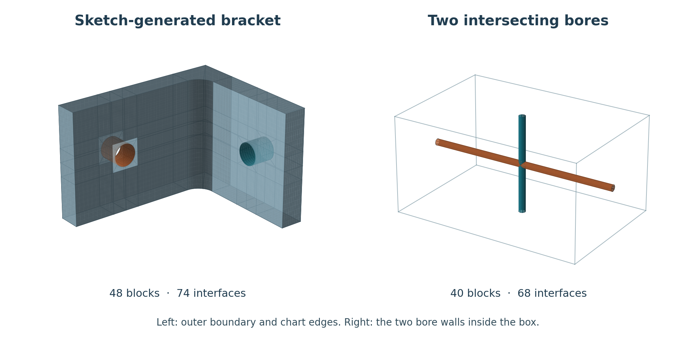
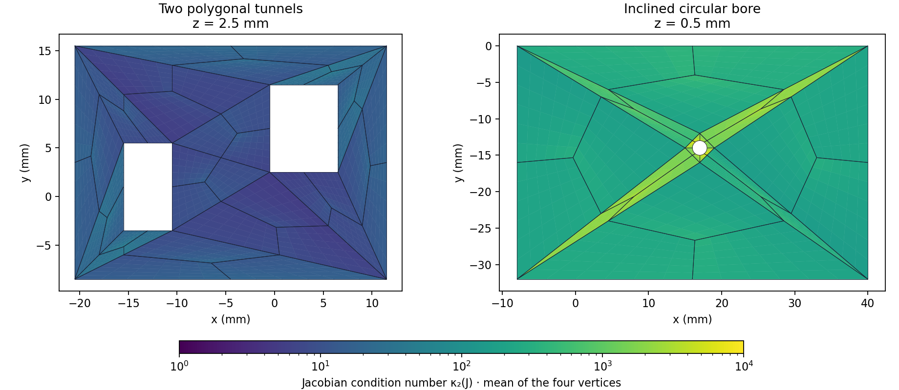

# Luna campaign results — 25 November 2026

**The campaign closed at 09:23 UTC on 25 November**, ten hours after it began at 23:23 UTC on 24 November. All three agents completed their assignments. Baseline: L1 `ea5b940`; branch: `campagne-20261125-10h`; published functional revision: `819eb478431c98b3ae46d516b557c599c3317849`. An isolated check of that revision passed 389 Rust tests and 58 Python tests, `make check`, and strict Clippy (`-D warnings`). The [campaign journal](campagne-20261125.md) records dated protocols, thresholds, method changes and failed attempts.

## Demonstrator workflow

A supported SolidCraft history can produce a solid made of rational maps without parametric trimming. Before adopting a model, the Rust kernel re-audits its maps, interfaces and face provenance. The same audited model can be exported as STEP, loaded on a named face, solved as an elasticity problem, and exported as VTU. The [README](../README.md) gives an executable workflow for the reference bracket.

## Variable-weight NURBS sketches

The Rust kernel exactly extracts Bézier spans from clamped NURBS curves of degrees 1–3. For the qualified free-extrusion family, two curves share a strictly monotone rational abscissa and bound a strictly positive vertical interval. Three cubic cases are admitted and three rejected, matching the six expected decisions. Map boundaries and interior points were compared against independent evaluation using the original knots and weights. All three reread STEP files are valid solids with closed shells. For the variable-gap recipe, section integration and adaptive Open CASCADE mass properties both give 45.9653451060 mm³. See the [format and commands](nurbs-sketch.md) and [curve/STEP oracle](results/nurbs-sketch-20261125.json).


The C0 rational cubic basis for this band has 112 scalar functions. A constant-stress field prescribes traction on all ten exterior faces. The relative nodal defect between volume integration and boundary forces is 3.57e-4, 2.42e-6 and 2.41e-12 at quadrature orders 4, 8 and 16. This checks discrete equilibrium for the prescribed field. [Equilibrium patch test](results/nurbs-patch-equilibrium-20261125.json)

Two transverse cuts with synchronized NURBS walls provide a second free case. The exact construction with flat ends has 26 blocks and 36 interfaces. Order-16 integration recovers 50,835.0245041331 mm³ within 1.81e-13 relative. All 702 checked interior points lie in the material defined by the source curves. A desynchronized witness with 0.25 mm lateral tolerance uses the certified approximate path: 82 blocks and a 0.50 mm boundary bound. Its measured volume difference is −16.31 mm³. [Exact, approximate and refused cases](results/nurbs-cross-20261125.json)

Two closed oval profiles formed by reflecting synchronized cubic meridians produce 40 blocks, 68 interfaces and 104 exterior faces. The STEP reread finds one valid solid with a closed shell. Adaptive mass properties and independent meridian integration give 63,390.9804704817 mm³. The Q3 package checks 1,088 interface coefficient matches and 2,560 affine-field/gradient evaluations. A 16-variant independent sweep varies widths, weights and knots: all eight two-span profiles produce 40 blocks and all eight three-span profiles 56; maximum relative order-16 volume error is 4.50e-12. These results apply to symmetric, monotone, synchronized profiles. [Recipe and construction](nurbs-cross.md) · [STEP mass](results/nurbs-oval-step-20261125.json) · [Q3 space](results/nurbs-oval-space-20261125.json) · [16-variant sweep](results/nurbs-oval-sweep-20261125.json)

## Automatic construction from sketches

Polygon contours and construction lines form a planar graph whose quadrilateral faces propagate through levels introduced by pockets and bores. The independent oracle agrees on all 40 corpus decisions. Reference volumes include 46,800 and 44,000 mm³ for blind-pocket and through-pocket plates, and 1,568 mm³ for a two-hole C-profile. The blind-pocket plan uses 17 blocks versus 84 by triangulation; the C-profile uses 35 versus 84. Maximum sampled spectral condition numbers at 27 points per block fall from 60.8 to 3.33 and from 329 to 8.89. Raw timing data for both methods are retained. [Partition corpus and CAD reread](results/sketch-partition-20261125.json) · [Quality and cost](results/sketch-partition-cost-20261125.json)

Ordered operations on nested footprints distinguish attached from floating islands. All nine decisions agree with the exact cell oracle, and the seven admitted geometries were independently rebuilt in CAD. Permuting two dependent operations changes the result from 3,448 to 3,400 mm³. Both refusals preserve the previous model. [Ordered Boolean operations](results/sketch-boolean-20261125.json)

The 60 × 50 × 40 mm bracket is built from an L-profile, a fillet and two transverse bores. Its automatic partition has 48 blocks and 74 interfaces. The native STEP and the original SolidCraft STEP are valid closed solids; their classifications agree on 2,096 independent probes. Volume is 34,080 − 616π mm³. The specialized template has a measured advantage for this part: 36 blocks, maximum sampled condition number 10 instead of 128, and faster construction. [Host-document comparison](results/sketch-bracket-host-20261125.json) · [IGA package and cost](results/sketch-analysis-20261125.json)



Two equal-radius cylindrical bores on perpendicular, intersecting principal axes are constructed in 40 blocks for a 60 × 40 × 30 mm box with radius 3 mm. The model has 68 interfaces and 104 exterior faces; the Jacobian lower bound on every closed cube is 14.74559999999808 mm³. Volume is 72,144 − 810π mm³ (approximately 69,599.3099506 mm³). An independent STEP reread finds a valid solid. The Q2 space has 554 scalar functions and 1,662 components. The affine test checks 612 coefficient matches; the relative energy difference is at most 2.06e-15 at the diagnostic setting. The ten oracle decisions include XY/XZ/YZ axis pairs, radius/center variants and refusals. [Construction and reproduction](steinmetz.md) · [Independent STEP oracle](results/steinmetz-partition-20261125.json)

The J4 reference study ultimately produced four fine references and 24 comparable trials under a cumulative 3,600 s budget. Under the initial 1,800 s budget, only one of four references and six of 24 comparisons qualified. For the nearly incompressible cylinder, the full 3D residual-correction solve at h5/q8 passes for both formulations, with residuals 9.00e-11 and 7.98e-11. Wall-stress error remains distinct from equilibrium. [Extended J4 references](results/bracket-finer-reference-extended-20261125.json) · [Cylinder correction](results/pressure-cylinder-defect-correction-20261125.json)

## Milestone results

| Milestone | Results and scope |
|---|---|
| J1 — geometry | All seven original corpus geometries passed their audits. The bracket has 36 blocks, 55 interfaces, volume 32,144.7789254 mm³ and continuous determinant lower bound 160 mm³. Two additional tangent planes explain the difference from the upstream fixture’s 30 blocks and 45 interfaces. Each family’s audit names its regularity, injectivity and coverage method; point classification and quadrature remain observations. [Planar certificate](planar-certificate.md) |
| J2 — mechanics | Independent SciPy reassembly of two brackets at orders 4, 6 and 8 recovers all six rigid modes. Across two radii, the native h3 energy distance to nominal C3D10 h0.9 is about 1.1%; the difference between the two fine FEM references is about 1.4%. Comparisons use displacement and strain at shared physical points; radius, resolution, material and supports are part of each result. [Solver reassembly](results/solver-package-20261125.json) · [Field refinement](results/bracket-field-refinement-20261125.json) |
| J3 — edits | All 1,681 bracket-radius pairs passed the audit; the minimum certified grid determinant bound is 151.4213562 mm³. Six out-of-domain pairs were rejected. Radius, map and load derivatives use fixed selections. For five S2 affine deformations, tangent, adjoint and centered differences meet the primary criteria; the auxiliary quadratic-remainder test passes 4/5. [Radius grid](results/bracket-radius-grid-20261125.json) · [Affine-job derivative](results/affine-job-derivative-20261125.json) |
| J4 — specified cost | J4b contains four radius pairs and 76 trials. C3D10 h1.5 and immersed h1.25/q8 meet tip and fillet criteria on 4/4 cases. Uniform native refinement meets constraint-stability criteria on 0/4 from h2 to h3; native h1 with local fillet refinement passes 4/4. J4r’s 24 repeats qualify the observables. Two runs per method and geometry used recorded CPU affinity while other campaign tasks remained active. Retained-level cost, cumulative search and global-field checks answer different questions. [Initial cost](results/bracket-cost-20261125.json) · [Serial repeats](results/bracket-serial-cost-20261125.json) |

## Geometry domains and interoperability

G16 box programs, G17 simple polygon profiles and G18 polygon profiles with holes have separate contracts. G17 reaches the expected 156 decisions (117 admissions, 39 refusals); G18 reaches 152 (119 admissions, 33 refusals). Seven G17 and eight G18 STEP solids were independently reread. [G16](results/orthogonal-program-20261125.json) · [G17](results/polygon-prism-20261125.json) · [G18](results/perforated-prism-20261125.json)

G19 transports maps, determinants, bounds and selections through rational affine transformations. Six solids, including a sheared torus, were compared with independent oracles. The torus requires the full homogeneous i64 mode. The report preserves the initial-mode refusal and three cases where OCC’s classification of a directly transformed primitive differs; an independent torus-boundary reconstruction resolves them. [Affine images](results/affine-images-20261125.json)

SolidCraft 0.48.1 recorded and reopened editable bracket, box-program and extrusion histories. Comparisons of host solids and native STEP cover mass, geometry and classification. Unsupported families receive an explicit adapter refusal. [Bracket history](results/solidcraft-bridge-20261125.json) · [Box history](results/solidcraft-box-timeline-20261125.json) · [Polygon profiles](results/solidcraft-polygon-20261125.json)

G20 accepts one to four exact circular holes in polygonal contours with sheared extrusion: 118 admissions and 36 expected refusals. Eight STEP comparisons have maximum relative volume difference 2.45e-15. SC7 recovers four asymmetric SolidCraft extrusions on their original XZ/YZ planes and protects the target on two out-of-domain histories. [Circular holes](results/circular-polygon-20261125.json) · [Oriented SolidCraft planes](results/solidcraft-oriented-plane-20261125.json)



The figure shows two cuts from geometric VTU files with six subdivisions per parameter. Black lines show map boundaries; color indicates local Jacobian conditioning on a common scale. On the strongly sheared geometry, the 3D grid reaches κ₂ = 6,404. All 21 VTU files across seven families were read with VTK and compared against independent NumPy SVD results. [VTU verification](results/geometry-vtu-20261125.json)

G21 covers blind bores from either end and closed voids in sheared prisms: 127 decisions, 11 STEP comparisons and 4,742 classifications agree with the oracle. Three SolidCraft bore histories were reopened; maximum volume difference from native STEP was 6.15e-9 mm³. G22 replayed 96 interval edits with exact model equality against cold reconstruction, reusing 14,084 blocks and rebuilding 26,010; twelve invalid batches preserved the target. [Interval-bore volumes and pressure](results/interval-bores-20261125.json) · [SolidCraft bore history](results/solidcraft-blind-bore-20261125.json) · [Interval edits](results/interval-edits-20261125.json)

G23 counterbores combine a through-bore with a larger counterbore over part of its depth: 94 admissions and 28 expected refusals. Seven STEP solids and 3,700 material classifications agree with independent OCCT cuts; maximum relative volume difference is 2.22e-15. A 2.5 MPa pressure on an offset shoulder gives +86.394 N or −86.394 N in z, depending on input; moments match the sheared shoulder’s lever arm. [Counterbore qualification](results/counterbores-20261125.json)

SolidCraft created and reopened three counterbores in one bore operation. Checks cover top and bottom openings, two offset centers and 36 probes; Boolean differences between host and native STEP are zero. A 13 mm counterbore accepted by the host is outside G23’s integer-radius contract, and rejection preserves the target. [SolidCraft counterbore histories](results/solidcraft-counterbore-20261125.json)

Exploratory coverage advanced from 3/6 to 4/6 with a near-tangent case, then 5/6 for disjoint holes and 6/6 for intersecting holes. All six recipes were replayed without removing early refusals from the denominator. [Initial coverage](results/exploratory-20261125-initial.json) · [Final replay](results/exploratory-20261125-g7.json)

G24 uses a variable-angle sector θ = 2 atan(t), rational weights and six named physical faces. Of 108 recipes, 84 admissions and 24 refusals match predictions. Eight OCCT STEP rereads cover 640 classification decisions. The initial audit found an incorrect homogeneous coefficient at the terminal edge; its recipe remains a regression. [G24 corpus](results/rational-sector-20261125.json) · [Regression](../tests/regressions/rational_sector_endpoint_y_control.json)

## Cost at matched field accuracy

J4g adds a 3% energy-distance threshold and 0.5% L²-displacement threshold against C3D10 h1.0 to J4b’s two observables. At all four radii, the second local native refinement from h2 (2,528 leaves) passes: energy distance 2.448–2.697%, displacement 0.0480–0.0645%. C3D10 h1.25-to-h1.0 energy sensitivity is 2.006–2.099%. Each geometry uses 589,824 common physical sample points. [Field comparisons](results/bracket-candidate-fields-20261125.json) · [Native refinement tiers](results/bracket-field-tiers-20261125.json)

| Method | Cold time, median [min–max] | Simultaneously sampled RSS, median [min–max] |
|---|---:|---:|
| Native h2, two local fillet refinements | 19.62 s [19.17–23.92] | 232 MiB [195–284] |
| Immersed h1.25/q8 | 34.96 s [33.96–51.24] | 1,531 MiB [1,499–1,567] |
| C3D10 h1.5 | 73.76 s [71.31–84.54] | 1,672 MiB [1,661–1,680] |

All 24 J4g trials pass. Each method ran twice for every radius pair, serially on CPUs 2 and 3 while other campaign work continued. Time includes field output and a physical fillet probe. Independent coefficient verification adds up to 2.78 s for C3D10. Fine references, search for the first admissible state and initial field-distance calculation have separate costs. Native checkpoints retain paths, weights and displacements. Four additional replays are byte-identical and exactly compare 273,024 homogeneous coordinates per geometry against the root-map subdivision. [Checkpoint geometry checks](results/bracket-checkpoint-geometry-20261125.json)

J4g memory is the sum of RSS sampled every 150 ms across the process session; J4r’s GNU `time` metric is a per-process maximum. [Raw 24-run measurements](results/bracket-field-matched-cost-20261125.json)

In both J4h runs, the minor radius edit 50/16 → 51/16 mm reuses 2,272 of 2,528 stiffness contributions; reverting reuses all 2,528. Cold checks are part of the transaction, bringing minor-edit time to 34.2–34.3 s. Peak memory is 762–775 MiB. Across ten accepted states, maximum displacement-coefficient difference from J4f is 5.50e-12 relative. Both invalid radii preserve state and cache. [Measured mechanical edits](results/bracket-matched-edits-20261125.json)

J4i retains the cache and excludes cold reconstruction from transaction time. The minor edit takes 14.61 and 14.83 s, versus 34.2–34.3 s with J4h’s internal double check. Independent checks of six events per run add 2.86 and 2.67 s. Warm fields, the 1,000 N reaction, homogeneous coordinates and refusals were checked. Session RSS peaks are 612 and 621 MiB. [Incremental J4i edits](results/bracket-incremental-edits-20261125.json)

The finer C3D10 h0.90 reference completed one of four radii within the initial 1,800 s budget (six of 24 comparisons). A second pass under a separate cumulative 3,600 s budget completed all four references and all 24 comparisons; time already spent, including the interrupted run, counts. Energy distances are 2.432–2.700% for native, 1.383–1.762% for immersed, and 2.333–2.392% for C3D10 h1.5. The figure shows both repeat times per state and 95% integration half-widths. [Initial budget](results/bracket-finer-reference-20261125.json) · [Extended budget](results/bracket-finer-reference-extended-20261125.json)


All four J4d h1 runs completed. The four h2 runs hit the 1,800 s ceiling. Radius pair [50,74] retains a first unqualified state; [51,74] reached the limit at 1,800.10 s. Empty GNU `time` resource files leave peak memory unknown. [J4d run closure](results/local-fillet-cost-20261125.md)

The two Kirsch tests impose analytical traction on all four sides of the finite plane-strain square; the hole target is 300 MPa. At radii 4 and 3.5 mm, all three solver chains meet the 3% pointwise threshold and 2% stability criterion. The first stable native values are 301.495 and 302.151 MPa. These differ from the 3D bracket fields above, which use another loading. [Kirsch pilot](results/kirsch-pilot-20261125.json)

## Convergence and mechanical limits

Different constructions of the same prism can produce different meshes. For the L bracket and two-tunnel plate in M7, all 24 resolutions completed. At h3, work differences are 0.2853% and 0.02412%; L² displacement distances are 0.3352% and 0.03341%; energy distances are 10.338% and 5.0234%. Both energy distances exceed the 5% threshold. Independent clouds contain 49,152 and 344,064 physical sites, each located exactly once in each partition. [Equivalent-prism mechanics](results/equivalent-prism-mechanics-20261125.json)

Local refinement in M8 exposed a missing edge identification and partial assembly tying free coefficients. For the edge witness, 7,272 independently reconstructed equations over 7,641 local coefficients have exact rational rank 5,193, giving assembled dimension 2,448. The v3 job also removes dependent support equations using exact rationals. [Rank witness](results/adaptive-edge-rank-20261125.json) · [Initial M8 runs](results/adaptive-equivalent-prisms-20261125.json)

After refinement, the two-tunnel plate reaches 4.642% ± 0.101 percentage point energy distance on both M8c partitions. For the L bracket, M10 stratification reduces measurement uncertainty: after two additional rounds, confirmation on 4,909,056 sites gives 4.1770% ± 0.0287 point and 0.03588% L² displacement. Both results compare discrete fields on the same domain. [Two-tunnel plate](results/adaptive-equivalent-prisms-c-20261125.json) · [L bracket](results/stratified-prism-20261125.json)

M9 body forces and S3 spatially affine supports are checked with manufactured bars and independent shape differences. M11 surface loads cover seven cases, including a steep rational wall whose fixed-q12 area has 4.87e-5 relative bias. Initial results include two integrations exceeding 65,536 panels; on the current binary, the same seven jobs pass at a maximum isotropic count of 65,536 or directional count of 4,096. Budget verdicts and revisions remain separate. [Body forces](results/volume-force-20261125.json) · [Moving supports](results/moving-support-derivative-20261125.json) · [Surface loads](results/adaptive-surface-load-20261125.json)

For the nearly incompressible pressurized cylinder, the sparse full 3D h4 correction passes all six required cases. Reports separate discrete-equation residual, displacement, pressure and energy error against the Lamé solution. Solver qualification and physical-solution convergence have separate criteria. [Lamé solution and corrections](results/pressure-cylinder-full-correction-20261125.json)

Three M13 jobs converge to order 10 for volume quadrature after 57,600–921,600 evaluations including intermediate orders. Independent q16/q24 references check distributed force, moment and work. Invalid budgets/ranges preserve the output. Work derivative is near zero for the symmetric cavity. At internal tolerance 1e-11, tangent–adjoint difference was 1.08e-12 N·mm, above the 1e-12 absolute budget; the solver now uses 1e-12. All three cases pass the stronger check. [Adaptive body-load quadrature](results/adaptive-body-load-20261125.json)

S5 moves the axial bottom of a blind bore, deforming the two adjacent layers. Three tests on a sheared solid use floor pressure, wall traction and affine body force. Volume derivative agrees with ±πr² within 3.12e-11 relative. Tangent/adjoint and rebuilt-geometry field differences at 4, 2 and 1 mm pass. Five out-of-domain requests, including an external depth or one shared by two bores, preserve the previous file. [Bore-bottom sensitivity](results/interval-endpoint-sensitivity-20261125.json)

T-P6 reparameterization passes Rust and an independent oracle on 16 inputs, five invalid. For 21 T-P7 intersections, the oracle checks geometric class, point, jet and conditioning; maximum jet difference is 1.73e-10 mm/mm. [Reparameterization](results/reparameterization-oracle-20261125.json) · [Intersections](results/sketch-intersections-oracle-20261125.json)

Moving from one to two analysis maps near 135° changes the default Q2 space. Traction work changes from 0.11185 to 0.13371 N·mm between neighboring angles. With S8’s two fixed half-charts, the empty-plan dimension is 45 per side. Across two loads and one refined plan, relative difference between the field secant and mean tangent is below 1.17e-8 at Δt = 1/6,930. This continuity claim applies only to the tested spaces and cases. [Opening derivative](results/sector-job-sensitivity-20261125.json) · [135° chart transition](results/sector-chart-transition-20261125.json)

For three S7 local plans, the oracle recovers rational-constraint derivatives by rebuilding matrices at perturbed angles. Physical trace differentiation includes N′u in addition to Nu′. A fourth evaluation removes the C′ work contribution to measure its effect. S9 adds affine supports in physical coordinates. For two angles and one or two root blocks, centered differences verify field, support offsets, traction/reaction work and energy. Two incompatible-law/spatial-selection requests preserve the prior target. [Moving constraints](results/sector-constraint-sensitivity-20261125.json) · [Affine sector supports](results/sector-support-sensitivity-20261125.json)

A sector with two local-refinement levels shows why residual checks need a rank check. SciPy reassembly detects eight spurious modes among 432 assembled unknowns at order 2. The force projection onto those modes is only 5.49e-15, allowing a small balance error despite non-uniqueness. At orders 3 and 4 the assembled spectrum is positive; derivative-versus-centered-difference error falls from 8.52% to 4.0e-6 relative in the one-chart case. The CLI now rejects mechanical sector derivatives below order 3. [Spectra and residuals](results/sector-quadrature-modes-20261125.json)

For S2 uniform traction on a bend, the Taylor-remainder quotient was about 16, outside the requested interval around 4. A direct SciPy solve finds fourth-order decay of the work remainder for this direction. The difference from free work equals the squared energy norm of the clamping defect, whose norm decays quadratically with h. Mixed loading on the same geometry gives a second-order remainder. q10/q14 reassembly confirms the uniform-traction case. [Direct remainder check](results/bend-work-remainder-20261125.json)

## Specification test coverage

| Tests | Evidence and domain |
|---|---|
| T-G1–T-G3 | Oriented incidences and boundary-operator compositions reread from the adaptive complex; spatial certificates cover rational bounds and local inversions; supported-family trace identities are checked before adoption. [Complexes](results/adaptive-complex-20261125.json) · [Spatial bounds](results/spatial-certificate-20261125.json) |
| T-G4–T-G7 | Exact models record their representation method; edits compare against cold reconstruction; affine audit includes inclusions without intersecting boundaries; program and bore tests cover their stated operations and axial intervals. [Affine images](results/affine-images-20261125.json) · [Programs](results/coaxial-program-20261125.json) · [Intervals](results/interval-bores-20261125.json) |
| T-G8–T-G10 | Piecewise composition, arc restrictions and weights are tested on supported families. Independent SVD checks anisotropic-map conditioning; degenerate geometry and out-of-template parameters have reproducible witnesses. [Sectors](results/rational-sector-20261125.json) · [Conditioning](results/geometry-vtu-20261125.json) |
| T-I1–T-I3 | Adaptive package exports overlaps, orientations, equations and lifts; independent rank calculation checks an edge shared by multiple interfaces. [Analysis package](results/adaptive-package-20261125.json) · [Rank](results/adaptive-edge-rank-20261125.json) |
| T-I4–T-I6 | Tests distinguish exterior/interior subfaces, master/slave refinement and dependent supports; independent reassembly checks six rigid modes for the bracket cases. [Transfers](results/adaptive-transfer-20261125.json) · [Supports](results/essential-constraint-reduction-20261125.json) · [Modes](results/solver-package-20261125.json) |
| T-M1–T-M2 | Manufactured regular T-junction solution has final L² and H¹ rates 3.003 and 2.008. The perforated plate uses Kirsch traction on its finite outer boundary. [Manufactured test](../examples/manufactured_t.rs) · [Kirsch traction](results/kirsch-pilot-20261125.json) |
| T-M3–T-M5 | J4 compares field, observables, time and memory; equivalent programs show refinement-dependent distances; quadrature studies separate volume/surface loads, order, subdivision and budget. [J4 fields](results/bracket-field-matched-cost-20261125.json) · [Partitions](results/stratified-prism-20261125.json) · [Quadrature](results/adaptive-surface-load-20261125.json) |
| T-P1–T-P4 | Bore movement and interval edits cover tangencies, exits and selection changes; Taylor remainders and centered differences are reported by regime; the 135° angle tests a chart transition. [Trajectory](results/travelling-bore-extrema-20261125.json) · [Taylor](results/affine-job-derivative-20261125.json) · [Chart transitions](results/sector-chart-transition-20261125.json) |
| T-P5–T-P8 | Variable-weight map jets and lifts are checked in the studied regime; KKT and intersection tests distinguish regular and singular cases; J4i cache tests check the full field after edits. [Variable weights](results/sector-job-sensitivity-20261125.json) · [KKT](results/reparameterization-oracle-20261125.json) · [Intersections](results/sketch-intersections-oracle-20261125.json) · [Cache](results/bracket-incremental-edits-20261125.json) |

## Reproduction and provenance

From a clone containing its six locked references, run:

```sh
cargo test --locked --offline
cargo clippy --locked --offline --all-targets -- -D warnings
make check
```

For three exact NURBS geometries, changing one homogeneous control is detected by the re-audit. Six subsequent STEP and H1 export attempts on the altered models preserve previously accepted files. [Atomic-export witnesses and hashes](results/nurbs-atomic-export-20261125.json)

Long studies keep recipes in `tests/references/`, numerical results in `docs/results/` and regenerable data in `build/`. The kernel and new constructors are Rust; Python scripts provide porting references, independent oracles, solver reruns and measurements. [Architecture](architecture.md) · [Locked references](../references.lock)

The upstream FieldCraft FEM test at revision `35e8346` required objects and Cargo dependencies absent from the local checkout. The automated authorization review rejected dependency downloads. Its reported numbers remain labeled as upstream results. Local comparisons use the locked design fixture, SolidCraft, Open CASCADE, Netgen and CalculiX. The project holder remains responsible for choosing the original code’s distribution license (NF-8).
