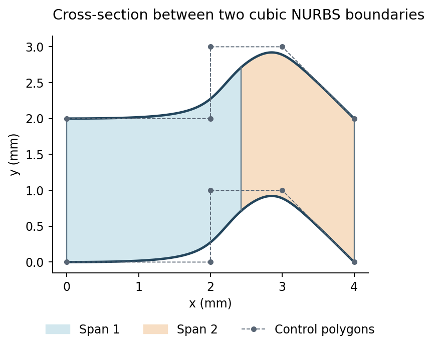
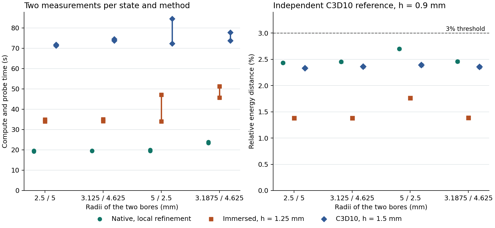

# Bilan de la campagne Luna du 25 novembre 2026

**Campagne close le 25 novembre 2026 à 09 h 23 UTC**, après dix heures depuis le 24 novembre à 23 h 23 UTC. Les trois agents ont terminé. Base L1 `ea5b940`, branche `campagne-20261125-10h`. La révision fonctionnelle publiée est `819eb478431c98b3ae46d516b557c599c3317849`. Le contrôle isolé de cette révision a passé 389 tests Rust et 58 tests Python, les démonstrations de `make check` et Clippy avec les avertissements traités comme erreurs. Le journal conserve les protocoles datés, les seuils, les changements de méthode et la chronologie des échecs. [Journal de campagne](campagne-20261125.md)

## Ce que permet le démonstrateur

Un historique SolidCraft pris en charge peut produire un solide formé de cartes rationnelles sans découpe paramétrique. Le noyau Rust réaudite ces cartes, leurs raccords et la provenance des faces avant adoption. Le même modèle sert à exporter sa frontière en STEP, à poser une traction ou une pression sur une face nommée, à résoudre un problème d’élasticité et à exporter les champs en VTU. Le README donne une chaîne exécutable sur l’équerre de référence. [Démonstration](../README.md)

## Esquisses NURBS à poids variables

Le noyau Rust extrait exactement des travées de Bézier depuis des courbes NURBS clampées de degrés 1 à 3. Pour l’extrusion libre qualifiée, deux courbes ont une abscisse rationnelle commune strictement monotone et délimitent un intervalle vertical strictement positif. Les trois cas cubiques admis et les trois refus donnent les six décisions attendues. Les frontières et les points intérieurs des cartes sont comparés à une évaluation indépendante sur les nœuds et les poids de départ. Les trois STEP relus sont des solides à une coquille fermée. La recette à écart variable donne 45,9653451060 mm³ par l’intégrale de section et par les propriétés de masse adaptatives d’Open CASCADE. [Format et commandes](nurbs-sketch.md) · [Oracle des courbes et des STEP](results/nurbs-sketch-20261125.json)



Sur cette bande, la base rationnelle C0 de degré trois compte 112 fonctions scalaires. Un champ de contrainte constant prescrit la traction sur chacune des dix faces extérieures. Le défaut nodal relatif entre l’intégrale volumique et les efforts de bord vaut 3,57e−4, 2,42e−6 puis 2,41e−12 aux ordres 4, 8 et 16. Ce contrôle porte sur l’équilibre discret du champ prescrit. [Patch test d’équilibre](results/nurbs-patch-equilibrium-20261125.json)

Les deux enlèvements transverses à flancs NURBS synchronisés donnent un second cas libre. La construction exacte à bouts plats comporte 26 blocs et 36 interfaces. L’intégration des cartes à l’ordre 16 retrouve le volume de référence 50 835,0245041331 mm³ à 1,81e−13 relatif. Les 702 points intérieurs contrôlés appartiennent à la matière définie par les courbes sources. Pour un témoin désynchronisé et une tolérance latérale de 0,25 mm, le parcours approché certifié donne 82 blocs et une borne de frontière de 0,50 mm. L’écart de volume mesuré sur ce témoin vaut −16,31 mm³. [Cas exact, cas approché et refus](results/nurbs-cross-20261125.json)

Deux profils ovales fermés construits par réflexion de méridiennes cubiques synchronisées donnent 40 blocs, 68 interfaces et 104 faces extérieures. La relecture STEP trouve un solide valide à une coquille fermée. La masse adaptative et l’intégration indépendante des méridiennes donnent 63 390,9804704817 mm³. Le contrôle du paquet Q3 vérifie 1 088 correspondances de coefficients sur les raccords et 2 560 évaluations de champ affine et de gradient. Le balayage indépendant de 16 variantes modifie les largeurs, les poids et les nœuds. Les huit profils à deux travées donnent 40 blocs, les huit profils à trois travées en donnent 56. L’écart relatif maximal de volume à l’ordre 16 est de 4,50e−12. Les conditions de symétrie, de monotonie et de synchronisation délimitent ce résultat. [Recette et construction](nurbs-cross.md) · [Masse STEP](results/nurbs-oval-step-20261125.json) · [Espace Q3](results/nurbs-oval-space-20261125.json) · [Balayage des 16 variantes](results/nurbs-oval-sweep-20261125.json)

## Construction automatique depuis les esquisses

Les contours polygonaux et les lignes de construction sont assemblés en graphe plan. Les faces quadrangulaires se propagent aux niveaux où apparaissent une poche ou un trou. L’oracle indépendant a retrouvé les 40 décisions du corpus, dont les volumes de 46 800 et 44 000 mm³ pour la plaque à poche borgne ou traversante et 1 568 mm³ pour le contour en C à deux trous. Sur la plaque borgne, le plan orthogonal utilise 17 blocs contre 84 par triangulation. Sur le C, les effectifs sont 35 et 84. Les conditionnements spectraux maximaux mesurés sur 27 points par bloc passent respectivement de 60,8 à 3,33 et de 329 à 8,89. Les temps bruts et les deux méthodes sont conservés. [Corpus et relecture CAO](results/sketch-partition-20261125.json) · [Qualité et coûts](results/sketch-partition-cost-20261125.json)

La suite ordonnée d’opérations sur des empreintes imbriquées distingue l’îlot rattaché et l’îlot flottant. Les neuf décisions sont conformes à l’oracle de cellules exactes, les sept géométries admises ont été reconstruites indépendamment en CAO. La permutation de deux opérations dépendantes donne 3 448 ou 3 400 mm³. Les deux refus préservent le modèle antérieur. [Opérations ordonnées](results/sketch-boolean-20261125.json)

L’équerre de 60 × 50 × 40 mm est construite depuis le contour en L, le congé et deux perçages transverses. Son partitionnement automatique compte 48 blocs et 74 raccords. Le STEP correspondant et le STEP original de SolidCraft sont deux solides fermés et leurs classements concordent avec les 2 096 sondes indépendantes. Le volume vaut 34 080 − 616π mm³. Le gabarit spécialisé conserve un avantage mesuré sur cette pièce, avec 36 blocs, un conditionnement maximal échantillonné de 10 contre 128, et une construction plus rapide. [Comparaison avec le document hôte](results/sketch-bracket-host-20261125.json) · [Paquets IGA et coûts](results/sketch-analysis-20261125.json)


Deux perçages cylindriques de même rayon sur des axes principaux perpendiculaires et exactement sécants ont une construction globale en 40 blocs. Pour le pavé de 60 × 40 × 30 mm et le rayon de 3 mm, les 68 raccords sont conformes, les 104 faces extérieures sont classées et le jacobien est minoré sur chaque cube fermé par 14,74559999999808 mm³. Le volume vaut 72 144 − 810π mm³, soit 69 599,3099506 mm³. Le STEP relu indépendamment donne un solide valide. L’espace Q2 comporte 554 fonctions scalaires et 1 662 composantes. Le test affine vérifie 612 correspondances de coefficients, avec un écart énergétique relatif de 2,06e−15 au plus au réglage du diagnostic. Les dix décisions de l’oracle comprennent les trois paires d’axes, des variantes de rayon et de centre, et des refus. [Construction et reproduction](steinmetz.md) · [Oracle STEP indépendant](results/steinmetz-partition-20261125.json)

Le cas de référence J4 atteint quatre références fines et 24 essais comparables sous 3 600 s cumulées. Sous 1 800 s, le dénominateur reste de quatre références et 24 essais prévus, dont une référence et six essais sont qualifiés. Sur le cylindre presque incompressible, la correction dans le système 3D complet passe au niveau h5 et ordre 8 pour les deux formulations, à 9,00e−11 et 7,98e−11 de résidu relatif. Les écarts de contraintes en paroi restent distincts de ces mesures d’équilibre. [Références J4](results/bracket-finer-reference-extended-20261125.json) · [Cylindre](results/pressure-cylinder-defect-correction-20261125.json)

## Résultats par jalon

| Jalon | Essai et mesure | Portée |
|---|---|---|
| J1 — géométrie | Les sept géométries du corpus initial ont passé leur audit. L’équerre comporte 36 blocs, 55 interfaces, un volume de 32 144,7789254 mm³ et une borne continue de déterminant de 160 mm³. Les deux plans de tangence supplémentaires expliquent l’écart aux 30 blocs et 45 interfaces de la fixture amont. | L’audit de chaque famille précise la méthode de régularité, d’injectivité et de couverture. Une quadrature du volume ou une classification de points reste une observation. [Contrat de l’équerre](planar-certificate.md) |
| J2 — mécanique | Les réassemblages SciPy de deux équerres aux ordres 4, 6 et 8 retrouvent les six modes rigides du corps libre. Sur deux rayons, la distance énergétique native h3 à la référence C3D10 nominale 0,9 mm est voisine de 1,1 %. Le changement entre deux références EF fines est lui-même de l’ordre de 1,4 %. | Les comparaisons portent sur le déplacement et sa déformation en des points physiques communs. Le rayon, la résolution, le matériau et les appuis font partie du résultat. [Réassemblage](results/solver-package-20261125.json) · [Comparaison des champs](results/bracket-field-refinement-20261125.json) |
| J3 — modification | Les 1 681 couples de rayons de l’équerre ont passé l’audit. Le minimum de la borne certifiée de déterminant sur la grille est 151,4213562 mm³. Six couples hors domaine ont été refusés. Les dérivées de rayon, de carte et de charge sont contrôlées en régime de sélections fixes. | Pour les cinq déformations affines S2, dérivée tangente, adjoint et différences centrées concordent selon les critères principaux. Le test auxiliaire du reste quadratique admet 4/5 cas. [Grille exhaustive](results/bracket-radius-grid-20261125.json) · [Sensibilités de job](results/affine-job-derivative-20261125.json) |
| J4 — coût à précision fixée | Le corpus J4b comprend quatre couples et 76 essais. C3D10 h1,5 et l’immergé h1,25/q8 satisfont les critères de pointe et de congé sur 4/4. Le parcours natif uniforme obtient 0/4 au critère de stabilité de contrainte entre h2 et h3. Le parcours natif démarrant à h1 et raffiné autour du congé atteint ces critères sur 4/4. Les 24 répétitions J4r ont qualifié leurs observables. | Deux exécutions par méthode et par géométrie, affinité enregistrée, autres tâches de campagne actives. Le coût du niveau retenu, le cumul de recherche et le contrôle global du champ répondent à trois questions différentes. [Essais initiaux](results/bracket-cost-20261125.json) · [Répétitions](results/bracket-serial-cost-20261125.json) |

## Domaines géométriques et interopérabilité

- Les programmes de boîtes G16, les profils simples G17 et les profils à contours internes polygonaux G18 ont des contrats de construction distincts. G17 a obtenu les 156 décisions attendues (117 admissions, 39 refus), G18 les 152 décisions attendues (119 admissions, 33 refus). Les STEP de sept cas G17 et huit cas G18 ont été relus en CAO indépendante. [G16](results/orthogonal-program-20261125.json) · [G17](results/polygon-prism-20261125.json) · [G18](results/perforated-prism-20261125.json)
- L’image affine rationnelle G19 transporte cartes, déterminants, frontières et sélections. Six solides ont été comparés aux oracles, dont un tore cisaillé. Ce dernier exige le mode homogène entier i64. Le rapport conserve le refus du mode initial et trois témoins pour lesquels la classification OCC de la primitive portant directement la transformation diverge. Une reconstruction indépendante de sa frontière torique tranche ces trois cas. [Images affines](results/affine-images-20261125.json)
- SolidCraft 0.48.1 a enregistré puis rouvert les documents éditables utilisés dans les comparaisons de l’équerre, des programmes de boîtes et des extrusions de contours. Les contrôles rapprochent le solide hôte et le STEP natif par masse, géométrie et classification. Les familles non reconnues déclenchent un refus explicite de l’adaptateur. [Équerre](results/solidcraft-bridge-20261125.json) · [Historiques de boîtes](results/solidcraft-box-timeline-20261125.json) · [Profils](results/solidcraft-polygon-20261125.json)

Le constructeur G20 accepte jusqu’à quatre trous circulaires dans un contour polygonal, avec extrusion cisaillée. Le corpus donne 118 admissions et 36 refus attendus. Les huit STEP contrôlés présentent un écart maximal de volume de 2,45e−15 relatif. L’adaptateur SC7 retrouve les quatre extrusions asymétriques SolidCraft sur les plans d’origine XZ et YZ, et protège la cible pour deux historiques hors domaine. [Perçages](results/circular-polygon-20261125.json) · [Plans SolidCraft](results/solidcraft-oriented-plane-20261125.json)

Les deux coupes suivantes proviennent directement des VTU géométriques, à six subdivisions par paramètre. Les traits noirs délimitent les cartes. La couleur montre le conditionnement local du jacobien sur une échelle commune. Sur la géométrie très cisaillée, la grille tridimensionnelle atteint κ₂ = 6 404. Les 21 fichiers de sept familles ont été relus avec VTK et comparés à une SVD NumPy indépendante. [Vérification](results/geometry-vtu-20261125.json)


G21 traite les perçages borgnes depuis chaque extrémité et les vides fermés dans les prismes cisaillés. Les 127 décisions concordent avec l’oracle ; les 11 comparaisons STEP ont passé 4 742 classifications. Les trois historiques de perçage réellement enregistrés puis rouverts dans SolidCraft ont un écart maximal de volume de 6,15e−9 mm³ avec le STEP natif. G22 a rejoué 96 éditions d’intervalles avec égalité de tout le modèle à une reconstruction froide, réutilisant 14 084 blocs et en construisant 26 010. Douze refus de lots ont préservé le fichier cible. [Volumes et pressions](results/interval-bores-20261125.json) · [Historiques hôtes](results/solidcraft-blind-bore-20261125.json) · [Éditions](results/interval-edits-20261125.json)

Les lamages G23 combinent un pilote traversant et un alésage élargi sur une partie de la hauteur. Le corpus comporte 94 admissions et 28 refus attendus. Sur sept solides exportés en STEP, les 3 700 classifications matérielles concordent avec les coupes OCCT indépendantes. L’écart maximal de volume est de 2,22e−15 relatif. Une pression de 2,5 MPa sur l’épaulement décentré donne +86,394 N ou −86,394 N en z suivant l’entrée. Les moments concordent avec le bras de levier de l’épaulement cisaillé. [Qualification des lamages](results/counterbores-20261125.json)

SolidCraft a créé puis rouvert trois lamages avec une seule opération de perçage sur une boîte. Les comparaisons couvrent les ouvertures supérieure et inférieure, deux centres décalés et 36 sondes. Les différences booléennes entre les STEP hôte et natif sont nulles sur ces cas. Le diamètre de lamage de 13 mm admis par l’hôte est hors du contrat de rayons entiers de G23 et préserve la cible au refus. [Comparaison des historiques SolidCraft](results/solidcraft-counterbore-20261125.json)

Sur le corpus exploratoire initial, la couverture est passée de 3/6 à 4/6 avec le cas proche de la tangence, puis à 5/6 avec deux trous disjoints et à 6/6 avec deux trous sécants. Ces six recettes ont été rejouées sans retirer les premiers refus du dénominateur. [État initial](results/exploratory-20261125-initial.json) · [Dernier rejeu](results/exploratory-20261125-g7.json)

Le secteur G24 possède un angle variable θ = 2 atan(t), des poids rationnels et six faces physiques nommées. Sur 108 recettes, les 84 admissions et les 24 refus concordent avec les prédictions. Huit STEP relus par OCCT couvrent 640 décisions de classification. Le contrôle initial a révélé un coefficient homogène erroné sur le bord terminal. Sa recette reste un test de régression. [Corpus G24](results/rational-sector-20261125.json) · [Régression](../tests/regressions/rational_sector_endpoint_y_control.json)

## Coût à précision de champ et observables imposées

J4g ajoute aux deux observables de J4b un seuil de 3 % en distance énergétique du champ et de 0,5 % en déplacement L² par rapport au C3D10 h1,0. Les quatre rayons admettent le deuxième raffinement local natif à partir de h2 (2 528 feuilles), avec 2,448–2,697 % en énergie et 0,0480–0,0645 % en déplacement. La sensibilité du comparateur C3D10 h1,25/h1,0 vaut 2,006–2,099 % en énergie. Chaque distance s’appuie sur 589 824 points physiques communs par géométrie. [Comparaisons](results/bracket-candidate-fields-20261125.json) · [Niveaux natifs](results/bracket-field-tiers-20261125.json)

| Méthode retenue | Temps à froid, médiane [min–max] | Pic RSS simultané observé, médiane [min–max] |
|---|---:|---:|
| Natif h2, deux raffinements au congé | 19,62 s [19,17–23,92] | 232 Mio [195–284] |
| Immergé h1,25/q8 | 34,96 s [33,96–51,24] | 1 531 Mio [1 499–1 567] |
| C3D10 h1,5 | 73,76 s [71,31–84,54] | 1 672 Mio [1 661–1 680] |

Les 24 essais J4g ont satisfait les contrôles. Chaque méthode a été relancée deux fois sur chaque couple de rayons, en série sur les cœurs 2 et 3, avec les autres activités de campagne en cours. Le temps inclut la production du champ et le contrôle physique du congé. La vérification indépendante des coefficients prend en sus jusqu’à 2,78 s pour C3D10. Les références fines, la recherche du premier état admissible et le calcul initial des distances de champ ont leur propre coût. Les checkpoints natifs contiennent les chemins, les poids et les déplacements. Quatre relances complémentaires reproduisent leurs octets et comparent exactement les 273 024 coordonnées homogènes par géométrie au découpage de la carte racine. [Contrôles des coordonnées](results/bracket-checkpoint-geometry-20261125.json)

La mémoire J4g est la somme des RSS échantillonnées toutes les 150 ms dans la session de processus ; la métrique GNU time de J4r est un maximum par processus. [24 mesures brutes](results/bracket-field-matched-cost-20261125.json)

Sur les deux parcours J4h, l’édition mineure de rayon 50/16→51/16 mm reprend 2 272 des 2 528 contributions de raideur. Le retour reprend les 2 528. Les vérifications froides font partie de cette transaction et portent le temps de l’édition mineure à 34,2–34,3 s. Le pic mémoire des deux parcours est de 762–775 Mio. Sur les dix états adoptés, l’écart maximal des coefficients de déplacement à J4f est de 5,50e−12 relatif. Les deux rayons invalides ont préservé l’état et le cache. [Éditions mécaniques mesurées](results/bracket-matched-edits-20261125.json)

J4i conserve le cache et retire la reconstruction froide du temps de transaction. L’édition mineure demande 14,61 et 14,83 s dans les deux parcours, contre 34,2–34,3 s avec double vérification interne en J4h. Un contrôle indépendant des six événements de chaque parcours a pris respectivement 2,86 et 2,67 s supplémentaires. Le champ chaud, la réaction de 1 000 N, les coordonnées homogènes et les refus ont été contrôlés. Le pic de RSS de la session atteint 612 et 621 Mio. [Éditions incrémentales J4i](results/bracket-incremental-edits-20261125.json)

La référence plus fine C3D10 h0,90 a tenu le budget initial de 1 800 s sur un rayon sur quatre, soit 6 comparaisons qualifiées sur 24. En reprenant la seconde passe sous un budget cumulatif distinct de 3 600 s, les quatre références et les 24 comparaisons ont abouti. Le temps déjà consommé, y compris la passe interrompue, compte dans ce deuxième budget. La distance énergétique est comprise entre 2,432 et 2,700 % pour le parcours natif, entre 1,383 et 1,762 % pour l’immergé et entre 2,333 et 2,392 % pour C3D10 h1,5. La figure donne les temps des deux répétitions par état et les demi-largeurs à 95 % de l’intégration de champ. [Budget initial](results/bracket-finer-reference-20261125.json) · [Budget étendu](results/bracket-finer-reference-extended-20261125.json)



Les quatre parcours h1 du premier essai J4d ont terminé. Les quatre parcours h2 ont atteint le plafond de 1 800 s. Celui de rayons [50,74] conserve un premier état non qualifié. Le dernier, [51,74], a atteint le délai à 1 800,10 s d’après le compte rendu terminal. Les fichiers de ressources GNU time vides laissent le pic mémoire inconnu. [Clôture des parcours J4d](results/local-fillet-cost-20261125.md)

Les deux essais de Kirsch imposent la traction analytique sur les quatre côtés du carré fini en déformation plane. À l’alésage, la cible est 300 MPa. Pour les rayons 4 et 3,5 mm, les trois chaînes atteignent le seuil ponctuel de 3 % et le critère de stabilité de 2 %. Au premier niveau natif stable, les valeurs sont 301,495 et 302,151 MPa. Les champs d’équerre 3D du tableau précédent répondent à un autre problème de chargement. [Pilote de Kirsch](results/kirsch-pilot-20261125.json)

## Convergence et limites mécaniques

Deux constructions du même prisme peuvent avoir des maillages différents. Sur le L et la plaque à deux tunnels du lot M7, les 24 résolutions ont abouti. À h3, les écarts de travail valent 0,2853 % et 0,02412 %, ceux de déplacement L² 0,3352 % et 0,03341 %, et les distances énergétiques 10,338 % et 5,0234 %. Les deux distances énergétiques dépassent le seuil de 5 %. Les nuages indépendants totalisent respectivement 49 152 et 344 064 sites physiques, tous situés une fois par partition. [Partitions équivalentes](results/equivalent-prism-mechanics-20261125.json)

Le raffinement local M8 a mis en évidence une identification d’arête manquante, puis un montage partiel qui lie plusieurs coefficients libres. Sur le témoin d’arête, 7 272 équations indépendamment reconstruites sur 7 641 coefficients locaux ont un rang rationnel démontré de 5 193. La dimension montée est donc 2 448. Le job v3 élimine aussi les équations d’appuis dépendants en rationnels exacts. [Témoin de rang](results/adaptive-edge-rank-20261125.json) · [Premiers parcours M8](results/adaptive-equivalent-prisms-20261125.json)

Après raffinement, la plaque à deux tunnels atteint 4,642 % ±0,101 point en énergie sur les deux partitions M8c. Pour le L, la stratification M10 réduit l’incertitude de mesure ; après deux tours supplémentaires, la confirmation à 4 909 056 sites donne 4,1770 % ±0,0287 point et 0,03588 % en déplacement L². Ces mesures comparent deux champs discrets au même domaine. [Plaque](results/adaptive-equivalent-prisms-c-20261125.json) · [L](results/stratified-prism-20261125.json)

Les forces volumiques M9 et les appuis spatialement affines S3 sont contrôlés par des barres manufacturées et des différences de forme indépendantes. La charge de surface M11 couvre sept cas, y compris une paroi rationnelle très inclinée dont l’aire à l’ordre fixe 12 est biaisée de 4,87e−5 relatif. Les résultats initiaux comportent deux intégrations dépassant 65 536 panneaux. Au rejeu sur le binaire courant, les sept mêmes jobs passent à ce plafond en mode isotrope et à 4 096 en mode directionnel. Les verdicts de budget et leurs révisions sont conservés séparément. [Forces volumiques](results/volume-force-20261125.json) · [Appuis mobiles](results/moving-support-derivative-20261125.json) · [Charges de surface](results/adaptive-surface-load-20261125.json)

Sur le cylindre sous pression proche de l’incompressibilité, la correction creuse 3D au niveau h4 a passé les six cas imposés. Les mesures distinguent le résidu des équations discrètes, le déplacement, la pression et l’erreur énergétique contre la solution de Lamé. La qualification du solveur discret et la convergence de la solution physique ont chacune leur critère. [Lamé et corrections](results/pressure-cylinder-full-correction-20261125.json)

Les trois jobs M13 convergent à l’ordre 10 pour la quadrature volumique, après 57 600 à 921 600 évaluations en comptant les ordres intermédiaires. Les références indépendantes à q16 et q24 contrôlent la force distribuée, son moment et son travail. Les trois budgets ou plages invalides ont conservé le fichier de sortie. Sur la cavité symétrique, la dérivée du travail est quasi nulle. Avec une tolérance interne de 1e−11, la différence tangente–adjoint était de 1,08e−12 N·mm, au-dessus du budget absolu de 1e−12. Le solveur dérivé du job à quadrature volumique adaptative utilise désormais 1e−12. Les trois cas satisfont le contrôle renforcé. [Quadrature volumique](results/adaptive-body-load-20261125.json)

Le déplacement axial d’un fond de perçage S5 déforme les deux couches voisines de part et d’autre du plan mobile. Sur un solide cisaillé, les trois essais portent sur une pression de fond, une traction de paroi et une force volumique affine. La dérivée du volume rejoint ±πr² à 3,12e−11 relatif. La tangente et l’adjoint passent leurs seuils, de même que les différences de champs obtenues en reconstruisant les modèles aux pas de 4, 2 et 1 mm. Les cinq demandes hors régime, dont une cote externe ou partagée par deux trous, préservent le fichier précédent. [Sensibilité au déplacement d’un fond](results/interval-endpoint-sensitivity-20261125.json)

Les cas de reparamétrisation T-P6 passent par le code Rust et une référence indépendante sur 16 entrées, dont cinq invalides. Pour les 21 configurations d’intersection de T-P7, l’oracle confronte la classe géométrique, le point, le jet et le conditionnement. L’écart maximal sur les jets est de 1,73e−10 mm/mm. [Reparamétrisation](results/reparameterization-oracle-20261125.json) · [Intersections](results/sketch-intersections-oracle-20261125.json)

Le passage de la représentation géométrique à une puis deux cartes au voisinage de 135° change l’espace d’analyse Q2 par défaut. Le travail sous traction passe de 0,11185 à 0,13371 N·mm entre deux angles voisins. Avec l’option de deux demi-cartes d’analyse fixes S8, la dimension à plan vide vaut 45 de chaque côté. Sur deux chargements et un plan raffiné, la différence relative entre la sécante du champ et la moyenne des tangentes reste inférieure à 1,17e−8 au plus petit intervalle Δt = 1/6 930. Cette continuité concerne le choix d’espace et les essais décrits. [Dérivée de l’ouverture](results/sector-job-sensitivity-20261125.json) · [Traversée des 135°](results/sector-chart-transition-20261125.json)

Sur les trois plans locaux de S7, l’oracle retrouve les dérivées des contraintes rationnelles en reconstruisant les matrices aux angles perturbés. La dérivée de la trace physique tient compte du terme N′u qui s’ajoute à Nu′. Un quatrième calcul retire artificiellement la contribution de C′ au travail pour en mesurer l’effet. S9 ajoute des appuis affines dans les coordonnées physiques. Pour deux angles, un et deux blocs racines, les différences centrées vérifient simultanément le champ, les offsets d’appui, le travail de traction, le travail des réactions et l’énergie. Les deux essais de loi incompatible et de sélection spatiale conservent la cible précédente. [Contraintes mobiles](results/sector-constraint-sensitivity-20261125.json) · [Appuis affines sur le secteur](results/sector-support-sensitivity-20261125.json)

Un secteur à deux niveaux de raffinement local montre pourquoi le contrôle du résidu doit s’accompagner d’un contrôle de rang. Sur les 432 inconnues montées, le réassemblage SciPy détecte huit modes parasites à l’ordre 2. La force a une projection relative de 5,49e−15 sur ces modes, ce qui permet une faible erreur d’équilibre malgré la perte d’unicité. Aux ordres 3 et 4, le spectre monté est positif et la différence entre champ dérivé et différence centrée tombe de 8,52 % à 4,0e−6 relatif sur le cas à une carte. Le CLI refuse désormais la dérivée mécanique de secteur en dessous de l’ordre 3. [Spectres et résidus](results/sector-quadrature-modes-20261125.json)

Le cas S2 de traction uniforme sur un coude avait donné un quotient de restes de Taylor proche de 16, hors de l’intervalle demandé autour de 4. Une résolution directe SciPy retrouve une décroissance d’ordre quatre du reste de travail pour cette direction. L’écart au travail libre est égal au carré de la norme énergétique du défaut d’encastrement. La norme de ce défaut décroît comme le carré du pas. Un chargement mixte sur la même géométrie retrouve un reste d’ordre deux. Les réassemblages aux ordres 10 et 14 corroborent le cas de traction uniforme. [Contrôle direct du reste](results/bend-work-remainder-20261125.json)

## Correspondance avec les essais du cahier des charges

| Essais | Vérification exécutée et domaine |
|---|---|
| T-G1 à T-G3 | Les incidences orientées et les compositions des opérateurs de bord sont relues sur le complexe adaptatif. Les certificats spatiaux traitent les bornes rationnelles et les inversions localisées. Les identités de trace des familles prises en charge sont contrôlées avant adoption. [Complexes](results/adaptive-complex-20261125.json) · [Bornes spatiales](results/spatial-certificate-20261125.json) |
| T-G4 à T-G7 | Les modèles exacts enregistrent leur méthode de représentation. Les éditions sont comparées à une reconstruction froide. L’audit affine inclut les inclusions sans intersection des frontières. Les essais de programmes et de perçages couvrent leurs opérations et intervalles axiaux annoncés. [Images affines](results/affine-images-20261125.json) · [Programmes](results/coaxial-program-20261125.json) · [Intervalles](results/interval-bores-20261125.json) |
| T-G8 à T-G10 | La composition par morceaux, la restriction des arcs et leurs poids sont testées sur les familles admises. La SVD indépendante contrôle le conditionnement de cartes anisotropes. Les cas de géométrie dégénérée et de paramètres hors gabarit ont des témoins reproductibles. [Secteurs](results/rational-sector-20261125.json) · [Conditionnement](results/geometry-vtu-20261125.json) |
| T-I1 à T-I3 | Le paquet adaptatif exporte les recouvrements, orientations, équations et relèvements. Un calcul indépendant vérifie le rang sur une arête commune à plusieurs raccords. [Paquet d’analyse](results/adaptive-package-20261125.json) · [Rang](results/adaptive-edge-rank-20261125.json) |
| T-I4 à T-I6 | Les tests distinguent les sous-faces extérieures et intérieures, le raffinement maître/esclave et les appuis dépendants. Le réassemblage indépendant contrôle les six modes rigides pour les équerres testées. [Transferts](results/adaptive-transfer-20261125.json) · [Appuis](results/essential-constraint-reduction-20261125.json) · [Modes](results/solver-package-20261125.json) |
| T-M1 et T-M2 | La solution manufacturée en jonction T régulière donne des taux finaux L² de 3,003 et H¹ de 2,008. La plaque percée utilise les conditions de traction de Kirsch sur sa frontière extérieure finie. [Essai manufacturé](../examples/manufactured_t.rs) · [Traction de Kirsch](results/kirsch-pilot-20261125.json) |
| T-M3 à T-M5 | La comparaison J4 mesure le champ, les observables, le temps et la mémoire. Deux programmes équivalents donnent des distances relatives qui varient avec le raffinement. Les études de quadrature séparent charges volumiques et surfaciques, ordre, subdivision et budget. [Champs J4](results/bracket-field-matched-cost-20261125.json) · [Partitions](results/stratified-prism-20261125.json) · [Quadrature](results/adaptive-surface-load-20261125.json) |
| T-P1 à T-P4 | Le déplacement d’un trou et l’édition des intervalles traitent les tangences, sorties et changements de sélection. Les restes de Taylor et différences centrées sont documentés par régime. L’angle de 135° règle un changement de carte. [Trajectoire](results/travelling-bore-extrema-20261125.json) · [Taylor](results/affine-job-derivative-20261125.json) · [Transitions de carte](results/sector-chart-transition-20261125.json) |
| T-P5 à T-P8 | Les jets de cartes à poids variables et les relèvements sont vérifiés au régime étudié. Les cas KKT et les intersections distinguent les régimes réguliers et singuliers. Les essais de cache J4i vérifient le champ complet après édition. [Poids variables](results/sector-job-sensitivity-20261125.json) · [KKT](results/reparameterization-oracle-20261125.json) · [Intersections](results/sketch-intersections-oracle-20261125.json) · [Cache](results/bracket-incremental-edits-20261125.json) |

## Reproduction et provenance

Depuis un clone préparé avec ses six références verrouillées, la vérification de base s’exécute ainsi.

```sh
cargo test --locked --offline
cargo clippy --locked --offline --all-targets -- -D warnings
make check
```

Sur les trois géométries NURBS exactes, une altération unitaire d’un contrôle homogène est détectée au réaudit. Les six tentatives d’export STEP et H¹ à partir de ces modèles altérés ont préservé les fichiers acceptés précédemment. [Témoins et empreintes](results/nurbs-atomic-export-20261125.json)

Les études longues ont leurs recettes sous `tests/references/`, leurs résultats numériques sous `docs/results/` et leurs données régénérables sous `build/`. Le noyau et les nouveaux constructeurs sont en Rust. Les scripts Python servent aux références de portage, aux oracles, aux relances de solveurs et aux mesures indépendantes. [Architecture](architecture.md) · [Références verrouillées](../references.lock)

Le test EF amont de FieldCraft à la révision `35e8346` requérait des objets et des dépendances Cargo absents du checkout local. La revue automatique d’autorisation a rejeté le téléchargement des dépendances. Les nombres publiés par cet essai restent identifiés comme valeurs amont. Les comparaisons exécutées ici utilisent la fixture de conception verrouillée, SolidCraft, Open CASCADE, Netgen et CalculiX. Le choix de licence du code original avant diffusion relève toujours du porteur du projet (NF-8).
