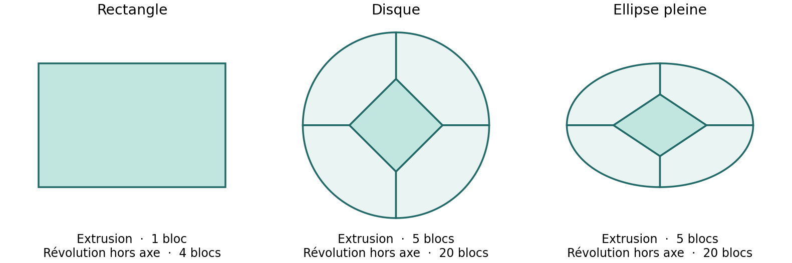

# De la primitive d’esquisse aux volumes NURBS

Le générateur choisit ses lignes de construction au moment où la primitive est créée. Il conserve ses travées de frontière, les jonctions prévues et le réseau homogène de chaque carte de section. L’opération choisit ensuite la direction et les travées du balayage. Les nombres ci-dessous désignent les cartes émises par ces conventions de la bibliothèque. Une seule courbe NURBS d’esquisse peut contenir plusieurs travées.

| Primitive remplie | Travées du contour | Jonctions géométriques | Cartes de section | Blocs pour une extrusion droite | Blocs pour un tour complet autour de Y |
|---|---:|---|---:|---:|---:|
| Rectangle | 4 droites de degré 1 | 4 coins G0 | 1 | 1 | 4 |
| Disque | 4 quarts rationnels de degré 2 | 4 raccords G2 ou plus | 5 | 5 | 20 |
| Ellipse pleine | 4 quarts rationnels de degré 2 | 4 raccords G2 ou plus | 5 | 5 | 20 |

Le nombre de surfaces NURBS sur la frontière est distinct du nombre de blocs de volume. Le rectangle extrudé a 6 faces de blocs exposées. Le disque et l’ellipse extrudés en ont 14 chacun : 4 parois latérales et 5 cartes sur chacun des deux plats. En révolution hors axe, les trois gabarits ont 16 faces exposées, une par paire travée de contour × quart de tour. Le tore possède ainsi 16 faces de frontière pour 20 blocs de matière.



Pour le disque, les lignes relient les quatre sommets d’un losange central situé à mi-rayon aux quatre points cardinaux du cercle. Le losange donne une carte centrale régulière et les quatre régions latérales relient ses côtés à la frontière. Le centre possède donc une carte de surface non dégénérée. L’ellipse utilise l’image affine du même découpage. Pour le rectangle les paramètres des deux côtés définissent directement la carte intérieure.

Chaque quart de cercle vient de la paramétrisation rationnelle exacte `(1−t², 2t)/(1+t²)`, de ses rotations et des changements de sens nécessaires pour accorder les poids aux raccords. Ces coefficients admettent une représentation entière en coordonnées homogènes. Le constructeur connaît les jonctions avant même de produire les contrôles de volume. Les essais vérifient indépendamment les jets sur les coefficients émis ainsi que les incidences et le signe du déterminant sur chaque cube fermé.

Sur le disque unité, chaque carte latérale a pour bord un côté du losange, deux segments radiaux et un quart de cercle. Cette frontière est simple et parcourt exactement une fois le bord du secteur correspondant. Avec un déterminant strictement positif, le degré topologique vaut un dans ce secteur : chaque point intérieur a un antécédent. Les quatre secteurs et le losange ont des intérieurs disjoints. Une translation et deux dilatations positives transportent cette partition à l’ellipse. La longueur positive de l’extrusion ou le rayon strictement positif de la révolution conserve la régularité sur chaque secteur angulaire.

Pour l’extrusion, une carte de section est prolongée sur toute la longueur positive. Pour la révolution, chaque carte est croisée avec quatre quarts de tour. L’axe est l’axe Y de l’esquisse et la coordonnée radiale doit rester strictement positive. Un disque décalé de l’axe donne ainsi un tore plein. Le passage ou le contact avec l’axe demande un autre gabarit à cause de la dégénérescence des coordonnées angulaires sur l’axe.

Les nombres du tableau s’appliquent à la primitive isolée remplie. L’enlèvement de cette primitive dans une pièce nécessite aussi les cartes de **matière autour du trou**. Pour deux enlèvements qui se croisent, les lignes induites dans chaque esquisse dépendent des positions relatives des deux profils et des directions d’extrusion. Le gabarit conserve ses jonctions d’origine, puis le préplanificateur ajoute les intersections nécessaires. [Prépartition des esquisses](prepartition-esquisse-nurbs.md)

L’API Rust est `Primitive::plan(operation)`. Le plan fournit `contour`, `junctions`, `section_patches` et `block_count()` avant toute construction 3D. `plan.build()` instancie le volume. Les dimensions de l’esquisse sont des rationnels à capacité vérifiée. [Code](../src/primitive_template.rs) · [Tests](../tests/primitive_template.rs)

Sur le témoin de longueur 3 mm ou de rayon de révolution au centroïde 6 mm, les six volumes intégrés à l’ordre de Gauss 12 concordent avec l’aire × longueur ou le théorème de Pappus à 5,66 × 10⁻¹⁵ en relatif au maximum. Le certificat de Bernstein établit un déterminant strictement positif sur les 55 blocs des six volumes. Les incidences mesurées sont de 0 et 4 interfaces pour le rectangle extrudé et tourné, de 8 et 52 pour le disque et pour l’ellipse.

## Rejouer le tore plein

La recette fournit le centre et le rayon du disque et demande un tour autour de Y. La commande de planification donne les 20 blocs attendus avant leur construction. [Recette du tore](../tests/references/primitive_circle_revolution.recipe.json) · [Six essais CLI](results/primitive-sweep-cli.json)

```sh
mkdir -p build/templates
cargo run --locked --offline -- plan-sketch tests/references/primitive_circle_revolution.recipe.json
cargo run --locked --offline -- build tests/references/primitive_circle_revolution.recipe.json build/templates/tore.json
cargo run --locked --offline -- audit build/templates/tore.json
cargo run --locked --offline -- export-step build/templates/tore.json build/templates/tore.step
```
