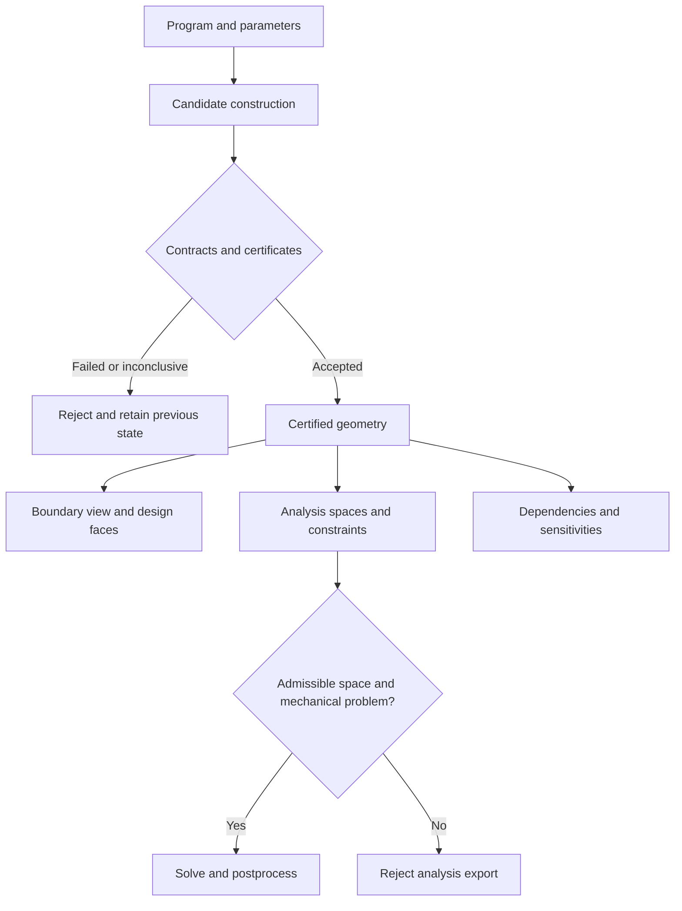

# Requirements for the partition-based trivariate geometry kernel

**Technical revision of 24 November 2026.**

The kernel constructs whole, untrimmed trivariate blocks with strong interblock coupling, validity certificates and an analysis interface. This specification defines the required guarantees and how to establish them. Performance and coverage must be measured on the stated test sets.

“Must”, “required” and “acceptance criterion” denote obligations. Research objectives and unqualified extensions are identified separately. Geometric representation, model validity and suitability for a particular analysis are three separate decisions.

## 1. Context and design hypothesis

The material domain is a finite assembly of injective, nondegenerate tensor-product B-spline or NURBS blocks. Each active block represents material over its entire parameter cube. Design operations construct and maintain these maps. The boundary representation and the analysis model are derived from the same assembly.

The first target is displacement-based three-dimensional linear elasticity in an $H^1$-conforming space. Adjacent blocks share degrees of freedom or impose strong constraints between nested trace spaces. This coupling requires no weak interface terms. The mechanical problem must still be well posed, with admissible materials and sufficient boundary conditions.

**Motivation.** A boundary representation alone does not supply an interior map suitable for volumetric IGA. The kernel retains this map as design data that can also carry material fields. The construction history constrains the possible decompositions. Where equivalent transformations are permitted, the final partition need not follow the order of the design operations.

**Related approaches**

| Approach | Contribution | Role in the project |
| --- | --- | --- |
| Immersed analysis | Analysis on a background grid with cut-cell integration and suitable formulations | Independent numerical reference |
| Trimmed trivariate V-rep | Volumetric modeling, internal fields and Boolean operations | Prior work on volumetric construction. The native output here is a union of whole blocks. |
| Conversion from a final B-rep | Segmentation and parameterization of existing geometry | Relevant prior work. General reconstruction from STEP lies outside the initial scope. |
| Volumetric untrimming | Tensor-product decomposition of a trimmed domain, including for integration | An integration map may be singular. A map used as native geometry must satisfy every kernel invariant. |

Section 21 lists the sources and their limits. The choice of native representation makes no general claim about the numerical accuracy of alternative methods.

**Construction.** On an affine planar host, sketch contours and compatible operations define an arrangement. The compiler partitions it into parameterizable cells and applies the supported operators to build the blocks. It distinguishes material boundaries from internal partition lines. An edit may require rebuilding the partition. Locality must be demonstrated or measured.

**Research hypothesis.** Maintaining valid volumetric geometry throughout design may reduce the cost and ambiguity of analysis and subsequent edits while providing usable sensitivities. Sections 18 and 19 specify admissible families, certificates and decision criteria. Coverage and performance claims apply only within the tested scope.

## 2. Objectives, scope and exclusions

The first deliverable pairs a displacement-based 3D linear elasticity solver with a prismatic kernel that represents a declared family of sections and operations exactly. Measure coverage on a corpus fixed before testing.

| ID | Objective | Acceptance evidence |
| --- | --- | --- |
| O1 | Represent the material volume | Whole, injective, nondegenerate trivariate blocks with strong $C^0$ coupling of the analysis spaces |
| O2 | Construct and edit parts | Sketching, partitioning, extrusion, holes, pockets, patterns, fillets and chamfers in declared families. Qualify extensions one operator at a time. |
| O3 | Establish validity | Jacobian certificates, injectivity and partition proofs, structural watertightness, consistent incidences and constraints |
| O4 | Support local edits | Invalidate by dependency, reuse unchanged data and measure reconstruction. Track domain, representation and validity events separately. |
| O5 | Provide sensitivities | Complete derivatives of the required geometric and algebraic data within a declared regular regime |
| O6 | Prepare analysis | Export compatible spaces, constraints, Dirichlet lifts and subface groups linked to design faces |
| O7 | Demonstrate the workflow | Build, edit and analyze a 2.5D corpus. Compare reference workflows at prescribed accuracy. |

**Representation contracts.** Each accepted geometry must satisfy the geometric invariants in Section 4. Export for analysis also requires a suitable field space and an admissible mechanical problem.

| Result | Guarantee |
| --- | --- |
| `EXACT_REPRESENTATION` | No geometric fitting or model approximation. Quantify numerical errors in construction and predicates. Exact representation does not imply symbolic equality of all stored coefficients. |
| `APPROX_ESTIMATED` | Report the observed error, sampling domain and density. The result carries no global error bound. |
| `APPROX_CERTIFIED` | A verified global bound in the declared metric is at most the requested tolerance. |
| Rejection | A precondition failed, the configuration is unsupported, the budget was exhausted or the proof was inconclusive. Preserve the last valid state. |

A request for guaranteed accuracy may accept exact representation within its numerical budget or a certified approximation. An estimated approximation is exploratory. Compose the contracts of every operand and approximation in a composite construction.

| Phase | Scope |
| --- | --- |
| 1. Prismatic families | Segment and arc profiles covered by a template, admissible sketch constraints, extrusion, parallel bores and pockets, patterns, longitudinal fillets and chamfers with a validated metric construction, and 3D linear elasticity. Admit NURBS only in qualified subfamilies with an explicit representation contract. |
| 2. Edits and sensitivities | Representation branches, events and differentiability conditions. Differentiate control points and weights or homogeneous coordinates, constraints and lifts. Provide adjoint sensitivities. |
| 3. Targeted 3D extensions | Revolutions with classified axis contacts, oblique bores in planar walls, bosses and end fillets with validated regular volume maps throughout their neighborhoods. |
| 4. Research extensions | Sweeps, lofts, approximate free-form Booleans, intersecting fillets, partial import of real feature histories and separately validated mechanical formulations. |

Section 7.3 also specifies the qualified FieldCraft extension for transverse bores in two perpendicular arms.

An operator needs an admissible domain, a construction, compatible interfaces and a certification procedure. Exact representation of its input curves does not establish those properties. Milestones J1 and J2 govern phase 1, J3 governs use of gradients, and J4 governs coverage and performance claims (Section 19).

**Exclusions.** The initial model excludes trimmed material cells, including automatic fallback, and blocks with a collapsed edge or face or a zero Jacobian on a closed Bézier element. At low-continuity knot lines, check the appropriate one-sided derivatives. The target displacement space is $H^1$-conforming. Global $C^1$ continuity and general weak mortar or Nitsche coupling are outside this contract. Exclude tips, cusps, lower-dimensional contacts and nonmanifold configurations that violate the material-domain invariants. Adding a core block does not make an exact cone tip admissible.

A complete interactive modeler, exhaustive proprietary format import, and general reconstruction from a B-rep or images are outside the initial scope. Large deformation and near-incompressibility require separate formulations and validation. An edit that changes the part to make it admissible, such as rounding a tip, requires explicit authorization and an approximation contract.

## 3. Glossary

| Term | Definition |
| --- | --- |
| Block (`Block`) | An injective, untrimmed tensor-product B-spline or NURBS map $X:[0,1]^3\to\mathbb R^3$. In an active block, the entire cube represents material. Certify a strictly positive Jacobian lower bound on every element, including the relevant one-sided limits. |
| Section cell (`Cell2D`) | A four-sided region of a sketch partition, the full image of $[0,1]^2$ under a regular map. |
| Host | Reference map $S$ carrying a face or volume. A planar sketch has an affine host. Blocks derived from it still need certification. |
| Partition | A covering by whole regular cells with disjoint interiors and recorded interfaces. Arrangement curves and surfaces guide the subdivision. |
| Reparameterization | A map $\varphi_c:[0,1]^2\to c$ onto a cell in host parameter space. Its geometric patch is $S\circ\varphi_c$. |
| Required cut | A curve or surface that must appear on a cell boundary, such as a hole wall, pocket floor or sketch profile. |
| Structural cut | An additional separator that makes a regular partition possible, such as a spoke of an O-grid. |
| Template | A partition rule with verifiable preconditions, geometry, incidences and interfaces. |
| O-grid | A ring of blocks around a hole or a central region. Its template defines the sectors and their interfaces. |
| Core block | A central block that avoids the polar collapse of a disk or a solid of revolution containing its axis. |
| Parametric side (`BlockSide`) | Restriction of $X$ to one of the cube's six faces. A side may carry several topological faces, including both exposed and interior regions. |
| Topological face (`TopologicalFace`) | A whole subface of one or two block sides in their common rectangular subdivision. One material incidence identifies a boundary face and two identify an interior face. Its edges can also be subdivided. |
| Design face (`DesignFace`) | A named semantic group of boundary faces, such as the wall of hole H7. It carries provenance and boundary-condition selections. |
| Canonical trace | The shared interface definition, including parameterization, degrees, knots, weights and exact restriction or refinement relationships. |
| Matching interface | Both geometric traces coincide after reorientation and weight normalization. Direct identification of analysis coefficients also requires identical analysis trace spaces. |
| Nested interface | The restricted master trace space is contained exactly in the slave space on the interface subrectangle. Check degrees, multiplicities, parameterizations and rational denominators before constructing strong linear constraints. |
| Cell complex (`CellComplex`) | Blocks, sides, topological faces, edges and vertices with oriented incidences, interfaces, states and provenance. The active complex represents the material domain. |
| Homogeneous control point | For $P_A$ of weight $w_A>0$, the vector $H_A=(w_AP_A,w_A)$. Knot insertion and degree elevation act linearly on these vectors. |
| Analysis space | Field space over the blocks with compatible traces. The default exact refinement of the geometry basis reproduces physical coordinates, affine fields and rigid-body modes. |
| Representation contract | The exact, estimated or certified geometric status defined in Section 2. Model validity requires separate evidence. |
| Rejection | A documented failure to satisfy the contract or preconditions of an operation. Preserve the last valid state. |
| Jacobian certificate | A proof of $\det DX\ge J_{\min}>0$ on each element, with one-sided limits at low-continuity knots. Injectivity and partition require additional evidence. |
| Topological singularity | An interior vertex of a quadrilateral partition with valence other than four, or the corresponding 3D edge. Every incident block still needs a regular map. |
| Corner assignment $k$ | Number of cells incident at a boundary corner. Its angle $\alpha$, admissible templates and quality target constrain this choice. |
| Topological branch | A connected parameter region with unchanged material connectivity, tunnels, cavities and relevant adjacencies, independently of structural cuts. |
| Representation branch | A regime with fixed structural cells and incidences, templates, assignments, master sides, degrees, knots and parametric subrectangles. |
| Regular differential regime | The part of a branch where implicit constructions, active sets, constraint ranks and analysis data satisfy the hypotheses for the reported derivatives. |
| Event | A change in physical state, topology, representation or differential regime. Report its nature and the guarantees affected. |
| Inactive block | A block retained for construction or provenance and excluded from the material domain, active topology and mechanical assembly. |
| Design program | The graph of parameters, sketches, features, selections and dependencies that defines a part and its variants. |

## 4. Design principles and invariants

Every geometric transaction must satisfy the geometric invariants below. Failure preserves the previous assembly. Analysis export also requires the analysis clauses of INV-4, INV-9 and INV-10.

| ID | Requirement | Evidence |
| --- | --- | --- |
| INV-1 | The material domain is exactly the union of whole active block images. | Check block classification and the absence of material trims. |
| INV-2 | On each closed Bézier element, $\det DX\ge J_{\min}>0$. | Use a polynomial or rational certificate with bounded rounding error. Include denominators, scale changes and one-sided derivatives (Section 12). |
| INV-3 | Blocks are individually injective. Their interiors are disjoint and their contacts agree with the declared incidences. | Prove the partition by construction or certify intersection and containment. Check boundary injectivity. |
| INV-4 | Strong field continuity agrees with the geometry, including at shared edges and vertices. | Check trace inclusion, weights, multiplicities, global constraint rank and reproduction of the required fields (Section 10). |
| INV-5 | Incident blocks use the same canonical interface geometry. | Derive both sides from a common entity or its homogeneous restrictions. Bound evaluation error and check cached coefficients. |
| INV-6 | Record representation status and validity evidence independently. | Apply the contracts in Section 2 and record approximations and reasons for rejection. |
| INV-7 | Each exposed subface belongs to an explicit design face or group. Every entity has provenance. | Check selections for completeness after a split, merge or deletion. |
| INV-8 | The program, parameters, options, version and numerical environment determine reproducible results. | Use deterministic ordering, record random seeds and test reconstruction. |
| INV-9 | Demonstrate compatibility between geometry and analysis spaces. | Use an exact reference refinement. Reproduce physical coordinates and rigid modes while satisfying trace constraints. |
| INV-10 | The initial analysis uses an $H^1$-conforming Galerkin formulation with strong coupling on full material cells. | Verify the field space, strong Dirichlet lift, quadrature and well-posedness. |

A positive Jacobian establishes local regularity. Global injectivity and disjointness need separate proofs. Quality indicators quantify distortion and potential analysis cost even on a valid block.

1. Build the interior on every operation. Construct and validate candidate maps before committing. Measure the neighborhood affected by an edit.
2. Batch compatible operations only when design semantics, dependencies, intermediate face selections and fillet order are preserved. Compute the arrangement, intersections and events.
3. Distinguish required material boundaries from structural separators. Record structural choices so that they can evolve.
4. Reject an unproved guarantee. Keep a rejected mandatory test in the coverage denominator.
5. Qualify each family on its declared domain. Start with affine hosts and exactly representable boundaries. Identify exact, approximate and out-of-scope cases before testing.
6. Track material topology, representation and differentiability separately. Fixed discrete choices still require rank, transversality and regularity checks.
7. Attach boundary conditions to topological selections. Propagate changes in exposure to subfaces and trace spaces. Report ambiguous selections rather than silently transferring them.

## 5. Representation layers

The design program generates a geometric assembly. That assembly defines the material domain and is the common source for the boundary view and analysis model.



| Layer | Contents and responsibility |
| --- | --- |
| Design program | Parameters, sketches, operations, selections and dependencies define each part and its variants. Grouped compilation must preserve their semantics. |
| Geometric assembly | Blocks, sides, subfaces, edges, vertices, interfaces, certificates and provenance constitute the native material domain. |
| Boundary view | Oriented external subfaces and design-face groups support selection, visualization and boundary export. Preserve incompatible surfaces as distinct entities. |
| Analysis model | Refined spaces, trace operators, constraint elimination, lifts, quadrature, materials and boundary conditions define a conforming discretization and its discrete sensitivities. |

| Module | Responsibility | Sections |
| --- | --- | --- |
| Sketch solver | Solve constraints on a declared branch, detect rank deficiencies and preserve analytic curve types and the numerical error budget. | 7, 14 |
| Planar arrangement | Compute robust intersections, classify regions and derive axial levels and required cuts. | 7, 13 |
| Partition planner | Choose admissible templates and structural cuts, bound combinatorial search and revise the partition as needed. | 7 |
| Reparameterization | Construct maps with prescribed boundaries, improve quality, check feasibility and certify. | 7, 11, 12 |
| Volume operators | Construct extrusions, layers, qualified revolutions, holes and fillet neighborhoods. | 8, 9 |
| Interfaces and traces | Derive parameter correspondences, compatible weights, subfaces, global constraints and essential boundary conditions. | 6, 10, 15 |
| Certification | Verify regularity, injectivity, coverage, watertightness and any promised error bound. | 11, 12 |
| Parameter management | Track dependencies, signatures and events. Compute geometric and algebraic derivatives. | 14 |
| Export | Produce native geometry, the analysis package, the STEP boundary and the validity report. | 15, 16 |

Invalidate dependencies from the actual changes. Measure advance compilation and incremental updates separately. Reuse a certificate only while its hypotheses and the coefficients on which it depends remain unchanged.

## 6. Data model

Keep parametric blocks, their topological subdivision and semantic design groups distinct. A radial-edge structure can record the multiple incidences needed during construction. Accepted material still has to meet the partition, neighborhood and regularity requirements in Section 12.

**6.1 Topology.** Each block has six parametric sides. Overlay the interface subrectangles, exposed portions and boundary selections to subdivide each side into topological faces. This subdivision retains every material point. Each face occupies a whole rectangle on the reference side and has an oriented incidence on each participating material side. Build the common subdivision of edges and vertices across all sides, including T-junctions. A face with four parametric sides may have more than four topological edges.

After every operation, verify the following properties.

- Topological faces cover each active side with disjoint interiors.
- An interior face has two oppositely oriented material incidences. A boundary face has one.
- All faces meeting at an edge or vertex agree on its incidences.
- The local neighborhoods meet the declared material-domain conditions. Edge-only or vertex-only contact does not establish a mechanical connection.
- Inactive blocks are excluded from the domain, its topological counts and the mechanical assembly.

Apply the Euler check to the subdivided active complex:

$$
V-E+F-C=\chi=\beta_0-\beta_1+\beta_2,
$$

where $C$ counts active blocks and the Betti numbers describe the bounded material domain. A contractible part has $\chi=1$ and a solid torus has $\chi=0$. Count enclosed cavities as well. Euler counts alone do not establish local manifold structure, injectivity or absence of overlaps. Each phase 1 template must provide reference incidences and checks, including at T-junctions.

**6.2 Geometry and status.**

| Entity | Required data |
| --- | --- |
| Block | Degrees $(p,q,r)$, open knot vectors, points $P_A$ and weights $w_A>0$ or homogeneous controls $H_A$, six sides, activity, representation contract, validity certificates, quality indicators, origin and update state |
| Parametric side | Incident block, fixed axis and endpoint 0 or 1, full tensor-product trace, list of faces, local orientation and any canonical trace |
| Topological face | Reference subrectangle, affine maps to incident sides, oriented edges and geometry by restriction. Record boundary or interior status, material incidences and the design group for an exposed face. |
| Edge and vertex | Common restrictions, positions, oriented incidences, explicit hanging subdivisions, provenance, design-corner status, valence and any topological singularity |
| Canonical trace | Degrees, knots, normalized weights, reference homogeneous coefficients and exact restriction or refinement relations. Bound errors in derived numerical representations. |
| Interface | Sides, faces, orientations, subrectangles, homogeneous geometry operator $A_g$, Euclidean geometry operator $T_g$ and analysis operator $T_a$ where distinct. Record geometric and analysis types, master selection, inclusion, consistency and rank checks. |
| Design face | Group of boundary faces, stable identity, semantic selection, provenance and rules for transferring boundary conditions |
| Analysis space | Degrees, knots, weights, numbering, exact refinement operator from the geometry or equivalent reproduction proof, version, refinement rules, affine-field and rigid-mode checks |
| Analysis model | Per-block spaces, global constraints $B_{\mathrm{int}}u=0$, nullspace parameterization $C_I$, trace operators and reduction with boundary conditions. Include rank, material groups, loads, quadrature, signatures and sensitivity status. |
| Construction record | Host $S$, maps $\varphi_c$, layer intervals, template, corner assignments, canonical relations, preconditions, guards, dependencies, discrete choices and event history |

Represent unit weights explicitly or document the convention. Adjacent sides derive from the canonical trace and refinement relations. Floating-point coefficient arrays are controlled representations of this common definition. Store units, tolerances, methods, measurements and bounds with the representation contract. Every accepted status requires validity evidence. A failed transaction leaves the previous assembly available.

**6.3 Provenance and dependencies.** Record each block's generating operation and each exterior face's design face. Track how parameters affect homogeneous controls, analysis spaces, constraints and boundary data. Supply $dP/d\theta$ and $dw/d\theta$, or $dH/d\theta$, and the needed operator derivatives. Retain three signatures for material topology, representation and regular differential regime (Section 14). Equality of combinatorial signatures alone does not establish differentiability. Record the assumptions, regime and guards of every derivative.

**6.4 Serialization.** The versioned native format stores topology, canonical relations and metadata in JSON. Binary arrays, for example HDF5 or NPZ, can carry coefficients and sparse matrices. Use deterministic entity order. Preserve all three face levels, weight normalization, interface parameter maps, contracts, validity evidence and signatures. Specify a migration policy. Reloading must reproduce the incidences, constraints and geometry without a tolerance-based reclassification.

**6.5 Illustrative API.** The types below specify responsibilities. Canonical definitions take precedence over cached coefficients.

```python
@dataclass
class Block:
    geometry: TensorSplineMap      # degrees, knots, homogeneous coefficients
    sides: tuple[BlockSideId, ...] # exactly six parametric sides
    active: bool
    representation: RepresentationContract
    validity: ValidityReport
    origin: OperationId

@dataclass
class BlockSide:
    block: BlockId
    axis: int
    end: int                       # 0 or 1
    faces: list[TopologicalFaceId]
    canonical_trace: TraceId | None

@dataclass
class SideIncidence:
    side: BlockSideId
    rectangle: ParametricRect
    parameter_map: AxisAffineMap  # includes permutation and reversal
    orientation: int

@dataclass
class TopologicalFace:
    incidences: list[SideIncidence] # one boundary, two interior
    oriented_edges: list[EdgeUse]
    design_face: DesignFaceId | None

@dataclass
class DesignFace:
    boundary_faces: list[TopologicalFaceId]
    semantic_name: str
    origin: OperationId

@dataclass
class TraceRelation:
    master: BlockSideId
    slave: BlockSideId
    parameter_map: AxisAffineMap
    geometry_refinement: HomogeneousRefinement
    analysis_constraint: SparseOperator
    verification: TraceCompatibilityReport

@dataclass
class AnalysisModel:
    spaces: dict[BlockId, AnalysisSpace]
    interface_constraints: SparseOperator  # B_int
    interface_reduction: SparseOperator    # C_I
    boundary_data: BoundaryData
    reduction: ReducedSystemMap | None    # u = C * u_free + u_D
    sensitivities: SensitivityBundle | None

class CellComplex:
    def apply(self, op: Operation) -> Result:
        # Ok(new_valid_complex) or Refused(reason); atomic commit
        ...
    def signatures(self) -> SignatureBundle: ...
    def certify(self) -> ValidityReport: ...
    def make_analysis(self, spec: AnalysisSpec) -> Result: ...
```

## 7. Sketches and planar partitioning

For a planar sketch, the host map is affine: a partition of the parametric domain is carried exactly into the physical plane. The construction produces four-sided cells with regular maps over their closed domains. A combinatorially admissible partition is accepted only after geometric certification.

**7.1 Input.** A sketch is a set of curves—segments, quadratic rational arcs, or NURBS—with geometric and dimensional constraints solved by a sketch solver. It defines oriented closed profiles: the outer contour is counterclockwise and holes are clockwise. Curves must be regular on every portion used. A continuous but non-G1 junction is a corner; a regular G1 junction is not. Cusps, tangent reversals, and contacts between contours are classified separately.

Phase 1 covers an explicit family of segment and arc profiles, with templates and stated preconditions. NURBS profiles are a qualified extension: retaining them without adjustment permits an exact representation contract when the full construction justifies it; otherwise, the approximation contract in Section 11 applies. No general coverage guarantee for NURBS sketches is claimed.

**7.2 Host map.** Choose an oriented orthonormal frame in the sketch plane, with $\mathbf n=\mathbf e_1\times\mathbf e_2$:

$$
S(u,v)=O+u\,\mathbf e_1+v\,\mathbf e_2,
\qquad (u,v)\in[0,L_1]\times[0,L_2].
$$

The composition $S\circ\varphi_c$ does not increase the degree of $\varphi_c$. If another affine frame is used, its metric and area factor are retained explicitly; physical distances, radii, and thresholds are not evaluated as though that frame were orthonormal.

**7.3 Anticipatory arrangement.** Overlay the sketch profiles with profiles of later operations that can be mapped into this plane and share the same extrusion direction: through-holes, pockets, patterns, and eligible longitudinal fillets. The arrangement edges define the imposed cuts. Each region retains the list and order of the features covering it; its material occupancy is determined by axial intervals as specified in Section 8.2. A single “pocket depth $d$” label is not sufficient for overlapping pockets or pockets cut from opposite sides.

**Qualified multi-host extension.** The single extrusion direction above applies to one planar arrangement. In the FieldCraft bracket family, the L-shaped stock is extruded once, and each transverse bore is defined in a separate local frame on its arm. The builder partitions the two pierced arm sections, extrudes each across its wall thickness and joins their full planar traces to the bend. Its qualification requires regular maps on each closed block, matching oriented interfaces, an independent material-volume check and a replayable construction plan. The phase 1 row in Section 2 describes the initial single-host scope. This bracket qualifies one additional multi-host construction; arbitrary combinations of skew features still require their own contracts. [Builder and verification](results/fieldcraft-compact.md)

- For segments and arcs in the exact family, curves remain in their analytical representation. Intersections, including those with algebraic coordinates, are isolated and their incidence is certified. “Exact representation” does not mean every calculation is exact in floating-point arithmetic.
- For NURBS, the kernel distinguishes exact retention of restricted curves from adjustments needed to assemble them. Any adjustment that moves a curve, vertex, or interface contributes to the geometric error budget. A numerically solved intersection is not automatically exact.
- Orientation, incidence, intersection count, and classification decisions use robust predicates or certified root isolation. An unresolved ambiguity must not be silently treated as coincidence.
- Shared curves and their endpoints use a shared canonical representation. The difference between computed geometry and design geometry is accounted for separately from this internal identity.

**7.4 Corner assignments.** For an interior angle $\alpha$, initialization proposes $k=\operatorname{round}(\alpha/90^\circ)$, clamped to the range 1 through 4. A vertex introduced on a smooth edge defaults to $k=2$. This is a heuristic; it must be validated globally against partition constraints and the count in Section 7.5.

Each cell sector at a corner must have an angle strictly between $0$ and $180^\circ$, regular tangents, and a margin compatible with the Jacobian certificate. The effective thresholds at which $k$ changes are $135^\circ$, $225^\circ$, and $315^\circ$; the nominal $45^\circ$ threshold does not change the value after enforcing $k\ge1$. Choices near a threshold are recorded in the combinatorial signature. Construction is refused below the admissible angle $\alpha_{\min}$ or when no compatible assignment exists.

**7.5 Counting formula.** For a conforming quadrangulation, let $d_v$ be the number of edges incident to an interior vertex, $k_v$ the number of incident cells at a boundary vertex, and $\chi=\text{components}-\text{holes}$:

$$
\sum_{v\in\mathcal V_{\mathrm{int}}}(4-d_v)
=4\chi-\sum_{v\in\mathcal V_{\mathrm{boundary}}}(2-k_v).
$$

This identity helps budget valences, check a partition, and characterize certain combinatorial events. It is necessary, but does not prove that an admissible geometric partition exists or that it is good. The parity of the total number of boundary edges and the other incidences in the complex must also be checked.

| Region | $\chi$ | Boundary assignment | Interior charge | Example partition |
| --- | --- | --- | --- | --- |
| Rectangle | 1 | 4 corners with $k=1$ | 0 | 1 cell |
| Disk | 1 | Smooth boundary | $+4$ | 5 cells: a core and 4 side cells, with 4 interior vertices of valence 3 |
| L shape | 1 | 5 corners with $k=1$, 1 re-entrant corner with $k=3$ | 0 | 3 conforming cells; 2 macro-cells possible with a nested interface |
| Perforated rectangle, admissible template | 0 | 4 corners split with $k=2$, 45° sectors | 0 | 4-cell O-grid |
| Perforated rectangle, right angles preserved | 0 | 4 corners with $k=1$ | $-4$ | 12 cells: a 3×3 grid with an O-grid replacing the center cell, and 4 interior vertices of valence 5 |

The table describes templates subject to their placement and clearance conditions. A valence-3 or valence-5 “singularity” is combinatorial; it never permits a zero Jacobian in an incident map.

For T-junctions, construct the conforming topological graph by subdividing edges at incidences. A geometric macro-cell may then have a topological boundary with $n_f$ sides without changing its tensor-product map. For simply connected topological cells and simple boundary components, check:

$$
\sum_{v\in\mathcal V_{\mathrm{int}}}(4-d_v)
+\sum_{v\in\mathcal V_{\mathrm{boundary}}}(3-d_v)
=4\chi+\sum_f(n_f-4).
$$

The degrees and side counts refer to the same conformized graph. Do not mix macro-cell parametric sides with the topological subentities of Section 6.

The disk illustrates the non-degeneracy constraint: a single regular map of a square cannot map all four corners to an everywhere-smooth boundary while keeping a strictly positive Jacobian through the boundary. The perforated plate shows that the valence budget depends on the angles assigned to cells.

**7.6 Partition generation.**

1. **Phase 1 templates.** Rectangle, disk with a core, annulus, L, T, U, a hole in a rectangle, and a row of holes. Each template specifies its parameter domain, clearance margins, interfaces, and certification method. Juxtaposed templates must themselves be validated.
2. **General method, under research.** Cross fields and separators, or combinatorial optimization. The objective combines cell count, corner distortion, cell sizes, and interface compatibility. No universal success is assumed.
3. **Common rules.** Each material region in the arrangement is a union of complete cells; no cell crosses an imposed cut. A T-junction is admitted only with a nested interface meeting the contract in Section 10. Every cell must have a Jordan boundary and corners differentially compatible with a regular square map.

**7.7 Reparameterization $\varphi_c$.**

- **Boundaries.** The four sides come from canonical arrangement curves. They retain either their exact representation geometry or their approximation contract. Neighboring cells share a parameterization, or a restriction compatible with their nested interface. Degrees, knots, and rational weights are accounted for.
- **Initialization.** Coons interpolation supplies a candidate, without guaranteeing bijectivity. For compatible sides $c_0,c_1,d_0,d_1$ and corners $p_{ij}$:

$$
\begin{aligned}
\varphi(s,t)={}&(1-t)c_0(s)+t c_1(s)+(1-s)d_0(t)+s d_1(t)\\
&-\big[(1-s)(1-t)p_{00}+s(1-t)p_{10}+(1-s)t p_{01}+st p_{11}\big].
\end{aligned}
$$

- **Improvement.** The kernel may seek a harmonic map, use a Winslow formulation, or minimize a distortion energy. Degree, refinement, and cost limits are explicit. Boundaries remain fixed during interior optimization; changing them is a coordinated operation with neighboring cells and requires a new geometric contract.
- **Scope of the harmonic result.** Given a homeomorphic correspondence of the boundaries, the Radó–Kneser–Choquet theorem gives a harmonic map from a Jordan domain to a convex target that is a diffeomorphism in the interior. It does not by itself give a uniform positive Jacobian bound on the closed domain, nor a bounded-degree spline map that reproduces the boundaries exactly. See Hinz and Buffa (2024), Section 21.
- **Acceptance.** Each candidate must pass the certificates in Section 12. If it fails, the kernel may refine, raise degree, change the partition, or refuse. Adding knots is not guaranteed to suffice without adding cells.
- **Degree.** Spaces must represent the required boundaries and interfaces. For rational boundaries, common-denominator construction and Coons interpolation may raise degree; the policy in Section 11 applies.

**7.8 Outputs.** Cells; certified maps $\varphi_c$; topological adjacencies and subentities; interfaces; corner assignments; accuracy contracts; and provenance. After extrusion, each design-curve segment generates one or more faces tied to the same design intent.

**7.9 Grounds for refusal.** Self-intersecting profile; unsupported or non-regular cusp or curve; ligament outside the admissible domain; corner incompatible with prescribed margins; uncertified incidence or intersection; no applicable template; incompatible interface; degree or cell budget exceeded; or required Jacobian, injectivity, or geometric error bound not certified. Refusal never permits a trimmed or degenerate output.

## 8. Volumetric operators and their contracts

Each operator specifies its preconditions, construction, geometric contract, and grounds for refusal. Phase 1 targets exact representation for validated families of segments, arcs, and templates; it does not cover every sketch or configuration. An exact operation applied to an already approximated input does not remove inherited error.

The statuses `EXACT_REPRESENTATION`, `APPROX_ESTIMATED`, and `APPROX_CERTIFIED` follow Section 11. All require complete untrimmed blocks, certified non-degeneracy, and valid assembly. Refusal is a separate result and does not change the current valid state.

| Operator | Phase | Construction | Contract covered | Main preconditions or grounds for refusal |
| --- | --- | --- | --- | --- |
| Normal extrusion | 1 | Section cells × axial interval | `EXACT_REPRESENTATION` for an exact section | Positive height; transverse direction; certified section and interfaces |
| Parallel through-hole | 1 | Cut imposed in the 2D arrangement | Exact for supported templates | Ligaments and exits within the admissible domain |
| Parallel blind pocket | 1 | Axial-layer occupancy and nested interfaces | Exact for supported templates | Admissible depth; zero-depth or through-depth event has explicit semantics |
| Linear or circular pattern | 1 | Duplicate profiles in the arrangement | Exact for supported transformations and profiles | Contacts and interference covered by a template; cell count within budget |
| Longitudinal fillet or chamfer | 1 | Metric section construction, then extrusion | Exact for the first normal-extrusion template | Section 9 conditions; oblique case requires its own template |
| Revolution | 3 | Off-axis profile × rational sectors; separate templates at axis contact | Exact for certified regular families | Unsupported axis contact, including an exact cone tip, is refused |
| Oblique hole in a planar wall | 3 | Axis-oriented annulus and transition blocks | Exact for fully constructed and certified templates | Two transverse planar exits, sufficient clearance, compatible transitions |
| Boss or non-coaxial union | 3 | Anticipatory partition | Exact in specific cases; qualified approximation in general | Intersections, partition, and interfaces must be certifiable |
| Mirror | 1 | Block symmetry and reversal of a parametric direction | Preserve the input contract | Update orientations and provenance |
| Drafted extrusion | 4 | Variable sections under an explicit metric definition | Exact for some analytical families; qualified approximation otherwise | Representable offsets and transitions; no section disappearance |
| Sweep | 4 | Transport cells with a minimum-rotation frame | Family-specific contract, usually approximated | Local regularity and certified absence of global collision |
| Loft | 4 | Partition correspondence, then interpolation or adjustment | Construction-specific contract | Compatible correspondence and certified injectivity |
| General Boolean | 4 | Construction in Section 13 | Qualified approximation in general | Supported configuration; budget and certificates respected |

**8.1 Normal extrusion.** For a section cell $c$, extrusion length $h>0$, and unit direction $\mathbf d$:

$$
X_c(u,v,w)=S\big(\varphi_c(u,v)\big)+h\,w\,\mathbf d.
$$

In the general affine frame $S(u,v)=O+u\mathbf e_1+v\mathbf e_2$:

$$
\det DX_c
=h\,\det D\varphi_c\,(\mathbf e_1\times\mathbf e_2)\cdot\mathbf d.
$$

In the oriented orthonormal frame of Section 7.2, the final factor is $\mathbf n\cdot\mathbf d$. Require a positive lower bound for this factor and the prescribed volumetric Jacobian margin. With these bounds, 2D certification of $\varphi_c$ suffices for local block non-degeneracy; the section partition and axial intervals provide the corresponding assembly certificate.

The degree in $w$ is 1; degree elevation for analysis does not change the geometry. Normal extrusion is the first template. Oblique extrusion is still an exact geometric construction, but $h$ is not the thickness measured along $\mathbf n$; that thickness is $h\,\mathbf n\cdot\mathbf d$. An oblique metric fillet is not obtained by simply extruding a same-radius arc in the sketch plane.

**8.2 Axial layers.** For each section cell, the levels of the features covering it define axial intervals. Evaluate occupancy on each interval in operation order and with the specified references. This handles overlapping pockets, cuts from opposite faces, and unions of different heights.

If $n_c^{\mathrm{act}}$ denotes the number of retained material intervals after permitted grouping:

$$
N_{\mathrm{active\ blocks}}=\sum_c n_c^{\mathrm{act}}.
$$

Count any inactive blocks separately. Do not merge levels and interfaces required by design loads, materials, or references unless their semantics are preserved.

Adjacent block stacks may be connected by nested interfaces when their face restrictions and trace spaces satisfy Section 10. A stack with fewer layers is not automatically a valid master: the partitions must actually be compatible. Otherwise, introduce a local common subdivision or refuse.

A partially covered parametric face is split into rectangular topological subfaces: some are internal and others form the pocket wall. The split lines must be compatible with traces and their integration. This never means cutting active material out of the interior of a block.

**8.3 Reduction of coaxial Booleans to 2D.** More generally, this reduction applies to extrusions in the same direction and expressed in the same transverse frame. For sections $A,B$ and axial intervals $I,J$:

$$
\begin{aligned}
(A\times I)\setminus(B\times J)&=(A\setminus B)\times I,
&&\text{if }I\subseteq J,\\
(A\times I)\cap(B\times J)&=(A\cap B)\times(I\cap J).
\end{aligned}
$$

When $I=J$, all three operations, including union, reduce to one section operation followed by extrusion over $I$. The inclusion $I\subseteq J$ alone is not enough to reduce union to one extrusion of $A\cup B$.

For different intervals, stratify the axis at all interval endpoints and apply the 2D operation on each stratum. These identities describe occupancy; boundaries follow the regularized-Boolean convention in Section 13.

**8.4 Revolution.** Away from the axis, rotate profile cells using rational circular sectors of at most $90^\circ$ in the first template. The geometric angle is not assumed to vary affinely with the rational parameter.

Let $(r(u,v),z(u,v))$ be the profile coordinates and $(c(t),s(t))$ a rational arc of the positively oriented unit circle. With parametric coordinate order $(u,t,v)$:

$$
X(u,t,v)=\big(r(u,v)c(t),\,r(u,v)s(t),\,z(u,v)\big),
$$

$$
\det D_{(u,t,v)}X
=r\,\det D_{(u,v)}(r,z)\,\big(c\,s'-s\,c'\big).
$$

The final factor is the derivative of the geometric angle. The certificate requires strictly positive lower bounds for $r$, the profile Jacobian, and this factor, with the stated orientations.

Axis contacts require a different volumetric partition: a Cartesian core with peripheral blocks for validated families, such as a solid cylinder. It is not enough to revolve a cell that reaches $r=0$. Geometrically regular poles may require dedicated 3D templates.

An exact cone tip or essential cusp is not admitted under the contract of regular rational maps on the closed domain: the boundary singularity forces degeneration of any face covering a sector up to the tip. The kernel refuses this exact contract. Regularized geometry is possible only as an explicitly identified approximation with its own error and certificates. A profile crossing the axis or an unclassified contact is also refused.

**8.5 Oblique hole.** The first template covers a cylindrical hole opening onto two planar faces transverse to its axis, away from edges, fillets, and other features. The intersections are then ellipses, possibly circles, and are rationally representable. This alone does not guarantee that transition blocks can be constructed.

In a frame aligned with axis $\mathbf d$, a regular planar annulus $q(u,v)$ can be extended between the two planes by:

$$
X(u,v,w)=q(u,v)+
\big[(1-w)z_a(q(u,v))+w z_b(q(u,v))\big]\mathbf d,
$$

where $q$ lies in the transverse plane and $z_a,z_b$ are the affine heights of the two faces. A positive lower bound on $z_b-z_a$, together with regularity of $q$, certifies this local extension. Blocks connecting the annulus to the rest of the part require their own template, trace contract, and certificates.

Accept the template only after validating the complete assembly. A nearly tangential axis, insufficient clearance, an exit through a fillet, incompatible transition, or indeterminate certificate results in refusal or an explicit choice of another family.

**8.6 Common specification for every operator.** Named inputs and parameters; admissible domain and margins; exact operation semantics; imposed cuts; discrete templates and choices; blocks created, rebuilt, or disabled; updated subentities and interfaces; provenance; dependencies and derivatives of geometric data, weights, and constraints under Section 14; error status and budget; required certificates; maximum costs; and refusal reason.

Validation precedes publication of the new state. No operator bypasses its preconditions with a trimmed cell, degenerate map, or undeclared approximation.

## 9. Fillets and chamfers

A fillet is represented by one or more block faces, with an explicit metric definition and geometric contract. Volumetric maps in its neighborhood must retain strictly positive thickness and Jacobian up to the edge. Rationality of the outer surface alone does not certify this neighborhood.

**Requirements.**

| ID | Requirement |
| --- | --- |
| C-1 | Define the target fillet by a rolling ball of radius $r$, identifying the material side and tangent faces. `EXACT_REPRESENTATION` means the metric construction is represented without geometric adjustment; `APPROX_CERTIFIED` provides a deviation bound from that target. An estimated error alone does not meet a guaranteed-tolerance contract. |
| C-2 | Both tangency lines are edges or edge chains in the complex. Include them in the partition cuts once their geometric dependencies are resolved. |
| C-3 | Do not use only the added or removed rounded-wedge volume as a block that collapses onto its rails. Rebuild a neighborhood with positive thickness, then certify it with adjacent blocks. |
| C-4 | Construct or prove G1 geometric continuity of the fillet face with its neighbors, independently of C0 continuity of analysis fields. A small sampled angular deviation is not proof of exact G1 continuity. |
| C-5 | For every fillet/chamfer template pair declared interchangeable, define a common parameter domain on which block topology and interfaces are identical. Do not claim this for all configurations. |

**Topological cost of rounding.** In a conforming quadrangulation, with assignments at all other corners unchanged, rounding a convex corner with $k=1$ removes a boundary contribution of $+1$. The interior charge must therefore increase by $+1$, for example through a valence-3 vertex. Rounding a re-entrant corner with $k=3$ requires a change of $-1$, for example through a valence-5 vertex.

- A rectangle with one rounded corner admits a three-cell template around a valence-3 vertex.
- A rectangle with four rounded corners has the same charge budget as a disk, for example a core and four side cells.
- Extrusion turns these vertices into edges of corresponding valence. In a general 3D construction, they belong to a graph whose junctions and boundary endpoints are validated by vertex templates.

These singularities are combinatorial; they do not permit a singular map or loss of thickness. For nested interfaces, perform the count on the conformized topological complex of Section 7.5.

**45° chamfer: a threshold case.** In a section with an original 90° corner, a symmetric chamfer creates two 135° corners. Assignments $k=1$ and $k=2$ are locally possible; global compatibility determines the choice. A template interchangeable with the fillet uses $k=2$ at both corners, preserving its charge budget and potentially its topology. This is a template-specific choice, not a universal rounding rule.

**Difficulty levels.**

| Level | Case | Construction | Contract | Phase |
| --- | --- | --- | --- | --- |
| A | Longitudinal fillet or chamfer on a normal extrusion | Rational quadratic tangent arc or segment in the metric section; partition the neighborhood, then extrude | Exact for supported curves, tangencies, and templates | 1 |
| A, oblique extension | Edge parallel to an oblique extrusion direction | Construct in a plane normal to the edge, then map back to the sketch plane; a circle generally becomes an ellipse | Exact if the complete template is representable and certified; otherwise refuse or provide qualified approximation | After template validation |
| B1 | Terminal fillet between orthogonal planar faces along a straight edge | Quarter-cylinder; in the normal plate template, offset cut by $r$ and layer to $h-r$; rebuild the neighborhood | Exact within template margins and certificates | 3 |
| B2 | Circular entry of a cylindrical hole on a planar face normal to its axis | Torus portion and rebuilt neighborhood | Exact on ranges excluding degeneration, self-intersection, and interface conflicts | 3 |
| B3 | Terminal fillet on general NURBS geometry | Construct rolling-ball target, then approximate its faces and rails compatibly | Qualified approximation; parameterization and certification remain research topics | 4 |
| C | Fillets meeting at a vertex; variable radius | Vertex template and metric definition of the transition | Family-specific contract; refuse until supported | 4 |
| Terminal straight chamfer | Chamfer along a straight edge between planes | Sloped planar face and reconstruction following the B1 approach | Exact in the admissible template | 3 |

For level A, obliquely extruding a circle drawn in the sketch does not generally yield a fillet with the same metric radius: its cross-section normal to the edge is elliptical. The first template is therefore limited explicitly to normal extrusion. For B1 and B2, having an exact cylinder or torus does not replace constructing regular volumetric maps or certifying interfaces.

**Operation order.** Fillets depend on the Booleans that create their edges. Anticipation identifies these dependencies and reserves the required cuts; tangency lines are computed once their supporting geometry is known. Operations may be grouped only if their references and construction results are preserved.

The work of Masalha, Cirillo, and Elber (2021), cited in Section 21, is prior work on trivariate fillets, but their constructions do not establish the present contract: some degenerate along their rails, and the proposed blends are not all constant-radius metric fillets. The kernel must therefore validate its own regular-neighborhood templates.

**Grounds for refusal.** Radius or footprint outside the admissible domain; complete consumption of a neighboring face not allowed by the template; irregular or uncertified rails; conflicting adjacent fillets; unsupported vertex meeting; required G1 continuity not established; thickness, Jacobian, injectivity, or interfaces not certified; or required error bound unavailable. Automatic substitution by a chamfer is allowed only within the certified common domain in C-5.

## 10. Interfaces between blocks

Two interface types are admitted: identical and nested. Both impose strong trace continuity and produce a globally $H^1$-conforming space for the targeted formulations, without an interface-coupling term. Geometric conformity and analysis-space conformity are verified separately on the same physical correspondence.

| Type | Trace contract | Effect on propagation | Status |
| --- | --- | --- | --- |
| Identical | Parameterizations, degrees, knots, and weights are compatible after orientation; common geometric definition and identical analysis trace bases permit direct identification | Trace refinement is shared, or the analysis interface is reclassified as nested after verification | Admitted |
| Nested | Restriction of the master trace to a subrectangle belongs exactly to the slave space; rational denominators are compatible; strong constraints are explicit | Allows different subdivisions and limits some propagation; no universal one-layer bound is guaranteed | Admitted |
| General nonconforming | Traces lack an admissible inclusion, or their parameter correspondence is unsupported | Rebuild, apply compatible refinement, or refuse | Mortar and Nitsche coupling are excluded under INV-10 |

Geometry on an identical interface may carry two nested analysis spaces after refinement. Record the two statuses and operators separately. An unavailable admissible interface never triggers trimming, immersion, or weak coupling.

**10.1 Nesting condition.** Let $M$ be a master side with domain $[0,1]^2$, and $E$ a slave side whose full domain corresponds to the master subrectangle $R=[a,b]\times[c,d]$. The map $\rho:[0,1]^2\to R$ is affine in the parametric directions and includes any required permutation or reversal. Store it explicitly. The geometric condition is:

$$
X_E(\eta)=X_M(\rho(\eta)),\qquad \eta\in[0,1]^2.
$$

The analysis condition applies to trace functions, not merely to coincident supports:

$$
\{v_M\circ\rho:\ v_M\in V_M^{\mathrm{trace}}\}
\subseteq V_E^{\mathrm{trace}}.
$$

For selected tensor-product spaces, the kernel checks this inclusion by restriction, degree elevation, and knot insertion. Slave degrees must be sufficient in both directions, and restricted master knots must be present with the required multiplicities. Elevating degree from $p_M$ to $p_E$ preserves the continuity at an interior master knot of multiplicity $m_M$ by assigning it multiplicity at least $m_M+p_E-p_M$. Matching knot locations alone is insufficient.

For a NURBS trace, denominators must also be made compatible. Let $A$ be the **polynomial** restriction and refinement operator in homogeneous coordinates after orientation. With consistently normalized weights:

$$
w_E=Aw_M,\qquad Q_E=AQ_M,\qquad Q_M=\operatorname{diag}(w_M)P_M.
$$

The operator on Euclidean coefficients is:

$$
T=\operatorname{diag}(w_E)^{-1}A\operatorname{diag}(w_M),
\qquad P_E=TP_M.
$$

The same formula gives the operator on field coefficients expressed in these NURBS bases. Do not apply the raw polynomial Oslo operator $A$ directly to Euclidean points or coefficients when weights are nonuniform. Weights proportional by a positive global factor are equivalent; record their normalization.

Name geometry and analysis operators separately:

$$
P_E=T_gP_M,\qquad u_E=T_au_M.
$$

They are identical only when the spaces concerned are identical. An identical interface also requires compatible corresponding weights, not only common degrees, knots, and control points. The canonical trace is authoritative; restriction and refinement do not create an independent geometric definition.

Strong constraints for refined NURBS traces are established, among others, by Kleiss, Pechstein, Jüttler, and Tomar (2012), *IETI*, Sections 3.2 and 5.1, DOI: 10.1016/j.cma.2012.08.007.

**10.2 Partial coverage and boundary portions.** Slave subrectangles on the same master side must have disjoint interiors. Their union, together with exposed portions, forms a complete topological subdivision of that side. Represent each exposed portion by complete rectangular topological faces attached to the corresponding design faces. All separators are parametric isolines of the master.

A separator between an interior interface and the exterior boundary must also be represented in the master analysis trace space. In Phase 1, insert the corresponding knot with multiplicity $p$ in the degree-$p$ direction, giving $C^0$ continuity and allowing independent traces on either side except for their common value. Apply the same rule to separators between groups with different essential conditions. Propagate the consequences of these insertions to slave traces.

This requirement prevents overconstraint: if one polynomial or rational span covers both an interior portion and a clamped exterior portion, imposing an exactly zero trace on an open subset of that span forces zero over the entire span. Dirichlet projection does not repair this space defect.

The insertion affects analysis and may leave geometry and block count unchanged. Interfaces remain strong and material blocks remain whole. If compatible refinement cannot be built within the stated limits, refuse analysis preparation with an explicit reason.

**10.3 Global constraints and elimination.** First identify identical degrees of freedom. Record remaining master-to-slave relations in a dependency graph. Phase 1 templates must permit acyclic elimination after those identifications. A cyclic relation that cannot be resolved by canonical equivalence causes refusal of that interface; it is not presented as a general geometric impossibility.

Compose chains while preserving weight normalization. All relations enter a global system:

$$
B_{\mathrm{int}}u=0,\qquad u=C_Iz,\qquad
B_{\mathrm{int}}C_I=0,\qquad
\operatorname{Im}C_I=\ker B_{\mathrm{int}}.
$$

The columns of $C_I$ are independent. The kernel checks global rank and consistency using template structure and algebraic checks suited to the working precision. It must not silently accept numerical rank ambiguity. Acyclicity alone does not certify conformity or approximation quality.

Reproduction checks include constants and physical affine fields. In a free 3D elastic assembly, all six rigid modes must belong to the constrained space. Tests also check for parasitic modes, as appropriate to the boundary conditions and problem.

**10.4 Shared edges and vertices.** An edge may belong to several nested sides; all induced relations must define the same geometric trace and field space on that edge. Check its endpoints and hanging vertices as well.

The construction compares the different restriction or refinement paths, assembles constraints once per canonical entity, and eliminates redundancy. Verify that these operations preserve every field required by the reproduction contract. Edge and vertex compatibility is a **Phase 1 acceptance condition**, with dedicated test cases; it cannot be deferred as a research question. More general graphs may remain outside the initial scope.

**10.5 Construction order.** Define interface geometry on the master side and transmit it through canonical relations. Choose a master only after checking admissible inclusions; among valid choices, prefer the least-subdivided trace and then a deterministic creation order. Comparing cell counts alone does not replace this check.

Record geometric and analysis choices. Changing the master or trace representation is a representation event and requires rebuilding the affected constraints. Preserve subrectangles, orientations, and normalizations in serialization.

**10.6 Refinement compatibility and quality.** Analysis refinement must preserve trace inclusion, boundary separators, and the global checks above. Report a master knot insertion or degree elevation on affected slaves with appropriate multiplicities and weights.

Refining only a slave is allowed if inclusion still holds; it does not automatically enrich the common trace, which remains limited by the master. The refinement manager must therefore be able to request master enrichment when trace error limits convergence. Declare and monitor any size or level-ratio limits required by templates and approximation goals.

Propagate trace updates until a compatible state is reached, including through chains and edge constraints. Measure the number of affected blocks and the cost; no general one-layer termination guarantee is claimed. Refinement must either finish within stated resource limits or be refused without changing the previous valid model.

**10.7 Continuity.** Across blocks, traces are required to be $C^0$. Within a block, continuity in a degree-$p$ direction is $C^{p-m}$ at a knot of multiplicity $m$, and $C^{p-1}$ at simple knots. Displacement-elasticity spaces remain at least continuous within blocks. Higher inter-block continuity is not a goal.

With regular maps, a valid partition, and compatible traces, the assembled space is $H^1$-conforming. Convergence and conditioning require separate checks; continuity alone does not establish them.

## 11. Degree, composition, and tolerances

The kernel distinguishes representation exactness, geometric error, and map validity. `EXACT_REPRESENTATION` means the mathematical construction is represented without geometric adjustment; numerical errors remain bounded and documented. `APPROX_ESTIMATED` provides an error estimate but no global tolerance guarantee. `APPROX_CERTIFIED` provides an error bound for a specified metric and domain. All three statuses require the validity certificates in Section 12.

Composition on an affine host preserves the degree of the reparameterization. On a curved host it may increase that degree and cross knot lines that are incompatible with a single tensor-product representation. The choice among exact composition, additional partitioning, approximation, and refusal follows an explicit contract.

**11.1 Degree of composition.** On a Bézier piece, let the polynomial or rational host map $S$ have bidegree at most $(p,q)$, and let the homogeneous components of reparameterization $\varphi$ have bidegree at most $(r,s)$ and a common denominator. The numerator and denominator of $S\circ\varphi$ satisfy:

$$
\deg(S\circ\varphi)\le\big((p+q)r,\,(p+q)s\big).
$$

This is an upper bound, not a general equality. Cancellation or separable dependencies may reduce the degree. For an affine host the bound reduces to $(r,s)$.

| Host on an admissible piece | Bidegree bound | Policy |
| --- | --- | --- |
| Affine plane | $(r,s)$ | Exact composition; preserve the input contract |
| Bilinear | $(2r,2s)$ | Exact composition if the budget permits |
| Cylinder or cone, regular rational patch of bidegree $(2,1)$ | $(3r,3s)$ | Exact if degrees, knots, and validity permit |
| Sphere or torus, regular rational patch of bidegree $(2,2)$ | $(4r,4s)$ | Same conditions |
| Free bicubic surface | $(6r,6s)$ | Compare exact cost, repartitioning, and qualified approximation |

These bounds guarantee neither regularity nor admissibility at a geometric singularity, particularly a cone tip. $D_{\max}$ bounds the permitted homogeneous degrees; budgets also cover knot count, block count, and certification cost.

For a trivariate host of multidegree $(p,q,\ell)$ and a volume reparameterization of homogeneous multidegree at most $(r,s,t)$, the analogous bound is:

$$
\deg(S\circ\varphi)\le
\big((p+q+\ell)r,\,(p+q+\ell)s,\,(p+q+\ell)t\big).
$$

**Knot crossings.** These formulas apply piecewise. The preimage under $\varphi$ of a host knot line or surface is generally not isoparametric. The composition may therefore fail to be a tensor-product B-spline on one rectangular grid, even at high degree. This is distinct from degree growth alone; see van Sosin and Elber (2018), Section 21.

Exact composition is allowed when its image stays within a suitable piece, its crossings align with tensor-product directions, or a new exact partition is constructed and certified. Otherwise, the kernel produces a qualified approximation in complete blocks or refuses. Exceeding $D_{\max}$ never authorizes silent approximation.

**11.2 Controlled approximation.** Fitting follows geometric dependencies from vertices to edges, faces, and interiors. Shared entities are built once, then shared or restricted using exact interface operators. Degree, knots, and weights are part of compatibility. Independent adjustments on neighboring faces do not guarantee watertightness.

Approximation must preserve selected design constraints, including G1 when required, and positivity of rational denominators. It is followed by Jacobian, injectivity, and assembly certificates. Inherited error and the error from each adjustment are propagated in a documented budget; an exact operation does not reset that budget to zero.

Geometric assessment distinguishes:

- **Estimate.** Documented sampling, closest-point searches, and adaptive indicators. A sampled Hausdorff distance remains an estimate and does not prove $d_H\le\varepsilon$.
- **Certificate.** A global bound over the stated domain, obtained, for example, by subdivision with error bounds or a uniform bound under a justified parametric correspondence. Specify the distance direction—or both directions for Hausdorff distance—and account for numerical error.

`APPROX_ESTIMATED` may be stored as a geometrically valid state, but it cannot satisfy a guaranteed-tolerance request. Such a request requires `APPROX_CERTIFIED` or refusal.

**11.3 Convergence floor.** Exact refinement of a spline space preserves the geometry already constructed. It therefore does not reduce geometric error relative to the design target. That error may limit convergence of the analysis toward the problem on the target geometry.

A length tolerance $\varepsilon_{\mathrm{geo}}$ is not compared directly with a stress, energy, or displacement error. Define the budget on a quantity of interest $Q$, assigning a share $\eta_{\mathrm{geo}}$ to geometry. When sensitivity estimates or controlled comparisons are available, use them to relate geometric tolerance to:

$$
\big|Q(\Omega_{\mathrm{built}})-Q(\Omega_{\mathrm{target}})\big|
\le\eta_{\mathrm{geo}}.
$$

Without a demonstrated bound, this relation remains an objective for numerical validation, not a certificate. A small Hausdorff distance alone does not control every mechanical response, especially near topology changes, corners, or sensitive boundary conditions.

Geometric adjustment during refinement is a separate operation: it changes maps, invalidates affected certificates, and requires controlled field transfer and revalidation.

**11.4 Hierarchical tolerances.**

| Parameter | Role | Definition rule |
| --- | --- | --- |
| $\varepsilon_{\mathrm{geo}}$ | Allowed geometric deviation from the target in a specified metric | Explicit budget for approximated operations; document its relation to mechanical accuracy |
| $\varepsilon_{\mathrm{num}}$ | Error bounds for calculations and stored representations | Include in certificates and geometric budgets |
| $\varepsilon_{\mathrm{coinc}}$ | Scale for handling proximity or coincidence | Consistent with units, numerical resolution, and the smallest admissible feature; does not alone decide topological fusion |
| $J_{\min}>0$ | Required Jacobian margin on normalized block parameters | Define relative to documented characteristic lengths, e.g. $J_{\min}=\beta\,\ell_1\ell_2\ell_3$ in 3D |
| $\alpha_{\min}$ | Minimum admissible cell angle | Fix by template family and quality requirements |

The relation $\varepsilon_{\mathrm{coinc}}\ll\varepsilon_{\mathrm{geo}}$ is not universal, particularly for exact representation. Declare and account for any fusion or geometric modification associated with a coincidence tolerance. Thresholds are distinct from sign certificates and robust topological decisions.

**11.5 Arithmetic.** Geometry may be stored in double precision. Topological predicates use a robust strategy, increasing precision or isolating roots when necessary. Certificates rely on directed-rounded intervals or explicit rounding-error bounds.

The report distinguishes proven validity of the stored map from any deviation from the target mathematical construction. Internal sharing identities are imposed by canonical representations and restriction operators, not replaced by proximity tests.

## 12. Block validity and certification

A block enters a new valid state only after non-degeneracy is certified over its entire closed domain. Injectivity, watertightness, and partition validity are also required. An indeterminate result rejects the candidate construction and preserves the previous valid state. Approximated geometry is subject to the same validity requirements as exact-representation geometry.

**12.1 Jacobian certificate.** On each Bézier piece of a polynomial block with degree at most $(p,q,r)$, the Jacobian is a polynomial of multidegree at most:

$$
\deg(\det DX)\le(3p-1,\,3q-1,\,3r-1).
$$

Derivatives are expressed in block parameters. If local parameters of an element or subdivision are renormalized, transport the threshold by the corresponding affine factor. A parametric coordinate change must not artificially change the verdict.

For a rational map $X=P/W$, where $P$ is the vector numerator, define $H=(P,W)$. With the four vectors as columns:

$$
\det DX=\frac{N}{W^4},
\qquad N=\det\big(H_u,H_v,H_w,H\big).
$$

Positive weights make the denominator strictly positive; retain the bound used. Certifying only the sign of $N$ suffices to certify the Jacobian sign, but not its margin. To require $\det DX\ge J_{\min}$, certify:

$$
N-J_{\min}W^4\ge0,
$$

or an equivalent bound such as $N_{\min}/W_{\max}^4\ge J_{\min}$. The result must be invariant under positive global scaling of homogeneous coordinates. In 2D, for $H=(P_1,P_2,W)$, use $\det D\varphi=\det(H_u,H_v,H)/W^3$ and the same margin logic.

Procedure:

1. Build Bernstein coefficients with rounding bounds for $\det DX-J_{\min}$ in the polynomial case, or for the equivalent polynomial in the rational case.
2. If all lower bounds are nonnegative, the convex-hull property certifies the margin.
3. Otherwise subdivide by de Casteljau and retry within the depth and cost limits. A negative coefficient alone does not prove that the map is invalid.
4. A point evaluation certifying $\det DX\le0$ proves degeneration or inversion. An evaluation certifying $0<\det DX<J_{\min}$ proves only that the required margin is not met; both cases are rejected under this contract.
5. If the bounds do not permit a conclusion within budget, the result is indeterminate and therefore rejected. An interval containing zero is not proof of degeneration.

The certificate also covers traces and piece boundaries. If the parameterization has internal interfaces that are only C0, check their compatibility and local non-overlap as block interfaces; determinant signs on either side are not the only check.

For extrusion under the Section 8.1 template, the 2D certificate and analytical extension bounds may replace the general 3D calculation. The construction formula justifies this simplification, which remains accompanied by the partition certificate.

**12.2 Injectivity.**

- **Within a block.** For the regular C1 maps considered, a strictly positive Jacobian and an injective boundary restriction imply global injectivity by a topological-degree argument. Certify all six faces together: each face has no self-intersection; face intersections occur only at intended incidences; and edges, vertices, and orientations are consistent. Sampled point tests are insufficient.
- **Between blocks.** Interior images must be disjoint, and block intersections must equal the declared complex entities. A template may guarantee this by construction if its preconditions are verified. Otherwise combine forbidden-intersection checks with inside/outside classification: blocks with disjoint boundaries can still be nested and overlap.
- **Tool scope.** A bounding-volume hierarchy can eliminate pairs that are certainly separated; remaining pairs require a certified method or a construction proof. Handle permitted contacts with their orientations and provenance. Any unresolved ambiguity prevents publication of the new assembly.

**12.3 Watertightness.** At an identical interface, both traces derive from the same canonical representation, including orientation. For rational maps, homogeneous knots, degrees, and coordinates—and therefore weights—participate in this identity. Sharing only Euclidean points is insufficient.

At a nested interface, the slave trace is the restriction of the master trace, built by exact representation operations in the compatible space described in Section 10. Verify homogeneous geometry relations and field-constraint matrices according to their respective definitions; do not conflate them.

A proved rational equivalence may justify two different encodings of the same trace. Sampled geometric proximity never establishes internal identity. The design-error budget remains separate from watertightness.

**12.4 Topological consistency.** Check oriented incidences, face coverage, omitted or double-counted subfaces, links around edges and vertices, and the expected components and topological characteristics of the operation.

Evaluate $V-E+F-C=\chi$ on a conforming topological complex consistent with the subfaces in Section 6, not by mixing parametric faces and subfaces. Apply the 2D formula in Section 7.5 only under its assumptions. These identities are necessary checks, not sufficient proof of correct topology.

Verify geometric interface relations and assignment of each boundary subface to a design face as part of geometric acceptance. Rank, reproduction, and consistency checks for field constraints in Section 10 also govern analysis preparation and export. The domain contract—not $\chi$ alone—determines which non-manifold configurations are admitted or rejected.

**12.5 Quality indicators.** Validity does not guarantee high accuracy or good numerical conditioning. Report the following indicators with their assessment method and whether they are estimated or certified. They are warnings, or rejection grounds when a threshold is explicitly part of the template or analysis contract.

| Indicator | Definition | Use |
| --- | --- | --- |
| Minimum singular value | Bound or estimate of $\min\sigma_{\min}(DX)$, with units and normalization stated | Quantifies locally compressed directions and map-inversion cost |
| Spectral distortion | $\kappa_2(DX)=\sigma_{\max}(DX)/\sigma_{\min}(DX)$ | Detects anisotropy or parametric shear |
| Scaled Jacobian | $\det DX/(\|X_u\|\,\|X_v\|\,\|X_w\|)$ | Measures loss of angular independence among directions |
| Jacobian variation | $\max\det DX/\min\det DX$ | Describes volume variation; alone it does not predict conditioning |
| Minimum angle | Smallest angle between parametric directions | Complements detection of collapsed maps |
| Aspect ratio | Ratio of characteristic lengths, interpreted with physical geometry | Guides refinement and template selection |
| Event margin | Admissible distance or interval before contact, ligament loss, or allocation change | Informs parametric optimization |

A highly elongated affine block can have a Jacobian ratio of 1 and high spectral distortion. Mechanical-system conditioning also depends on spaces, materials, constraints, and boundary conditions; geometry indicators alone do not certify it.

**12.6 Validity report.** Accompany every exported assembly with its combinatorial signature and a report specifying certified maps and versions; margins and normalizations; injectivity proof or method; partition and interface checks; geometric status of each operation; inherited, estimated, or bounded errors; compute budgets; and quality indicators. A data change invalidates dependent certificates.

Distinguish an obtained certificate, an established counterexample, and an indeterminate result. Do not present sampled success as global evidence or a conservative refusal as proof that the target geometry is impossible.

## 13. Boolean operations by advance partitioning

The chosen strategy is “partition, then select.” The kernel constructs a common partition of the operands using complete trivariate maps whose occupancy with respect to each operand is constant in the interior. The material result is a union of complete blocks; no active domain is cut within a map.

This strategy does not claim that every operand pair admits a regular partition of bounded cost. Operational closure is guaranteed only for declared template families. Outside those families the kernel may produce a qualified approximation or refuse, without changing representation models.

**13.1 Principle.** Booleans operate on regularized solids: residual entities of dimension below three do not by themselves constitute material volume. Each cell in the common partition carries certified membership labels for $A$ and $B$, based on the partition and classification.

| Operation | Blocks retained |
| --- | --- |
| $A\cup B$ | Blocks belonging to at least one operand; overlaps are not counted twice |
| $A\setminus B$ | Blocks in $A$ and outside $B$, with boundary regularization |
| $A\cap B$ | Blocks belonging to both operands |

Operand boundary portions that become internal are reclassified as interfaces or removed if an admissible block fusion is performed. Result boundaries retain their provenance. Classification at an interior point is sufficient only after establishing that no operand boundary crosses the cell.

**13.2 Two kinds of cuts.**

- **Imposed cuts.** Operand boundary portions that separate different occupancy states, together with physical or design interfaces to preserve. The construction plan identifies supports and dependencies; actual intersections and portions must still be computed and classified.
- **Structural cuts.** Surfaces added to obtain topologically cubic cells and regular maps. For example, a perforated region must be subdivided around its hole. O-grids are possible templates, not universal solutions for every hole arrangement.

Cutting surfaces belong to the construction plan and become faces of retained blocks. They never define a material mask inside an exported block.

**13.3 Procedure.**

1. Identify geometric families, dependencies, and candidate configurations: disjointness, overlap, shared directions, obliquity, contact, or coincidence.
2. Select a candidate template and check its preconditions using robust margins or predicates. Numerical proximity is not a certified topological classification.
3. Compute and classify curve/curve or surface/surface intersections. Infer the actual topology and confirm the template; declare any geometric adjustment and its budget.
4. Determine the neighborhood to rebuild and interfaces to preserve. Nested interfaces may limit propagation; a one-layer bound is guaranteed only by a template that establishes it. Otherwise, the neighborhood may grow within an explicit budget, or construction is refused.
5. Build cells and maps, impose interfaces, then certify Jacobians, injectivity, non-overlap, and coverage under Section 12.
6. Select blocks and update subfaces, provenance, materials, dependencies, constraints, and signature. Publish the new state only after validating the affected set.

**13.4 Grouped anticipation.** Read the operation program in advance to combine compatible operations. An extrusion followed by several parallel holes can use one transverse arrangement and one axial stratification, as in Sections 7.3 and 8.3. This avoids successive repartitioning but does not remove the inherent intersection cost or guarantee linear growth in cell count.

Preserve program order and semantics: a reference “up to this face,” material added at an intermediate stage, or a fillet on an intermediate edge may prohibit grouping. Justify grouping through feature dependencies and operator definitions.

**13.5 What cannot be anticipated.** History helps propose families, cuts, and candidate topology; computed geometry determines actual intersections, tangencies, and template applicability. Topology is therefore not guaranteed independently of geometric parameters.

A plane cutting a circular cylinder transversely produces an ellipse, possibly a circle, which is rationally representable. A general intersection of two cylinders may be a non-rational quartic; particular configurations remain rational. A non-rational curve does not become an exact NURBS edge by merely changing the partition.

The contract must then specify which entities are approximated and how their common representation is constructed. Coordinate adjustments on both sides to preserve exact-representation interfaces, and report error relative to the target operands.

**13.6 Degenerate configurations.** Tangency, nearly coincident faces, a hole touching an edge, disappearing ligaments, or conflicting neighboring templates are events to classify. A threshold $\varepsilon_{\mathrm{coinc}}$ guides the search but does not replace an incidence certificate. Residual uncertainty results in refusal.

Apply a specific template when available. Otherwise refuse rather than create very flat blocks, silently change topology, or lower the Jacobian margin. Admit lower-dimensional contacts and non-manifold configurations only when their geometric and mechanical semantics are explicitly supported.

**13.7 Inactive cells (optional).** Removed blocks may be retained as complete inactive blocks. The material domain remains a union of complete active blocks. Track their provenance, potential interfaces, and validity status.

Cancelling an operation may reduce to reactivation if required data and certificates remain valid. Moving a pocket is generally not simple reactivation: its boundaries may require map movement, a new partition, and recertification. Inactive cells ease reuse but do not guarantee stable topology under arbitrary edits.

**13.8 General Booleans, Phase 4.** For non-coaxial bodies with free-form surfaces, the problem includes at least three tasks: computing intersections, constructing an admissible volume partition, and parameterizing and connecting cells with the required certificates. The last two tasks are additional to the surface/surface intersection problem in B-rep.

When a curved host block is reparameterized, degree growth and crossings of its knot surfaces follow Section 11. Exact intersections do not guarantee a regular hexahedral partition or a low-degree atlas. The absence of a general guarantee is an acknowledged research topic; every extension must deliver a testable operation family with preconditions, budget, error contract, and grounds for refusal.

The objective remains a native result made of untrimmed, non-degenerate trivariate blocks. Search and certification methods do not create an alternative physical representation.

## 14. Parametric edits, topological events, and sensitivities

The kernel distinguishes continuity of the physical part, stability of its representation, and differentiability of numerical constructions. Unchanged topology alone does not guarantee a gradient. Deliver derivatives only within a regime whose regularity assumptions have been verified; report events with their nature and consequences.

Phase 1 retains the dependencies, construction choices, signatures, and events required for this purpose. Sensitivity computation and validation belong to milestone J3 in Phase 2; Sections 14.5–14.7 define that contract.

**14.1 Parameters, signatures, and regimes.** Parameters $\theta$ include sketch dimensions, positions, depths, radii, and angles. Pattern instance count is discrete; no continuous derivative is declared with respect to that count.

Maintain three signatures:

| Signature | Contents | Role |
| --- | --- | --- |
| Topological $\sigma_{\mathrm{top}}$ | Connectivity and physical components, tunnels, cavities, relevant material adjacencies, and physical-region labels, independent of structural cuts | Track declared material-topology properties |
| Representation $\sigma_{\mathrm{rep}}$ | Structural and analysis cells and their partition incidences; templates; corner assignments; masters; parametric correspondences; degrees; knots; normalizations; refinements; numbering | Define a particular geometric realization and discrete space |
| Differential $\sigma_{\mathrm{diff}}$ | Implicit-solver branch; active constraints; ranks and elimination choices; discrete analysis rules; boundary data | Identify assumptions required for sensitivities |

A branch is a connected parameter region satisfying declared choices and guards; matching fingerprints alone do not prove this property. The material signature is not claimed to be a complete topological invariant. New structural cuts may change $\sigma_{\mathrm{rep}}$ without changing the part or properties tracked by $\sigma_{\mathrm{top}}$. Distinguish configurations where rank degrades, an intersection becomes tangent, or the active set changes even if $\sigma_{\mathrm{top}}$ remains unchanged.

**14.2 Fixed-representation-parameter rule.** Within a representation branch, degrees, knot vectors, and parametric interface subrectangles remain fixed. Geometry varies through control points **and, when needed, weights**:

$$
P_A=P_A(\theta),\qquad w_A=w_A(\theta)>0,\qquad
H_A(\theta)=(w_A(\theta)P_A(\theta),w_A(\theta)).
$$

Fixed knots do not make NURBS functions independent of $\theta$. For example, the middle weight of a quadratic rational arc varies with its angle.

For a pocket, a parametric location $\zeta_*$ may remain fixed while an axial map $g$ satisfies $g(\zeta_*;\theta)=d(\theta)/h(\theta)$. Neighboring maps must be built compatibly and remain certified. This possibility does not guarantee that one branch covers all depths or a depth crossing between features.

Polynomial refinement operators $A$ remain constant when degrees, knots, orientations, and subrectangles remain fixed. However,

$$
T(\theta)=
\operatorname{diag}(w_E(\theta))^{-1}
A\,\operatorname{diag}(w_M(\theta))
$$

may vary. Field constraints and their elimination must then be differentiated. Homogeneous unknowns can make some relations constant, but this choice must be declared in the export and does not remove the denominator dependence of basis functions.

**14.3 Update.** The dependency graph limits updates to affected objects, including weights, trace operators, constraints, boundary groups, and their certificates. Build each update provisionally.

If regime signatures and guards remain valid, recalculate affected coefficients and available sensitivities, then recheck validity before publication. If a guard fails, report the event, rebuild the region when the contract permits, or refuse the edit. Rejection preserves the prior valid state. Unchanged topology does not justify automatically retaining a stale interface matrix or gradient.

**14.4 Events and consequences.**

| Type | Example | Detection | Consequence |
| --- | --- | --- | --- |
| Physical or topological | Hole reaches an edge; holes merge; pocket becomes through | Arrangement and classification of regions and intervals | New partition; revalidate boundary selections and mechanical problem |
| Representation | Angle crosses an assignment threshold; template, master, or refinement changes | Template guards and signature comparison | New representation; rebuild constraints and derived operators |
| Differential | Active set changes; sketch solver loses rank; intersection becomes tangent | Regularity conditions for implicit solvers | Classical gradient guarantee stops; continue only in a revalidated regime |
| Validity | Jacobian or separation bound is uncertified | Partition certificates and checks | Certified rebuild or refusal |
| Discrete | Pattern instance count changes | Parameter type | Rebuild pattern; no derivative across the jump |
| Numerical analysis | Adaptive rule, discretization, or boundary-data selection changes | Analysis-model metadata | New numerical regime; verify sensitivities of the system actually solved |

A representation change does not prove that the derivative of the part or physical objective does not exist. The kernel reports the specific lost guarantee: gradient unavailable, uncertified, or a directional derivative defined by an explicitly supported method. It does not systematically report “gradient does not exist.”

Boundary-condition transfer uses design faces and provenance. If a face disappears, splits, or changes role, an explicit transfer rule must apply; otherwise, report the analysis as incomplete rather than silently reassigning the condition to a different face.

Available margins are conservative distances or bounds relative to monitored guards, with their certification status. The kernel does not promise to know the exact distance to the next event across all possible configurations at every instant.

**14.5 Construction derivatives.** Each operator declares its differentiable variables and regularity preconditions. The derivative chain includes:

- Sketch solver: implicit differentiation after handling gauge degrees of freedom and redundant constraints, with the required rank verified.
- Intersections: identified branch, transverse intersection, and nonsingular implicit system.
- Coons construction and representation conversions: derivatives of the boundaries, weights, and algebraic operations actually used.
- Optimized reparameterization: derivative of the optimality system for the constraints actually solved.
- Extrusion, revolution, and other explicit operators: derivatives of points, weights, and transformations.
- Interfaces: derivatives of normalizations, rational operators, and their elimination when these objects vary.

For an unconstrained problem with an interior optimum and invertible Hessian, the usual formula remains valid:

$$
\frac{dQ}{d\theta}
=-\bigl(\nabla^2_{QQ}E\bigr)^{-1}\nabla^2_{Q\theta}E.
$$

It does not apply unchanged when quality or Jacobian constraints are active. For a differentiable finite-dimensional formulation of construction constraints, write the KKT conditions as $F(z,\theta)=0$, where $z$ collects unknowns and multipliers for the selected active set:

$$
\frac{dz}{d\theta}
=-\left(\frac{\partial F}{\partial z}\right)^{-1}
\frac{\partial F}{\partial\theta}.
$$

The active set must remain stable and the optimality system must be regularly solvable. Common sufficient conditions include constraint qualification, sufficient second-order conditions, and strict complementarity. Local uniqueness alone is insufficient. An active-set change or singular KKT matrix invalidates the classical derivative guarantee for this regime.

Global geometric certification remains required after optimization, regardless of the numerical formulation used to obtain the result. Record the effect on the construction regime if subdivision or active constraint selection is adapted.

**14.6 Mechanical sensitivities.** Differentiate the reduced system actually solved, including interfaces and essential conditions. Write:

$$
u=C(\theta)\widetilde u+u_D(\theta),
$$

where $u_D$ satisfies the projected essential data and interfaces, and the columns of $C$ satisfy the corresponding homogeneous constraints. With assembled matrices $K$ and $f$:

$$
K_r=C^{\mathsf T}KC,\qquad
f_r=C^{\mathsf T}(f-Ku_D),\qquad
K_r\widetilde u=f_r.
$$

Derivatives include those of reduction and recovery:

$$
K_r'=C'^{\mathsf T}KC+C^{\mathsf T}K'C+C^{\mathsf T}KC',
$$

$$
f_r'=C'^{\mathsf T}(f-Ku_D)
+C^{\mathsf T}(f'-K'u_D-Ku_D').
$$

In particular, $K'$ includes dependencies on geometric points and weights, analysis-basis weights, and variable material data. With fixed knots and degrees, one explicit form is:

$$
K'
=\sum_A \frac{\partial K}{\partial P_A^g}(P_A^g)'
+\sum_A \frac{\partial K}{\partial w_A^g}(w_A^g)'
+\sum_B \frac{\partial K}{\partial w_B^a}(w_B^a)'
+K'_{\mathrm{data}}.
$$

Analysis weights obtained by refinement are differentiated through the same chain used to construct them. Depending on the stated physical convention, load derivative $f'$ includes changes to surfaces, normals, measures, pressures, or prescribed forces. Variable essential conditions contribute to $u_D'$.

For a quantity $J(u,\theta)$, define $J_r(\widetilde u,\theta)=J(C\widetilde u+u_D,\theta)$. The adjoint satisfies:

$$
K_r^{\mathsf T}\lambda
=\left(\frac{\partial J_r}{\partial\widetilde u}\right)^{\mathsf T},
\qquad
\frac{dJ}{d\theta}
=\frac{\partial J_r}{\partial\theta}
+\lambda^{\mathsf T}\bigl(f_r'-K_r'\widetilde u\bigr).
$$

These formulas assume a regularly solvable reduced problem and a differentiable objective in the regime considered. A free problem must explicitly handle rigid modes and gauge. Nonsmooth objectives or repeated eigenvalues require a separate sensitivity contract.

**14.7 Verification and use in optimization.**

- Phase 2 sensitivity tests for milestone J3 include variable weights, nested interfaces, nonzero Dirichlet lifting, and derivatives of $C$ when it varies.
- Check gradients using centered finite differences at multiple step sizes and directional Taylor tests within the same regular regime. Solver and quadrature tolerances must be tight enough to distinguish derivative error from numerical noise.
- Keep quadrature and discretization choices fixed during these checks; verify their adequacy for the tested perturbations.
- Event tests also cover active-set changes and rank loss at fixed topology. Update sensitivity status before an unjustified gradient can be used.
- The optimizer receives signatures, guards, and statuses. Reduce or refuse a step that leaves the accepted regime, or enter a new regime after rebuilding and validation. Never reuse derivatives across an event without this control.

## 15. Interface to analysis

The kernel supplies the solver with a partition into certified whole blocks, a compatible analysis space, global constraints, and boundary selections based on design faces. The phase-1 target is standard displacement-based Galerkin analysis with an $H^1$-conforming space. Integration is over whole parametric elements and whole topological faces: no material cell is cut, and no weak interface coupling is introduced.

Geometric validity and validity of the discrete space are both necessary for analysis. They do not by themselves ensure that an arbitrary mechanical problem is well posed; the analysis model checks materials, loads, boundary conditions, and any unconstrained modes.

**15.1 Export contents.**

| Item | Required contents |
|---|---|
| Geometry | Active blocks; degrees, knots, points, and weights or homogeneous coefficients; canonical traces; orientations and units; representation contracts and certificates |
| Topology | Parametric sides; boundary and interior topological faces; subrectangles and affine correspondences; edge and vertex incidences |
| Analysis space | Degrees, knots, weights, numbering, and optional element extraction; relation to geometry; affine reproduction and rigid-mode checks |
| Interfaces | Constraints $B_{\mathrm{int}}u=0$; operator $C_I$ mapping interface-compatible unknowns; normalization and composition rules |
| Boundary conditions | Selected design and topological faces; affected components; physical data; projection and trace operators; transfer rules |
| Problem reduction | After essential conditions are defined, $C$ and $u_D$ such that $u=C\widetilde u+u_D$, or sufficient unambiguous reconstruction data |
| Materials and loads | Laws and parameters by block or group; pressure, traction, total-force, and frame conventions; any parameter dependencies |
| Quadrature | Rule per element and face; selected order; tolerances and convergence-check results; adaptation status |
| Derivatives | At milestone J3, phase 2: $dP^g/d\theta$ and $dw^g/d\theta$, or $dH/d\theta$; derivatives of analysis weights, constraints, reduction, lifting, and variable data; signatures and sensitivity status. Before available, report an explicit status without substituting a value. |
| Report | Geometric validity, trace compatibility, ranks, quality, representation accuracy, numerical checks, and declared limits |

Analysis space and geometric storage remain separate, as required by INV-9. **By default, the analysis space is derived from exact refinement of the geometric representation.** It then contains coordinates $X_1,X_2,X_3$ and constants, so physical affine fields and rigid rotations are representable.

An alternative basis is accepted only if it explicitly satisfies the same reproduction contract, strong coupling, and associated checks. A rational map paired arbitrarily with an independent polynomial basis is not assumed to meet that contract.

**15.2 Refinement rules.** $h$, $p$, and $k$-type refinement sequences must preserve geometry, required fields, and trace conformity. The model records transfer operators from the preceding space.

- For identical analysis interfaces, refine traces together or explicitly verify that they have become nested.
- At a nested interface, propagate any master change to affected slaves. Slave-only refinement does not enrich the common trace; enrich the master too if required by the error objective.
- Separators between boundary and interface, and separators for essential conditions, use the knots and multiplicities required by Section 10.2.
- Recompute edge, vertex, and chain constraints globally. Propagate until compatible, subject to resource limits and explicit refusal.
- Degree elevation or a $k$-type sequence must not freely remove multiplicities inherited from geometry. Increasing continuity must preserve inclusion of geometric coordinates and boundary constraints.

Convergence objectives use space families with controlled maps and sizes whose common traces are actually enriched. Measure separately the behavior of an interface left coarse while only interiors are refined.

Internal THB refinement may be added after the initial phase with a demonstrated trace, transfer, independence, and reproduction contract. It is not needed for phase 1 and does not waive the preceding checks.

**15.3 Assembly and quadrature.** Assemble element contributions in local unknowns, then reduce by interface constraints and essential conditions. For an admissible lifting $u_D$:

$$
u=C\widetilde u+u_D,\qquad
C^{\mathsf T}KC\,\widetilde u=C^{\mathsf T}(f-Ku_D).
$$

Columns of $C$ are independent and satisfy homogeneous interface and Dirichlet constraints. The lifting satisfies interfaces and projected essential data. The case $u_D=0$ is a specialization, not a general export assumption.

Volume integration uses elements defined by knot vectors. Boundary integrals cover whole subrectangles of topological faces, mapped to a reference square by their affine map. These rectangular restrictions are not quadrature over cut cells.

Gauss quadrature with $p_a+1$ points in a direction of analysis degree $p_a$ may be an initial rule. **It is not generally declared exact.** Even for non-affine polynomial geometry, inverse Jacobians generally make stiffness integrands rational. NURBS bases introduce the same issue through their denominators.

Degree-counting exactness is claimed only when the integrand is actually polynomial, for example with certain affine maps, polynomial bases, and constant material data. Otherwise:

1. Increase order or subdivide parametric integration domains according to a recorded strategy.
2. Check changes in relevant matrices or actions, loads, and energy quantities under successively more precise rules.
3. Continue until analysis quadrature tolerances are met, or report failure.
4. Check the procedure against independent references and reproduction tests to detect under-integration or spurious modes.

Integration accuracy is tracked separately from discretization error. Observed convergence between rules is not presented as a universal quadrature-error proof. For sensitivities, discrete quadrature choices are fixed within the differential regime and their adequacy is checked again.

Before solving, the solver checks required material and reduced-problem properties. A free body retains its rigid modes, which are handled explicitly; geometric stabilization must not hide a singular system caused by insufficient supports.

**15.4 Boundary conditions.** Define a condition on a design face or an explicit semantic selection of design faces. Implement it using the exact list of boundary topological faces and their parametric subrectangles. Do not attach it to an unstable block name.

**Dirichlet.** Represent data as a function in the trace space compatible with interfaces. When data $g$ is not exactly in that space, an appropriate interpolation or projection provides $g_h$; declare the method and its error. Impose $g_h$ strongly. Do not treat NURBS coefficients as interpolatory nodal values without justification.

Solve constraints globally with interfaces. Group separators and partially exposed portions must meet the node rule in Section 10.2 before this solve. Report incompatible data at group intersections and refuse the analysis until they define a consistent problem. Do not fix a DOF merely because its support touches a partially clamped face.

**Neumann.** Integrate tractions or pressures on selected boundary topological faces, using normals and measures computed from geometric maps. Traction per unit area, normal pressure, and distributed total force are distinct data; record the convention and parameter dependence.

Sensitivity includes derivatives of lifting, normals, measures, and variable loads. After an event, revalidate selections using provenance and transfer rules; do not implicitly replace a vanished face.

**15.5 Target solvers.** Phase 1 uses an internal reference solver for 3D linear elasticity, to control maps, bases, constraints, essential data, and quadrature. Its validation gates include affine fields, the six rigid modes of a free body, rational nested interfaces, partially clamped boundaries, and convergence checks.

Next, evaluate adapters to IGA libraries such as G+Smo, GeoPDEs, and PetIGA, plus Bézier-extraction export. Export rational weights, maps, constraints, and boundary selections; a list of points and elements is insufficient.

Support an adapter only after re-import, reproduction checks, preserved interfaces, and comparison with the reference solver. Bézier extraction facilitates integration into an FE code with a suitable reader; it does not guarantee native reading by every existing solver.

**15.6 Post-processing.** Evaluate displacement, strain, and stress on blocks and design faces; provide quality and error maps; and compare with reference solutions on identified domains and quantities.

$C^0$ displacement continuity does not imply stress continuity across blocks. Make values on each side of an interface separately accessible. Identify any averaging or stress reconstruction as post-processing; do not substitute it for computed fields in error or sensitivity evaluation.

## 16. Inputs and outputs

The first reliable calculation uses a controlled geometry source: an internal description language. Real-world importers are versioned adapters; they must supply the data and semantics required by operators and must not assume an imported history is complete.

**16.1 Inputs.**

| Source | Phase | Contents | Contract |
|---|---:|---|---|
| Internal language, feature recipes handled by the Rust kernel | 1 | Named parameters, sketches, constraints, extrusion, cut, pocket, fillet, chamfer, pattern, mirror | Selections by design entities; explicit preconditions and construction modes |
| Code-CAD programs, e.g. CadQuery or build123d | 3, optional | Translation of a subset of calls and their dependencies | List covered operations and equivalence tests; do not infer trivariates automatically from B-rep output alone |
| CADIR / CADmpeg | 4 | Design data actually available in an identified format version | Validate operands, parameters, references, and semantics; refuse native, unresolved, or incomplete features that cannot be translated under the required contract |
| STEP without history | Outside initial scope | Solid boundary | Generative reconstruction and segmentation to be developed and evaluated separately |

External-format decoding-level names are not lasting guarantees. Each adapter declares schema version, tested capabilities, and missing information. Import is not on the critical path for the first demonstrator.

**16.2 Example description (illustrative recipe pseudocode, in English).**

```python
m = Model(
    params={"L": 120.0, "W": 60.0, "T": 10.0,
            "D": 12.0, "x0": 35.0, "r": 4.0, "depth": 4.0},
    length_unit="mm",
    representation_contract="EXACT_REPRESENTATION",
)
sk = m.sketch(plane=XY)
sk.rect("outline", w="L", h="W").fillet_corners("r")
sk.circle("hole", center=("x0", "W/2"), d="D")
body = m.extrude(sk, length="T")
pocket_sketch = m.sketch(plane=body.face("top"))
pocket_sketch.rect("pk", w=30, h=20, at=(80, 30))
m.pocket(body.face("top"), sketch=pocket_sketch, depth="depth")
result = m.build()  # Accepted(CellComplex, ValidityReport) | Refused(reason)
```

This example does not establish coverage. Sketch conventions, selections, and templates must be defined in the API, and this case and its variants must be in the qualified corpus.

**16.3 Outputs.**

- Versioned native assembly: geometry, sides and subfaces, incidences, contracts, certificates, and provenance.
- Conforming analysis model and boundary-condition data, only after validating the trace contract and problem (Section 15).
- Watertight B-rep view and STEP export from admissible boundary patches. Grouping into a `DesignFace` is semantic; it does not automatically merge multiple patches into one untrimmed rectangular surface. Rectangular restrictions can be extracted exactly for export.
- Report separating stored-model validity, geometric status, numerical errors, estimated or certified error, quality limits, and refusal reasons.
- Visualization of blocks, subfaces, interfaces, Jacobians, distortion metrics, and combinatorial singularities.
- Dependency graph, signatures, and available derivatives with their validity regimes.

**16.4 Selection persistence.** Boundary conditions reference `DesignFace` entities and recorded selection rules. A split may extend a group; a merge, disappearance, or orientation change may make selection ambiguous. The importer or edit manager produces a resolution report. Never reassign a condition on a vanished face by proximity alone without an explicit rule; suspend analysis until the selection is resolved.

## 17. Non-functional requirements

Robustness and traceability take priority over raw speed. Exploratory measurements inform targets; acceptance thresholds for the validation corpus are then frozen before its campaign and are not adjusted after results are observed.

| ID | Area | Requirement |
|---|---|---|
| NF-1 | Robustness | Every transaction produces a valid assembly or a justified refusal; no exception leaves partial state. Analysis export has its own validation. |
| NF-2 | Reproducibility | Deterministic choices and stable ordering; record library versions, options, numerical environment, and any seeds. Declare the required level of numerical reproducibility. |
| NF-3 | Traceability | Log each template, assignment, master choice, degree, approximation, and retry with its reason and dependencies. |
| NF-4 | Language and code | Native kernel in Rust from the demonstrator onward, with a stable API. Constructors, production audits, and new algorithms are implemented in Rust. Python is for test oracles and porting references. Code, technical comments, docstrings, and commit messages are in English. |
| NF-5 | Verification | Property tests, analytic cases, constraint tests, manufactured solutions, regression tests, and benchmarks per Section 18. Sampling campaigns do not replace certificates. |
| NF-6 | Performance | Measure ahead-of-time compilation and incremental updates separately; invalidate by dependencies and reuse unchanged results. Count blocks, subfaces, coefficients, DOFs, constraints, and nonzeros; time intersections, rebuild, certification, assembly, and solve. Assume neither universal linear complexity nor a one-layer update radius. |
| NF-7 | Documentation | For each family: preconditions, parameter domain, construction, statuses, proofs, compute budget, refusal causes, and runnable examples. |
| NF-8 | License | Free software; establish project license and dependency compatibility before integration. |
| NF-9 | Interoperability | Open, versioned formats; explicit units, conventions, orientations, and normalization; validate STEP and analysis exports. |
| NF-10 | Visualization | Inspect blocks and subfaces, constraints, certificates, and failures; provide tools needed to develop templates. |

Interface-matrix caches depend on relevant degrees, knots, orientations, subdomains, and weights. Derivative caches also depend on the differential regime. Do not reuse a cache based solely on topological signature.

At minimum, refusal diagnostics distinguish invalid input, outside declared domain, advertised but unbuilt configuration, inconsistent constraints, invalid map, indeterminate certification, exhausted budget, unresolved boundary condition, and unavailable derivative. Include failed-run time and human intervention in coverage results.

## 18. Validation, benchmarks, and decision criteria

Validation distinguishes three requirements: **never deliver invalid geometry**, **actually succeed on advertised constructions**, and **obtain sufficiently accurate analysis at measured cost**. A refusal preserves the first requirement; it does not satisfy the other two.

Tests use the EXACT_REPRESENTATION, APPROX_ESTIMATED, and APPROX_CERTIFIED contracts defined in this specification. Geometric fidelity and model validity are independent: required certification of blocks and interfaces applies to all three contracts. Exact-representation assertions do not assume real arithmetic without rounding.

### 18.1 Geometric tests

| ID | Test | Required result |
|---|---|---|
| T-G1 | Oriented incidences, Euler characteristic, and 2D counting | Check on the common topological complex after subdividing master sides into topological faces. Apply quadrangulation formulas only under their assumptions; do not count T-junctions as identical interfaces. Expected characteristic accounts for components, tunnels, and cavities. |
| T-G2 | Jacobian certificates, polynomial and rational cases | Compare with analytic cases and independent evaluation using rounding bounds. Include valid maps difficult to certify, highly localized inversions, and values near threshold. Dense sampling can refute a certificate but cannot prove one. |
| T-G3 | Interface watertightness | Check construction identity in a canonical representation, orientations, and homogeneous restriction relations for NURBS; independently compare traces numerically. Tolerance repair does not replace shared identity. |
| T-G4 | Operator fidelity | EXACT_REPRESENTATION: compare with analytic representation and audit exact transformations with bounded rounding error. APPROX_ESTIMATED: publish observed error and sampling protocol. APPROX_CERTIFIED: prove an upper error bound no greater than the declared tolerance. Sampled Hausdorff distance alone cannot validate the latter status. |
| T-G5 | Parametric variants and transactions | Deterministic sets and fixed-seed variations over declared domains; preserve invariants for every accepted output; restore prior state on refusal. Count refusals in the coverage of 18.5. |
| T-G6 | Global injectivity and no double coverage | Include self-intersections, overlap, one block wholly contained in another with no boundary intersection, admissible coincidences, and inadmissible contacts. Boundary tests alone cannot rule out volume containment. |
| T-G7 | Set operations and axial intervals | Check difference, intersection, and union for extrusions of the same sections with equal, nested, and partially overlapping intervals. Check volume, connectivity, block selection, and boundary provenance. |
| T-G8 | Rational representation and composition | Variable-opening arcs, arc restrictions, nonuniform weights, degree elevation, and composition crossing or not crossing a host knot. Check declared exact/approximate status, positive weights, and piecewise changes. |
| T-G9 | Quality and scale changes | Highly anisotropic affine transforms, thin blocks, and unit changes. Check normalized metrics, Jacobian singular values, and quality decisions; constant determinant alone does not imply low distortion. |
| T-G10 | Geometries excluded by contract | Collapsed edge or face, geometric singularity incompatible with required regular blocks, and out-of-template configuration. Return a reproducible typed refusal, distinct from indeterminate certification. |

### 18.2 Interface and conforming-space tests

These tests precede generalization of nested interfaces in phase 1.

| ID | Test | Required result |
|---|---|---|
| T-I1 | Identical and nested interfaces; face orientations | All supported orientations, rectangular restrictions, different degrees, and interface chains; equal traces and no dependence on incidence traversal order. |
| T-I2 | NURBS interfaces | Nonuniform weights and weights from restriction/elevation. Distinguish transformation of homogeneous coordinates from field coefficients; reject claimed nesting based only on degrees and knots when weights are incompatible. |
| T-I3 | Edge or vertex shared by several interfaces | Consistent constraints after removing redundancies, expected rank, and no overconstraint. Include both compatible and deliberately incompatible cases. |
| T-I4 | Block side partly interface and partly Dirichlet boundary | Status carried by topological faces; trace adapted to the split and compatible with Dirichlet lifting. Verify that boundary enforcement does not spuriously constrain the interior portion. |
| T-I5 | Master and slave refinement | Successively refine master, one slave, then multiple neighbors; rebuild necessary constraints and check nesting, field reproduction, and convergence. Measure actual propagation. |
| T-I6 | Rigid kernel and essential constraints | Before Dirichlet conditions, recover six independent rigid motions per free 3D material component under test assumptions. After removing rigid motions, no spurious modes; also check nonhomogeneous liftings in $u=C\tilde u+u_D$. |

### 18.3 Mechanical tests

| ID | Test | Required result |
|---|---|---|
| T-M1 | Affine reproduction and manufactured solutions | Patch test, then refinement sequences on assemblies with nested interfaces and irregular valences. Rates $p+1$ in $L^2$ and $p$ in the $H^1$ seminorm are expected when solution/adjoint regularity, map quality, spaces, and refinement satisfy the applicable assumptions; assess singular cases separately. |
| T-M2 | Tension-loaded perforated plate | Use Kirsch under compatible regime and boundary conditions, e.g. plane-strain extrusion with suitable loading. On a finite plate quantify deviation from the infinite-domain solution separately; do not attribute it to the kernel. |
| T-M3 | Demonstrator versus high-order FEM | Same target domain, constitutive law, boundary conditions, and comparable geometric-error budgets. Compare energy error and quantities of interest against total time and memory; DOF count is complementary. |
| T-M4 | Two programs producing the same domain | Same physical problem and load groups; convergence to the same solution, without requiring identical partitions or fixed-mesh errors. |
| T-M5 | Quadrature convergence | On curved polynomial and rational maps, increase order until quadrature error is negligible relative to the selected budget. Jacobian regularity alone does not justify a universal $p+1$-point rule. |

### 18.4 Parametric and sensitivity tests

| ID | Test | Required result |
|---|---|---|
| T-P1 | Move a bore toward a pocket, then toward the boundary | Track domain signature, representation signature, and differential regime separately. Check validity, expected physical continuity, event detection; compare update with complete rebuild. |
| T-P2 | Directional Taylor tests | In a fixed differentiable regime, check remainder $R(h)=|J(\theta+hd)-J(\theta)-h\nabla J(\theta)\cdot d|$ over a range of steps. Expect $O(h^2)$ when regularity allows, before rounding and solver-tolerance plateaus. Also use centered finite differences and suitable absolute/relative criteria for near-zero gradients. |
| T-P3 | Angle crossing an assignment threshold, including $135^\circ$ | Identify an algorithmic partition change. Do not automatically declare the physical gradient nonexistent; compare results on both sides and report limits of the available discrete derivative. |
| T-P4 | Pocket reaching another layer or breaking through | Locate the set event; update domain and selections. A removed or ambiguous face triggers explicit notice, never silent boundary-condition transfer. |
| T-P5 | Variable-opening arc and moving rational interface | Check $dH/d\theta$ or $(dP/d\theta,dw/d\theta)$, and $dC/d\theta$ when nonzero. Include derivatives of lifting $u_D$ and reduced system. |
| T-P6 | Reparameterization by constrained optimization | Test fixed active set, then active-set change. Check KKT-system derivatives, regularity conditions, and decisions when the minimizer is not locally unique. |
| T-P7 | Sketch and intersections | Fixed-rank, transverse intersections followed by rank loss or tangency. Check validity of implicit derivatives and report unavailability outside assumptions. |
| T-P8 | Caches and dependencies | Parameter changes invalidate all dependent geometry, weights, constraints, certificates, and analysis data. Results match a cache-free rebuild at the declared reproducibility level. |

### 18.5 Corpus, coverage, and refusals

Define two versioned corpora **before** the campaign:

- **Mandatory version corpus (must-succeed).** Families, templates, parameter ranges, and regression cases advertised as supported. Every valid case must produce a certified model and planned analysis. Refusal for lack of a template or indeterminate certification is a version failure on this corpus.
- **Exploratory corpus.** Broader valid parts and variants stratified by complexity, proximity to events, and operation type. It measures coverage and limits; do not select it after the fact from successes alone.

Publish geometric preconditions and exclusions before tests. Count truly invalid or out-of-scope inputs separately. Give every test one final category so refusals, timeouts, and execution errors are not double-counted. For admissible inputs:

$$
\text{coverage}=\frac{N_{\text{complete successes}}}{N_{\text{complete successes}}+N_{\text{in-scope refusals}}+N_{\text{timeouts}}+N_{\text{execution errors}}}.
$$

A complete success meets every output required by the campaign. For a mechanical campaign, certified geometry followed by refused export or analysis that misses required precision is not a complete success. Also publish geometric and analysis coverage separately, with denominators.

A refusal cannot retroactively reclassify a case as “out of scope.” Preserve each reason: precondition unmet, operator unsupported, invalid construction, indeterminate certification, incompatible constraint, or resource exhaustion. Also report time spent on failed runs and any human intervention.

### 18.6 End-to-end pipeline comparison

Compare the kernel with high-order FEM on automatically generated curved tetrahedra and with an immersed B-spline method. These are trade-off references; they do not become trimmed representation modes of the kernel.

Fix target geometry, physical conditions, quantities of interest, error budgets, and resources. The primary criterion is **cost to a valid result at prescribed accuracy**, for the first solve and after a dimension edit.

Measure separately: geometry preparation, intersections and partitioning, reparameterization, certification, constraint generation, quadrature, assembly, solve, preconditioning, gradient calculation, peak memory, and human intervention. Also publish block, control-point, DOF, and constraint-nonzero counts. Reference methods must themselves meet precision and convergence checks.

### 18.7 Decision criteria and interpretation of failure

| ID | Criterion | Interpretation |
|---|---|---|
| R1 | At prescribed accuracy, no gain on advertised first-solve or repeated-edit scenarios after accounting for preparation and coverage | Invalidates the claimed operational advantage for those scenarios. Lack of an error-per-DOF gain alone does not refute the value of a native volume model. |
| R2 | Any mandatory-corpus case fails, or exploratory coverage is below its preregistered threshold | Blocks delivery of the affected scope or requires explicit revision of claims. A safe refusal remains a coverage failure. |
| R3 | For patterns with bounded spacing, interaction, and local complexity, blocks, checks, or constraints grow beyond the stated budget | Challenges propagation control. For interacting patterns, normalize costs by actual arrangement and layer complexity: geometry-imposed superlinear growth is not an algorithm failure. |
| R4 | Taylor tests or independent derivatives disagree with the reported gradient in an admissible differentiable regime | Blocks use of that gradient; does not automatically invalidate the geometric constructor. |
| R5 | Maps or constraints degrade accuracy, conditioning, or cost beyond the accepted budget | Requires a better template, refinement, or explicit restriction. Compare documented systems and preconditioners; determinant alone is insufficient. |

Set coverage, cost, and quality thresholds in the campaign plan before execution. Until then, results are exploratory and do not validate performance claims.

## 19. Evidence milestones before generalization

Development starts with four limited demonstrators. Each has inputs, assumptions, outputs, and a pass report. Passing a milestone establishes guarantees only within its declared scope; it does not justify generalizing templates without proof or replacing untrimmed blocks with another representation.

### J1 — Construct and certify native blocks

**Scope.** Reference sections: rectangle, disk with core, annulus, perforated plate, and rounded corner; straight extrusion. Include an axially layered pocket, initially with identical interfaces if needed. Version parameters, units, degrees, tolerances, and admitted domains.

**Deliverables.** Runnable constructors, map visualization, boundary representation, Jacobian certificates, and global injectivity check. Demonstrate the difference between EXACT_REPRESENTATION and an approximate construction.

**Pass.** Pass mandatory J1 corpus and applicable tests in 18.1; no degeneracy or double coverage; correct diagnostics for negative cases. Publish certification cost, including indeterminate results. Fix template defects or explicitly narrow scope in a new version and campaign. Publish the initial campaign failure and retain its denominator unchanged.

### J2 — Establish interfaces, topology, and conforming analysis

**Scope.** 3D T-junction, several faces sharing an edge, varied orientations, rational interfaces, a master side partly interface and partly boundary, and successive master/slave refinement.

**Deliverables.** BlockSide/TopologicalFace distinction, common incidence complex, constraints and lifting $u=C\tilde u+u_D$, minimal mechanics calculation, and admissibility rules for interface configurations.

**Pass.** T-I1 through T-I6, affine reproduction and manufactured-solution convergence, and controlled quadrature. Constraints create neither spurious modes nor overconstraint; Dirichlet enforcement does not spuriously block an interior interface. Unproven configurations remain excluded. J2 gates general use of nested interfaces in the phase-1 version.

### J3 — Update and differentiate the construction

**Scope.** Bore position and radius, pocket depth, arc opening, optimized reparameterization, and crossing an algorithmic threshold. Include a true domain-topology event.

**Deliverables.** Dependency graph, distinct signatures, homogeneous geometric derivatives or $dP,dw$, needed derivatives of constraints and lifting, adjoint of the reduced problem, and comparison with a full rebuild.

**Pass.** Applicable T-P1 through T-P8; expected Taylor behavior in regular regimes; justified derivative unavailability when assumptions fail. Distinguish a template change from a physical-domain change. Make KKT regularity, sketch rank, and weight assumptions explicit.

### J4 — Establish coverage and cost at prescribed accuracy

**Scope.** Frozen mandatory and exploratory corpora; 2.5D families combining holes, pockets, patterns, and longitudinal fillets. Use two pattern series to separate intrinsic geometric interactions from artificial cut propagation.

**Deliverables.** Reproducible campaign, comparison with both references in 18.6, raw results, refusals, interventions, error budgets, per-stage measurements, and scientific positioning against the closest work in Section 21.

**Pass.** No mandatory-corpus failure; meet preregistered exploratory thresholds and campaign budgets; validate mechanical convergence and gradients for claimed uses. Set thresholds before testing, not after observing results. Begin targeted 3D operators only after this pass, with a separate contract for each.

**Decision after failure.** Fix the algorithm, explicitly narrow scope in a new version, or add a research milestone. Scope reduction does not retroactively turn a failed campaign into a successful one. Do not abandon the required untrimmed, nondegenerate, conforming properties to pass a test.

## 20. Risks and mitigations

The primary risk is actual coverage of regular construction at acceptable cost. Interface, certification, and differentiation risks are handled by Section 19 milestones; they are not deferred while being assumed solved in phase 1.

| Risk | Severity | Mitigation and control condition | Indicator |
|---|---|---|---|
| Automatic partitioning insufficient beyond simple cases | High | Explicit initial family, mandatory corpus, verified templates, and study of general methods before extension | Coverage and refusals by family; J1/J4 |
| Existence of a smooth map confused with a spline map certifiable on its closure | High | Explicit boundary/corner assumptions; degree, knot, and cell budgets; no general guarantee inferred from the harmonic theorem alone | Parameterization/certification failures; J1 |
| Intrinsic arrangement cost confused with avoidable propagation | High | Measure intersections, regions, layers, controls, and constraints; separate interacting and noninteracting patterns | R3 and per-stage cost |
| Nested interfaces incompatible at edges/vertices or overconstraining a partial boundary | High | Proven admissible configurations, common topology, correct rational constraints, trace/Dirichlet tests | Rank, rigid modes, convergence; J2 |
| False certification from rounding or insufficient boundary comparison | High | Rounding bounds, rational normalization, independent tests, detection of inclusion and overlap | T-G2/T-G6; no incorrect certificate accepted |
| Distortion despite positive Jacobian | High | Singular values, normalized metrics, and mechanical checks; reblock or restrict template | Quality, solve cost, R5 |
| Degree growth and host-knot crossings under composition | High for extensions | Piecewise treatment, proof of representation or explicitly stated approximation; prioritize affine hosts | Degrees, controls, error, certification |
| Incomplete derivatives omitting weights, constraints, lifting, or active set | High | Complete differential contract, Taylor tests, and KKT verification | T-P2/T-P5/T-P6; J3 |
| Representation event mistaken for physical singularity | Medium | Separate signatures, compare branches and rebuilds | T-P3, continuity of quantities of interest |
| Claimed locality despite dependencies or global optimizations | High | Invalidation log, distinguish precompile and incremental modes, verify caches | Blocks actually recomputed and edit cost |
| Approximate geometry incorrectly called certified | High | Separate APPROX_ESTIMATED/APPROX_CERTIFIED; record bound provenance and budgets | T-G4; export status |
| Terminal fillets, tips, and fillet corners outside available regular constructors | High for extension | Per-family contract, explicitly scope excluded geometric singularities, no collapsed-block substitute | Successful/refused 3D cases and reasons |
| Novelty overstated | Medium | Targeted review of Chen 2022/2024, IETI 2012, Hinz–Buffa 2024, Wang et al. 2026; table demonstrated differences | Written positioning before J4 |
| Premature dependence on proprietary histories | Low if phased | Internal DSL first; versioned CADIR adapter later | No J1–J4 blocker due to codec |
| General-kernel workload committed before foundations are validated | High | Four milestones, verifiable minimal solver, operator-by-operator extensions | Pass reports and versioned scopes |

## 21. State of the art and positioning

The project relates to feature-guided volumetric models, multiblock parameterizations, and conforming spaces with nested traces. These principles have direct precedents. The intended contribution is their implementation in a **native untrimmed kernel with declared coverage and verified operations, updates, and analyses**.

The bibliography is current to 24 November 2026. Statuses below distinguish a checked citation or abstract, inspected technical passages, and detailed review still required. A correctly identified reference is not independent validation of its algorithm.

### 21.1 Candidate contributions to establish by comparison

| Candidate contribution | Prior work to account for | What this project must demonstrate |
|---|---|---|
| Direct volumetric construction from features | Chen et al. 2022 and 2024; iMSO platform described by Wang et al. 2026 | Operator contracts, preservation of invariants through operations, coverage, and reproducible incremental updates |
| Untrimmed partition and reparameterization | Segmentation, untrimming, and spline-composition work | Regular blocks on closed domains, declared fidelity, subdivision decisions, and achieved coverage |
| Conforming nested interfaces | NURBS trace nesting and hanging nodes already treated in IETI 2012 | Admissible 3D configurations, edge consistency, partial boundaries, no overconstraint, measured propagation cost |
| Certification during construction | Sufficient positivity conditions and parameterization optimization already studied | Certificates with controlled rounding, global-complex checks, transactions, and refusals distinct from success |
| Sensitivities of the design program | Chen et al. 2024; differentiable parameterization and shape optimization | Derivatives of weights, maps, interfaces, and liftings; explicit differentiable regimes; Taylor tests and representation transitions |

Detailed algorithm review of the closest work must precede any novelty claim. Open licensing or software integration may be useful contributions, but do not make established mathematical properties new.

### 21.2 Directly relevant sources

| Reference and primary link | Review performed | Use and limits for this project |
|---|---|---|
| **Chen, Bu, Jin, Xu, Li (2022)**, *Construction of IGA-suitable Volume Parametric Models by the Segmentation–Mapping–Merging Mechanism of Design Features*, Computer-Aided Design 146, 103228. [DOI 10.1016/j.cad.2022.103228](https://doi.org/10.1016/j.cad.2022.103228) | Citation and abstract checked; detailed algorithm review required | Central precedent for construction from a semantic feature network. Examine incrementality, interfaces, validity, and coverage before distinguishing this project's contribution. |
| **Chen, Zhang, Wu, Xu, Li (2024)**, *Isogeometric Size Optimization Design Based on Parameterized Volume Parametric Models*, Computer-Aided Design 169, 103672. [DOI 10.1016/j.cad.2023.103672](https://doi.org/10.1016/j.cad.2023.103672) | Metadata and abstract checked | Links design dimensions, volume controls, and sensitivities. Publication year is 2024 despite “2023” in the DOI. |
| **Kleiss, Pechstein, Jüttler, Tomar (2012)**, *IETI – Isogeometric Tearing and Interconnecting*, CMAME 247–248, 201–215. [DOI 10.1016/j.cma.2012.08.007](https://doi.org/10.1016/j.cma.2012.08.007); [author text](https://www.ag.jku.at/pubs/2012kpjt.pdf) | Text and interface/hanging-node passages reviewed | Exact trace nesting, compatible refined weights, continuity constraints. An IETI solver is not required here. This kernel's 3D configurations and partial boundaries need their own proofs. |
| **Hinz, Buffa (2024)**, *On the use of elliptic PDEs for the parameterisation of planar multipatch domains. Part 1: Numerical algorithms and foundations of parametric control*, Engineering with Computers 40, 3735–3764. [DOI 10.1007/s00366-024-01997-x](https://doi.org/10.1007/s00366-024-01997-x) | Text, assumptions, and harmonic theorem reviewed | Harmonic inverse methods and multipatch parametric control. An interior continuous result does not prove a uniform Jacobian bound for a spline approximation on the closure with prescribed boundary and complexity; it does not transfer automatically to 3D. |
| **van Sosin, Elber (2018)**, *Crossing knot lines in composition of freeform B-spline geometry*, Computer Aided Geometric Design 62, 217–227. [DOI 10.1016/j.cagd.2018.03.009](https://doi.org/10.1016/j.cagd.2018.03.009); [author text](https://gershon.cs.technion.ac.il/papers/cross_knot_line_comp2018.pdf) | Metadata, abstract, and introduction reviewed | When composition crosses a host knot, a regularity break may follow a non-isoparametric curve. A degree-elevation formula alone is insufficient to establish exact tensor-product representation. |
| **Pan, Chen, Tong (2019)**, *Volumetric Spline Parameterization for Isogeometric Analysis*. [DOI 10.1016/j.cma.2019.112769](https://doi.org/10.1016/j.cma.2019.112769); [preprint and text](https://arxiv.org/abs/1902.00650) | Bijectivity and positivity conditions reviewed | Distinguish local positivity, boundary assumptions, global injectivity, and quality. Bernstein conditions are sufficient, not necessary; finite-budget subdivision may remain indeterminate. |
| **Masalha, Cirillo, Elber (2021)**, *Heterogeneous Parametric Trivariate Fillets*. [DOI 10.1016/j.cagd.2021.101970](https://doi.org/10.1016/j.cagd.2021.101970); [author text](https://gershon.cs.technion.ac.il/papers/HeterogeneousFillets2021.pdf) | Construction and rail-singularity passages reviewed | Instructive volumetric fillet construction with Jacobian zeros on some join lines. It does not directly provide the regular-to-boundary templates required here; the neighborhood must be rebuilt and certified under this contract. |
| **Wang, Chen, Zhang (2026)**, *Construction of complex non-uniform rational B-spline volume parametric models with G1 continuity*, Visual Computing for Industry, Biomedicine, and Art 9, article 7. [DOI 10.1186/s42492-026-00217-1](https://doi.org/10.1186/s42492-026-00217-1) | Text, examples, discussion, and conclusion reviewed; published 9 April 2026 | Describes iMSO, feature construction, and interface adjustment. Examples still discuss negative Jacobians and the conclusion defers their elimination, so the work does not prove this project's nondegeneracy invariant. Geometric $G^1$ improvement is not generally required for displacement-based $H^1$ elasticity. |
| **Patrikalakis, Maekawa, Cho**, *Shape Interrogation for Computer Aided Design and Manufacturing*, online edition, §3.1 “Tangent plane and surface normal.” [MIT source](https://web.mit.edu/hyperbook/Patrikalakis-Maekawa-Cho/node27.html) | Passage reviewed | Distinguishes artificial parameterization singularities from essential geometric singularities such as a cone tip. Conclusions about representation by this finite atlas of regular blocks belong to analysis of this contract; they are not attributed to the page as a general impossibility theorem. |

### 21.3 Decomposition, representation, and provenance

| Reference | Status and role |
|---|---|
| **Massarwi, Elber (2016)**, *A B-spline based framework for volumetric object modeling*, Computer-Aided Design 78, 36–47. [DOI 10.1016/j.cad.2016.05.003](https://doi.org/10.1016/j.cad.2016.05.003); [author text](https://gershon.cs.technion.ac.il/papers/vrep_framework2016.pdf) | Citation and V-rep framework identified. Volumetric structures and Booleans are instructive; trimmed blocks are not an allowed output here. |
| **Antolin, Buffa, Martinelli (2019)**, *Isogeometric Analysis on V-reps: first results*. [Preprint](https://arxiv.org/abs/1903.03362) | Primary source identified; targeted numerical review remains for comparison. V-rep analysis differs from the untrimmed contract. |
| **Massarwi, Antolin, Elber (2019)**, *Volumetric untrimming: Precise decomposition of trimmed trivariates into tensor products*, Computer Aided Geometric Design 71, 1–15. [EPFL repository](https://infoscience.epfl.ch/record/267682) | Reference identified. Check regularity of each block type and intended use, especially quadrature; “tensor product” does not automatically mean admissible for the kernel's shape functions. |
| **Lu, Gadh, Tautges (2001)**, *Feature based hex meshing methodology: feature recognition and volume decomposition*, Computer-Aided Design 33(3), 221–232. [DOI 10.1016/S0010-4485(00)00122-6](https://doi.org/10.1016/S0010-4485(00)00122-6) | Citation and abstract checked. Feature-guided decomposition into meshable volumes; this corrects the earlier erroneous link to the Pauley chapter. |
| **Pauley, Nguyen, Mayer, Špeh, Weeger, Jüttler (2015)**, *The isogeometric segmentation pipeline*, in *Isogeometric Analysis and Applications*, LNCSE 107, 51–72. [DOI 10.1007/978-3-319-23315-4_3](https://doi.org/10.1007/978-3-319-23315-4_3); [authors' record](https://research.jku.at/en/publications/the-isogeometric-segmentation-pipeline/) | Metadata and pipeline description checked. Segmentation then boundary-based parameterization; comparison source for structural cuts. |
| **Xu, Mourrain, Duvigneau, Galligo (2013)**, *Analysis-suitable volume parameterization of multi-block computational domain in isogeometric applications*, Computer-Aided Design 45(2), 395–404. [DOI 10.1016/j.cad.2012.10.022](https://doi.org/10.1016/j.cad.2012.10.022) | Metadata identified; study text before reusing multiblock conditions. |
| **Liu, Zhang, Hughes, Scott, Sederberg (2014)**, *Volumetric T-spline construction using Boolean operations*, Engineering with Computers 30(4), 425–439. [Author report](https://www.ices.utexas.edu/media/reports/2013/1319.pdf) | Source identified. Booleans, polycubes, and volume structure; do not equate its results with incremental native Booleans on these blocks. |
| **Boussuge, Léon, Hahmann, Fine (2014)**, work on extracting generative processes from B-reps. [HAL repository](https://hal.archives-ouvertes.fr/hal-00922908) | Citation to complete and text to review. Later path for missing histories; not a prerequisite for the native prototype. |
| **Capoyleas, Chen, Hoffmann (1996)**, *Generic naming in generative, constraint-based design*. [Author text](https://www.cs.purdue.edu/cgvlab/www/resources/papers/Capoyleas-Computer_aided_design-1996-Generic_naming-in_generative.pdf) | Source identified; targeted review needed for provenance and persistent selections. A feature identity alone does not resolve face splits or disappearance. |
| **CADmpeg — CADIR**, intermediate-representation documentation. [Project documentation](https://github.com/cadmpeg/cadmpeg/blob/main/docs/cad-ir.md) | Evolving source. Any adapter must cite tested version and commit, decoding level, and losses. Documentation does not guarantee exhaustive recovery of native histories. |

### 21.4 References for numerical comparisons

The following approaches are considered as analysis and cost references without changing the kernel's scope.

| Reference | Use and status |
|---|---|
| **Kamensky et al. (2015)**, immersed isogeometric analysis work. [Deposited text](https://pmc.ncbi.nlm.nih.gov/articles/PMC4274080/) | Primary source to review for a coherent comparison; do not attribute every property of immersed methods to one study. |
| **Hsu, Wang, Xu, Herrema, Krishnamurthy (2016)**, immersed analysis on B-rep models. [Author repository](https://works.bepress.com/ming-chen_hsu/20) | Reference identified; document choice of a case comparable to phase-1 elasticity. |
| **Schillinger, Ruess, Zander, Bazilevs, Düster, Rank (2012)**. [DOI 10.1007/s00466-012-0684-z](https://doi.org/10.1007/s00466-012-0684-z) | Finite cells and high-order bases; review text for parameters of the selected reference. |
| **Divi et al. (2022)**, Journal of Mechanics 38. [DOI 10.1093/jom/ufac015](https://doi.org/10.1093/jom/ufac015) | THB adaptivity in immersed formulation; Laplace/Stokes-specific results are not used to validate this elasticity formulation. |
| **de Prenter et al. (2019)**, *Multigrid solvers for immersed finite element methods and immersed isogeometric analysis*. [Preprint](https://arxiv.org/abs/1903.10977) | Reference preconditioning to avoid comparison against an artificially ill-conditioned immersed implementation. |
| **de Prenter, Verhoosel, van Brummelen, Larson, Badia (2023)**, *Stability and Conditioning of Immersed Finite Element Methods: Analysis and Remedies*. [DOI 10.1007/s11831-023-09913-0](https://doi.org/10.1007/s11831-023-09913-0) | Review consulted; distinguishes formulation stability from conditioning. Useful for qualifying the external reference. |
| **Wunsch et al. (2025)**, *Enriched immersed finite element and isogeometric analysis: algorithms and data structures*, Engineering with Computers 41, 3919–3957. [DOI 10.1007/s00366-025-02163-7](https://doi.org/10.1007/s00366-025-02163-7) | Text reviewed. Material connectivity in supports, enrichment, quadrature, and stabilization; document which are needed in the chosen comparison. |

### 21.5 Additional bibliography to check before use

These entries do not yet support any guarantee in this specification:

- Aigner, Heinrich, Jüttler, Pilgerstorfer, Simeon, Vuong (2009), swept-volume parameterization for IGA: check regularity assumptions and families actually covered.
- Nguyen, Pauley, Jüttler (2016), *Isogeometric segmentation: Construction of auxiliary curves*: complete the citation and study structural-cut constraints.
- Giannelli, Jüttler, Speleers (2012), THB-splines: complete the citation and distinguish basis properties, coupling, and geometric representation.
- Buffa, Puppi, Vázquez, minimal stabilization of trimmed geometries: [preprint 1902.04937](https://arxiv.org/abs/1902.04937), for external reference only.
- Overlapping-patch coupling: [preprint 1912.06400](https://arxiv.org/abs/1912.06400), authors and scope to confirm before technical citation.
- Wei, Marussig, Antolin, Buffa, *Immersed boundary-conformal isogeometric method for linear elliptic problems*: [preprint 2011.01622](https://arxiv.org/abs/2011.01622), review as a distinct comparison method.
- Shahan, Walker, *Exact shape derivatives with unfitted FEM*: [author text](https://www.math.lsu.edu/~walker/pdfs/ShahanWalker_exact_shape_deriv_unfitted_FEM.pdf), verify metadata and assumptions.
- Kripac, persistent naming; Takacs–Jüttler (2011), singular parameterizations; DeRose–Goldman–Hagen–Mann (1993), blossoming composition; Weiler, radial-edge structure: complete original-source citations.

## 22. Remaining decisions and resolution order

Native trivariate objectives, no trimming, no degenerate blocks, and a conforming displacement space are fixed. The following questions concern implementation and validity domains; they do not defer conditions essential to a claimed release.

### 22.1 Resolve before or during J1

- [ ] **Exact phase-1 scope.** List admitted profiles, intersections, compositions, and templates; fix mandatory-corpus ranges. Separate exact-representation constructions from NURBS variants requiring approximation.
- [ ] **Arithmetic and certificates.** Choose predicates, rounding bounds, and homogeneous conventions; fix normalization of $J_{\min}$, certification budgets, and invalid/indeterminate statuses.
- [ ] **Section parameterization.** Choose template initialization/improvement, boundary conditions, subdivision policy, and criteria for allowing more knots or cells.
- [ ] **Common topological complex.** Set BlockSide/TopologicalFace/DesignFace incidences, nested subdivision handling, and Euler/counting checks under their assumptions.
- [ ] **Library reuse.** Identify reusable sketch, arrangement, and intersection components, licenses, and numerical contracts. Having a B-rep kernel does not imply a sketch solver is available or exactness is established.
- [ ] **Project license.** Choose a free-software license and verify dependency compatibility before integration, as required by NF-8.

### 22.2 Resolve before J2 passes

- [ ] **Admitted nested configurations.** Define orientation, restriction, master choice, chains, weight compatibility, and edge consistency. Do not enable unproven configurations by default.
- [ ] **Partial boundary trace.** Choose knots and multiplicities needed for status changes and Dirichlet conditions; define projection and lifting compatible with elimination.
- [ ] **Analysis space.** Specify the link between rational geometry and analysis basis, refinement rules, and required propagation. Check field reproduction and rank before studying THB.
- [ ] **Reference solver.** Fix material conventions, boundary conditions, quadrature checks, and independent assembly verification. Freeze J2 mechanical-test thresholds before its campaign.

### 22.3 Resolve before J3 and J4 pass

- [ ] **Differentiable regime.** Define rank, transversality, active-set, and local-uniqueness assumptions; choose derivatives $dH$ or $dP,dw$, and derivatives of $C$ and lifting where needed.
- [ ] **Events and parameterization.** Specify what remains fixed within a representation, rules at assignment thresholds, and transfers between branches. Do not equate an algorithmic choice with automatic loss of physical differentiability.
- [ ] **Ahead-of-time compilation and updates.** Define groupings permitted by semantics, dependencies, and invalidation; measure locality instead of assuming it.
- [ ] **Campaigns.** Freeze corpora, preconditions, denominators, error budgets, and R1–R5 thresholds. Set thresholds before tests; unmeasured performance remains a hypothesis.
- [ ] **Scientific positioning.** Compare algorithms with Section 21 sources, especially known nested interfaces and feature-guided volume models. Identify differences actually implemented and validated.

### 22.4 Extensions after validating the foundation

- [ ] **Targeted 3D.** Regular templates for revolutions, oblique bores, and terminal fillets; separate contract per family and explicit handling of excluded geometric singularities.
- [ ] **Composition and maximum degree.** Set degree/cost budgets for curved hosts and a strategy accounting for knot preimages.
- [ ] **General decomposition.** Evaluate cross fields, separators, and combinatorial optimization as measured extensions to templates, without assuming coverage.
- [ ] **THB refinement.** Study interaction with nested traces and differentiable regimes after tensor refinement is validated.
- [ ] **Retaining inactive cells.** Choose a policy based on demonstrated usefulness for undo, variants, memory, and maintenance cost.
- [ ] **Material fields and physics.** Specify scope of heterogeneous fields, orientations, and transfers; add large deformation and near-incompressibility with their own mechanical validations.
- [ ] **Industrialization.** Profile the Rust kernel and select import/export adapters and optimizations to maintain, within the established license.

## Appendix A. Main corrections in this revision

| Topic | Correction incorporated | Sections |
|---|---|---|
| Scope | Explicitly qualified prismatic families; removed promise of full 2.5D coverage | 1, 2, 18, 19 |
| Contracts | Distinguished representation exactness, estimated error, certified error, and independent validity | 2, 4, 6, 11, 12 |
| Topology | Separated parametric sides, topological subfaces, and design faces; counts on subdivided complex | 3, 6, 7, 10 |
| Interfaces | NURBS weights, multiplicities, edge constraints, field reproduction, and common-trace refinement | 10, 15, 18 |
| Boundary conditions | Partial exposed faces, strong liftings, and explicit selection transfer | 10, 14, 15, 16 |
| Parameterization | Scope of harmonic theorem, repartitioning, essential singularities, and composition across knots | 7, 8, 11 |
| Operators | Layered Booleans, metric fillet radius, axis contacts, and volumetric transition contracts | 8, 9, 13 |
| Certification | Rational denominator, global injectivity, block inclusion, and distortion indicators | 12 |
| Sensitivities | Weights and homogeneous coordinates, variable constraints, lifting, KKT systems, and differential regimes | 14, 15 |
| Validation | Mandatory corpus, coverage, full cost at prescribed accuracy, and four decision milestones | 17, 18, 19 |
| State of the art | Corrected and expanded references; distinguished established results from contributions to prove | 21 |
