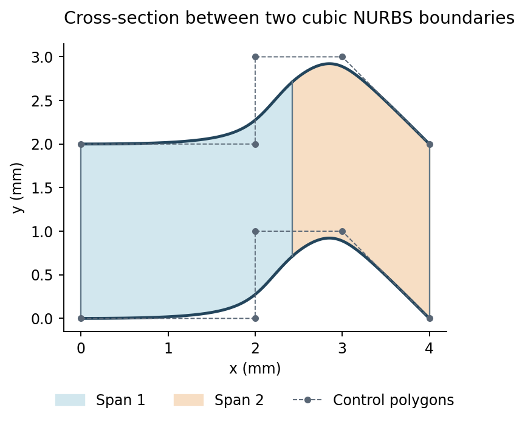

# Building an extrusion from two NURBS curves

Family `nurbs_sketch_strip_v1` takes two design curves, `lower` and `upper`, and an extrusion height in millimeters. Each curve provides its degree (1 to 3), clamped integer knot vector, and integer homogeneous controls `[wx, wy, w]`. Weights must be positive. Knots may represent rational parameters after applying a common scale factor. The example recipe uses two non-linear cubic boundaries, two spans, and varying weights. [Recipe](../tests/references/nurbs_strip.recipe.json)

Knot insertion uses checked rational arithmetic. Each span is brought to a common integer gauge. The constructor verifies that both boundaries have the same intervals and degree, the same rational x coordinate, and proportional weights span by span. It requires x to be strictly monotone in the same direction over the entire chain and a strictly positive gap between ordinates. Bernstein bounds on the derivative numerator and gap establish these properties over the closed intervals. Monotonicity lets the constructor recover the span and longitudinal parameter from x. The position between the two ordinates determines the transverse parameter; height sets the last parameter. Maps share their end faces. For each map, the model records the source-parameter interval in the local increasing-u direction.

From the repository root, the following commands use the same audited model.

```sh
mkdir -p build/nurbs-demo
cargo run --locked --offline -- build tests/references/nurbs_strip.recipe.json build/nurbs-demo/strip.json
cargo run --locked --offline -- audit build/nurbs-demo/strip.json
cargo run --locked --offline -- export-step build/nurbs-demo/strip.json build/nurbs-demo/strip.step
cargo run --locked --offline -- export-analysis build/nurbs-demo/strip.json 16 build/nurbs-demo/space.json
```

Package `solidcraft_nurbs_h1_space_v1` exactly elevates nets to the highest degree encountered and identifies scalar DOFs on faces according to their orientation. It provides a rational C0-conforming basis across maps, homogeneous controls, numbering, and volume integrated at the requested Gauss order. The Q2 mechanical benchmark on quadric profiles and geometric measurements of new cubic profiles use separate protocols. Arbitrary closed profiles, non-monotone curves, and general reparameterization of two NURBS remain outside this strip's certificate. [Profile crossing](nurbs-cross.md)



For the supplied recipe, reference volume is 45.96534510602271 mm³. At order 8, H¹-package integration gives 45.9653838425 mm³. OCC mass re-import uses adaptive integration with tolerance 1e-12. The three admitted cases and three refusals, default and adaptive measurements, and quadrature settings are recorded in the reports. [NURBS and STEP](results/nurbs-sketch-20261125.json) · [Patch equilibrium](results/nurbs-patch-equilibrium-20261125.json)
