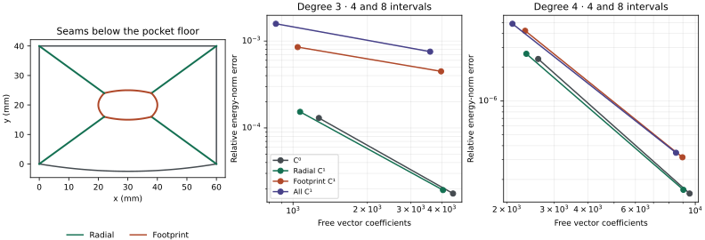

# Where physical C¹ costs accuracy on the curved pocket

The published pocket has four radial section seams and four seams around its curved footprint. On the quintic load, enforcing C¹ on the radial seams preserves the observed cubic energy order and saves 396 free vector coefficients at eight intervals. Enforcing C¹ on all eight seams costs a factor of 42.9 in cubic energy error at that resolution. Quartic fields recover much of the accuracy. All runs keep the same nine volume maps.

## Geometry and exact witnesses

The gallery recipe reproduces the model with SHA-256 `df0b4bd7672c25ea98df8415c9dc4ab1e78e53438c290ad4fae39dc1aa04373f`. The native audit certifies nine regular (2,2,1) maps, 16 shared faces, 22 exterior faces and a determinant lower bound of 836.57 mm³. The section has five footprints below the floor and four above. The four radial joins occupy eight lateral volume faces; the four footprint joins occupy four. The remaining four shared faces are axial.

All four radial seams admit AS-G¹ data. On each footprint seam the unique ratio between transverse factors has coprime quadratic numerator and denominator. For example, on the east footprint the reduced factors in the independent inward convention are proportional to 36t²−36t+19 and 16t²−16t−6. No linear pair can realize this ratio. All eight section seams fall outside the normalized affine transition test. These are results on the actual charts, including their parametrization. The classifier accepts polynomial lateral jets on supported extruded maps. General rational NURBS and changes of parametrization need their own admission tests. [Native factors and beta splits](native-gluing.json) · [Independent per-face factors](symbolic-gluing.json) · [Native classifier](../../../src/transverse_transitions.rs) · [Independent coefficient oracle](../../../tests/references/curved_section_gluing.py)

Comparing classifications alone missed a derivative error. On the initial parameter side, the old native routine formed the inward derivative using the last control row. For degree p the endpoint derivative is p times the difference between control rows **1 and 0**. Reading row p can yield a different vector while preserving the admission verdict. The independent oracle now substitutes the returned alpha and beta coefficients into the vector identity on each curved edge, verifies the split beta identity, and checks signs and orientations. Degree-two and degree-three tests include valid curved traces, an interior trace mismatch, and a cubic counterexample with coprime quadratic factors. The precise inputs from the earlier external review were unavailable; the new regressions have their own provenance. [Classifier tests](../../../tests/transverse_transitions.rs)

## Approximation and trace dimensions

Each chart carries an open degree-p field with C¹ continuity at every internal knot (multiplicity p−1). The vector trial field has three free displacement components and a bottom-clamped factor z/20. The primary displacement is vertical, with amplitude ((x+2y+10)/150)⁵ z/20. It lies outside the section field spaces tested. All loads include the pocket floor and the four walls. The body and traction terms use E=2.6 MPa and ν=0.3.

| Degree | C¹ selection | Free vector coefficients at n=8 | Relative energy-norm error at n=8 | Observed energy order n=4→8 |
|---:|---|---:|---:|---:|
| 3 | None | 4,440 | 1.75941e−5 | 2.89 |
| 3 | Four radial seams | 4,044 | 1.92773e−5 | 2.99 |
| 3 | Four footprint seams | 3,972 | 4.48014e−4 | 0.93 |
| 3 | All eight | 3,588 | 7.55010e−4 | 1.07 |
| 4 | None | 9,528 | 1.49802e−7 | 3.98 |
| 4 | Four radial seams | 9,036 | 1.61656e−7 | 4.03 |
| 4 | Four footprint seams | 8,964 | 3.15092e−7 | 3.75 |
| 4 | All eight | 8,484 | 3.45708e−7 | 3.82 |

The projection of the physical gradient onto a fixed transverse Cartesian component exposes the restriction. On **each cubic footprint seam**, its trace space has dimension **2 at every tested n** (1, 2, 4, 8). On a radial seam the corresponding sequence is 3, 4, 6, 10. In degree four the footprint sequence is 3, 4, 6, 10. The exact rank concerns one measured gradient component along the complete seam; the value trace has a different dimension. At cubic n=8 the footprint value trace still has dimension 12. Imposing the other seven C¹ seams leaves the single-edge projection dimensions unchanged after the local C¹ constraint on all tested layouts.

Thus the cubic footprint loses transverse approximation capacity on these refinements, and the observed volume convergence slows. The volume error still decreases. The quartic results and the physically reproduced control fields preclude a blanket conclusion about enforcing C¹ on curved geometry. AS-G¹ witnesses characterize the representation of a seam; they give no load-independent ranking of the mechanical choices. [All 32 primary observations](primary.json) · [Selective comparisons and wall-clock measurements](seam-selection.json) · [Exact trace ranks](../../../tests/references/curved_pocket_trace_richness.md)

## What happened to the 21.33% historical error?

The archived coarse solve used a quadratic axial space and had 180 free vector coefficients when all lateral joins were constrained. On its actual quadratic displacement load, the exact strain energy is 3.42749106636 N·mm. Its reported energy and error satisfy Galerkin orthogonality to within 4e−13 relative on the cubic all-join row. The present field has a prescribed linear axial factor; at cubic n=1, all joins, it has 48 free coefficients. Its coarse error is 27.30%. Neither coarse number defines an h-rate.

At n=1,2,4,8 the new cubic all-join energy errors for that same load are 27.302%, 2.3160%, 0.63961%, 0.26203%. The C⁰ branch reaches 0.00040944% at n=8. The load is exactly representable on the curved charts at degree four, because squaring the biquadratic x coordinate has bidegree at most (4,4). All quartic cases reproduce it within the 1e−8 relative-energy threshold. [Historical-load replay](historical.json) · [Earlier assembly and axial space](../inherited-continuity/README.md)

## Qualification and reproduction

The Rust solver first certifies the rational constraint nullspace and its dimension. For a well-conditioned numerical basis it selects a full-pivot interpolation minor on the original constraints, certifies its rank modulo a prime, and evaluates the implied interpolation coordinates in floating point. It checks the lift against every original equation. This changes field coordinates within the same space and preserves the geometry. The first PCG iteration-limit failures and a subsequent overflow in expanded rational coordinate exchanges are retained. [Initial diagnostics](initial-coordinate-failures.json)

The independent continuum oracle integrates boundary moments by Green's theorem in rational arithmetic. The curved floor area is 512/3 mm², total volume is 48,976 mm³, and the primary exact strain energy is 9.71165182150 N·mm. Signed work on the top, walls and floor plus the body work equals twice the strain energy exactly. We also compare separate forces, body moment and the Ritz energy identity. At the finest level the q8/q10 energy-error change is below 4e−9 relative. The two coarse quartic energy-error changes exceed 1e−7 for q8/q10; q10/q12 gives 5.17e−10 with C⁰ and 5.49e−9 with all joins. All observations use the stated quadrature. [Exact continuum integrals](continuum.json) · [Protocol](protocol.md) · [Vector field protocol](vector-protocol.md)

Run `make check-curved-pocket-fields` with Rust, Python 3.12 and SymPy. Raw solves and native witnesses go to `build/`. The cost fields report individual observations on Linux x86_64 (Intel Core Ultra 5 228V, rustc 1.99.1). The mechanical values and dimensions are regression targets. Assembly, solve and whole-process times depend on the machine and concurrent workload.

The theoretical comparison concerns planar multipatch approximation. This experiment fixes the axial displacement dependence, includes the change of footprint at z=14 mm and measures one published part. [Collin, Sangalli and Takacs](https://arxiv.org/abs/1509.07619) · [Hasanova, Takacs and Takacs](https://arxiv.org/abs/2605.13270)
