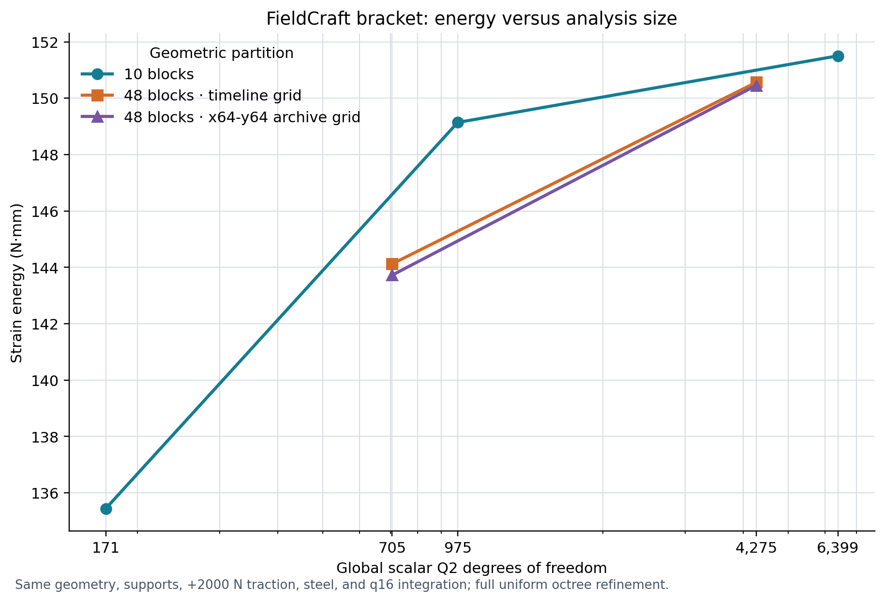

# FieldCraft bracket: strain energy versus Q2 degrees of freedom

## Question and comparison

The current driver builds and audits the ten-block FieldCraft bracket from its [sketch recipe](../site/data/fieldcraft_x64_y64/fieldcraft_x64_y64.recipe.json). This report retains the measured 48-block curves from the earlier refinement study as numerical references. The [historical revision](https://github.com/jeffwitz/SolidCraftTrivariate/tree/3e48ae3) contains the corresponding geometry and driver.

All three models describe the same bracket: bore centers (40, 4, 20) mm along Y and (4, 32, 20) mm along X, each with radius 4 mm. Their q32 volume integrals agree at 32144.7789254 mm³. The two 48-block models must remain separate in an energy plot: they have the same block and degree counts but different Q2 approximation spaces.

The common job fixes all displacement components on the y=0 foot face and applies uniform +x traction of 6.25 MPa on the y=50 upright face. The selected load area is 320 mm², so the resultant is +2000 N. The material is steel with E=210000 MPa and ν=0.3. This matches the transferred FieldCraft PA5 loading convention. The model-specific face provenance tags differ (`outer/profile` and `outer/outline`); the script maps both to the same exact y=0 and y=50 faces.

## Method

All geometry audits, Q2 space construction, uniform refinement, quadrature, stiffness assembly and solves are performed by the Rust `solve-job` command. The Python script only builds inputs, invokes the Rust CLI, validates common load and geometry quantities, collects result JSON and renders the plot.

Each h step subdivides every current block into eight dyadic children. The table reports global scalar Q2 degrees of freedom; vector coefficients are three times this count. Quadrature orders 8, 16, 24 and 32 were compared on each unrefined model. Refined runs use q16. The q16-to-q32 energy discrepancy at h0 is at most 1.47 × 10⁻⁸ relative, and the maximum q24-to-q32 relative energy difference is 2.76e-11. q8 underintegrates volume on the curved historical spaces and is not used for the plotted curves.

All q16 solves have relative residuals below 1.0 × 10⁻¹⁰. The maximum relative work/energy, force and moment imbalances are 2.79e-12, 1.09e-10, 5.76e-11, respectively. All runs retain six independent rigid constraints and integrate the loaded face to 320 mm² and +2000 N.

## q16 results

| Partition | h | Blocks | Scalar Q2 DOFs | Strain energy (N·mm) | PCG iterations | One-run wall time (s) |
|---|---:|---:|---:|---:|---:|---:|
| 10 blocks | 0 | 10 | 171 | 135.444751390 | 206 | 0.282 |
| 10 blocks | 1 | 80 | 975 | 149.141187353 | 364 | 1.782 |
| 10 blocks | 2 | 640 | 6,399 | 151.504277497 | 643 | 14.664 |
| 10 blocks | 3 | 5,120 | 45,951 | 151.878840833 | 1,256 | 139.345 |
| 48 blocks, timeline grid | 0 | 48 | 705 | 144.123646473 | 299 | 1.255 |
| 48 blocks, timeline grid | 1 | 384 | 4,275 | 150.566740660 | 655 | 9.105 |
| 48 blocks, timeline grid | 2 | 3,072 | 29,223 | 151.743764145 | 1,227 | 80.546 |
| 48 blocks, x64-y64 archive grid | 0 | 48 | 705 | 143.724598875 | 734 | 1.393 |
| 48 blocks, x64-y64 archive grid | 1 | 384 | 4,275 | 150.458808227 | 1,650 | 11.548 |
| 48 blocks, x64-y64 archive grid | 2 | 3,072 | 29,223 | 151.718314045 | 3,392 | 140.747 |



The compact h3 run gives 151.8788 N·mm. Aitken extrapolation from the last three levels of each sequence gives approximately 151.949, 152.007 and 152.008 N·mm. For a comparison at matched error, take 151.95 N·mm as an illustrative limiting energy. Log-linear interpolation of relative energy deficit against scalar DOFs between measured h1 and h2 points gives approximately 3,710, 7,830 and 8,576 DOFs respectively at a 0.5% deficit. The two historical spaces require 2.11× and 2.31× the compact count under this estimate. The extrapolation supplies no certified upper bound. For this homogeneous clamp and prescribed load, the energy deficit equals half the squared energy norm of the displacement error in the exact Galerkin problem. A small energy deficit therefore leaves appreciable field error.

In the frozen experiment, the timeline-native archive reproduced the previously reported 144.124 N·mm: q16 gives 144.123646473 N·mm and q32 gives 144.123644356 N·mm. The other archived 48-block model yields 143.724598875 N·mm at q16 and 143.724597622 N·mm at q32. Both have 705 scalar DOFs and the same volume, supports and load. The 0.277% energy separation comes from their distinct parameterized analysis spaces, not from different stated geometry or boundary conditions. The earlier `fieldcraft-compact.md` value refers to the timeline-native model.

This parameterization distinction also appears in geometric conditioning. An independent `export-geometry-vtu MODEL 4` sample on the 125-point tensor grid in every block reports maximum Jacobian condition numbers κ of 13.33 for the ten-block model, 128 for the timeline grid, and 2,048 for the x64-y64 archive grid. The sample is a conditioning diagnostic, not a continuous bound; details and reproduction are in [`fieldcraft-compact.md`](fieldcraft-compact.md). The high κ and 1,650 PCG iterations on the x64-y64 h1 run give a concrete cost difference between the two 48-block analysis parameterizations.

Wall times are single end-to-end CLI observations from one machine run. They include process startup, model audit, refinement, integration, assembly and PCG solve. They are useful for scale context, not statistically repeated timing claims; no peak-memory measurement is included.

## Reproduction

Build the current release and replay the ten-block sketch recipe:

```sh
cargo build --locked --offline --release
python3 scripts/fieldcraft_bracket_pa5.py \
  --cli target/release/solidcraft-trivariate \
  --max-level 3 \
  --orders 8 16 24 32
```

The driver rebuilds the geometry from the current recipe, audits it and writes its refinement study under `build/fieldcraft-bracket-pa5/`. The numerical table and three-curve plot record the original comparative experiment.

The extended run used the release executable from kernel revision `e5bd5c6`. The result identifies the executable by SHA-256 and records the driver checkout separately.

The numerical result is [`fieldcraft-bracket-pa5-energy-dof.json`](fieldcraft-bracket-pa5-energy-dof.json). The standalone plot is [`fieldcraft-bracket-pa5-energy-dof.png`](fieldcraft-bracket-pa5-energy-dof.png) with a vector version at [`fieldcraft-bracket-pa5-energy-dof.svg`](fieldcraft-bracket-pa5-energy-dof.svg). The job fixture is [`fieldcraft_bracket_hex_pa5.json`](../../tests/references/mechanical_jobs/fieldcraft_bracket_hex_pa5.json); archive provenance and geometry checks are recorded in [`fieldcraft-replay/README.md`](fieldcraft-replay/README.md) and [`fieldcraft-compact.md`](fieldcraft-compact.md).
