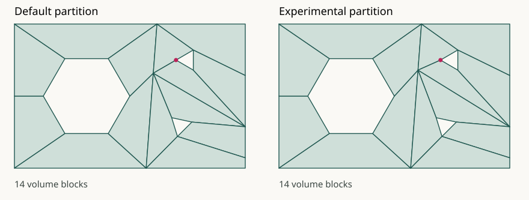

# Separation chords and ring quality

The external `mixed_sizes` sketch contains a hexagonal through-hole and two triangular through-holes. The reference release reproduces the model supplied by the reviewer byte for byte. Its worst planar Jacobian condition number occurs at the triangle corner (112, 75) mm. An internal separator junction and the adjacent hole edge form an angle of 179.79° there.



| Strategy | Volume blocks | Maximum sampled planar κ |
| --- | ---: | ---: |
| Production default | 14 | 559.00 |
| Rerank the original ring candidates | 14 | 559.00 |
| Explore additional chords and slide an unpinned junction | 14 | 45.48 |

The winning partition preserves the three input contours and the material volume of 269,820 mm³. The certified lower bound on the volume-map Jacobian determinant rises from 18.74 to 507.96 mm³. The minimum sampled corner sine rises from 0.00371 to 0.06556. The planar condition numbers are numerical measurements on the material maps; the positivity bound is a separate continuous certificate.

The experimental selector first minimizes the number of material blocks. At equal count it compares ring maps by their worst planar condition number on a closed 3 × 3 grid, then tries bounded rational displacements of constructed junctions along a straight edge. Every face incident on the junction receives the same new point. Source vertices and guide endpoints are fixed. An independent evaluation samples the exported volume maps on a 5 × 5 × 5 grid.

The corpus includes the 45 original sketches, 12 published supplemental sketches, and the 11 sketches from the independent reviewer. Only `mixed_sizes` from the final group was used to develop the correction. The two suites have different independent checks and are reported separately.

See the [decision protocol](protocol.md) and [production baseline audit](../polygon-extrusion-quality/README.md).

## Evaluation and decision

| Cohort | Planar κ improved / tied / worse | Blocks, both strategies | Build + audit seconds, default → experimental |
| --- | --- | ---: | ---: |
| 45 public sketches + 12 supplements | 29 / 28 / 0 | 1,628 | 159.40 → 398.12 |
| External development sketch | 1 / 0 / 0 | 14 | See external measurements |
| Ten reserved external sketches | 4 / 6 / 0 | 205 | See external measurements |

All 57 public cases passed exact section and volume checks on both sides. The largest sampled planar κ across that cohort fell from 229.39 to 119.66. On the eleven external sketches, each release passed all 3,706 CAD classification probes, preserved section coverage, and exported one valid STEP solid per recipe. Build and audit took 13.45 and 30.47 seconds respectively over those eleven recipes. Times come from individual runs on a shared machine.

The production default remains unchanged. In the public cohort twelve cases had higher full 3D κ, with a maximum increase of 52%, and six had a lower minimum corner sine. The measured improvement in planar κ carries a runtime cost even on some unchanged cases. Convex separator search and movement of existing junctions leave the concave and multilevel block-count issues open.

- [Paired measurements and per-case witnesses for all 57 public recipes](../polygon-extrusion-quality/ring-lookahead/README.md)
- [Independent CAD and coverage checks for all eleven external recipes](../planar-external-review/README.md)
- [Four-case ablation of reranking and expanded search](../ring-lookahead-prototype.md)

To build and audit the external development sketch with the experimental strategy, run from this branch:

```sh
cargo build --release --locked --offline
mkdir -p build
python3 -c 'import json,sys; r=json.load(open(sys.argv[1])); r["partition_strategy"]="ring_planar_lookahead"; print(json.dumps(r))' docs/results/planar-external-review/inputs/mixed_sizes.recipe.json > build/mixed_sizes-lookahead.recipe.json
target/release/solidcraft-trivariate build build/mixed_sizes-lookahead.recipe.json build/mixed_sizes-lookahead.model.json
target/release/solidcraft-trivariate audit build/mixed_sizes-lookahead.model.json
```
