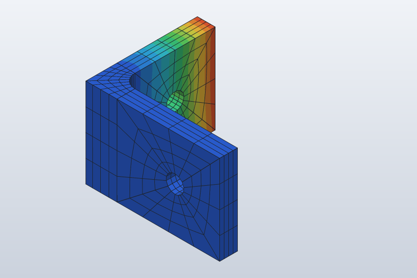

Run a native analysis and inspect it in FieldCraft
==================================================

Use the Linux x86-64 workstation bundle from the
`plugin workflow <https://github.com/jeffwitz/SolidCraftTrivariate/actions/workflows/solidcraft-trivariate-plugin.yml>`_.
Extract the tarball, enter its directory and launch the included version:

.. code-block:: sh

   python3 scripts/solidcraft_compact_desktop.py ./solidcraft-trivariate-0.5.0.zip

Install SolidCraft 0.48.1 and FieldCraft 0.8.1 on the workstation. The launcher
looks for both the FieldCraft desktop and CLI. For an extracted installation
pass the executable paths with ``--fieldcraft`` and ``--fieldcraft-cli``.
A workstation without FieldCraft can still use the CAD commands.

Choose the domain and job
-------------------------

Open **FieldCraft IGA Bridge Status** in the plugin commands. When it reports
ready, choose **Solve and Display IGA Field**. Check the recipe and job names
before submitting. These are files in the approved companion folder; the
request captures their contents. Use the supplied bracket case first. For a
new case, provide a complete trivariate recipe and a mechanical job whose
boundary selections actually exist on that model.

Inspect the result
------------------

FieldCraft opens the result archive. Select the solved step and request
**Contours** for displacement magnitude or von Mises stress. Use **Deformed
Shape** to inspect the direction of deflection. An automatic deformation
scale amplifies the motion for display. For values in physical units, read
the contour legend or export the field. Keep the original mechanical result
JSON for reactions, residual and energy. See :doc:`../reference/fieldcraft-plugin`.

   Displacement magnitude on the undeformed bracket, from 0 mm (blue) to
   0.13814 mm (red). FieldCraft 0.8.1 drew this view after reopening the
   sample archive. Four subdivisions per chart direction give 640 display
   hexahedra; the native analysis still has ten charts.

If the operation stops
----------------------

* **Unavailable**: verify that both FieldCraft executables and the native
  solver are available to the launcher. Start the compact launcher after
  installing or moving the applications.
* **Missing recipe or job**: use filenames relative to the approved companion
  directory of the profile you launched. A desktop opened by another launcher
  can have a different profile.
* **Support or load selection rejected**: compare feature names and plane
  coordinates with the constructed model's design faces. A face selected on
  the screen does not automatically define a mechanical boundary condition.
* **Unchanged result after editing the CAD body**: identify the complete
  updated trivariate recipe, update its job and submit a new named case.
