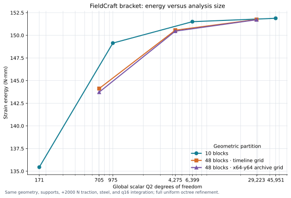

Analysis on audited trivariate models
=====================================

The analysis layer consumes a geometric model only after its family audit has
accepted it. This is a deliberate boundary: a valid volume representation,
positive local Jacobians, complete face incidence, and an analysis-suitable
field space are separate claims. A determinant certificate for the geometry
does not by itself prove that an elasticity discretization is stable or
accurate.

Hughes, Cottrell and Bazilevs introduce the use of CAD spline bases for
analysis [Hughes2005]_.

The central fixed-family entry points are
``analysis_space::build_analysis_space`` and its family-specific siblings in
``src/analysis_space.rs``. The bracket path exactly elevates degree-one axes
to Q2 Bernstein form and identifies face controls by rational physical
coordinates after the audited face orientation has been applied. The general
adaptive path is in ``src/adaptive_space.rs``: matching Q2 traces are
identified, while nonmatching nested traces become exact rational constraint
rows. ``constraint_system::resolve`` turns those rows into a lift from free
masters. This is strong algebraic conformity for the supported trace patterns;
it is not a general multipatch coupling method.

For context, common multipatch alternatives include mortar constraints and
Nitsche coupling for nonmatching interfaces [Brivadis2015]_ [Nguyen2014]_. These methods impose continuity
weakly and introduce their own multiplier-space or stabilization choices.
The present supported Q2 adaptive path instead builds exact trace relations
for certified whole-face and nested dyadic interfaces. Do not infer support
for arbitrary partial, curved, or non-nested overlaps from that implementation.
Variable-size extracted elements are implemented in ``extracted_space``
and exercised by ``cargo test --test extracted_space``. On the recovered
NURBS strip the local THB job uses this assembly route. The separate
crossed-tool bending study has a ten-chart geometry with partial interfaces.
See :doc:`spline-fields` for the supported field transfers. On general
multipatch inputs, partial footprints need interface-specific treatment, and a THB basis
does not automatically resolve those joins.

The small-strain isotropic elasticity implementation is in
``src/elasticity.rs``. ``assemble`` uses the supplied tensor-product Gauss
order for volume integration; ``constrained_elasticity::solve_constrained``
and ``solve_preconditioned`` solve the reduced system after boundary and trace
constraints have been resolved. Report assembly quadrature, reduced residual,
DOFs, solver iterations, and physical error norms separately. A small algebraic
residual is evidence about the linear solve, not a discretization-error bound.

The source-level APIs are exercised by Rust tests and by independent
reassembly scripts. From the repository root, useful commands are::

   cargo test --locked --offline --test elasticity
   cargo test --locked --offline --test adaptive_partition
   cargo test --locked --offline --test nested_trace
   make check-local-thb

``make check-local-thb`` rebuilds the native CLI, runs the THB-specific tests
and independent function/traction checks. For the broader project gate use
``make check``; it is substantially more expensive.

Foundational and coupling references
------------------------------------

.. [Hughes2005] T. J. R. Hughes, J. A. Cottrell, and Y. Bazilevs,
   “Isogeometric analysis: CAD, finite elements, NURBS, exact geometry and
   mesh refinement,” *Computer Methods in Applied Mechanics and Engineering*,
   194 (2005), 4135–4195. `DOI 10.1016/j.cma.2004.10.008
   <https://doi.org/10.1016/j.cma.2004.10.008>`_.

.. [Brivadis2015] E. Brivadis, A. Buffa, B. Wohlmuth, and L. Wunderlich,
   “Isogeometric mortar methods,” *Computer Methods in Applied Mechanics and
   Engineering*, 284 (2015), 292–319. `DOI 10.1016/j.cma.2014.09.012
   <https://doi.org/10.1016/j.cma.2014.09.012>`_. This describes a weak
   interface-coupling family, not the exact constraint implementation here.

.. [Nguyen2014] V. P. Nguyen, P. Kerfriden, M. Brino, S. P. A. Bordas, and
   E. Bonisoli, “Nitsche's method for two and three dimensional NURBS
   patch coupling,” *Computational Mechanics*, 53(6) (2014), 1163--1182.
   `DOI 10.1007/s00466-013-0955-3
   <https://doi.org/10.1007/s00466-013-0955-3>`_.

   Uniform refinement on three geometric partitions of the FieldCraft bracket.
   Follow one curve to see the change with field dimension; compare curves at
   similar dimensions to assess the effect of the partition. Energy is in N·mm.
