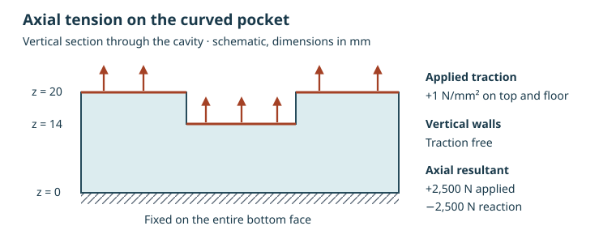
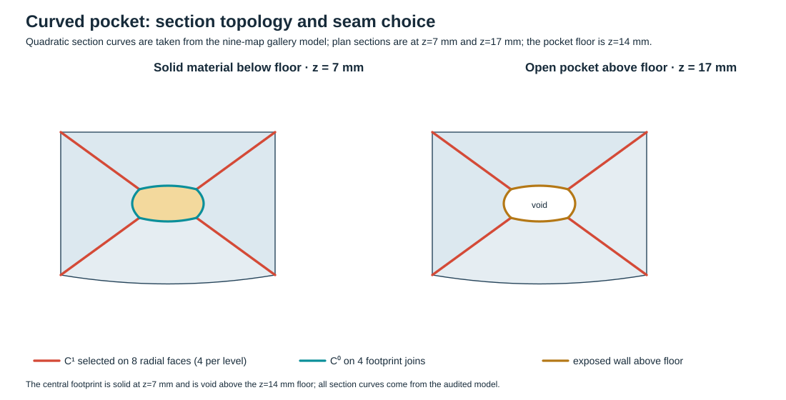

Automatic displacement continuity
=================================

For a homogeneous bonded elastic solid, give the native solver a geometry model,
a material, a support and loads. The field compiler chooses the supported joins
before stiffness assembly. It never solves a trial load case to choose a join.
This decision sets the approximation space. Solver residual tolerance controls
algebraic equilibrium in that space; it does not specify displacement accuracy.

Run one load case
-----------------

From a checkout, run:

.. code-block:: sh

   mkdir -p build
   cargo build --release --locked --offline
   target/release/solidcraft-trivariate solve-job \
     docs/site/data/plate_blind_pocket/plate_blind_pocket.model.json \
     tests/references/automatic_pocket_tension.job.json build/tension.json

The :download:`input job <../../../tests/references/automatic_pocket_tension.job.json>`
names the support and loaded design faces. The :download:`audited geometry
<../../site/data/plate_blind_pocket/plate_blind_pocket.model.json>` supplies the
maps, incidences and surface names. No degree, constraint list or comparison
solve appears in the job.

   At zero Poisson ratio, unit axial stress solves this loading exactly.
   The floor contributes 512/3 N to the resultant. Omitting it changes the
   physical problem.

Read the results
----------------

The job specifies Young's modulus 10 MPa and Poisson ratio zero. The exact
displacement is :math:`u_z=z/10` mm. The projected loaded area is 2,500 mm².
With a volume of 48,976 mm³ and strain-energy density of 0.05 N/mm², check
``energy_n_mm`` against 2,448.8 and ``reaction_n`` against (0, 0, −2500).
This regression exercises the real clamp, both tractions and the selected
space in a single solve. The analytic comparison belongs to qualification.

Selection before assembly
-------------------------

.. list-table::
   :header-rows: 1
   :widths: 31 30 39

   * - Interface presented to the field compiler
     - Automatic action
     - Evidence used
   * - Internal split of the recovered NURBS strip
     - Restore the continuity available in the source basis.
     - Source coefficients, knot multiplicity, true parameter intervals and oriented trace.
   * - Qualifying axial split of translated sections
     - Couple the first axial derivative.
     - Identical section mapping and physical interval lengths.
   * - Qualified radial seam in the published curved pocket
     - Use a cubic section field and couple its physical gradient.
     - Exact model controls and face incidence, matched to the qualified seam layout.
   * - Other conforming lateral joins, including the curved footprint
     - Retain the shared displacement trace (C⁰).
     - Physical gradient matching has no qualified selection rule there.
   * - Contact, slip, cracking or multiple material laws
     - Outside this homogeneous bonded job contract.
     - The input needs a solver implementing the intended interface law.

   The four radial lines appear in both layers (eight shared block faces).
   The footprint is an internal join below the floor and a free wall above it.
   A boundary face carries a load or a boundary condition; it has no
   neighbouring displacement field to smooth.

Geometry edits that change the pocket controls or incidence invalidate its
specialized rule. An admitted matching interface then receives the conservative
rule for its class. A failed geometry audit or an unsupported volume family
stops the analysis. Saved field packages continue to use their recorded plan.
Legacy fixed-Q2 mechanical jobs retain their original field formulation.

Inspecting a decision
---------------------

In the raw-model result, ``continuity_selection`` records the policy,
the axial and section degree choices, and the qualified radial face count.
``interface_decisions`` identifies each pair of block sides, its field order
and the evidence used. ``field_compilation_ms`` times the raw field compiler,
including construction of the constrained basis. It excludes mechanical assembly
and solution. To inspect a plan separately, use ``export-inherited-space``
with ``{"schema":"inherited_field_auto_plan_v1","axial_degree":2}``.
The normal load command above does not need this export.

On the published pocket the three-dimensional field has degree three in the
section and two axially. Four axial interfaces inherit C¹, eight lateral faces
use the radial C¹ rule and four footprint faces retain C⁰. The loaded example
has 276 free vector coefficients. The measured relative solver residual was
:math:`7.13\times10^{-12}`.

**Cost and accuracy.** In a separate development comparison, the same field
with all twelve lateral faces at C⁰ had 456 free vector coefficients. On the
smooth quintic manufactured load, its relative energy-norm error was 0.524%;
the automatic selection gave 0.821% with 276 coefficients. These measurements
use one section span per chart, the same axial field and order-ten quadrature.
They concern a full three-dimensional field. The multi-level section
study in :doc:`continuity-experiments` uses a restricted linear height profile.
The production decision uses neither the applied traction nor these two solves.

Why the rules depend on the interface
-------------------------------------

On a matching physical face the bonded displacement has a common value (C⁰).
C¹ additionally requires equality of physical gradients. Within a recovered
regular tensor parent a knot of multiplicity :math:`m` in a degree-:math:`p`
basis guarantees :math:`C^{p-m}` continuity. Across separately constructed
maps a common boundary curve alone is insufficient to determine the normal
derivative. The compiler must also account for the transverse maps and their
orientation. See :doc:`interface-fields`.

On the studied pocket, a cubic field retained four section coefficients for
its transverse gradient on a radial seam at two intervals, and ten at eight.
On the curved footprint it retained only two at both resolutions. The
geometry and topology tests performed during analysis identify where an
already qualified rule applies. The rational trace-rank study and the 32
elasticity solves were run during development and are recorded in
:doc:`continuity-experiments`.

Collin, Sangalli and Takacs describe how a C¹ condition on neighbouring
parameterizations can restrict field traces. Hasanova, Takacs and Takacs give
approximation estimates under explicit planar analysis-suitable G¹ assumptions.
These results explain why the field rule depends on its domain of qualification.
They do not establish a universal convergence order for a pocket that changes
section with height.
`Collin et al. <https://arxiv.org/abs/1509.07619>`__;
`Hasanova et al. <https://arxiv.org/abs/2605.13270>`__.
