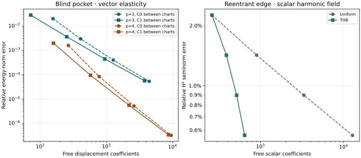
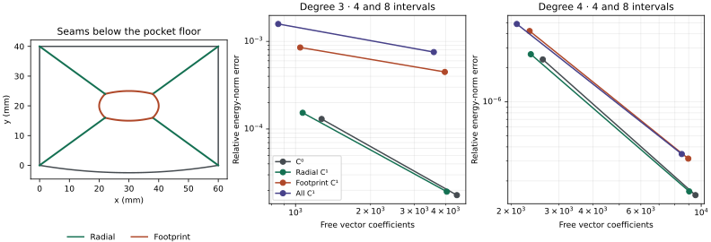

Selecting displacement continuity
=================================

A designer can keep the same geometric partition and change the displacement
field on its interfaces. The relevant comparison depends on what is held
fixed: the supporting maps, the integration cells, or the number of free
displacement coefficients.

Which derivatives can be shared?
---------------------------------

A subdivision of one original support inherits its derivatives in that
support's parameter. For adjacent extruded sections, the native compiler
uses the actual axial interval lengths in the matching equations. Across
68 polygonal models, 617 axial joins permit 7,829 scalar coefficients to
be reduced to 6,751. A separate homogeneous-jet check on curved parts
selects compatible lateral joins. On the manufactured load the following
pairs retain the same geometry, degree and integration cells.

=======================  ====================  =========================
Part                     Free vector DOFs      Relative energy error
=======================  ====================  =========================
S3 face pocket           2,679 → 1,710         3.6405% → 3.6417%
Multiloop NURBS plate    1,056 → 576           1.3936% → 1.3995%
G2 crossed plate         1,236 → 864           5.4335% → 5.4367%
=======================  ====================  =========================

The transition classifier and analysis-suitable G¹ (AS-G¹) answer
different local questions. A normalized transverse transition asks for
affine coefficients after fixing one coefficient to unity. AS-G¹ allows
two linear gluing factors whose ratio can be nonaffine. The regular
piecewise-bilinear section construction is covered by the planar theory;
using it for an approximation requires the field degree, internal
regularity, vertex conditions and refinement to be specified. In
particular, a successful edge certificate alone gives no 3D convergence
rate. Across 68 polygonal models, the normalized constant/affine test admits
626 of the 2,519 lateral interfaces and the AS-G¹ edge test admits all 2,519.
`Collin, Sangalli and Takacs, Analysis-suitable G¹ multi-patch parametrizations for C¹ isogeometric spaces <https://arxiv.org/abs/1509.07619>`__.

Accuracy per unknown on the cube
---------------------------------

The original cubic sine test on an affine cube missed its prospective
equal-cell criterion. At equal dimension (343 scalar functions), its measured
C² energy-norm error was 3.69 times smaller than C⁰. The larger C² solve
at 1,331 functions measured 0.00036113. Both statements use the original
solutions.

A second frozen study prescribes a Gaussian varying along all three
directions, multiplied by height to satisfy the clamp. Each row below
compares the same number of *free vector* displacement coefficients in
isotropic 3D elasticity. Errors are relative energy norms.

=================  =================  ===========  ===========  ========
Free vector DOFs   Spans/axis C⁰/C²   C⁰ error     C² error     Ratio
=================  =================  ===========  ===========  ========
6,084              4 / 10             0.00555250   0.00073965   7.51
11,520             5 / 13             0.00288067   0.00032368   8.90
=================  =================  ===========  ===========  ========

C² uses more integration cells at both dimensions. The result measures
accuracy per unknown for this smooth solution on affine geometry.
`Native measurements and protocols <https://github.com/jeffwitz/SolidCraftTrivariate/tree/main/docs/results/continuity-followup>`__.

Refinement across construction supports
---------------------------------------

The historical all-lateral C¹ pocket with 21.33% energy error used curved
biquadratic section charts, one element per source patch. For the separate
bilinear control, the kernel rebuilds five section maps from the polygonal
sketch: a footprint surrounded by four trapezoids. Only the four trapezoids
continue above the pocket floor. The comparison retains all nine solids,
the slanted interfaces and the free pocket walls.

Both vector spaces use physical height-linear displacements in all three
components with a bottom clamp. The manufactured vertical displacement is
quintic in x and linear in height. Each chart has interior C¹ knots in
both tests. Only the interchart conditions vary. The C¹ solver identifies
the trace first and matches a transverse physical gradient on each edge
span with exact rational arithmetic. Clearing the two bilinear Jacobian
determinants gives a polynomial of degree at most p+1, so p+2 distinct
evaluations determine the whole identity. Endpoints participate in the
same system as the interior. The notes give the measured h-sequences and
a separate scalar section problem.
`Pocket vector protocol <https://github.com/jeffwitz/SolidCraftTrivariate/blob/main/docs/results/continuity-followup/pocket-vector-protocol.md>`__.

For cubic fields the measured energy orders on the final doubling are
2.916 (C⁰) and 2.979 (C¹). For quartics they are 4.009 and 4.052.
At eight subdivisions cubic C¹ uses 3,780 free vector DOFs and has
relative energy error 5.64e−5; cubic C⁰ uses 4,440 and gives 5.34e−5.
The observed rate recovers on the bilinear control. The original
curved-pocket campaign initially measured one coarse level. The curved-pocket section below reports the subsequent refinements.

   Each point is an independent native solve. The left panel counts free
   vector coefficients. The right panel counts free scalar coefficients.

Local refinement near a reentrant edge
---------------------------------------

The original strip's fine interior region is 8 by 4 by 4 spans. A cubic
basis function occupies four consecutive fine spans in each direction,
so only five fine supports fit wholly inside. A larger marked region or
a mark touching an open boundary changes this count. Truncation and nesting
can be tested by comparing exact Bernstein coefficients on a common fine
partition. Multilevel locality also depends on the levels of basis functions
that can be nonzero on each integration cell.
`Giannelli, Jüttler and Speleers, THB-splines <https://doi.org/10.1016/j.cagd.2012.03.025>`__.
`Buffa and Giannelli, Adaptive isogeometric methods with hierarchical splines <https://arxiv.org/abs/1502.00565>`__.

On the prescribed three-chart L section, the scalar harmonic field varies
as radius to the power 2/3. At the third local level the THB field has
645 free scalar coefficients and 0.564334% relative H¹ seminorm error.
Uniform refinement to the same finest span width has 12,805 free coefficients
and 0.564310% error. A separate finest-grid Galerkin assembly recovers both
results, including the effect of mass projection of the exterior trace. The
fixed corner boxes qualify one multilevel schedule.
`THB and uniform convergence histories <https://github.com/jeffwitz/SolidCraftTrivariate/blob/main/docs/results/continuity-followup/reentrant-ritz.json>`__.

The curved gallery pocket
-------------------------

The gallery pocket has nine polynomial maps of degree (2,2,1). Its bottom
section consists of five footprints. Four radial interfaces continue above
the floor, where the curved footprint of the void disappears. An interface
in a section and a shared face in the solid therefore have different counts.

The four distinct radial seams admit linear AS-G¹ gluing factors. The four
seams around the footprint require coprime quadratic transverse factors for
these parametrizations. On the east footprint seam, in the inward-derivative
convention, their quotient is proportional to
(36t² − 36t + 19)/(16t² − 16t − 6). The polynomials have no common root.
This obstructs a pair of linear gluing factors without a change of chart.
A globally smooth physical field can still satisfy the physical gradient
conditions on that seam. An approximation experiment must establish how many
such fields the discrete space retains as the intervals are subdivided.

The source volume is 48,976 mm³ and the floor area is 512/3 mm². Integrating
polynomial moments along the oriented quadratic boundaries supplies an
independent reference for strain energy and the separate work of body, top,
floor and wall loads. On this curved pocket a physical quadratic displacement
times height pulls back to a field of degree at most (4,4,1). It supplies a
reproduction test for a quartic section field, and a convergence test for a
cubic one.

`Curved-pocket measurements and replay <https://github.com/jeffwitz/SolidCraftTrivariate/tree/main/docs/results/curved-pocket-fields>`_.

   On the quintic manufactured field, the last observed cubic energy order is
   2.89 with C⁰, 2.99 with only the radial seams constrained, 0.93 with only
   the footprint constrained and 1.07 with all eight seams constrained. The
   corresponding quartic orders are 3.98, 4.03, 3.75 and 3.82. Each segment
   joins two measured refinements. The chart partition and loads are identical.
