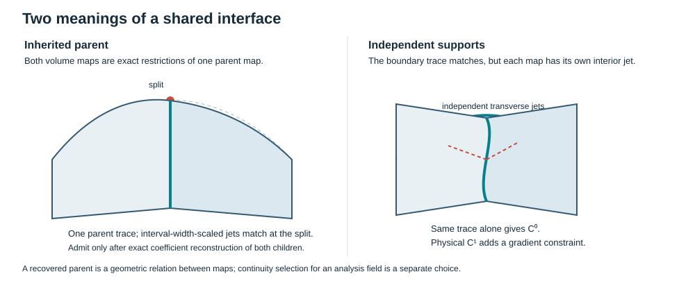

Recovering parents and choosing interface continuity
====================================================

A recovered support
-------------------

   A parent split carries its transverse jets through the split ratio. For
   independent supports, matching values establish C⁰ only; physical C¹ is
   an additional analysis constraint.

Take two adjacent homogeneous Bézier nets with an audited complete face.
Orient their tangential axes consistently and elevate their traces to
common degrees. On the whole face, the two nets must agree up to one
positive homogeneous scale. A single positive ratio of *normal interval
lengths* must also fit their first jets. The candidate parent is then
split at that ratio with de Casteljau's algorithm. Admission requires
coefficient identity on both complete volume nets. A shared tangent plane
or a successful point test is insufficient.

``recover-pair-parents MODEL REPORT`` exposes that test. A vanishing jet
can leave the width ratio undetermined. A checked-arithmetic limit also
produces an indeterminate result. The output separates these from a proved
incompatible pair. A recovered algebraic support is evidence about the two
maps; identifying which historical feature created them needs provenance.

The eight audited curved model states have 367 full interfaces. Of those,
107 recover a complete parent, including 13 on lateral axes. The five
FieldCraft variants account for 55 tested interfaces and zero recovered
parents. The independent oracle splits the recovered parents with rational
arithmetic and compares both source nets.
`Per-model evidence and reproduction <https://github.com/jeffwitz/SolidCraftTrivariate/blob/main/docs/results/inherited-continuity/pair-parents.md>`__.

Three different field constraints
------------------------------------

* **Trace C⁰.** Identifying compatible displacement values leaves transverse
  derivatives free.
* **Inherited continuity.** For two restrictions of one translated section,
  derivative rows use the actual interval widths. Across the 68 polygonal
  models, 617 of 3,136 complete interfaces admit this axial construction.
  For quadratic axial fields the sum of scalar dimensions drops from
  7,829 to 6,751.
* **Physical C¹ across independent supports.** In local coordinates a
  scalar field has physical gradient
  :math:`J^{-T}\nabla_\xi u`. Equate these gradients after mapping both
  traces to the same location and orientation. The compiler checks the
  resulting signed rational lift and affine reproduction. This operation
  can reduce the approximation capacity of the field substantially.

``classify-transverse-transitions`` reports which jets satisfy a constant
or affine transverse transition. It also emits a separate exact AS-G¹ gluing witness for regular bilinear section edges. See :doc:`continuity-experiments` for the two criteria and matched-dimension mechanical measurements.
``export-inherited-space`` constructs the space requested by the plan.
``audit-inherited-space`` and the independent field oracle check the
result. Use ``solve-inherited-space`` to compare two selections under
the same material, load and essential boundary conditions.

On the cubic-section cylinder, enforcing one physical C¹ rail gives 552
free displacement coefficients and a relative energy-norm error of 6.19%.
Enforcing every rail leaves 144 coefficients and raises the error to
55.02% on the same manufactured problem. The stiffness residual and rank
checks alone would miss that loss.
`Field measurements, loads and negative controls <https://github.com/jeffwitz/SolidCraftTrivariate/blob/main/docs/results/inherited-continuity/README.md>`__.

Collin, Sangalli and Takacs analyse how multipatch geometry affects the
approximation of globally C¹ fields on two-dimensional parametrized domains.
Their analysis explains why the choice of gluing data matters. The exact
constraints and 3D measurements above apply to the explicitly tested volume
families.
`Analysis-suitable G¹ multi-patch parametrizations for C¹ isogeometric spaces <https://arxiv.org/abs/1509.07619>`__.
