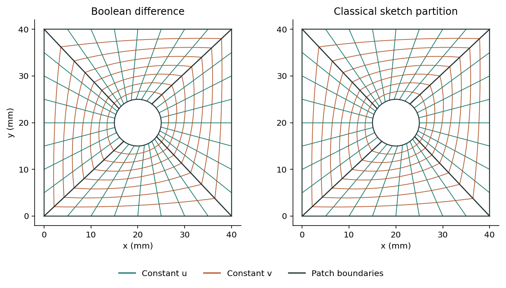

Boolean operations and edge treatments
======================================

Boolean construction
--------------------

Boolean operations are implemented by several qualified constructors rather
than one unrestricted B-Rep Boolean engine. Supported inputs include exact
orthogonal sketch features, selected box/cylinder combinations, crossed
orthogonal tools, polygon cuts, circular profiles, and specific NURBS
crossings. A recipe declares the operation, operand geometry, coordinate
frame, and feature history required by its family. The output is a new
trivariate partition with active material blocks, exposed boundary faces, and
an audit record.

For layered sketch booleans, event levels partition the axial range into
material and void intervals. A blind pocket adds a floor and side walls; a
through-hole has no floor. Overlapping cuts are resolved by the family planner
from the union of tool regions, so a shared region is removed once. Cross-axis
tools require a 3D arrangement: independent 2D cuts cannot simply be stacked
when their induced surfaces intersect. Constructors therefore require
supported, explicitly planned intersection events and a conforming shared
partition. Tangency, coincident boundaries, unresolved event order, unsupported
loop topology, excessive search, or exact-arithmetic overflow may cause a
refusal. A refusal preserves the previous target artifact in transactional
CLI commands.

Important modules include the `axial Boolean builder <https://github.com/jeffwitz/SolidCraftTrivariate/blob/main/src/axial_boolean.rs>`_,
`box/cylinder constructor <https://github.com/jeffwitz/SolidCraftTrivariate/blob/main/src/box_cylinder_boolean.rs>`_,
`crossed-tool constructor <https://github.com/jeffwitz/SolidCraftTrivariate/blob/main/src/crossed_tool_boolean.rs>`_,
`layered sketch planner <https://github.com/jeffwitz/SolidCraftTrivariate/blob/main/src/sketch_layers.rs>`_,
and `crossed NURBS builder <https://github.com/jeffwitz/SolidCraftTrivariate/blob/main/src/nurbs_cross.rs>`_,
with separate audit and JSON adapters. Related fixtures include:

* ``tests/references/box_cylinder_classic.recipe.json`` for a box/cylinder
  case;
* ``tests/references/crossed_tool_oracle.py`` for the independent crossed-tool
  oracle and replay protocol;
* ``tests/references/g2_cross_plate.recipe.json`` for intersecting NURBS
  sketches;
* ``tests/references/s3_face_pocket.recipe.json`` for an operation supported
  on a parent-face region;
* ``tests/counterexamples/`` and ``tests/regressions/`` for rejected and
  historically failing cases.

Use ``cargo run --locked --offline -- build RECIPE MODEL`` followed by
``audit MODEL`` and, when needed, ``export-step MODEL STEP``. For an automatic
curved-cell cover, run ``cargo run --locked --offline -- plan-patches MODEL
PATCHES.json``. It assembles exact homogeneous nets in Rust, retains source
cell spans and maps exterior faces and interpatch subfaces back to their
source sides. Tall periodic cylinders are an explicit special case: the
``box_cylinder_boolean_suite_v1`` cylinder uses a custom periodic cover; the
publisher retains the two- and three-cover constructions in
``scripts/build_box_cylinder_tall_patches.py`` and the native
``src/cylinder_tensor_covers.rs`` implementation.

   At mid-height the Boolean difference and the sketch-based through-hole produce the same four sector maps. The interior curves are images of constant parameter lines. The two panels use the same physical scale.

Exact command arguments for the current executable are available with ``--help``. The
general Boolean experiment and its independent classification protocol are
documented in the
`crossed-tool study <https://github.com/jeffwitz/SolidCraftTrivariate/blob/main/docs/crossed-tool-boolean.md>`_.

Relation to volumetric untrimming
---------------------------------

Massarwi, Antolin and Elber's volumetric-untrimming method starts with an
already trimmed B-spline trivariate and decomposes its trimmed domain into
mutually exclusive tensor-product trivariates (which may be singular on the
boundary). This is a related decomposition approach, not a general B-rep
Boolean algorithm and not the input route used here. The crossed-tool
constructor instead starts with two source sketches. It first
splits and pairs their monotone arcs, then chooses material columns in a
shared arrangement. In the published SolidCraft crossed-tool fixtures, the
intersection has two charts and the union has ten; both preserve original
profile intervals. Partial faces
remain where a column continues through a neighboring cut plane. F. Massarwi,
P. Antolin, and G. Elber, “Volumetric untrimming: Precise decomposition of
trimmed trivariates into tensor products,” *Computer Aided Geometric Design*
71 (2019), 1--15,
`DOI 10.1016/j.cagd.2019.04.005 <https://doi.org/10.1016/j.cagd.2019.04.005>`_.

Edge treatments
---------------

Fillets and chamfers are represented as geometric feature operations with
their own local charts, not as cosmetic mesh edits. The treatment can alter
the boundary parameterization, block topology, and Jacobian conditioning.
The implementation retains the surrounding material partition and adds the
qualified transition maps. Some fixed-partition treatments can be expressed
with local rim charts; other cases require remeshing/repartitioning or are
rejected. Radius/width bounds, tangent supports, corner combinations, and
clearance are family-specific. A successful chart on one annulus or bracket
does not establish support for arbitrary edge selections or variable radii.

Relevant modules include the `annular charts <https://github.com/jeffwitz/SolidCraftTrivariate/blob/main/src/annular.rs>`_,
`annular audit <https://github.com/jeffwitz/SolidCraftTrivariate/blob/main/src/annular_audit.rs>`_,
`offset rail <https://github.com/jeffwitz/SolidCraftTrivariate/blob/main/src/s3_offset_rail.rs>`_,
`stock rim <https://github.com/jeffwitz/SolidCraftTrivariate/blob/main/src/s3_stock_rim.rs>`_,
`bracket edge edits <https://github.com/jeffwitz/SolidCraftTrivariate/blob/main/src/bracket_edge_edit.rs>`_,
and `rational sectors <https://github.com/jeffwitz/SolidCraftTrivariate/blob/main/src/rational_sector.rs>`_,
plus their associated audits. Reproducible studies are the
`four-block annulus topology <https://github.com/jeffwitz/SolidCraftTrivariate/blob/main/docs/annulus-four-block-topology.md>`_,
`annulus edge states <https://github.com/jeffwitz/SolidCraftTrivariate/blob/main/docs/annulus-original-edge-states.md>`_,
and fixed-partition rim results linked from the
`project documentation index <https://github.com/jeffwitz/SolidCraftTrivariate/blob/main/docs/README.md>`_.

Treatment preconditions commonly include a strictly positive radius or
chamfer width, sufficient local stock, nondegenerate tangent supports, and a
compatible boundary chain. Zero or negative radii, self-intersecting offsets,
zero-height material, and supports that collapse or reverse a chart are
rejected. The exact failure mode is schema- and constructor-specific; consult
the matching audit and ``tests/counterexamples/`` rather than inferring a
universal tolerance.

Masalha, Cirillo, and Elber present several methods for constructing
trivariate fillets between input trivariates, including functional-composition
and half-volumetric-Boolean-sum approaches. This is related volumetric-fillet
work; it does not certify the annulus charts described here. For the reference
annulus, a radius check and tangent agreement on the boundary establish the
blend geometry. Testing the volume determinant at the same rail answers a different
question. A strictly positive lower bound on every closed integration span
is required for the regular ten-volume result.
R. Masalha, E. Cirillo, and G. Elber, “Heterogeneous parametric trivariate
fillets,” *Computer Aided Geometric Design* 86 (2021), article 101970,
`DOI 10.1016/j.cagd.2021.101970 <https://doi.org/10.1016/j.cagd.2021.101970>`_.

Exact simplification and geometric identity
--------------------------------------------

Exact operations include rational knot insertion, Bézier extraction,
degree elevation, restriction to rational subintervals, supported
homogeneous subdivision, and the crate's restricted degree-one knot removal
when reinsertion recovers all homogeneous controls exactly. These
transformations preserve the represented curve/map algebraically, subject to
checked integer arithmetic and the family's common-scale convention. They can
refine the representation without changing a logical design-volume identity.
Approximate knot removal is a different operation and needs an explicit error
contract and audit. Tiller's NURBS curve/surface algorithms include error
analysis, while Eck and Hadenfeld optimize a local single-knot removal under
several norms; neither reference describes the crate's exact-only operation.
Point sampling cannot establish exactness. See Tiller, “Knot-removal
algorithms for NURBS curves and surfaces,” *Computer-Aided Design* 24(8)
(1992), 445--453,
`DOI 10.1016/0010-4485(92)90012-Y <https://doi.org/10.1016/0010-4485(92)90012-Y>`_,
and Eck and Hadenfeld, “Knot removal for B-spline curves,” *Computer Aided
Geometric Design* 12(3) (1995), 259--282,
`DOI 10.1016/0167-8396(94)00012-H <https://doi.org/10.1016/0167-8396(94)00012-H>`_.

For model edits, persistent keys are based on canonical rational geometry and
feature provenance in the families that support them. Unchanged cells can
retain IDs across a local edit; cells incident to moved geometry may receive
new keys. Global identity matching across different topologies and unrestricted
selection of corner valence remain open problems. See the
`knot-reduction implementation <https://github.com/jeffwitz/SolidCraftTrivariate/blob/main/src/nurbs_knot_reduction.rs>`_,
`fixed-span topology <https://github.com/jeffwitz/SolidCraftTrivariate/blob/main/src/fixed_span_topology.rs>`_,
`sketch partition plan <https://github.com/jeffwitz/SolidCraftTrivariate/blob/main/src/sketch_partition_plan.rs>`_,
and exact trace/subdivision modules.

Verification layers
-------------------

Do not conflate a successful construction with every downstream claim:

* the recipe-to-model audit checks its family contract and recorded topology;
* STEP export checks exchange serialization but is not an independent reader;
* STEP re-import in a separate CAD kernel checks B-Rep validity, closure, mass,
  and selected classifications under that reader's tolerances;
* the analysis export has its own trace, rank, quadrature, and field checks.

Independent oracles and versioned reports are linked from the feature pages.
Run ``make check`` for the repository integration suite and
``make check-published-geometry`` to rebuild tracked published geometry from
source recipes. The latter ensures the published model and native audit match
the current constructor; it is a repository-specific reproducibility check,
not a general proof of correctness.

Native commands for the reference solids
----------------------------------------

* ``compose-axial tests/jobs/composed_axial.job.json result.json``
  evaluates the union of the first two aligned rectangular extrusions,
  then subtracts the third. The output records each surviving control net,
  its source block, both axial intervals and the original owners of boundary
  faces. A disconnected first union cannot be passed to the second stage as
  one interval.
* ``cover-cylinder MODEL 2 OUT`` assembles the square core and the entire
  angular ring on the three-layer tall cylinder. Select ``3`` to keep two
  ring patches. The two-patch result describes the closed angular seam and
  retains every source interval. Serialized file hashes are publication
  metadata and are added by the file-based example.
* ``annulus-edges LAYOUT PROFILE OUT`` takes ``four-linear``,
  ``four-quadratic``, ``prepared-ten`` or ``prepared-twenty`` and
  ``sharp``, ``chamfer`` or ``fillet``. The linear layout accepts sharp
  and chamfer states. The original quadratic layout preserves four volumes
  for all three states. Its fillet has zero determinant at the circular
  rails. On the prepared ten-chart layout all 128 integration spans each
  have a strict positive determinant certificate in all three states.
