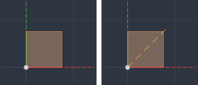

SolidCraft viewport and sketch bridge
=====================================

The geometry service owns the rational volume maps. SolidCraft owns the display
of a design. The bridge passes construction sketch entities for a planar layout
and a STEP boundary representation for a solid. SolidCraft reads the boundary
and tessellates it using the same display path as any other CAD body in the
application. Changing the viewport quality requires no change to the volume
maps. The STEP file carries the boundary; retain the model JSON for interior
charts, exact weights and analysis.

Compact sketch ribbon
---------------------

Launch the separate compact profile to open the sharp FieldCraft bracket:

.. code-block:: bash

   python3 scripts/solidcraft_compact_desktop.py /path/to/solidcraft-trivariate-0.4.1.zip

Its Sketch tab pins new sketch, line, two-point rectangle, coincidence,
horizontal/vertical, fit-point spline, control-point spline, finish and cancel. The same ribbon adds **extrude**,
**drill**, **boolean**, **chamfer** and **fillet**. Standard modeling tabs are
hidden. SolidCraft still provides its sketch section menus and global search.
On SolidCraft 0.48.1 the Sketch-tab plugin buttons use the host's plug glyph;
the entry dialogs use the package's operation icons.

* **Extrude** takes the latest authored sketch by default. On an attached planar
  face choose **Add material** or **Remove material**, then enter a positive
  depth in millimetres. The attachment identifies the body; its outward normal
  sets the sign. **New body** creates a separate solid. Linked face outlines
  and construction geometry are excluded from the authored profile.

  The native constructor accepts a single regular loop with a certified curved
  partition. A rectangular stock can carry the complete addition or pocket as
  trivariate charts. For another supported face, including the FieldCraft
  bracket, the plugin imports the boundary of the trivariate extrusion tool
  and SolidCraft combines it with the owning body. The companion output name
  distinguishes a complete result from a tool. Each operation records the
  contour snapshot at execution time; editing the sketch later requires
  rebuilding the extrusion.
* **Drill** cuts a centered through-bore. On the reference box enter a radius.
  On a rectangular sketch extrusion also identify the original sketch and height.
* **Boolean** accepts the reference box and crossing cylinder as two viewport
  picks. The chosen operation updates the stock feature and suppresses the tool.
* **Fillet** and **Chamfer** accept viewport picks on a single solid. Finish
  the sketch and select an edge, several edges, or a face whose boundary
  should be treated. Adjacent coplanar patches are grouped to exclude
  internal partition seams. Tangent-chain propagation is disabled. If the
  rolling fillet reaches a pocket on a single eligible full-length straight
  outside corner of axis-aligned stock, the plugin can also cut the corner
  with an extruded quarter-circle. Its cylindrical face retains the entered
  radius wherever it borders material. Run the plugin from the original
  sharp edge when replacing an existing fillet.
  Enter the radius or distance in millimetres and run
  the command. The edited solid can already contain extrusions and cuts.
  SolidCraft creates a B-rep feature in the document timeline. The native
  fixed-partition bore-rim demonstration remains available through Build Recipe.

Sketch and extrusion
--------------------

For a closed polygonal sketch on the origin XY plane, the companion enumerates
the exact edges with two incident planar cells. A separate native sketch holds
one construction line per shared edge. The descriptor keeps its rational
coordinates, the source feature and the source timeline. Only the host display
coordinates go through a floating-point conversion. A rectangle can give zero
interior lines. The L profile from the bracket history gives one diagonal from
(0, 0) to (8, 8) mm, two cells and, at 40 mm height, 32,640 mm³. This is the
layout **before** the bracket's later fillet and holes.

To create an ordinary SolidCraft design with the overlay initially hidden, run
the following from the repository root:

.. code-block:: bash

   cargo build --release --locked
   python3 scripts/solidcraft_preview_design.py \
       tests/references/solidcraft_sketch_bracket.timeline.json 1 build/bracket.sc

Open the design and toggle **SCT Partition 1** in the SolidCraft browser.
The preview can also be generated when the timeline contains only the sketch.
The preview accepts integral polygon coordinates in the planner's ±4096 mm
range and coincident, horizontal and vertical line constraints. The extrusion path accepts a
positive new-body extrusion of 1 through 64 mm with the supported profile
selection. It applies the same planar planner through the actual thickness.

   Identical crops of the SolidCraft desktop. The partition is hidden on
   the left. On the right the dashed construction line joins the origin
   to the reentrant corner. The solid and source profile are hidden in both
   captures to isolate the overlay.

For a captured two-feature timeline, these commands build the exact result for
inspection in either SolidCraft or FieldCraft:

.. code-block:: bash

   target/release/solidcraft-trivariate sketch-preview timeline.json 1 partition.json
   target/release/solidcraft-trivariate extrude-sketch timeline.json model.json
   target/release/solidcraft-trivariate export-step model.json result.step

SolidCraft exposes sketch visibility and shaded body display separately. The
stock shaded setting suppresses the body's edge overlay. Switching display
styles can expose edges between adjacent STEP boundary faces. The volume
partition remains recorded in the model JSON. FieldCraft's stable 0.8.1 headless reader refused the STEP;
its design reader accepts format 57 and SolidCraft 0.48.1 writes format 66.
FieldCraft nightly 0.8.1-nightly.20261124.89.1 opened the trivariate
box-minus-cylinder STEP and rendered it through its own viewport. The
`two-client test and original screenshots
<https://github.com/jeffwitz/SolidCraftTrivariate/actions/runs/46017997317>`_
use the same STEP bytes in both clients. FieldCraft's snapshot includes
boundary-face edges. The SolidCraft shaded display setting applies only in
SolidCraft.

Intersecting oblique pockets
----------------------------

The SolidCraft reference starts from a 40 mm cube with two disjoint openings
on its top face. Tool A has a periodic cubic control spline. Tool B has four
weighted quadratic arcs with distinct tangent directions at their joins.
Each pocket is a loft between a profile and its translated copy. The two
translation vectors are (10, 0, −22) and (−8, 0, −17) mm. Both tools end inside
the cube and their volumes intersect below the top surface.

.. code-block:: bash

   python3 scripts/check_solidcraft_oblique_cube.py
   solidcraft build/solidcraft-oblique-reference/both.sc

.. figure:: ../../results/solidcraft-plugin/oblique-cube-section.png
   :alt: Native section through two oblique blind pockets that meet below separate openings.
   :width: 520px

   SolidCraft section at y = 20 mm. The hatched material separates the mouths
   and remains below both floors. The two swept voids communicate at depth.

The script rebuilds both single cuts and the combined cut as independent
SolidCraft documents. It reopens them, checks their closed shells, and tests
seven material locations in each. Inclusion–exclusion of their measured
volumes gives a tool overlap of 440.91218 mm³ and a remaining volume of
60,497.17099 mm³. The B-rep reference uses the host's modeling kernel. Its
volume and classifications qualify the reference geometry; qualification of
trivariate charts requires a separate construction and determinant audit.

A separate native trivariate fixture, ``oblique_blind_pockets_v1``, uses a
10 mm cube, two interior footprints, and independent shear slopes +1/5 and
−1/10 in y per millimetre of depth. The floor depths are 7 and 5 mm.
The first profile has a true C¹ quadratic span joint with unequal second
derivatives. The other profile is rectangular. Both closed profiles have
corners. The openings overlap at the surface in this fixture. The planar
wall envelopes change order at an interior depth that varies with x.

The construction has 64 whole tensor-product charts and 122 shared faces.
Their Bernstein certificates bound the Jacobian determinant from below by
0.29583 mm³. The source-profile inequalities agree with the cell coverage on
616 off-boundary probes. SolidCraft opens the exported STEP as one closed
solid with 140 boundary faces and volume 871.43658667 mm³.

.. code-block:: bash

   target/release/solidcraft-trivariate build tests/references/oblique_blind_pockets.recipe.json pockets.json
   target/release/solidcraft-trivariate export-step pockets.json pockets.step
   solidcraft pockets.step

The qualified constructor checks the complete fixed recipe. Smooth periodic
profiles with disjoint openings as in the 40 mm reference require an extension
of this arrangement.

Native rendering checks
-----------------------

.. code-block:: bash

   python3 scripts/check_solidcraft_native_render.py --help

The check imports exact boundaries, calls the host's ``model.mesh`` and takes
snapshots with the stock renderer. The number of display triangles depends on
display settings. Mechanical elements and rational volume spans are counted
separately. The fixed-partition FieldCraft bore chamfer and fillet use their
native boundary exports. The fillet has a singular contact rail; a successful
display does not establish regularity there.
