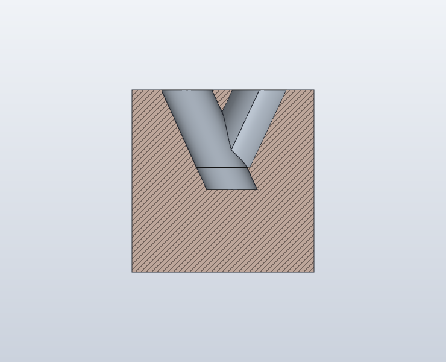

SolidCraft viewport and sketch bridge
=====================================

The geometry service owns the rational volume maps. SolidCraft owns the display
of a design. The bridge passes construction sketch entities for a planar layout
and a STEP boundary representation for a solid. SolidCraft reads the boundary
and tessellates it using the same display path as any other CAD body in the
application. Changing the viewport quality requires no change to the volume
maps. The STEP file carries the boundary; retain the model JSON for interior
charts, exact weights and analysis.

Sketch and extrusion
--------------------

For a closed polygonal sketch on the origin XY plane, the companion enumerates
the exact edges with two incident planar cells. A separate native sketch holds
one construction line per shared edge. The descriptor keeps its rational
coordinates, the source feature and the source timeline. Only the host display
coordinates go through a floating-point conversion. A rectangle can give zero
interior lines. The L profile from the bracket history gives one diagonal from
(0, 0) to (8, 8) mm, two cells and, at 40 mm height, 32,640 mm³. This is the
layout **before** the bracket's later fillet and holes.

To create an ordinary SolidCraft design with the overlay initially hidden, run
the following from the repository root:

.. code-block:: bash

   cargo build --release --locked
   python3 scripts/solidcraft_preview_design.py \
       tests/references/solidcraft_sketch_bracket.timeline.json 1 build/bracket.sc

Open the design and toggle **SCT Partition 1** in the SolidCraft browser.
The preview can also be generated when the timeline contains only the sketch.
The preview accepts integral polygon coordinates in the planner's ±4096 mm
range and the supported coincident constraints. The extrusion path accepts a
positive new-body extrusion of 1 through 64 mm with the supported profile
selection. It applies the same planar planner through the actual thickness.

For a captured two-feature timeline, these commands build the exact result for
inspection in either SolidCraft or FieldCraft:

.. code-block:: bash

   target/release/solidcraft-trivariate sketch-preview timeline.json 1 partition.json
   target/release/solidcraft-trivariate extrude-sketch timeline.json model.json
   target/release/solidcraft-trivariate export-step model.json result.step

SolidCraft exposes sketch visibility and shaded body display separately. The
stock shaded setting suppresses the body's edge overlay. Switching display
styles can expose edges between adjacent STEP boundary faces. The volume
partition remains recorded in the model JSON. FieldCraft can open the STEP
through its CAD geometry import. Its own mesher then operates on that boundary.

Intersecting oblique pockets
---------------------------

The SolidCraft reference starts from a 40 mm cube with two disjoint openings
on its top face. Tool A has a periodic cubic control spline. Tool B has four
weighted quadratic arcs with distinct tangent directions at their joins.
Each pocket is a loft between a profile and its translated copy. The two
translation vectors are (10, 0, −22) and (−8, 0, −17) mm. Both tools end inside
the cube and their volumes intersect below the top surface.

.. code-block:: bash

   python3 scripts/check_solidcraft_oblique_cube.py
   solidcraft build/solidcraft-oblique-reference/both.sc

   SolidCraft section at y = 20 mm. The hatched material separates the mouths
   and remains below both floors. The two swept voids communicate at depth.

The script rebuilds both single cuts and the combined cut as independent
SolidCraft documents. It reopens them, checks their closed shells, and tests
seven material locations in each. Inclusion–exclusion of their measured
volumes gives a tool overlap of 440.91218 mm³ and a remaining volume of
60,497.17099 mm³. The B-rep reference uses the host's modeling kernel. Its
volume and classifications qualify the reference geometry; qualification of
trivariate charts requires a separate construction and determinant audit.

Native rendering checks
-----------------------

.. code-block:: bash

   python3 scripts/check_solidcraft_native_render.py --help

The check imports exact boundaries, calls the host's ``model.mesh`` and takes
snapshots with the stock renderer. The number of display triangles depends on
display settings. Mechanical elements and rational volume spans are counted
separately. The fixed-partition FieldCraft bore chamfer and fillet use their
native boundary exports. The fillet has a singular contact rail; a successful
display does not establish regularity there.
