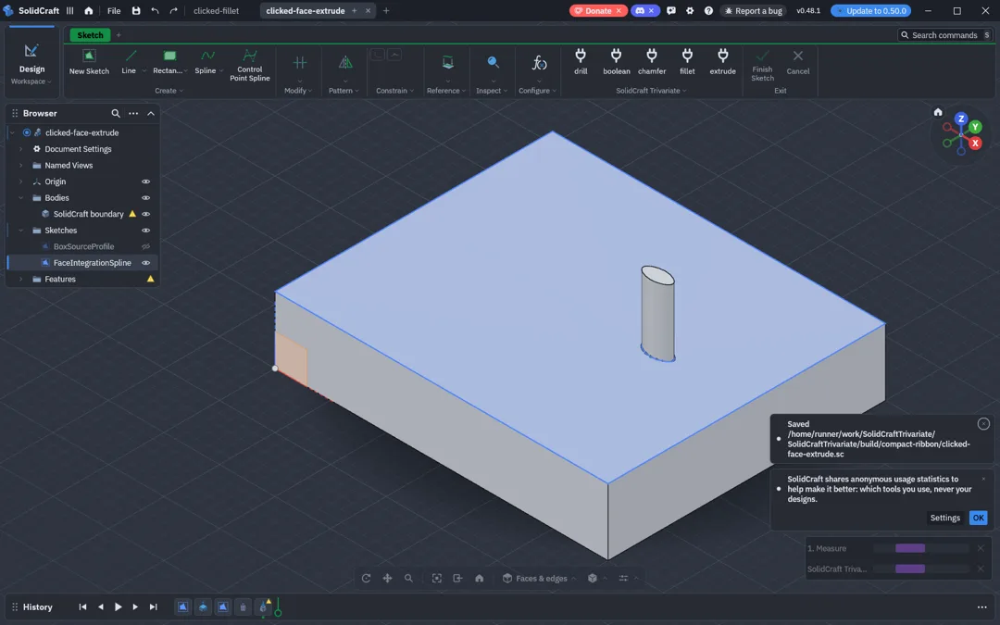

Edit a bracket from the compact ribbon
======================================

This exercise uses the sharp bracket supplied with the plugin. Work on a copy.
You will add material on a wing and identify the geometry that can be passed
to analysis. The modeling dimensions below are in millimetres.

Plugin operation illustrations
------------------------------

These thumbnails are the vector images packaged with the plugin. They identify
its own commands in the plugin ribbon group; the integration does not replace
or rebind SolidCraft's built-in Sketch tools.

.. list-table::
   :widths: 1 1 1
   :align: center

   * - .. image:: ../../../plugins/solidcraft-trivariate/icons/extrude.svg
          :alt: Sketch extrusion
          :width: 48 px
     - .. image:: ../../../plugins/solidcraft-trivariate/icons/drill.svg
          :alt: Drill a bore
          :width: 48 px
     - .. image:: ../../../plugins/solidcraft-trivariate/icons/boolean.svg
          :alt: Boolean operands
          :width: 48 px
   * - **Extrude**
     - **Drill**
     - **Boolean**
   * - .. image:: ../../../plugins/solidcraft-trivariate/icons/chamfer.svg
          :alt: Chamfer a corner
          :width: 48 px
     - .. image:: ../../../plugins/solidcraft-trivariate/icons/fillet.svg
          :alt: Fillet a corner
          :width: 48 px
     - .. image:: ../../../plugins/solidcraft-trivariate/icons/compute.svg
          :alt: Solve for analysis
          :width: 48 px
   * - **Chamfer**
     - **Fillet**
     - **Analysis**

Open the example
----------------

Install SolidCraft 0.48.1 and check that both ``solidcraft`` and
``solidcraft-cli`` are on your path. Download the ZIP from the
`plugin build <https://github.com/jeffwitz/SolidCraftTrivariate/actions/workflows/solidcraft-trivariate-plugin.yml>`_
and extract the GitHub artifact wrapper. Keep the inner plugin ZIP intact.
From the matching project checkout run:

.. code-block:: sh

   python3 scripts/solidcraft_compact_desktop.py /path/to/solidcraft-trivariate-0.5.0.zip

SolidCraft opens the example in a separate profile. The default sketch view
shows the geometry you draw. To inspect its proposed partition, use the
preview procedure in :doc:`../reference/solidcraft-plugin`.

Make a feature from a face sketch
----------------------------------

#. Select a planar wing face and start a sketch on it. Draw a small closed
   rectangle within the material. Finish the sketch. The face attachment
   identifies the owning body and the direction of the extrusion.
#. Open **Extrude**, choose **Add material**, and enter 2 mm. Rotate the bracket
   until the side of the raised pad is visible. Undo the operation, reopen
   **Extrude** and choose **Remove material** to leave a pocket instead.
#. To try a spline, start another face sketch. Close the fit-point curve at
   its first point and finish the sketch. Use a regular, simple profile.
   The modeling command reports profiles outside its admitted family.
#. Finish sketch editing before choosing **Fillet** or **Chamfer**. Pick an edge
   of the body, enter the radius or setback, and leave **Follow tangent edges**
   enabled to continue across tangent portions of a rim. A face selection
   applies the operation to its boundary.

   SolidCraft displays the result using its own viewport and tessellation.
   The visible solid and the model used for analysis have separate records.

Continue with :doc:`../how-to/solidcraft-fieldcraft` for the mechanical
workflow and :doc:`../explanation/plugin-boundaries` for the distinction
between a complete trivariate result and a trivariate cutting tool.
