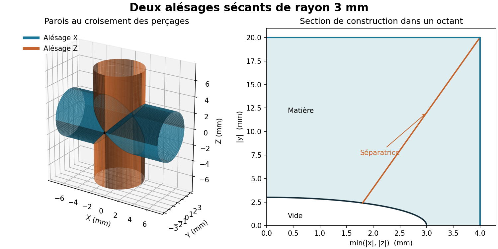

# Deux perçages perpendiculaires qui se croisent

## Contrat

Dans un pavé, deux perçages traversants de rayon commun r ont des axes sécants et orthogonaux, parallèles à deux directions du pavé. Le cas canonique utilise X et Z. L’origine locale est leur intersection. Les données de la pièce sont les bornes du brut, les axes et le rayon. Le constructeur déduit les feuilles de séparation des équations des deux surfaces actives. La partition admet une distance de garde g strictement supérieure à r et strictement inférieure aux distances aux quatre faces normales à X et Z. Les deux faces normales à Y doivent être à distance strictement supérieure à r.

## Règle de construction

Un point appartient à la matière si les deux inégalités x²+y² ≥ r² et z²+y² ≥ r² sont satisfaites. Leur différence donne les plans x=z et x=−z. Ils indiquent **quel cylindre définit effectivement la paroi** dans chacune des régions. Ces plans coupent les deux cylindres suivant les branches de leur intersection. Les deux points de tangence (0,±r,0) sont des sommets partagés.

Dans un octant, posons m=min(|x|,|z|), d=max(|x|,|z|), e=|y|. Dans chaque région de dominance, la condition matière se réduit à m²+e² ≥ r². Pour m≤g, la section est le rectangle [0,g] × [0,H_y] privé d’un quart de disque. On la divise en deux quadrilatères curvilignes. Leur frontière circulaire est donnée exactement par

    C(q) = r (1−q², 2q) / (1+q²),   q ∈ [0,1/2] ou [1/2,1].

La séparation part du point (3r/5,4r/5) vers (g,H_y). Le bord extérieur suit d’abord le côté vertical du rectangle, puis son côté horizontal. Le réseau homogène assemble chaque arc quadratique à ce bord par interpolation réglée. On extrude ensuite la section dans la direction de l’axe dominant depuis d=m jusqu’à la face du brut d=H_d. Au-delà des deux plans |x|=g et |z|=g, la matière restante est un pavé par octant.

Chaque octant contient quatre blocs courbes et un pavé, soit 40 blocs. Les arcs et les traces ont des contrôles homogènes entiers. Les raccords sur les plans diagonaux transportent exactement la même paramétrisation. Aux pôles, la largeur de la règle d’extrusion est H_d, ce qui évite de rabattre une face entière sur un point.



À gauche, les parois issues des réseaux de contrôle exportés, limitées à 7 mm de l’intersection pour montrer la jonction. À droite, les deux régions à extruder dans un octant du cas de référence. Les axes de la coupe ont des échelles différentes.

## Pourquoi les cartes couvrent la matière

Dans le premier secteur, le point du bord extérieur est B=(g,H_y t) pour q=t/2 ; dans le second, B=(g(1−t),H_y) pour q=(1+t)/2. Dans les deux cas B−C a des composantes positives ou nulles. Sur l’arc orienté, m décroît et e croît. Le bord extérieur suit les mêmes monotonies. L’interpolation en coordonnées homogènes décrit, après projection, le segment C–B avec un paramètre strictement croissant en direction radiale. Quand on dérive dans la direction angulaire, la dérivée du coefficient de mélange est parallèle au segment et disparaît du déterminant. Les deux autres termes sont les tangentes pondérées de C et de B. Leur déterminant avec B−C garde un signe strict, y compris aux extrémités : le bord vertical bénéficie de g>r et le bord horizontal de H_y>r.

Chaque section a ainsi un jacobien de signe constant et sa frontière est une courbe simple parcourue une fois. Le degré topologique sur son intérieur vaut un en valeur absolue, donc chaque point intérieur a un seul antécédent. Les deux sections couvrent le rectangle hors disque et partagent exactement le segment de séparation. Pour chaque point de section la règle d’extrusion est bijective sur [m,H_d], de longueur au moins H_d−g>0. Le choix d’octant, puis de coordonnée dominante, sépare les intérieurs des blocs. Les points de toutes les égalités sont portés par les traces correspondantes. Ce raisonnement établit la couverture indépendamment de l’intégration numérique du volume.

## Vérification reproductible

Depuis la racine, exécuter `cargo test --locked --offline --test steinmetz_core -- --nocapture`. Le test reconstruit les incidences, utilise le certificat de Bernstein à arrondi sortant sur chaque cube fermé, évalue les parois et intègre le jacobien des cartes. Dans le pavé 60 × 40 × 30 mm avec r=3 mm, le volume commun aux vides est 16 r³/3 = 144 mm³. La section commune des deux cylindres à altitude locale y est un carré d’aire 4(r²−y²), ce qui donne ce volume par intégration sur [−r,r]. Le volume de matière attendu est 72 000 − 810π + 144 mm³.

Des rayons différents ou des axes gauches changent l’équation des feuilles de séparation. Ils demandent un autre domaine de qualification.

### Rejouer depuis les deux features

```sh
mkdir -p build/steinmetz-demo
cargo run --locked --offline -- build tests/references/steinmetz_box.recipe.json build/steinmetz-demo/model.json
cargo run --locked --offline -- audit build/steinmetz-demo/model.json
cargo run --locked --offline -- export-step build/steinmetz-demo/model.json build/steinmetz-demo/percages-secants.step
cargo run --locked --offline -- export-geometry-vtu build/steinmetz-demo/model.json 4 build/steinmetz-demo/blocs.vtu
cargo run --locked --offline -- export-analysis build/steinmetz-demo/model.json 4 build/steinmetz-demo/analyse.json
```

Sur cette recette, l’audit des cartes persistées trouve 68 interfaces, 104 faces extérieures et une borne commune de 14,74559999999808 mm³ pour le jacobien. L’intégration indépendante des cartes donne 69 599,309950592913 mm³. Les aires exposées sur les cylindres de longueur L valent chacune 2πrL − 8r² ; le test les vérifie séparément à 10⁻⁸ mm². Open CASCADE relit un solide fermé valide de volume 69 599,30995051493 mm³, centré au point (30,20,15) mm.

L’espace IGA exporté compte 554 fonctions scalaires et 1 662 composantes de déplacement. Sur le modèle exporté à l’ordre de Gauss 4, l’oracle indépendant vérifie 612 correspondances de coefficients de face et reproduit exactement les valeurs et gradients paramétriques du champ affine sur la grille rationnelle de test. L’écart relatif entre l’énergie élastique assemblée et l’énergie à déformation constante est de 2,06 × 10⁻¹⁵ au plus pour cette quadrature. Ce test porte sur l’assemblage et les interfaces ; il ne quantifie pas une concentration de contrainte sous chargement.
